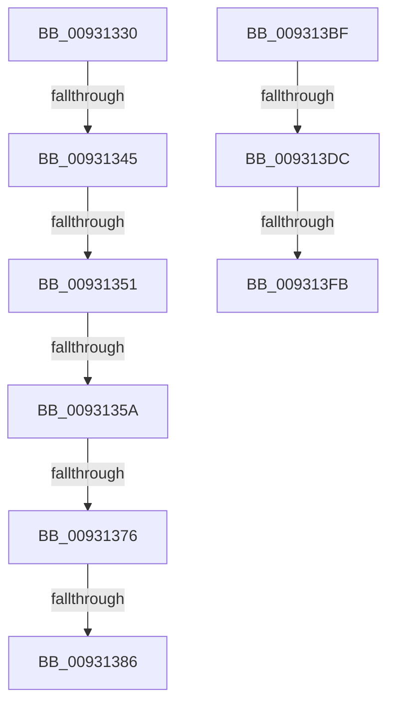

# sub_00931330

- RVA: `0x00931330`–`0x00931400` (길이 `208` bytes)
- VA: `0x0000000140931330`
- 실행 섹션: `PAGE`
- PDB 이름 있음: `아니요`; PDB Function 태그: `아니요`
- unwind 정보 RVA: `0x0008ECA8`
- 디코드: `49`개 명령, `208/208` bytes 표시
- 미해석 바이트: `0` (있으면 어셈블리에 `.byte`로 보존)

> 이 문서는 커널 이미지의 기계어와 PDB 기호를 분석해 생성했습니다. 4번과 5번은 함수 원형과 자료형을 바이너리 사용 방식에서 추정한 C 해석이며 원본 소스 복구 결과는 아닙니다.

## 1. Dependencies

- 직접 호출 지점: **3**; 고유 호출 대상: **3**
- 직접 호출자로 확인된 함수: **0**
- RIP 상대 이미지 참조: **1**

### Outgoing calls
- `0x00931336` → [DrvDbLoadDatabaseNode](DrvDbLoadDatabaseNode_function_00931668.md) (function, `0x00931668`)
- `0x009313B3` → [RegRtlCreateTreeTransacted](RegRtlCreateTreeTransacted_function_00931D1C.md) (function, `0x00931D1C`)
- `0x009313CB` → [wcschr](../../text/50/wcschr_function_00501A60.md) (function, `0x00501A60`)

### Direct callers
- 이 함수 시작 RVA로 연결되는 직접 call은 확인되지 않았습니다. 간접 호출은 완전히 역산할 수 없습니다.

### Static image references
- `0x0093135E` → RVA `0x000021B0` (`.rdata`; read)

## 2. Other-region calls and transfers

- 다른 실행 섹션으로 향하는 call: **1**
  - `0x009313CB` → [wcschr](../../text/50/wcschr_function_00501A60.md) (`PAGE` → `.text`)
- call이 아닌 외부 분기/꼬리 이동: **9**
  - `0x0093133F` → [sub_0093107C + 0xF2](Unknown_function_0093107C.md) (`tail-transfer`)
  - `0x0093134B` → [sub_00931420 + 0x161](Unknown_function_00931420.md) (`tail-transfer`)
  - `0x00931354` → [sub_00931420 + 0x1FE](Unknown_function_00931420.md) (`tail-transfer`)
  - `0x00931370` → [sub_00931420 + 0x14F](Unknown_function_00931420.md) (`tail-transfer`)
  - `0x00931380` → [sub_00931420 + 0x14F](Unknown_function_00931420.md) (`tail-transfer`)
  - `0x009313BA` → [sub_0093107C + 0xF2](Unknown_function_0093107C.md) (`tail-transfer`)
  - `0x009313D6` → [sub_0093107C + 0x39](Unknown_function_0093107C.md) (`tail-transfer`)
  - `0x009313F5` → [sub_0093107C + 0x39](Unknown_function_0093107C.md) (`tail-transfer`)
  - `0x009313FB` → [sub_0093107C + 0x44](Unknown_function_0093107C.md) (`tail-transfer`)

## 3. Assembly (complete function range)

```asm
00931330  48 8B D7                        mov rdx, rdi
00931333  49 8B CD                        mov rcx, r13
00931336  E8 2D 03 00 00                  call 0x140931668
0093133B  8B D8                           mov ebx, eax
0093133D  85 C0                           test eax, eax
0093133F  0F 88 29 FE FF FF               js 0x14093116e
00931345  48 63 5D 4F                     movsxd rbx, dword ptr [rbp + 0x4f]
00931349  85 DB                           test ebx, ebx
0093134B  0F 84 30 02 00 00               je 0x140931581
00931351  83 FB 01                        cmp ebx, 1
00931354  0F 84 C4 02 00 00               je 0x14093161e
0093135A  49 8B 45 00                     mov rax, qword ptr [r13]
0093135E  48 8D 0D 4B 0E 6D FF            lea rcx, [rip - 0x92f1b5]
00931365  48 8B 14 D9                     mov rdx, qword ptr [rcx + rbx*8]
00931369  4C 8B 57 60                     mov r10, qword ptr [rdi + 0x60]
0093136D  48 85 C0                        test rax, rax
00931370  0F 84 F9 01 00 00               je 0x14093156f
00931376  48 8B 80 E0 00 00 00            mov rax, qword ptr [rax + 0xe0]
0093137D  48 85 C0                        test rax, rax
00931380  0F 84 E9 01 00 00               je 0x14093156f
00931386  48 8B 48 08                     mov rcx, qword ptr [rax + 8]
0093138A  48 89 4C 24 40                  mov qword ptr [rsp + 0x40], rcx
0093138F  48 8D 45 CF                     lea rax, [rbp - 0x31]
00931393  4C 89 74 24 38                  mov qword ptr [rsp + 0x38], r14
00931398  41 B9 00 00 00 02               mov r9d, 0x2000000
0093139E  48 89 44 24 30                  mov qword ptr [rsp + 0x30], rax
009313A3  45 33 C0                        xor r8d, r8d
009313A6  44 88 74 24 28                  mov byte ptr [rsp + 0x28], r14b
009313AB  49 8B CA                        mov rcx, r10
009313AE  4C 89 7C 24 20                  mov qword ptr [rsp + 0x20], r15
009313B3  E8 64 09 00 00                  call 0x140931d1c
009313B8  8B D8                           mov ebx, eax
009313BA  E9 AF FD FF FF                  jmp 0x14093116e
009313BF  4D 8D 79 02                     lea r15, [r9 + 2]
009313C3  BA 3A 00 00 00                  mov edx, 0x3a
009313C8  49 8B CF                        mov rcx, r15
009313CB  E8 90 06 BD FF                  call 0x140501a60
009313D0  48 8B F0                        mov rsi, rax
009313D3  48 85 C0                        test rax, rax
009313D6  0F 84 D9 FC FF FF               je 0x1409310b5
009313DC  49 2B C7                        sub rax, r15
009313DF  4C 89 7D E7                     mov qword ptr [rbp - 0x19], r15
009313E3  48 D1 F8                        sar rax, 1
009313E6  66 03 C0                        add ax, ax
009313E9  66 89 45 DF                     mov word ptr [rbp - 0x21], ax
009313ED  66 89 45 E1                     mov word ptr [rbp - 0x1f], ax
009313F1  48 83 C6 02                     add rsi, 2
009313F5  0F 84 BA FC FF FF               je 0x1409310b5
009313FB  E9 C0 FC FF FF                  jmp 0x1409310c0
```

## 4. C-style interpretation (structured pseudocode)

```c
__int64 __fastcall sub_00931330(__int64 a1, __int64 a2, int a3)
{
    __int64 result;
    unsigned __int64 v_stack_p20;
    unsigned __int8 v_stack_p28;
    unsigned __int64 v_stack_p30;
    unsigned __int64 v_stack_p38;
    unsigned __int64 v_stack_p40;

    result = DrvDbLoadDatabaseNode(v_r13, v_rdi, a3, a4);
    v_stack_p40 = *(unsigned __int64 *)(*(unsigned __int64 *)(*(unsigned __int64 *)(v_r13) + 224) + 8);
    v_stack_p38 = v_r14;
    v_stack_p30 = v_rbp - 49;
    a3 = 0;
    v_stack_p28 = (unsigned __int8)(v_r14);
    v_stack_p20 = v_r15;
    result = RegRtlCreateTreeTransacted(*(unsigned __int64 *)(v_rdi + 96), *(unsigned __int64 *)(v_rip - 9630133 + (int)(*(unsigned int *)(v_rbp + 79)) * 8), a3, (unsigned int)(0x2000000ULL));
}
```

## 5. (Beta) C Style

```c
int64_t sub_00931330(int64_t Arg1, int64_t Arg2, int32_t Arg3)
{
    int64_t result;
    uint64_t v_stack_p20;
    uint8_t v_stack_p28;
    uint64_t v_stack_p30;
    uint64_t v_stack_p38;
    uint64_t v_stack_p40;

    result = DrvDbLoadDatabaseNode(local_r13, local_rdi, Arg3, a4);
    v_stack_p40 = *(uint64_t *)(*(uint64_t *)(*(uint64_t *)(local_r13) + 0xE0) + 0x8);
    v_stack_p38 = local_r14;
    v_stack_p30 = local_rbp - 49;
    Arg3 = 0;
    v_stack_p28 = (uint8_t)(local_r14);
    v_stack_p20 = local_r15;
    result = RegRtlCreateTreeTransacted(*(uint64_t *)(local_rdi + 0x60), *(uint64_t *)(v_rip - 0x92F1B5 + (int32_t)(*(uint32_t *)(local_rbp + 0x4F)) * 8), Arg3, (uint32_t)(0x2000000ULL));
}
```

## 6. Execution-region graph

[열기: 2D/3D 그래프와 함수 탐색 컨트롤 패널](../../../control-panel.html?section=page&rva=0x00931330&view=graph)

- 2D 그래프는 위에서 아래로 흐르고, 3D 그래프는 빈 공간을 드래그해 회전합니다. Shift+드래그는 이동, 휠은 확대·축소, 함수 노드 선택은 대상 보고서 이동입니다.

### Static fallback


