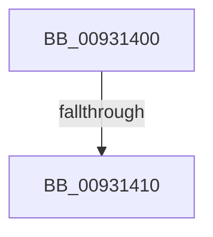

# sub_00931400

- RVA: `0x00931400`–`0x00931420` (길이 `32` bytes)
- VA: `0x0000000140931400`
- 실행 섹션: `PAGE`
- PDB 이름 있음: `아니요`; PDB Function 태그: `아니요`
- unwind 정보 RVA: `0x0008ECC4`
- 디코드: `8`개 명령, `32/32` bytes 표시
- 미해석 바이트: `0` (있으면 어셈블리에 `.byte`로 보존)

> 이 문서는 커널 이미지의 기계어와 PDB 기호를 분석해 생성했습니다. 4번과 5번은 함수 원형과 자료형을 바이너리 사용 방식에서 추정한 C 해석이며 원본 소스 복구 결과는 아닙니다.

## 1. Dependencies

- 직접 호출 지점: **2**; 고유 호출 대상: **2**
- 직접 호출자로 확인된 함수: **0**
- RIP 상대 이미지 참조: **0**

### Outgoing calls
- `0x00931403` → [ZwClose](../../text/6A/ZwClose_function_006AD2B0.md) (function, `0x006AD2B0`)
- `0x00931416` → [DrvDbUnloadDatabaseNode](DrvDbUnloadDatabaseNode_function_0093183C.md) (function, `0x0093183C`)

### Direct callers
- 이 함수 시작 RVA로 연결되는 직접 call은 확인되지 않았습니다. 간접 호출은 완전히 역산할 수 없습니다.

### Static image references
- 디코드된 RIP-relative 메모리 참조가 없습니다.

## 2. Other-region calls and transfers

- 다른 실행 섹션으로 향하는 call: **1**
  - `0x00931403` → [ZwClose](../../text/6A/ZwClose_function_006AD2B0.md) (`PAGE` → `.text`)
- call이 아닌 외부 분기/꼬리 이동: **2**
  - `0x0093140A` → [sub_009312D7 + 0x2E](Unknown_function_009312D7.md) (`tail-transfer`)
  - `0x0093141B` → [sub_009312D7 + 0x2E](Unknown_function_009312D7.md) (`tail-transfer`)

## 3. Assembly (complete function range)

```asm
00931400  48 8B CE                        mov rcx, rsi
00931403  E8 A8 BE D7 FF                  call 0x1406ad2b0
00931408  85 C0                           test eax, eax
0093140A  0F 88 F5 FE FF FF               js 0x140931305
00931410  48 8B D7                        mov rdx, rdi
00931413  49 8B CD                        mov rcx, r13
00931416  E8 21 04 00 00                  call 0x14093183c
0093141B  E9 E5 FE FF FF                  jmp 0x140931305
```

## 4. C-style interpretation (structured pseudocode)

```c
__int64 __fastcall sub_00931400(void)
{
    __int64 result;

    result = ZwClose(v_rsi, a2, a3, a4);
    result = DrvDbUnloadDatabaseNode(v_r13, v_rdi, a3, a4);
}
```

## 5. (Beta) C Style

```c
void sub_00931400(void)
{
    int64_t result;

    result = ZwClose(local_rsi, a2, a3, a4);
    result = DrvDbUnloadDatabaseNode(local_r13, local_rdi, a3, a4);
}
```

## 6. Execution-region graph

[열기: 2D/3D 그래프와 함수 탐색 컨트롤 패널](../../../control-panel.html?section=page&rva=0x00931400&view=graph)

- 2D 그래프는 위에서 아래로 흐르고, 3D 그래프는 빈 공간을 드래그해 회전합니다. Shift+드래그는 이동, 휠은 확대·축소, 함수 노드 선택은 대상 보고서 이동입니다.

### Static fallback


