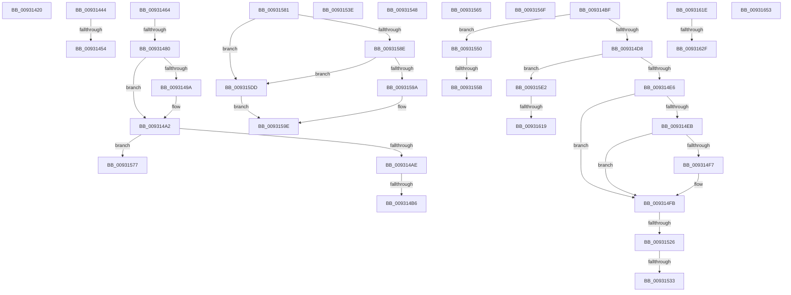

# sub_00931420

- RVA: `0x00931420`–`0x00931662` (길이 `578` bytes)
- VA: `0x0000000140931420`
- 실행 섹션: `PAGE`
- PDB 이름 있음: `아니요`; PDB Function 태그: `아니요`
- unwind 정보 RVA: `0x0008ECD4`
- 디코드: `136`개 명령, `578/578` bytes 표시
- 미해석 바이트: `0` (있으면 어셈블리에 `.byte`로 보존)

> 이 문서는 커널 이미지의 기계어와 PDB 기호를 분석해 생성했습니다. 4번과 5번은 함수 원형과 자료형을 바이너리 사용 방식에서 추정한 C 해석이며 원본 소스 복구 결과는 아닙니다.

## 1. Dependencies

- 직접 호출 지점: **17**; 고유 호출 대상: **12**
- 직접 호출자로 확인된 함수: **0**
- RIP 상대 이미지 참조: **0**

### Outgoing calls
- `0x00931427` → [ExReleaseResourceLite](../../text/25/ExReleaseResourceLite_function_0025FA10.md) (function, `0x0025FA10`)
- `0x00931435` → [KeLeaveCriticalRegionThread](../../text/25/KeLeaveCriticalRegionThread_function_0025EFF0.md) (function, `0x0025EFF0`)
- `0x00931447` → [ZwClose](../../text/6A/ZwClose_function_006AD2B0.md) (function, `0x006AD2B0`)
- `0x0093145A` → [DrvDbUnloadDatabaseNode](DrvDbUnloadDatabaseNode_function_0093183C.md) (function, `0x0093183C`)
- `0x00931471` → [RtlDuplicateUnicodeString](RtlDuplicateUnicodeString_function_009321F0.md) (function, `0x009321F0`)
- `0x0093148E` → [DrvDbFindDatabaseNode](DrvDbFindDatabaseNode_function_00932628.md) (function, `0x00932628`)
- `0x0093149D` → [ExFreePool](../../poolcode/B8/ExFreePool_function_00B82850.md) (function, `0x00B82850`)
- `0x009314CD` → [DrvDbAcquireDatabaseNodeBaseKey](DrvDbAcquireDatabaseNodeBaseKey_function_00930DE0.md) (function, `0x00930DE0`)
- `0x00931517` → [_RegRtlOpenKeyTransacted](../8E/_RegRtlOpenKeyTransacted_function_008EF810.md) (function, `0x008EF810`)
- `0x009315B7` → [_RegRtlOpenKeyTransacted](../8E/_RegRtlOpenKeyTransacted_function_008EF810.md) (function, `0x008EF810`)
- `0x009315C5` → [ExReleaseResourceLite](../../text/25/ExReleaseResourceLite_function_0025FA10.md) (function, `0x0025FA10`)
- `0x009315D3` → [KeLeaveCriticalRegionThread](../../text/25/KeLeaveCriticalRegionThread_function_0025EFF0.md) (function, `0x0025EFF0`)
- `0x0093160A` → [PnpCtxRegCreateTree](PnpCtxRegCreateTree_function_00931CA0.md) (function, `0x00931CA0`)
- `0x0093161E` → [DrvDbGetRegistrarSecurityDescriptor](../83/DrvDbGetRegistrarSecurityDescriptor_function_00835728.md) (function, `0x00835728`)
- `0x00931636` → [ExReleaseResourceLite](../../text/25/ExReleaseResourceLite_function_0025FA10.md) (function, `0x0025FA10`)
- `0x00931644` → [KeLeaveCriticalRegionThread](../../text/25/KeLeaveCriticalRegionThread_function_0025EFF0.md) (function, `0x0025EFF0`)
- `0x00931658` → [ExFreePoolWithTag](../../poolcode/B8/ExFreePoolWithTag_function_00B82870.md) (function, `0x00B82870`)

### Direct callers
- 이 함수 시작 RVA로 연결되는 직접 call은 확인되지 않았습니다. 간접 호출은 완전히 역산할 수 없습니다.

### Static image references
- 디코드된 RIP-relative 메모리 참조가 없습니다.

## 2. Other-region calls and transfers

- 다른 실행 섹션으로 향하는 call: **9**
  - `0x00931427` → [ExReleaseResourceLite](../../text/25/ExReleaseResourceLite_function_0025FA10.md) (`PAGE` → `.text`)
  - `0x00931435` → [KeLeaveCriticalRegionThread](../../text/25/KeLeaveCriticalRegionThread_function_0025EFF0.md) (`PAGE` → `.text`)
  - `0x00931447` → [ZwClose](../../text/6A/ZwClose_function_006AD2B0.md) (`PAGE` → `.text`)
  - `0x0093149D` → [ExFreePool](../../poolcode/B8/ExFreePool_function_00B82850.md) (`PAGE` → `POOLCODE`)
  - `0x009315C5` → [ExReleaseResourceLite](../../text/25/ExReleaseResourceLite_function_0025FA10.md) (`PAGE` → `.text`)
  - `0x009315D3` → [KeLeaveCriticalRegionThread](../../text/25/KeLeaveCriticalRegionThread_function_0025EFF0.md) (`PAGE` → `.text`)
  - `0x00931636` → [ExReleaseResourceLite](../../text/25/ExReleaseResourceLite_function_0025FA10.md) (`PAGE` → `.text`)
  - `0x00931644` → [KeLeaveCriticalRegionThread](../../text/25/KeLeaveCriticalRegionThread_function_0025EFF0.md) (`PAGE` → `.text`)
  - `0x00931658` → [ExFreePoolWithTag](../../poolcode/B8/ExFreePoolWithTag_function_00B82870.md) (`PAGE` → `POOLCODE`)
- call이 아닌 외부 분기/꼬리 이동: **22**
  - `0x0093143F` → [sub_0093107C + 0x1D9](Unknown_function_0093107C.md) (`tail-transfer`)
  - `0x0093144E` → [sub_0093107C + 0x1B3](Unknown_function_0093107C.md) (`tail-transfer`)
  - `0x0093145F` → [sub_0093107C + 0x1B3](Unknown_function_0093107C.md) (`tail-transfer`)
  - `0x0093147A` → [sub_0093107C + 0x23A](Unknown_function_0093107C.md) (`tail-transfer`)
  - `0x009314B0` → [sub_0093107C + 0x23A](Unknown_function_0093107C.md) (`tail-transfer`)
  - `0x009314BA` → [sub_0093107C + 0x5E](Unknown_function_0093107C.md) (`tail-transfer`)
  - `0x00931520` → [sub_0093107C + 0x23A](Unknown_function_0093107C.md) (`tail-transfer`)
  - `0x0093152D` → [sub_0093107C + 0x22E](Unknown_function_0093107C.md) (`tail-transfer`)
  - `0x00931539` → [sub_0093107C + 0x22E](Unknown_function_0093107C.md) (`tail-transfer`)
  - `0x00931543` → [sub_0093107C + 0x23A](Unknown_function_0093107C.md) (`tail-transfer`)
  - `0x0093154B` → [sub_0093107C + 0x162](Unknown_function_0093107C.md) (`tail-transfer`)
  - `0x00931555` → [sub_0093107C + 0x23A](Unknown_function_0093107C.md) (`tail-transfer`)
  - `0x00931560` → [sub_0093107C + 0x23A](Unknown_function_0093107C.md) (`tail-transfer`)
  - `0x0093156A` → [sub_0093107C + 0x23A](Unknown_function_0093107C.md) (`tail-transfer`)
  - `0x00931572` → [sub_00931330 + 0x5A](Unknown_function_00931330.md) (`tail-transfer`)
  - `0x0093157C` → [sub_0093107C + 0x23A](Unknown_function_0093107C.md) (`tail-transfer`)
  - `0x009315D8` → [sub_0093107C + 0x115](Unknown_function_0093107C.md) (`tail-transfer`)
  - `0x00931613` → [sub_0093107C + 0x22E](Unknown_function_0093107C.md) (`tail-transfer`)
  - `0x00931619` → [sub_0093107C + 0x23A](Unknown_function_0093107C.md) (`tail-transfer`)
  - `0x00931629` → [sub_00931330 + 0x2A](Unknown_function_00931330.md) (`tail-transfer`)
  - `0x0093164E` → [sub_0093107C + 0x23A](Unknown_function_0093107C.md) (`tail-transfer`)
  - `0x0093165D` → [sub_0093107C + 0x115](Unknown_function_0093107C.md) (`tail-transfer`)

## 3. Assembly (complete function range)

```asm
00931420  48 8B 8F 98 00 00 00            mov rcx, qword ptr [rdi + 0x98]
00931427  E8 E4 E5 92 FF                  call 0x14025fa10
0093142C  65 48 8B 0C 25 88 01 00 00      mov rcx, qword ptr gs:[0x188]
00931435  E8 B6 DB 92 FF                  call 0x14025eff0
0093143A  BB 34 00 00 C0                  mov ebx, 0xc0000034
0093143F  E9 11 FE FF FF                  jmp 0x140931255
00931444  49 8B CF                        mov rcx, r15
00931447  E8 64 BE D7 FF                  call 0x1406ad2b0
0093144C  85 C0                           test eax, eax
0093144E  0F 88 DB FD FF FF               js 0x14093122f
00931454  48 8B D7                        mov rdx, rdi
00931457  49 8B CD                        mov rcx, r13
0093145A  E8 DD 03 00 00                  call 0x14093183c
0093145F  E9 CB FD FF FF                  jmp 0x14093122f
00931464  4C 8D 45 EF                     lea r8, [rbp - 0x11]
00931468  B9 01 00 00 00                  mov ecx, 1
0093146D  48 8D 55 DF                     lea rdx, [rbp - 0x21]
00931471  E8 7A 0D 00 00                  call 0x1409321f0
00931476  8B D8                           mov ebx, eax
00931478  85 C0                           test eax, eax
0093147A  0F 88 36 FE FF FF               js 0x1409312b6
00931480  48 8B 7D F7                     mov rdi, qword ptr [rbp - 9]
00931484  4C 8D 45 D7                     lea r8, [rbp - 0x29]
00931488  48 8B D7                        mov rdx, rdi
0093148B  49 8B CD                        mov rcx, r13
0093148E  E8 95 11 00 00                  call 0x140932628
00931493  8B D8                           mov ebx, eax
00931495  48 85 FF                        test rdi, rdi
00931498  74 08                           je 0x1409314a2
0093149A  48 8B CF                        mov rcx, rdi
0093149D  E8 AE 13 25 00                  call 0x140b82850
009314A2  81 FB 34 00 00 C0               cmp ebx, 0xc0000034
009314A8  0F 84 C9 00 00 00               je 0x140931577
009314AE  85 DB                           test ebx, ebx
009314B0  0F 88 00 FE FF FF               js 0x1409312b6
009314B6  4C 8B 7D D7                     mov r15, qword ptr [rbp - 0x29]
009314BA  E9 1B FC FF FF                  jmp 0x1409310da
009314BF  44 8B 45 4F                     mov r8d, dword ptr [rbp + 0x4f]
009314C3  4C 8D 4D CF                     lea r9, [rbp - 0x31]
009314C7  49 8B D7                        mov rdx, r15
009314CA  49 8B CD                        mov rcx, r13
009314CD  E8 0E F9 FF FF                  call 0x140930de0
009314D2  8B D8                           mov ebx, eax
009314D4  85 C0                           test eax, eax
009314D6  78 78                           js 0x140931550
009314D8  49 8B 4D 00                     mov rcx, qword ptr [r13]
009314DC  44 38 75 67                     cmp byte ptr [rbp + 0x67], r14b
009314E0  0F 85 FC 00 00 00               jne 0x1409315e2
009314E6  48 85 C9                        test rcx, rcx
009314E9  74 10                           je 0x1409314fb
009314EB  48 8B 81 E0 00 00 00            mov rax, qword ptr [rcx + 0xe0]
009314F2  48 85 C0                        test rax, rax
009314F5  74 04                           je 0x1409314fb
009314F7  4C 8B 70 08                     mov r14, qword ptr [rax + 8]
009314FB  48 8B 45 6F                     mov rax, qword ptr [rbp + 0x6f]
009314FF  45 33 C0                        xor r8d, r8d
00931502  44 8B 4D 5F                     mov r9d, dword ptr [rbp + 0x5f]
00931506  48 8B D6                        mov rdx, rsi
00931509  48 8B 4D CF                     mov rcx, qword ptr [rbp - 0x31]
0093150D  4C 89 74 24 28                  mov qword ptr [rsp + 0x28], r14
00931512  48 89 44 24 20                  mov qword ptr [rsp + 0x20], rax
00931517  E8 F4 E2 FB FF                  call 0x1408ef810
0093151C  8B D8                           mov ebx, eax
0093151E  85 C0                           test eax, eax
00931520  0F 88 90 FD FF FF               js 0x1409312b6
00931526  48 8B 45 77                     mov rax, qword ptr [rbp + 0x77]
0093152A  48 85 C0                        test rax, rax
0093152D  0F 84 77 FD FF FF               je 0x1409312aa
00931533  C7 00 02 00 00 00               mov dword ptr [rax], 2
00931539  E9 6C FD FF FF                  jmp 0x1409312aa
0093153E  BB 0D 00 00 C0                  mov ebx, 0xc000000d
00931543  E9 6E FD FF FF                  jmp 0x1409312b6
00931548  49 8B C6                        mov rax, r14
0093154B  E9 8E FC FF FF                  jmp 0x1409311de
00931550  3D 67 04 00 C0                  cmp eax, 0xc0000467
00931555  0F 85 5B FD FF FF               jne 0x1409312b6
0093155B  BB 34 00 00 C0                  mov ebx, 0xc0000034
00931560  E9 51 FD FF FF                  jmp 0x1409312b6
00931565  BB 6D 03 00 C0                  mov ebx, 0xc000036d
0093156A  E9 47 FD FF FF                  jmp 0x1409312b6
0093156F  49 8B CE                        mov rcx, r14
00931572  E9 13 FE FF FF                  jmp 0x14093138a
00931577  BB 3A 00 00 C0                  mov ebx, 0xc000003a
0093157C  E9 35 FD FF FF                  jmp 0x1409312b6
00931581  49 8B 55 00                     mov rdx, qword ptr [r13]
00931585  48 8B 4F 60                     mov rcx, qword ptr [rdi + 0x60]
00931589  48 85 D2                        test rdx, rdx
0093158C  74 4F                           je 0x1409315dd
0093158E  48 8B 92 E0 00 00 00            mov rdx, qword ptr [rdx + 0xe0]
00931595  48 85 D2                        test rdx, rdx
00931598  74 43                           je 0x1409315dd
0093159A  48 8B 42 08                     mov rax, qword ptr [rdx + 8]
0093159E  48 89 44 24 28                  mov qword ptr [rsp + 0x28], rax
009315A3  41 B9 00 00 00 02               mov r9d, 0x2000000
009315A9  48 8D 45 CF                     lea rax, [rbp - 0x31]
009315AD  45 33 C0                        xor r8d, r8d
009315B0  33 D2                           xor edx, edx
009315B2  48 89 44 24 20                  mov qword ptr [rsp + 0x20], rax
009315B7  E8 54 E2 FB FF                  call 0x1408ef810
009315BC  48 8B 8F 98 00 00 00            mov rcx, qword ptr [rdi + 0x98]
009315C3  8B D8                           mov ebx, eax
009315C5  E8 46 E4 92 FF                  call 0x14025fa10
009315CA  65 48 8B 0C 25 88 01 00 00      mov rcx, qword ptr gs:[0x188]
009315D3  E8 18 DA 92 FF                  call 0x14025eff0
009315D8  E9 B4 FB FF FF                  jmp 0x140931191
009315DD  49 8B C6                        mov rax, r14
009315E0  EB BC                           jmp 0x14093159e
009315E2  48 8B 45 77                     mov rax, qword ptr [rbp + 0x77]
009315E6  45 33 C9                        xor r9d, r9d
009315E9  48 8B 55 CF                     mov rdx, qword ptr [rbp - 0x31]
009315ED  4C 8B C6                        mov r8, rsi
009315F0  48 89 44 24 38                  mov qword ptr [rsp + 0x38], rax
009315F5  48 8B 45 6F                     mov rax, qword ptr [rbp + 0x6f]
009315F9  48 89 44 24 30                  mov qword ptr [rsp + 0x30], rax
009315FE  8B 45 5F                        mov eax, dword ptr [rbp + 0x5f]
00931601  4C 89 74 24 28                  mov qword ptr [rsp + 0x28], r14
00931606  89 44 24 20                     mov dword ptr [rsp + 0x20], eax
0093160A  E8 91 06 00 00                  call 0x140931ca0
0093160F  8B D8                           mov ebx, eax
00931611  85 C0                           test eax, eax
00931613  0F 89 91 FC FF FF               jns 0x1409312aa
00931619  E9 98 FC FF FF                  jmp 0x1409312b6
0093161E  E8 05 41 F0 FF                  call 0x140835728
00931623  4C 8B F8                        mov r15, rax
00931626  48 85 C0                        test rax, rax
00931629  0F 85 2B FD FF FF               jne 0x14093135a
0093162F  48 8B 8F 98 00 00 00            mov rcx, qword ptr [rdi + 0x98]
00931636  E8 D5 E3 92 FF                  call 0x14025fa10
0093163B  65 48 8B 0C 25 88 01 00 00      mov rcx, qword ptr gs:[0x188]
00931644  E8 A7 D9 92 FF                  call 0x14025eff0
00931649  BB E5 00 00 C0                  mov ebx, 0xc00000e5
0093164E  E9 63 FC FF FF                  jmp 0x1409312b6
00931653  33 D2                           xor edx, edx
00931655  49 8B CF                        mov rcx, r15
00931658  E8 13 12 25 00                  call 0x140b82870
0093165D  E9 2F FB FF FF                  jmp 0x140931191
```

## 4. C-style interpretation (structured pseudocode)

```c
__int64 __fastcall sub_00931420(void)
{
    __int64 result;
    unsigned __int64 v_stack_p20;
    unsigned __int64 v_stack_p28;
    unsigned __int64 v_stack_p30;
    unsigned __int64 v_stack_p38;

    result = ExReleaseResourceLite(*(unsigned __int64 *)(v_rdi + 152), a2, a3, a4);
    result = KeLeaveCriticalRegionThread(*(unsigned __int64 *)(gs_base + (0 + 392)), a2, a3, a4);
}
```

## 5. (Beta) C Style

```c
void sub_00931420(void)
{
    int64_t result;
    uint64_t v_stack_p20;
    uint64_t v_stack_p28;
    uint64_t v_stack_p30;
    uint64_t v_stack_p38;

    result = ExReleaseResourceLite(*(uint64_t *)(local_rdi + 0x98), a2, a3, a4);
    result = KeLeaveCriticalRegionThread(*(uint64_t *)(gs_base + (0 + 0x188)), a2, a3, a4);
}
```

## 6. Execution-region graph

[열기: 2D/3D 그래프와 함수 탐색 컨트롤 패널](../../../control-panel.html?section=page&rva=0x00931420&view=graph)

- 2D 그래프는 위에서 아래로 흐르고, 3D 그래프는 빈 공간을 드래그해 회전합니다. Shift+드래그는 이동, 휠은 확대·축소, 함수 노드 선택은 대상 보고서 이동입니다.

### Static fallback


