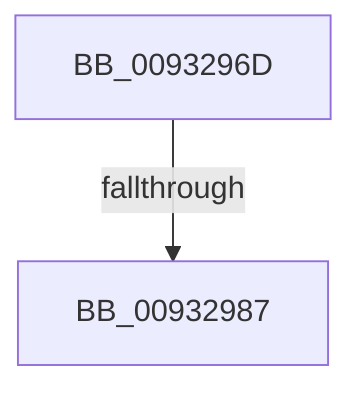

# sub_0093296D

- RVA: `0x0093296D`–`0x0093298E` (길이 `33` bytes)
- VA: `0x000000014093296D`
- 실행 섹션: `PAGE`
- PDB 이름 있음: `아니요`; PDB Function 태그: `아니요`
- unwind 정보 RVA: `0x0008EEC4`
- 디코드: `8`개 명령, `33/33` bytes 표시
- 미해석 바이트: `0` (있으면 어셈블리에 `.byte`로 보존)

> 이 문서는 커널 이미지의 기계어와 PDB 기호를 분석해 생성했습니다. 4번과 5번은 함수 원형과 자료형을 바이너리 사용 방식에서 추정한 C 해석이며 원본 소스 복구 결과는 아닙니다.

## 1. Dependencies

- 직접 호출 지점: **1**; 고유 호출 대상: **1**
- 직접 호출자로 확인된 함수: **0**
- RIP 상대 이미지 참조: **0**

### Outgoing calls
- `0x0093297E` → [ExAcquireRundownProtectionCacheAwareEx](../../text/41/ExAcquireRundownProtectionCacheAwareEx_function_00411F50.md) (function, `0x00411F50`)

### Direct callers
- 이 함수 시작 RVA로 연결되는 직접 call은 확인되지 않았습니다. 간접 호출은 완전히 역산할 수 없습니다.

### Static image references
- 디코드된 RIP-relative 메모리 참조가 없습니다.

## 2. Other-region calls and transfers

- 다른 실행 섹션으로 향하는 call: **1**
  - `0x0093297E` → [ExAcquireRundownProtectionCacheAwareEx](../../text/41/ExAcquireRundownProtectionCacheAwareEx_function_00411F50.md) (`PAGE` → `.text`)
- call이 아닌 외부 분기/꼬리 이동: **1**
  - `0x00932985` → [sub_0093299F](Unknown_function_0093299F.md) (`tail-transfer`)

## 3. Assembly (complete function range)

```asm
0093296D  48 89 74 24 40                  mov qword ptr [rsp + 0x40], rsi
00932972  48 8D 34 FD 00 00 00 00         lea rsi, [rdi*8]
0093297A  48 8B 0C 31                     mov rcx, qword ptr [rcx + rsi]
0093297E  E8 CD F5 AD FF                  call 0x140411f50
00932983  84 C0                           test al, al
00932985  75 18                           jne 0x14093299f
00932987  33 C0                           xor eax, eax
00932989  48 8B 74 24 40                  mov rsi, qword ptr [rsp + 0x40]
```

## 4. C-style interpretation (structured pseudocode)

```c
__int64 __fastcall sub_0093296D(__int64 a1, __int64 a2, __int64 a3, __int64 a4, __int64 a5, __int64 a6, __int64 a7, __int64 a8)
{
    __int64 result;
    unsigned __int64 v_stack_p40;

    v_stack_p40 = v_rsi;
    result = ExAcquireRundownProtectionCacheAwareEx(*(unsigned __int64 *)(a1 + v_rdi * 8 * 1), a2, a3, a4);
    result = 0;
    return result;
}
```

## 5. (Beta) C Style

```c
int64_t sub_0093296D(void *Arg1, int64_t Arg2, int64_t Arg3, int64_t Arg4, uint64_t Arg5, uint64_t Arg6, uint64_t Arg7, int64_t Arg8)
{
    uint8_t *arg1 = (uint8_t *)Arg1;

    int64_t result;
    uint64_t v_stack_p40;

    v_stack_p40 = local_rsi;
    result = ExAcquireRundownProtectionCacheAwareEx(*(uint64_t *)(arg1 + local_rdi * 8 * 1), Arg2, Arg3, Arg4);
    result = 0;
    return result;
}
```

### 관측된 메모리 오프셋

구조체 형식이 확인되지 않은 접근은 인자 기준의 오프셋으로만 기록했습니다.

| 기준 인자 | 오프셋 표현 | 폭 (bit) | 접근 |
|---|---:|---:|---|
| `Arg1` | `+ 0x0 + rsi*1` | `64` | `R` |

## 6. Execution-region graph

[열기: 2D/3D 그래프와 함수 탐색 컨트롤 패널](../../../control-panel.html?section=page&rva=0x0093296D&view=graph)

- 2D 그래프는 위에서 아래로 흐르고, 3D 그래프는 빈 공간을 드래그해 회전합니다. Shift+드래그는 이동, 휠은 확대·축소, 함수 노드 선택은 대상 보고서 이동입니다.

### Static fallback


