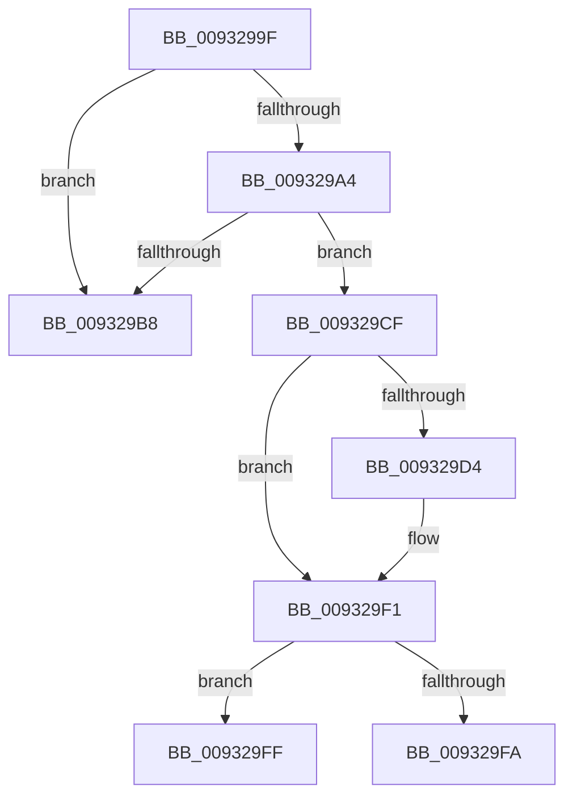

# sub_0093299F

- RVA: `0x0093299F`–`0x00932A10` (길이 `113` bytes)
- VA: `0x000000014093299F`
- 실행 섹션: `PAGE`
- PDB 이름 있음: `아니요`; PDB Function 태그: `아니요`
- unwind 정보 RVA: `0x0008EEEC`
- 디코드: `28`개 명령, `113/113` bytes 표시
- 미해석 바이트: `0` (있으면 어셈블리에 `.byte`로 보존)

> 이 문서는 커널 이미지의 기계어와 PDB 기호를 분석해 생성했습니다. 4번과 5번은 함수 원형과 자료형을 바이너리 사용 방식에서 추정한 C 해석이며 원본 소스 복구 결과는 아닙니다.

## 1. Dependencies

- 직접 호출 지점: **3**; 고유 호출 대상: **3**
- 직접 호출자로 확인된 함수: **0**
- RIP 상대 이미지 참조: **0**

### Outgoing calls
- `0x009329C8` → [ExReleaseRundownProtectionCacheAwareEx](../../text/25/ExReleaseRundownProtectionCacheAwareEx_function_0025F050.md) (function, `0x0025F050`)
- `0x009329EC` → [KeWaitForSingleObject](../../text/20/KeWaitForSingleObject_function_0020E6B0.md) (function, `0x0020E6B0`)
- `0x00932A06` → [EtwpReleaseLoggerContext](../A0/EtwpReleaseLoggerContext_function_00A04160.md) (function, `0x00A04160`)

### Direct callers
- 이 함수 시작 RVA로 연결되는 직접 call은 확인되지 않았습니다. 간접 호출은 완전히 역산할 수 없습니다.

### Static image references
- 디코드된 RIP-relative 메모리 참조가 없습니다.

## 2. Other-region calls and transfers

- 다른 실행 섹션으로 향하는 call: **2**
  - `0x009329C8` → [ExReleaseRundownProtectionCacheAwareEx](../../text/25/ExReleaseRundownProtectionCacheAwareEx_function_0025F050.md) (`PAGE` → `.text`)
  - `0x009329EC` → [KeWaitForSingleObject](../../text/20/KeWaitForSingleObject_function_0020E6B0.md) (`PAGE` → `.text`)
- call이 아닌 외부 분기/꼬리 이동: **3**
  - `0x009329CD` → [sub_0093296D + 0x1A](Unknown_function_0093296D.md) (`tail-transfer`)
  - `0x009329FD` → [sub_0093296D + 0x1C](Unknown_function_0093296D.md) (`tail-transfer`)
  - `0x00932A0B` → [sub_0093296D + 0x1A](Unknown_function_0093296D.md) (`tail-transfer`)

## 3. Assembly (complete function range)

```asm
0093299F  3B 7B 10                        cmp edi, dword ptr [rbx + 0x10]
009329A2  73 14                           jae 0x1409329b8
009329A4  0F AE E8                        lfence
009329A7  48 8B 83 C8 02 00 00            mov rax, qword ptr [rbx + 0x2c8]
009329AE  48 8B 3C 06                     mov rdi, qword ptr [rsi + rax]
009329B2  40 F6 C7 01                     test dil, 1
009329B6  74 17                           je 0x1409329cf
009329B8  48 8B 8B C0 02 00 00            mov rcx, qword ptr [rbx + 0x2c0]
009329BF  BA 01 00 00 00                  mov edx, 1
009329C4  48 8B 0C 31                     mov rcx, qword ptr [rcx + rsi]
009329C8  E8 83 C6 92 FF                  call 0x14025f050
009329CD  EB B8                           jmp 0x140932987
009329CF  40 84 ED                        test bpl, bpl
009329D2  74 1D                           je 0x1409329f1
009329D4  48 8D 8F 78 02 00 00            lea rcx, [rdi + 0x278]
009329DB  48 C7 44 24 20 00 00 00 00      mov qword ptr [rsp + 0x20], 0
009329E4  45 33 C9                        xor r9d, r9d
009329E7  45 33 C0                        xor r8d, r8d
009329EA  33 D2                           xor edx, edx
009329EC  E8 BF BC 8D FF                  call 0x14020e6b0
009329F1  83 BF 40 01 00 00 00            cmp dword ptr [rdi + 0x140], 0
009329F8  74 05                           je 0x1409329ff
009329FA  48 8B C7                        mov rax, rdi
009329FD  EB 8A                           jmp 0x140932989
009329FF  40 0F B6 D5                     movzx edx, bpl
00932A03  48 8B CF                        mov rcx, rdi
00932A06  E8 55 17 0D 00                  call 0x140a04160
00932A0B  E9 77 FF FF FF                  jmp 0x140932987
```

## 4. C-style interpretation (structured pseudocode)

```c
__int64 __fastcall sub_0093299F(__int64 a1, __int64 a2, int a3, int a4)
{
    __int64 result;
    unsigned __int64 v_stack_p20;

    if (((unsigned int)(v_rdi)) >= (*(unsigned int *)(v_rbx + 16))) goto loc_009329B8;
    if ((((unsigned __int8)(*(unsigned __int64 *)(v_rsi + *(unsigned __int64 *)(v_rbx + 712) * 1))) & (1)) == 0) goto loc_009329CF;
loc_009329B8:
    result = ExReleaseRundownProtectionCacheAwareEx(*(unsigned __int64 *)(*(unsigned __int64 *)(v_rbx + 704) + v_rsi * 1), 1, a3, a4);
loc_009329CF:
    if ((unsigned __int8)(v_rbp) != 0) {
        a1 = *(unsigned __int64 *)(v_rsi + *(unsigned __int64 *)(v_rbx + 712) * 1) + 632;
        v_stack_p20 = 0;
        a4 = 0;
        a3 = 0;
        a2 = 0;
        result = KeWaitForSingleObject(a1, a2, a3, a4);
    }
    if ((*(unsigned int *)(*(unsigned __int64 *)(v_rsi + *(unsigned __int64 *)(v_rbx + 712) * 1) + 320)) == 0) goto loc_009329FF;
loc_009329FF:
    result = EtwpReleaseLoggerContext(*(unsigned __int64 *)(v_rsi + *(unsigned __int64 *)(v_rbx + 712) * 1), (unsigned __int8)(v_rbp), a3, a4);
}
```

## 5. (Beta) C Style

```c
int64_t sub_0093299F(int64_t Arg1, int64_t Arg2, int32_t Arg3, int32_t Arg4)
{
    int64_t result;
    uint64_t v_stack_p20;

    if (((uint32_t)(local_rdi)) >= (*(uint32_t *)(local_rbx + 0x10))) goto loc_009329B8;
    if ((((uint8_t)(*(uint64_t *)(local_rsi + *(uint64_t *)(local_rbx + 0x2C8) * 1))) & (1)) == 0) goto loc_009329CF;
loc_009329B8:
    result = ExReleaseRundownProtectionCacheAwareEx(*(uint64_t *)(*(uint64_t *)(local_rbx + 0x2C0) + local_rsi * 1), 1, Arg3, Arg4);
loc_009329CF:
    if ((uint8_t)(local_rbp) != 0) {
        Arg1 = *(uint64_t *)(local_rsi + *(uint64_t *)(local_rbx + 0x2C8) * 1) + 632;
        v_stack_p20 = 0;
        Arg4 = 0;
        Arg3 = 0;
        Arg2 = 0;
        result = KeWaitForSingleObject(Arg1, Arg2, Arg3, Arg4);
    }
    if ((*(uint32_t *)(*(uint64_t *)(local_rsi + *(uint64_t *)(local_rbx + 0x2C8) * 1) + 0x140)) == 0) goto loc_009329FF;
loc_009329FF:
    result = EtwpReleaseLoggerContext(*(uint64_t *)(local_rsi + *(uint64_t *)(local_rbx + 0x2C8) * 1), (uint8_t)(local_rbp), Arg3, Arg4);
}
```

## 6. Execution-region graph

[열기: 2D/3D 그래프와 함수 탐색 컨트롤 패널](../../../control-panel.html?section=page&rva=0x0093299F&view=graph)

- 2D 그래프는 위에서 아래로 흐르고, 3D 그래프는 빈 공간을 드래그해 회전합니다. Shift+드래그는 이동, 휠은 확대·축소, 함수 노드 선택은 대상 보고서 이동입니다.

### Static fallback


