# sub_009330DC

- RVA: `0x009330DC`–`0x009333F9` (길이 `797` bytes)
- VA: `0x00000001409330DC`
- 실행 섹션: `PAGE`
- PDB 이름 있음: `아니요`; PDB Function 태그: `아니요`
- unwind 정보 RVA: `0x0008EF60`
- 디코드: `210`개 명령, `797/797` bytes 표시
- 미해석 바이트: `0` (있으면 어셈블리에 `.byte`로 보존)

> 이 문서는 커널 이미지의 기계어와 PDB 기호를 분석해 생성했습니다. 4번과 5번은 함수 원형과 자료형을 바이너리 사용 방식에서 추정한 C 해석이며 원본 소스 복구 결과는 아닙니다.

## 1. Dependencies

- 직접 호출 지점: **3**; 고유 호출 대상: **3**
- 직접 호출자로 확인된 함수: **0**
- RIP 상대 이미지 참조: **0**

### Outgoing calls
- `0x00933164` → [KeAbPreAcquire](../../text/21/KeAbPreAcquire_function_00210230.md) (function, `0x00210230`)
- `0x00933183` → [ExfAcquirePushLockSharedEx](../../text/21/ExfAcquirePushLockSharedEx_function_0021044C.md) (function, `0x0021044C`)
- `0x009332E5` → [wcsnicmp](../../text/50/wcsnicmp_function_005001C0.md) (function, `0x005001C0`)

### Direct callers
- 이 함수 시작 RVA로 연결되는 직접 call은 확인되지 않았습니다. 간접 호출은 완전히 역산할 수 없습니다.

### Static image references
- 디코드된 RIP-relative 메모리 참조가 없습니다.

## 2. Other-region calls and transfers

- 다른 실행 섹션으로 향하는 call: **3**
  - `0x00933164` → [KeAbPreAcquire](../../text/21/KeAbPreAcquire_function_00210230.md) (`PAGE` → `.text`)
  - `0x00933183` → [ExfAcquirePushLockSharedEx](../../text/21/ExfAcquirePushLockSharedEx_function_0021044C.md) (`PAGE` → `.text`)
  - `0x009332E5` → [wcsnicmp](../../text/50/wcsnicmp_function_005001C0.md) (`PAGE` → `.text`)
- call이 아닌 외부 분기/꼬리 이동: **4**
  - `0x009331C4` → [sub_009338D4](Unknown_function_009338D4.md) (`tail-transfer`)
  - `0x0093338D` → [sub_009338D4](Unknown_function_009338D4.md) (`tail-transfer`)
  - `0x009333B6` → [sub_0093345B](Unknown_function_0093345B.md) (`tail-transfer`)
  - `0x009333F7` → [sub_009333F9 + 0x9](Unknown_function_009333F9.md) (`tail-transfer`)

## 3. Assembly (complete function range)

```asm
009330DC  49 89 73 E8                     mov qword ptr [r11 - 0x18], rsi
009330E0  0F 57 C0                        xorps xmm0, xmm0
009330E3  49 89 7B E0                     mov qword ptr [r11 - 0x20], rdi
009330E7  48 8B C1                        mov rax, rcx
009330EA  4D 89 63 D8                     mov qword ptr [r11 - 0x28], r12
009330EE  33 C9                           xor ecx, ecx
009330F0  4D 89 6B D0                     mov qword ptr [r11 - 0x30], r13
009330F4  33 F6                           xor esi, esi
009330F6  4D 89 73 C8                     mov qword ptr [r11 - 0x38], r14
009330FA  0F 57 C9                        xorps xmm1, xmm1
009330FD  0F 11 45 B0                     movups xmmword ptr [rbp - 0x50], xmm0
00933101  4C 8B F0                        mov r14, rax
00933104  48 89 44 24 40                  mov qword ptr [rsp + 0x40], rax
00933109  41 0F B7 40 20                  movzx eax, word ptr [r8 + 0x20]
0093310E  0F 11 45 D0                     movups xmmword ptr [rbp - 0x30], xmm0
00933112  4D 89 7B C0                     mov qword ptr [r11 - 0x40], r15
00933116  0F 11 45 E0                     movups xmmword ptr [rbp - 0x20], xmm0
0093311A  89 44 24 30                     mov dword ptr [rsp + 0x30], eax
0093311E  41 0F 10 01                     movups xmm0, xmmword ptr [r9]
00933122  48 89 4D F0                     mov qword ptr [rbp - 0x10], rcx
00933126  0F 11 4C 24 50                  movups xmmword ptr [rsp + 0x50], xmm1
0093312B  89 4D F8                        mov dword ptr [rbp - 8], ecx
0093312E  0F 29 45 90                     movaps xmmword ptr [rbp - 0x70], xmm0
00933132  89 74 24 34                     mov dword ptr [rsp + 0x34], esi
00933136  48 89 74 24 70                  mov qword ptr [rsp + 0x70], rsi
0093313B  88 4C 24 38                     mov byte ptr [rsp + 0x38], cl
0093313F  41 0F 29 73 A8                  movaps xmmword ptr [r11 - 0x58], xmm6
00933144  65 48 8B 04 25 88 01 00 00      mov rax, qword ptr gs:[0x188]
0093314D  49 8D 4E 10                     lea rcx, [r14 + 0x10]
00933151  45 33 C0                        xor r8d, r8d
00933154  33 D2                           xor edx, edx
00933156  41 BF 11 00 00 00               mov r15d, 0x11
0093315C  66 FF 88 E4 01 00 00            dec word ptr [rax + 0x1e4]
00933163  90                              nop
00933164  E8 C7 D0 8D FF                  call 0x140210230
00933169  48 8B D8                        mov rbx, rax
0093316C  33 C0                           xor eax, eax
0093316E  F0 4D 0F B1 7E 10               lock cmpxchg qword ptr [r14 + 0x10], r15
00933174  74 12                           je 0x140933188
00933176  4D 8D 4E 10                     lea r9, [r14 + 0x10]
0093317A  4C 8B C3                        mov r8, rbx
0093317D  33 D2                           xor edx, edx
0093317F  49 8D 4E 10                     lea rcx, [r14 + 0x10]
00933183  E8 C4 D2 8D FF                  call 0x14021044c
00933188  48 85 DB                        test rbx, rbx
0093318B  74 04                           je 0x140933191
0093318D  C6 43 0A 01                     mov byte ptr [rbx + 0xa], 1
00933191  49 83 7E 30 00                  cmp qword ptr [r14 + 0x30], 0
00933196  48 8B C6                        mov rax, rsi
00933199  48 89 45 80                     mov qword ptr [rbp - 0x80], rax
0093319D  4C 8B CE                        mov r9, rsi
009331A0  48 89 74 24 78                  mov qword ptr [rsp + 0x78], rsi
009331A5  48 89 74 24 68                  mov qword ptr [rsp + 0x68], rsi
009331AA  0F 84 0C 02 00 00               je 0x1409333bc
009331B0  44 0F B7 7D 90                  movzx r15d, word ptr [rbp - 0x70]
009331B5  4C 8B 65 98                     mov r12, qword ptr [rbp - 0x68]
009331B9  66 44 89 7D 70                  mov word ptr [rbp + 0x70], r15w
009331BE  66 90                           nop
009331C0  49 3B 46 30                     cmp rax, qword ptr [r14 + 0x30]
009331C4  0F 83 0A 07 00 00               jae 0x1409338d4
009331CA  49 F7 66 28                     mul qword ptr [r14 + 0x28]
009331CE  48 89 55 C0                     mov qword ptr [rbp - 0x40], rdx
009331D2  48 85 D2                        test rdx, rdx
009331D5  75 0C                           jne 0x1409331e3
009331D7  49 8B 4E 48                     mov rcx, qword ptr [r14 + 0x48]
009331DB  48 03 C1                        add rax, rcx
009331DE  48 3B C1                        cmp rax, rcx
009331E1  73 03                           jae 0x1409331e6
009331E3  48 8B C6                        mov rax, rsi
009331E6  4C 8B 18                        mov r11, qword ptr [rax]
009331E9  4C 8B EE                        mov r13, rsi
009331EC  4C 89 5C 24 60                  mov qword ptr [rsp + 0x60], r11
009331F1  44 8B C6                        mov r8d, esi
009331F4  48 8B DE                        mov rbx, rsi
009331F7  45 0F B7 FF                     movzx r15d, r15w
009331FB  48 8B FE                        mov rdi, rsi
009331FE  66 90                           nop
00933200  48 8D 04 1B                     lea rax, [rbx + rbx]
00933204  44 0F B7 F6                     movzx r14d, si
00933208  49 3B C7                        cmp rax, r15
0093320B  73 0C                           jae 0x140933219
0093320D  66 41 83 3C 04 5C               cmp word ptr [r12 + rax], 0x5c
00933213  0F 84 F3 00 00 00               je 0x14093330c
00933219  48 8D 04 1B                     lea rax, [rbx + rbx]
0093321D  4D 8D 14 04                     lea r10, [r12 + rax]
00933221  49 3B C7                        cmp rax, r15
00933224  73 19                           jae 0x14093323f
00933226  66 41 83 3C 04 5C               cmp word ptr [r12 + rax], 0x5c
0093322C  74 11                           je 0x14093323f
0093322E  48 FF C3                        inc rbx
00933231  66 41 83 C6 02                  add r14w, 2
00933236  48 8D 04 1B                     lea rax, [rbx + rbx]
0093323A  49 3B C7                        cmp rax, r15
0093323D  72 E7                           jb 0x140933226
0093323F  48 8D 04 1B                     lea rax, [rbx + rbx]
00933243  49 3B C7                        cmp rax, r15
00933246  73 14                           jae 0x14093325c
00933248  66 41 83 3C 04 5C               cmp word ptr [r12 + rax], 0x5c
0093324E  75 0C                           jne 0x14093325c
00933250  48 FF C3                        inc rbx
00933253  48 8D 04 1B                     lea rax, [rbx + rbx]
00933257  49 3B C7                        cmp rax, r15
0093325A  72 EC                           jb 0x140933248
0093325C  41 0F B7 0B                     movzx ecx, word ptr [r11]
00933260  48 8D 04 3F                     lea rax, [rdi + rdi]
00933264  48 3B C1                        cmp rax, rcx
00933267  73 0F                           jae 0x140933278
00933269  49 8B 53 08                     mov rdx, qword ptr [r11 + 8]
0093326D  66 83 3C 02 5C                  cmp word ptr [rdx + rax], 0x5c
00933272  0F 84 A9 00 00 00               je 0x140933321
00933278  49 8B 53 08                     mov rdx, qword ptr [r11 + 8]
0093327C  48 8D 04 3F                     lea rax, [rdi + rdi]
00933280  4C 8D 0C 02                     lea r9, [rdx + rax]
00933284  48 3B C1                        cmp rax, rcx
00933287  73 1E                           jae 0x1409332a7
00933289  0F 1F 80 00 00 00 00            nop dword ptr [rax]
00933290  66 83 3C 02 5C                  cmp word ptr [rdx + rax], 0x5c
00933295  74 10                           je 0x1409332a7
00933297  48 FF C7                        inc rdi
0093329A  66 83 C6 02                     add si, 2
0093329E  48 8D 04 3F                     lea rax, [rdi + rdi]
009332A2  48 3B C1                        cmp rax, rcx
009332A5  72 E9                           jb 0x140933290
009332A7  48 8D 04 3F                     lea rax, [rdi + rdi]
009332AB  48 3B C1                        cmp rax, rcx
009332AE  73 13                           jae 0x1409332c3
009332B0  66 83 3C 02 5C                  cmp word ptr [rdx + rax], 0x5c
009332B5  75 0C                           jne 0x1409332c3
009332B7  48 FF C7                        inc rdi
009332BA  48 8D 04 3F                     lea rax, [rdi + rdi]
009332BE  48 3B C1                        cmp rax, rcx
009332C1  72 ED                           jb 0x1409332b0
009332C3  66 45 85 F6                     test r14w, r14w
009332C7  0F 84 89 00 00 00               je 0x140933356
009332CD  0F B7 C6                        movzx eax, si
009332D0  66 44 3B F6                     cmp r14w, si
009332D4  45 0F B7 C6                     movzx r8d, r14w
009332D8  49 8B D1                        mov rdx, r9
009332DB  44 0F 43 C0                     cmovae r8d, eax
009332DF  49 8B CA                        mov rcx, r10
009332E2  49 D1 E8                        shr r8, 1
009332E5  E8 D6 CE BC FF                  call 0x1405001c0
009332EA  44 8B C0                        mov r8d, eax
009332ED  85 C0                           test eax, eax
009332EF  75 59                           jne 0x14093334a
009332F1  0F B7 C6                        movzx eax, si
009332F4  45 0F B7 C6                     movzx r8d, r14w
009332F8  44 2B C0                        sub r8d, eax
009332FB  75 39                           jne 0x140933336
009332FD  4C 8B 5C 24 60                  mov r11, qword ptr [rsp + 0x60]
00933302  49 FF C5                        inc r13
00933305  33 F6                           xor esi, esi
00933307  E9 F4 FE FF FF                  jmp 0x140933200
0093330C  48 FF C3                        inc rbx
0093330F  48 8D 04 1B                     lea rax, [rbx + rbx]
00933313  49 3B C7                        cmp rax, r15
00933316  0F 82 F1 FE FF FF               jb 0x14093320d
0093331C  E9 F8 FE FF FF                  jmp 0x140933219
00933321  48 FF C7                        inc rdi
00933324  48 8D 04 3F                     lea rax, [rdi + rdi]
00933328  48 3B C1                        cmp rax, rcx
0093332B  0F 82 3C FF FF FF               jb 0x14093326d
00933331  E9 42 FF FF FF                  jmp 0x140933278
00933336  66 45 85 F6                     test r14w, r14w
0093333A  74 0E                           je 0x14093334a
0093333C  66 85 F6                        test si, si
0093333F  75 09                           jne 0x14093334a
00933341  4C 8B 5C 24 60                  mov r11, qword ptr [rsp + 0x60]
00933346  33 F6                           xor esi, esi
00933348  EB 1F                           jmp 0x140933369
0093334A  4C 8B 5C 24 60                  mov r11, qword ptr [rsp + 0x60]
0093334F  33 F6                           xor esi, esi
00933351  44 8B EE                        mov r13d, esi
00933354  EB 13                           jmp 0x140933369
00933356  66 85 F6                        test si, si
00933359  0F 85 6E FF FF FF               jne 0x1409332cd
0093335F  33 F6                           xor esi, esi
00933361  49 8B C5                        mov rax, r13
00933364  45 85 C0                        test r8d, r8d
00933367  74 3A                           je 0x1409333a3
00933369  4C 8B 4C 24 78                  mov r9, qword ptr [rsp + 0x78]
0093336E  4D 3B E9                        cmp r13, r9
00933371  76 0D                           jbe 0x140933380
00933373  4D 8B CD                        mov r9, r13
00933376  4C 89 6C 24 78                  mov qword ptr [rsp + 0x78], r13
0093337B  4C 89 5C 24 68                  mov qword ptr [rsp + 0x68], r11
00933380  4C 8B 74 24 40                  mov r14, qword ptr [rsp + 0x40]
00933385  44 0F B7 7D 70                  movzx r15d, word ptr [rbp + 0x70]
0093338A  45 85 C0                        test r8d, r8d
0093338D  0F 88 41 05 00 00               js 0x1409338d4
00933393  48 8B 45 80                     mov rax, qword ptr [rbp - 0x80]
00933397  48 FF C0                        inc rax
0093339A  48 89 45 80                     mov qword ptr [rbp - 0x80], rax
0093339E  E9 1D FE FF FF                  jmp 0x1409331c0
009333A3  4C 8B 74 24 40                  mov r14, qword ptr [rsp + 0x40]
009333A8  4C 8B C8                        mov r9, rax
009333AB  44 0F B7 7D 70                  movzx r15d, word ptr [rbp + 0x70]
009333B0  4D 8B EB                        mov r13, r11
009333B3  4D 85 ED                        test r13, r13
009333B6  0F 85 9F 00 00 00               jne 0x14093345b
009333BC  BB 34 00 00 C0                  mov ebx, 0xc0000034
009333C1  45 33 E4                        xor r12d, r12d
009333C4  0F 28 B4 24 00 01 00 00         movaps xmm6, xmmword ptr [rsp + 0x100]
009333CC  B8 11 00 00 00                  mov eax, 0x11
009333D1  4C 8B BC 24 18 01 00 00         mov r15, qword ptr [rsp + 0x118]
009333D9  4C 8B AC 24 28 01 00 00         mov r13, qword ptr [rsp + 0x128]
009333E1  48 8B B4 24 40 01 00 00         mov rsi, qword ptr [rsp + 0x140]
009333E9  F0 4D 0F B1 66 10               lock cmpxchg qword ptr [r14 + 0x10], r12
009333EF  4C 8B A4 24 30 01 00 00         mov r12, qword ptr [rsp + 0x130]
009333F7  74 09                           je 0x140933402
```

## 4. C-style interpretation (structured pseudocode)

```c
__int64 __fastcall sub_009330DC(__int64 a1, int a2, __int64 a3, __int64 a4, __int64 a5, __int64 a6, __int64 a7, __int64 a8, __int64 a9, __int64 a10, __int64 a11, __int64 a12, __int64 a13, __int64 a14, __int64 a15, __int64 a16, __int64 a17, __int64 a18, __int64 a19, __int64 a20, __int64 a21, __int64 a22, __int64 a23, __int64 a24, __int64 a25, __int64 a26, __int64 a27, __int64 a28, __int64 a29, __int64 a30, __int64 a31, __int64 a32, __int64 a33, __int64 a34, __int64 a35, __int64 a36, __int64 a37, __int64 a38, __int64 a39, __int64 a40)
{
    __int64 result;
    __int64 v_r12;
    __int64 v_r13;
    __int64 v_r14;
    __int64 v_rbx;
    __int64 v_rdi;
    __int64 v_rsi;
    unsigned int v_stack_p30;
    unsigned int v_stack_p34;
    unsigned __int8 v_stack_p38;
    unsigned __int64 v_stack_p40;
    unsigned __int64 v_stack_p60;
    unsigned __int64 v_stack_p68;
    unsigned __int64 v_stack_p70;
    unsigned __int64 v_stack_p78;

    *(unsigned __int64 *)(v_r11 - 24) = v_rsi;
    *(unsigned __int64 *)(v_r11 - 32) = v_rdi;
    *(unsigned __int64 *)(v_r11 - 40) = v_r12;
    a1 = 0;
    *(unsigned __int64 *)(v_r11 - 48) = v_r13;
    v_rsi = 0;
    *(unsigned __int64 *)(v_r11 - 56) = v_r14;
    *(unsigned __int64 *)(v_rbp - 80) = v_xmm0;
    v_stack_p40 = 0;
    *(unsigned __int64 *)(v_rbp - 48) = v_xmm0;
    *(unsigned __int64 *)(v_r11 - 64) = v_r15;
    *(unsigned __int64 *)(v_rbp - 32) = v_xmm0;
    v_stack_p30 = (unsigned int)(*(unsigned __int16 *)(a3 + 32));
    *(unsigned __int64 *)(v_rbp - 16) = 0;
    a10 = v_xmm1;
    *(unsigned int *)(v_rbp - 8) = 0;
    *(unsigned __int64 *)(v_rbp - 112) = v_xmm0;
    v_stack_p34 = 0;
    v_stack_p70 = 0;
    v_stack_p38 = 0;
    *(unsigned __int64 *)(v_r11 - 88) = v_xmm6;
    a3 = 0;
    a2 = 0;
    result = KeAbPreAcquire(0 + 16, a2, a3, a4);
    result = 0;
    if (!(condition_is_equal)) {
        a4 = 0 + 16;
        a3 = 0;
        a2 = 0;
        a1 = 0 + 16;
        result = ExfAcquirePushLockSharedEx(a1, a2, a3, a4);
    }
    if (result != 0) {
        *(unsigned __int8 *)(result + 10) = 1;
    }
    *(unsigned __int64 *)(v_rbp - 128) = 0;
    v_stack_p78 = 0;
    v_stack_p68 = 0;
    if ((*(unsigned __int64 *)(0 + 48)) == 0) goto loc_009333BC;
    *(unsigned __int16 *)(v_rbp + 112) = (unsigned __int16)(*(unsigned __int16 *)(v_rbp - 112));
loc_009331C0:
    *(unsigned __int64 *)(v_rbp - 64) = 0;
    if (0 != 0) goto loc_009331E3;
    result = (0) + (*(unsigned __int64 *)(0 + 72));
    if (result < (*(unsigned __int64 *)(0 + 72))) {
        result = 0;
    }
    v_stack_p60 = *(unsigned __int64 *)(result);
loc_00933200:
    if ((0 + 0 * 1) >= ((unsigned __int16)(*(unsigned __int16 *)(v_rbp - 112)))) goto loc_00933219;
loc_0093320D:
    if ((*(unsigned __int16 *)(*(unsigned __int64 *)(v_rbp - 104) + 0 + 0 * 1 * 1)) == 92) goto loc_0093330C;
loc_00933219:
    if ((0 + 0 * 1) >= ((unsigned __int16)(*(unsigned __int16 *)(v_rbp - 112)))) goto loc_0093323F;
loc_00933226:
    if ((*(unsigned __int16 *)(*(unsigned __int64 *)(v_rbp - 104) + 0 + 0 * 1 * 1)) == 92) goto loc_0093323F;
    v_rbx = (0) + 1;
    v_r14 = (unsigned __int16)((0) + (2));
    if ((v_rbx + v_rbx * 1) < ((unsigned __int16)(*(unsigned __int16 *)(v_rbp - 112)))) goto loc_00933226;
loc_0093323F:
    if ((v_rbx + v_rbx * 1) >= ((unsigned __int16)(*(unsigned __int16 *)(v_rbp - 112)))) goto loc_0093325C;
loc_00933248:
    if ((*(unsigned __int16 *)(*(unsigned __int64 *)(v_rbp - 104) + v_rbx + v_rbx * 1 * 1)) != 92) goto loc_0093325C;
    v_rbx = (v_rbx) + 1;
    if ((v_rbx + v_rbx * 1) < ((unsigned __int16)(*(unsigned __int16 *)(v_rbp - 112)))) goto loc_00933248;
loc_0093325C:
    if ((0 + 0 * 1) >= (*(unsigned __int16 *)(*(unsigned __int64 *)(result)))) goto loc_00933278;
loc_0093326D:
    if ((*(unsigned __int16 *)(*(unsigned __int64 *)(*(unsigned __int64 *)(result) + 8) + 0 + 0 * 1 * 1)) == 92) goto loc_00933321;
loc_00933278:
    if ((0 + 0 * 1) >= (*(unsigned __int16 *)(*(unsigned __int64 *)(result)))) goto loc_009332A7;
loc_00933290:
    if ((*(unsigned __int16 *)(*(unsigned __int64 *)(*(unsigned __int64 *)(result) + 8) + 0 + 0 * 1 * 1)) == 92) goto loc_009332A7;
    v_rdi = (0) + 1;
    v_rsi = (unsigned __int16)((v_rsi) + (2));
    if ((v_rdi + v_rdi * 1) < (*(unsigned __int16 *)(*(unsigned __int64 *)(result)))) goto loc_00933290;
loc_009332A7:
    if ((v_rdi + v_rdi * 1) >= (*(unsigned __int16 *)(*(unsigned __int64 *)(result)))) goto loc_009332C3;
loc_009332B0:
    if ((*(unsigned __int16 *)(*(unsigned __int64 *)(*(unsigned __int64 *)(result) + 8) + v_rdi + v_rdi * 1 * 1)) != 92) goto loc_009332C3;
    v_rdi = (v_rdi) + 1;
    if ((v_rdi + v_rdi * 1) < (*(unsigned __int16 *)(*(unsigned __int64 *)(result)))) goto loc_009332B0;
loc_009332C3:
    if ((unsigned __int16)(v_r14) == 0) goto loc_00933356;
loc_009332CD:
    a3 = (unsigned __int16)(v_r14);
    if (((unsigned __int16)(v_r14)) >= ((unsigned __int16)(v_rsi))) { a3 = (unsigned int)((unsigned __int16)(v_rsi)); }
    a3 = (a3) >> (1);
    result = wcsnicmp(*(unsigned __int64 *)(v_rbp - 104) + 0 + 0 * 1 * 1, *(unsigned __int64 *)(*(unsigned __int64 *)(result) + 8) + 0 + 0 * 1 * 1, a3, *(unsigned __int64 *)(*(unsigned __int64 *)(result) + 8) + 0 + 0 * 1 * 1);
    if ((unsigned int)(result) != 0) goto loc_0093334A;
    a3 = (unsigned int)(((unsigned __int16)(v_r14)) - ((unsigned int)((unsigned __int16)(v_rsi))));
    if (condition_is_not_equal) goto loc_00933336;
    v_r13 = (0) + 1;
    v_rsi = 0;
    goto loc_00933200;
loc_0093330C:
    v_rbx = (v_rbx) + 1;
    if ((v_rbx + v_rbx * 1) < ((unsigned __int16)(*(unsigned __int16 *)(v_rbp - 112)))) goto loc_0093320D;
    goto loc_00933219;
loc_00933321:
    v_rdi = (v_rdi) + 1;
    if ((v_rdi + v_rdi * 1) < (*(unsigned __int64 *)(v_rbp - 104) + 0 + 0 * 1 * 1)) goto loc_0093326D;
    goto loc_00933278;
loc_00933336:
    if ((unsigned __int16)(v_r14) == 0) goto loc_0093334A;
    if (0 != 0) goto loc_0093334A;
    v_rsi = 0;
    goto loc_00933369;
loc_0093334A:
    v_rsi = 0;
    goto loc_00933369;
loc_00933356:
    if (0 != 0) goto loc_009332CD;
    v_rsi = 0;
    if ((unsigned int)(a3) == 0) goto loc_009333A3;
loc_00933369:
    if (0 >= = a15) {
        a4 = 0;
        v_stack_p78 = 0;
        v_stack_p68 = a12;
    }
    result = (*(unsigned __int64 *)(v_rbp - 128)) + 1;
    *(unsigned __int64 *)(v_rbp - 128) = result;
    goto loc_009331C0;
loc_009333A3:
loc_009333BC:
    v_r12 = 0;
}
```

## 5. (Beta) C Style

```c
int64_t sub_009330DC(void *Arg1, int32_t Arg2, void *Arg3, void *Arg4, uint64_t Arg5, uint64_t Arg6, uint64_t Arg7, int64_t Arg8, uint64_t Arg9, int64_t Arg10, uint64_t Arg11, int64_t Arg12, uint64_t Arg13, uint64_t Arg14, int64_t Arg15, uint64_t Arg16, uint64_t Arg17, uint64_t Arg18, uint64_t Arg19, uint64_t Arg20, uint64_t Arg21, uint64_t Arg22, uint64_t Arg23, uint64_t Arg24, uint64_t Arg25, uint64_t Arg26, uint64_t Arg27, uint64_t Arg28, uint64_t Arg29, uint64_t Arg30, uint64_t Arg31, int64_t Arg32, uint64_t Arg33, uint64_t Arg34, int64_t Arg35, uint64_t Arg36, int64_t Arg37, int64_t Arg38, uint64_t Arg39, int64_t Arg40)
{
    uint8_t *arg1 = (uint8_t *)Arg1;
    uint8_t *arg3 = (uint8_t *)Arg3;
    uint8_t *arg4 = (uint8_t *)Arg4;

    int64_t result;
    int64_t local_r12;
    int64_t local_r13;
    int64_t local_r14;
    int64_t local_rbx;
    int64_t local_rdi;
    int64_t local_rsi;
    uint32_t v_stack_p30;
    uint32_t v_stack_p34;
    uint8_t v_stack_p38;
    uint64_t v_stack_p40;
    uint64_t v_stack_p60;
    uint64_t v_stack_p68;
    uint64_t v_stack_p70;
    uint64_t v_stack_p78;

    *(uint64_t *)(local_r11 - 0x18) = local_rsi;
    *(uint64_t *)(local_r11 - 0x20) = local_rdi;
    *(uint64_t *)(local_r11 - 0x28) = local_r12;
    Arg1 = 0;
    *(uint64_t *)(local_r11 - 0x30) = local_r13;
    local_rsi = 0;
    *(uint64_t *)(local_r11 - 0x38) = local_r14;
    *(uint64_t *)(local_rbp - 0x50) = v_xmm0;
    v_stack_p40 = 0;
    *(uint64_t *)(local_rbp - 0x30) = v_xmm0;
    *(uint64_t *)(local_r11 - 0x40) = local_r15;
    *(uint64_t *)(local_rbp - 0x20) = v_xmm0;
    v_stack_p30 = (uint32_t)(*(uint16_t *)(arg3 + 0x20));
    *(uint64_t *)(local_rbp - 0x10) = 0;
    Arg10 = v_xmm1;
    *(uint32_t *)(local_rbp - 0x8) = 0;
    *(uint64_t *)(local_rbp - 0x70) = v_xmm0;
    v_stack_p34 = 0;
    v_stack_p70 = 0;
    v_stack_p38 = 0;
    *(uint64_t *)(local_r11 - 0x58) = v_xmm6;
    Arg3 = 0;
    Arg2 = 0;
    result = KeAbPreAcquire(0 + 16, Arg2, Arg3, Arg4);
    result = 0;
    if (!(condition_is_equal)) {
        Arg4 = 0 + 16;
        Arg3 = 0;
        Arg2 = 0;
        Arg1 = 0 + 16;
        result = ExfAcquirePushLockSharedEx(Arg1, Arg2, Arg3, Arg4);
    }
    if (result != 0) {
        *(uint8_t *)(result + 0xA) = 1;
    }
    *(uint64_t *)(local_rbp - 0x80) = 0;
    v_stack_p78 = 0;
    v_stack_p68 = 0;
    if ((*(uint64_t *)(0 + 0x30)) == 0) goto loc_009333BC;
    *(uint16_t *)(local_rbp + 0x70) = (uint16_t)(*(uint16_t *)(local_rbp - 0x70));
loc_009331C0:
    *(uint64_t *)(local_rbp - 0x40) = 0;
    if (0 != 0) goto loc_009331E3;
    result = (0) + (*(uint64_t *)(0 + 0x48));
    if (result < (*(uint64_t *)(0 + 0x48))) {
        result = 0;
    }
    v_stack_p60 = *(uint64_t *)(result);
loc_00933200:
    if ((0 + 0 * 1) >= ((uint16_t)(*(uint16_t *)(local_rbp - 0x70)))) goto loc_00933219;
loc_0093320D:
    if ((*(uint16_t *)(*(uint64_t *)(local_rbp - 0x68) + 0x0 + 0x0 * 1 * 1)) == 92) goto loc_0093330C;
loc_00933219:
    if ((0 + 0 * 1) >= ((uint16_t)(*(uint16_t *)(local_rbp - 0x70)))) goto loc_0093323F;
loc_00933226:
    if ((*(uint16_t *)(*(uint64_t *)(local_rbp - 0x68) + 0x0 + 0x0 * 1 * 1)) == 92) goto loc_0093323F;
    local_rbx = (0) + 1;
    local_r14 = (uint16_t)((0) + (2));
    if ((local_rbx + local_rbx * 1) < ((uint16_t)(*(uint16_t *)(local_rbp - 0x70)))) goto loc_00933226;
loc_0093323F:
    if ((local_rbx + local_rbx * 1) >= ((uint16_t)(*(uint16_t *)(local_rbp - 0x70)))) goto loc_0093325C;
loc_00933248:
    if ((*(uint16_t *)(*(uint64_t *)(local_rbp - 0x68) + local_rbx + local_rbx * 1 * 1)) != 92) goto loc_0093325C;
    local_rbx = (local_rbx) + 1;
    if ((local_rbx + local_rbx * 1) < ((uint16_t)(*(uint16_t *)(local_rbp - 0x70)))) goto loc_00933248;
loc_0093325C:
    if ((0 + 0 * 1) >= (*(uint16_t *)(*(uint64_t *)(result)))) goto loc_00933278;
loc_0093326D:
    if ((*(uint16_t *)(*(uint64_t *)(*(uint64_t *)(result) + 0x8) + 0x0 + 0x0 * 1 * 1)) == 92) goto loc_00933321;
loc_00933278:
    if ((0 + 0 * 1) >= (*(uint16_t *)(*(uint64_t *)(result)))) goto loc_009332A7;
loc_00933290:
    if ((*(uint16_t *)(*(uint64_t *)(*(uint64_t *)(result) + 0x8) + 0x0 + 0x0 * 1 * 1)) == 92) goto loc_009332A7;
    local_rdi = (0) + 1;
    local_rsi = (uint16_t)((local_rsi) + (2));
    if ((local_rdi + local_rdi * 1) < (*(uint16_t *)(*(uint64_t *)(result)))) goto loc_00933290;
loc_009332A7:
    if ((local_rdi + local_rdi * 1) >= (*(uint16_t *)(*(uint64_t *)(result)))) goto loc_009332C3;
loc_009332B0:
    if ((*(uint16_t *)(*(uint64_t *)(*(uint64_t *)(result) + 0x8) + local_rdi + local_rdi * 1 * 1)) != 92) goto loc_009332C3;
    local_rdi = (local_rdi) + 1;
    if ((local_rdi + local_rdi * 1) < (*(uint16_t *)(*(uint64_t *)(result)))) goto loc_009332B0;
loc_009332C3:
    if ((uint16_t)(local_r14) == 0) goto loc_00933356;
loc_009332CD:
    Arg3 = (uint16_t)(local_r14);
    if (((uint16_t)(local_r14)) >= ((uint16_t)(local_rsi))) { Arg3 = (uint32_t)((uint16_t)(local_rsi)); }
    Arg3 = (Arg3) >> (1);
    result = wcsnicmp(*(uint64_t *)(local_rbp - 0x68) + 0 + 0 * 1 * 1, *(uint64_t *)(*(uint64_t *)(result) + 0x8) + 0 + 0 * 1 * 1, Arg3, *(uint64_t *)(*(uint64_t *)(result) + 0x8) + 0 + 0 * 1 * 1);
    if ((uint32_t)(result) != 0) goto loc_0093334A;
    Arg3 = (uint32_t)(((uint16_t)(local_r14)) - ((uint32_t)((uint16_t)(local_rsi))));
    if (condition_is_not_equal) goto loc_00933336;
    local_r13 = (0) + 1;
    local_rsi = 0;
    goto loc_00933200;
loc_0093330C:
    local_rbx = (local_rbx) + 1;
    if ((local_rbx + local_rbx * 1) < ((uint16_t)(*(uint16_t *)(local_rbp - 0x70)))) goto loc_0093320D;
    goto loc_00933219;
loc_00933321:
    local_rdi = (local_rdi) + 1;
    if ((local_rdi + local_rdi * 1) < (*(uint64_t *)(local_rbp - 0x68) + 0 + 0 * 1 * 1)) goto loc_0093326D;
    goto loc_00933278;
loc_00933336:
    if ((uint16_t)(local_r14) == 0) goto loc_0093334A;
    if (0 != 0) goto loc_0093334A;
    local_rsi = 0;
    goto loc_00933369;
loc_0093334A:
    local_rsi = 0;
    goto loc_00933369;
loc_00933356:
    if (0 != 0) goto loc_009332CD;
    local_rsi = 0;
    if ((uint32_t)(Arg3) == 0) goto loc_009333A3;
loc_00933369:
    if (0 >= = Arg15) {
        Arg4 = 0;
        v_stack_p78 = 0;
        v_stack_p68 = Arg12;
    }
    result = (*(uint64_t *)(local_rbp - 0x80)) + 1;
    *(uint64_t *)(local_rbp - 0x80) = result;
    goto loc_009331C0;
loc_009333A3:
loc_009333BC:
    local_r12 = 0;
}
```

### 관측된 메모리 오프셋

구조체 형식이 확인되지 않은 접근은 인자 기준의 오프셋으로만 기록했습니다.

| 기준 인자 | 오프셋 표현 | 폭 (bit) | 접근 |
|---|---:|---:|---|
| `Arg1` | `+ 0x10` | `64` | `R` |
| `Arg1` | `+ 0x30` | `64` | `R` |
| `Arg3` | `+ 0x20` | `16` | `R` |
| `Arg4` | `+ 0x0` | `128` | `R` |

## 6. Execution-region graph

[열기: 2D/3D 그래프와 함수 탐색 컨트롤 패널](../../../control-panel.html?section=page&rva=0x009330DC&view=graph)

- 2D 그래프는 위에서 아래로 흐르고, 3D 그래프는 빈 공간을 드래그해 회전합니다. Shift+드래그는 이동, 휠은 확대·축소, 함수 노드 선택은 대상 보고서 이동입니다.

### Static fallback

```mermaid
flowchart TD
  bb_009330DC[BB_009330DC]
  bb_00933176[BB_00933176]
  bb_00933188[BB_00933188]
  bb_0093318D[BB_0093318D]
  bb_00933191[BB_00933191]
  bb_009331B0[BB_009331B0]
  bb_009331C0[BB_009331C0]
  bb_009331CA[BB_009331CA]
  bb_009331D7[BB_009331D7]
  bb_009331E3[BB_009331E3]
  bb_009331E6[BB_009331E6]
  bb_00933200[BB_00933200]
  bb_0093320D[BB_0093320D]
  bb_00933219[BB_00933219]
  bb_00933226[BB_00933226]
  bb_0093322E[BB_0093322E]
  bb_0093323F[BB_0093323F]
  bb_00933248[BB_00933248]
  bb_00933250[BB_00933250]
  bb_0093325C[BB_0093325C]
  bb_00933269[BB_00933269]
  bb_0093326D[BB_0093326D]
  bb_00933278[BB_00933278]
  bb_00933289[BB_00933289]
  bb_00933290[BB_00933290]
  bb_00933297[BB_00933297]
  bb_009332A7[BB_009332A7]
  bb_009332B0[BB_009332B0]
  bb_009332B7[BB_009332B7]
  bb_009332C3[BB_009332C3]
  bb_009332CD[BB_009332CD]
  bb_009332F1[BB_009332F1]
  bb_009332FD[BB_009332FD]
  bb_0093330C[BB_0093330C]
  bb_0093331C[BB_0093331C]
  bb_00933321[BB_00933321]
  bb_00933331[BB_00933331]
  bb_00933336[BB_00933336]
  bb_0093333C[BB_0093333C]
  bb_00933341[BB_00933341]
  bb_0093334A[BB_0093334A]
  bb_00933356[BB_00933356]
  bb_0093335F[BB_0093335F]
  bb_00933369[BB_00933369]
  bb_00933373[BB_00933373]
  bb_00933380[BB_00933380]
  bb_00933393[BB_00933393]
  bb_009333A3[BB_009333A3]
  bb_009333BC[BB_009333BC]
  bb_009330DC -->|branch| bb_00933188
  bb_009330DC -->|fallthrough| bb_00933176
  bb_00933176 -->|flow| bb_00933188
  bb_00933188 -->|branch| bb_00933191
  bb_00933188 -->|fallthrough| bb_0093318D
  bb_0093318D -->|flow| bb_00933191
  bb_00933191 -->|branch| bb_009333BC
  bb_00933191 -->|fallthrough| bb_009331B0
  bb_009331B0 -->|flow| bb_009331C0
  bb_009331C0 -->|fallthrough| bb_009331CA
  bb_009331CA -->|branch| bb_009331E3
  bb_009331CA -->|fallthrough| bb_009331D7
  bb_009331D7 -->|branch| bb_009331E6
  bb_009331D7 -->|fallthrough| bb_009331E3
  bb_009331E3 -->|flow| bb_009331E6
  bb_009331E6 -->|flow| bb_00933200
  bb_00933200 -->|branch| bb_00933219
  bb_00933200 -->|fallthrough| bb_0093320D
  bb_0093320D -->|branch| bb_0093330C
  bb_0093320D -->|fallthrough| bb_00933219
  bb_00933219 -->|branch| bb_0093323F
  bb_00933219 -->|fallthrough| bb_00933226
  bb_00933226 -->|branch| bb_0093323F
  bb_00933226 -->|fallthrough| bb_0093322E
  bb_0093322E -->|branch| bb_00933226
  bb_0093322E -->|fallthrough| bb_0093323F
  bb_0093323F -->|branch| bb_0093325C
  bb_0093323F -->|fallthrough| bb_00933248
  bb_00933248 -->|branch| bb_0093325C
  bb_00933248 -->|fallthrough| bb_00933250
  bb_00933250 -->|branch| bb_00933248
  bb_00933250 -->|fallthrough| bb_0093325C
  bb_0093325C -->|branch| bb_00933278
  bb_0093325C -->|fallthrough| bb_00933269
  bb_00933269 -->|flow| bb_0093326D
  bb_0093326D -->|branch| bb_00933321
  bb_0093326D -->|fallthrough| bb_00933278
  bb_00933278 -->|branch| bb_009332A7
  bb_00933278 -->|fallthrough| bb_00933289
  bb_00933289 -->|flow| bb_00933290
  bb_00933290 -->|branch| bb_009332A7
  bb_00933290 -->|fallthrough| bb_00933297
  bb_00933297 -->|branch| bb_00933290
  bb_00933297 -->|fallthrough| bb_009332A7
  bb_009332A7 -->|branch| bb_009332C3
  bb_009332A7 -->|fallthrough| bb_009332B0
  bb_009332B0 -->|branch| bb_009332C3
  bb_009332B0 -->|fallthrough| bb_009332B7
  bb_009332B7 -->|branch| bb_009332B0
  bb_009332B7 -->|fallthrough| bb_009332C3
  bb_009332C3 -->|branch| bb_00933356
  bb_009332C3 -->|fallthrough| bb_009332CD
  bb_009332CD -->|branch| bb_0093334A
  bb_009332CD -->|fallthrough| bb_009332F1
  bb_009332F1 -->|branch| bb_00933336
  bb_009332F1 -->|fallthrough| bb_009332FD
  bb_009332FD -->|branch| bb_00933200
  bb_0093330C -->|branch| bb_0093320D
  bb_0093330C -->|fallthrough| bb_0093331C
  bb_0093331C -->|branch| bb_00933219
  bb_00933321 -->|branch| bb_0093326D
  bb_00933321 -->|fallthrough| bb_00933331
  bb_00933331 -->|branch| bb_00933278
  bb_00933336 -->|branch| bb_0093334A
  bb_00933336 -->|fallthrough| bb_0093333C
  bb_0093333C -->|branch| bb_0093334A
  bb_0093333C -->|fallthrough| bb_00933341
  bb_00933341 -->|branch| bb_00933369
  bb_0093334A -->|branch| bb_00933369
  bb_00933356 -->|branch| bb_009332CD
  bb_00933356 -->|fallthrough| bb_0093335F
  bb_0093335F -->|branch| bb_009333A3
  bb_0093335F -->|fallthrough| bb_00933369
  bb_00933369 -->|branch| bb_00933380
  bb_00933369 -->|fallthrough| bb_00933373
  bb_00933373 -->|flow| bb_00933380
  bb_00933380 -->|fallthrough| bb_00933393
  bb_00933393 -->|branch| bb_009331C0
  bb_009333A3 -->|fallthrough| bb_009333BC
```


