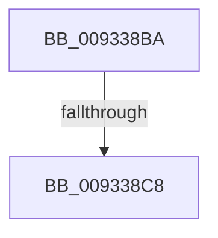

# sub_009338BA

- RVA: `0x009338BA`–`0x009338D4` (길이 `26` bytes)
- VA: `0x00000001409338BA`
- 실행 섹션: `PAGE`
- PDB 이름 있음: `아니요`; PDB Function 태그: `아니요`
- unwind 정보 RVA: `0x0008F00C`
- 디코드: `6`개 명령, `26/26` bytes 표시
- 미해석 바이트: `0` (있으면 어셈블리에 `.byte`로 보존)

> 이 문서는 커널 이미지의 기계어와 PDB 기호를 분석해 생성했습니다. 4번과 5번은 함수 원형과 자료형을 바이너리 사용 방식에서 추정한 C 해석이며 원본 소스 복구 결과는 아닙니다.

## 1. Dependencies

- 직접 호출 지점: **1**; 고유 호출 대상: **1**
- 직접 호출자로 확인된 함수: **0**
- RIP 상대 이미지 참조: **0**

### Outgoing calls
- `0x009338CA` → [ExFreePoolWithTag](../../poolcode/B8/ExFreePoolWithTag_function_00B82870.md) (function, `0x00B82870`)

### Direct callers
- 이 함수 시작 RVA로 연결되는 직접 call은 확인되지 않았습니다. 간접 호출은 완전히 역산할 수 없습니다.

### Static image references
- 디코드된 RIP-relative 메모리 참조가 없습니다.

## 2. Other-region calls and transfers

- 다른 실행 섹션으로 향하는 call: **1**
  - `0x009338CA` → [ExFreePoolWithTag](../../poolcode/B8/ExFreePoolWithTag_function_00B82870.md) (`PAGE` → `POOLCODE`)
- call이 아닌 외부 분기/꼬리 이동: **2**
  - `0x009338C2` → [sub_0093343F](Unknown_function_0093343F.md) (`tail-transfer`)
  - `0x009338CF` → [sub_0093343F](Unknown_function_0093343F.md) (`tail-transfer`)

## 3. Assembly (complete function range)

```asm
009338BA  48 8B 45 78                     mov rax, qword ptr [rbp + 0x78]
009338BE  48 3B 48 08                     cmp rcx, qword ptr [rax + 8]
009338C2  0F 84 77 FB FF FF               je 0x14093343f
009338C8  33 D2                           xor edx, edx
009338CA  E8 A1 EF 24 00                  call 0x140b82870
009338CF  E9 6B FB FF FF                  jmp 0x14093343f
```

## 4. C-style interpretation (structured pseudocode)

```c
__int64 __fastcall sub_009338BA(__int64 a1, int a2)
{
    __int64 result;

    a2 = 0;
    result = ExFreePoolWithTag(a1, a2, a3, a4);
}
```

## 5. (Beta) C Style

```c
int64_t sub_009338BA(int64_t Arg1, int32_t Arg2)
{
    int64_t result;

    Arg2 = 0;
    result = ExFreePoolWithTag(Arg1, Arg2, a3, a4);
}
```

## 6. Execution-region graph

[열기: 2D/3D 그래프와 함수 탐색 컨트롤 패널](../../../control-panel.html?section=page&rva=0x009338BA&view=graph)

- 2D 그래프는 위에서 아래로 흐르고, 3D 그래프는 빈 공간을 드래그해 회전합니다. Shift+드래그는 이동, 휠은 확대·축소, 함수 노드 선택은 대상 보고서 이동입니다.

### Static fallback


