# sub_009347B3

- RVA: `0x009347B3`–`0x009349A7` (길이 `500` bytes)
- VA: `0x00000001409347B3`
- 실행 섹션: `PAGE`
- PDB 이름 있음: `아니요`; PDB Function 태그: `아니요`
- unwind 정보 RVA: `0x0008F160`
- 디코드: `140`개 명령, `500/500` bytes 표시
- 미해석 바이트: `0` (있으면 어셈블리에 `.byte`로 보존)

> 이 문서는 커널 이미지의 기계어와 PDB 기호를 분석해 생성했습니다. 4번과 5번은 함수 원형과 자료형을 바이너리 사용 방식에서 추정한 C 해석이며 원본 소스 복구 결과는 아닙니다.

## 1. Dependencies

- 직접 호출 지점: **1**; 고유 호출 대상: **1**
- 직접 호출자로 확인된 함수: **0**
- RIP 상대 이미지 참조: **0**

### Outgoing calls
- `0x009348E4` → [wcsnicmp](../../text/50/wcsnicmp_function_005001C0.md) (function, `0x005001C0`)

### Direct callers
- 이 함수 시작 RVA로 연결되는 직접 call은 확인되지 않았습니다. 간접 호출은 완전히 역산할 수 없습니다.

### Static image references
- 디코드된 RIP-relative 메모리 참조가 없습니다.

## 2. Other-region calls and transfers

- 다른 실행 섹션으로 향하는 call: **1**
  - `0x009348E4` → [wcsnicmp](../../text/50/wcsnicmp_function_005001C0.md) (`PAGE` → `.text`)
- call이 아닌 외부 분기/꼬리 이동: **2**
  - `0x009347C7` → [sub_009349D6](Unknown_function_009349D6.md) (`tail-transfer`)
  - `0x00934955` → [sub_009349D6](Unknown_function_009349D6.md) (`tail-transfer`)

## 3. Assembly (complete function range)

```asm
009347B3  49 89 5B 10                     mov qword ptr [r11 + 0x10], rbx
009347B7  49 89 6B E8                     mov qword ptr [r11 - 0x18], rbp
009347BB  49 89 7B D8                     mov qword ptr [r11 - 0x28], rdi
009347BF  4D 89 73 D0                     mov qword ptr [r11 - 0x30], r14
009347C3  4D 3B 60 30                     cmp r12, qword ptr [r8 + 0x30]
009347C7  0F 83 09 02 00 00               jae 0x1409349d6
009347CD  49 8B C4                        mov rax, r12
009347D0  49 F7 60 28                     mul qword ptr [r8 + 0x28]
009347D4  48 8B C8                        mov rcx, rax
009347D7  48 85 D2                        test rdx, rdx
009347DA  75 0C                           jne 0x1409347e8
009347DC  49 8B 40 48                     mov rax, qword ptr [r8 + 0x48]
009347E0  48 03 C8                        add rcx, rax
009347E3  48 3B C8                        cmp rcx, rax
009347E6  73 03                           jae 0x1409347eb
009347E8  48 8B CE                        mov rcx, rsi
009347EB  4C 8B 29                        mov r13, qword ptr [rcx]
009347EE  4C 8B F6                        mov r14, rsi
009347F1  44 8B C6                        mov r8d, esi
009347F4  48 8B DE                        mov rbx, rsi
009347F7  48 8B FE                        mov rdi, rsi
009347FA  66 0F 1F 44 00 00               nop word ptr [rax + rax]
00934800  41 0F B7 0F                     movzx ecx, word ptr [r15]
00934804  48 8D 04 1B                     lea rax, [rbx + rbx]
00934808  0F B7 EE                        movzx ebp, si
0093480B  48 3B C1                        cmp rax, rcx
0093480E  73 0F                           jae 0x14093481f
00934810  49 8B 57 08                     mov rdx, qword ptr [r15 + 8]
00934814  66 83 3C 02 5C                  cmp word ptr [rdx + rax], 0x5c
00934819  0F 84 E7 00 00 00               je 0x140934906
0093481F  49 8B 57 08                     mov rdx, qword ptr [r15 + 8]
00934823  48 8D 04 1B                     lea rax, [rbx + rbx]
00934827  4C 8D 14 02                     lea r10, [rdx + rax]
0093482B  48 3B C1                        cmp rax, rcx
0093482E  73 17                           jae 0x140934847
00934830  66 83 3C 02 5C                  cmp word ptr [rdx + rax], 0x5c
00934835  74 10                           je 0x140934847
00934837  48 FF C3                        inc rbx
0093483A  66 83 C5 02                     add bp, 2
0093483E  48 8D 04 1B                     lea rax, [rbx + rbx]
00934842  48 3B C1                        cmp rax, rcx
00934845  72 E9                           jb 0x140934830
00934847  48 8D 04 1B                     lea rax, [rbx + rbx]
0093484B  48 3B C1                        cmp rax, rcx
0093484E  73 13                           jae 0x140934863
00934850  66 83 3C 02 5C                  cmp word ptr [rdx + rax], 0x5c
00934855  75 0C                           jne 0x140934863
00934857  48 FF C3                        inc rbx
0093485A  48 8D 04 1B                     lea rax, [rbx + rbx]
0093485E  48 3B C1                        cmp rax, rcx
00934861  72 ED                           jb 0x140934850
00934863  41 0F B7 4D 00                  movzx ecx, word ptr [r13]
00934868  48 8D 04 3F                     lea rax, [rdi + rdi]
0093486C  48 3B C1                        cmp rax, rcx
0093486F  73 0F                           jae 0x140934880
00934871  49 8B 55 08                     mov rdx, qword ptr [r13 + 8]
00934875  66 83 3C 02 5C                  cmp word ptr [rdx + rax], 0x5c
0093487A  0F 84 9B 00 00 00               je 0x14093491b
00934880  49 8B 55 08                     mov rdx, qword ptr [r13 + 8]
00934884  48 8D 04 3F                     lea rax, [rdi + rdi]
00934888  4C 8D 0C 02                     lea r9, [rdx + rax]
0093488C  48 3B C1                        cmp rax, rcx
0093488F  73 17                           jae 0x1409348a8
00934891  66 83 3C 02 5C                  cmp word ptr [rdx + rax], 0x5c
00934896  74 10                           je 0x1409348a8
00934898  48 FF C7                        inc rdi
0093489B  66 83 C6 02                     add si, 2
0093489F  48 8D 04 3F                     lea rax, [rdi + rdi]
009348A3  48 3B C1                        cmp rax, rcx
009348A6  72 E9                           jb 0x140934891
009348A8  48 8D 04 3F                     lea rax, [rdi + rdi]
009348AC  48 3B C1                        cmp rax, rcx
009348AF  73 13                           jae 0x1409348c4
009348B1  66 83 3C 02 5C                  cmp word ptr [rdx + rax], 0x5c
009348B6  75 0C                           jne 0x1409348c4
009348B8  48 FF C7                        inc rdi
009348BB  48 8D 04 3F                     lea rax, [rdi + rdi]
009348BF  48 3B C1                        cmp rax, rcx
009348C2  72 ED                           jb 0x1409348b1
009348C4  66 85 ED                        test bp, bp
009348C7  0F 84 AD 00 00 00               je 0x14093497a
009348CD  0F B7 C6                        movzx eax, si
009348D0  66 3B EE                        cmp bp, si
009348D3  44 0F B7 C5                     movzx r8d, bp
009348D7  49 8B D1                        mov rdx, r9
009348DA  44 0F 43 C0                     cmovae r8d, eax
009348DE  49 8B CA                        mov rcx, r10
009348E1  49 D1 E8                        shr r8, 1
009348E4  E8 D7 B8 BC FF                  call 0x1405001c0
009348E9  44 8B C0                        mov r8d, eax
009348EC  85 C0                           test eax, eax
009348EE  75 4A                           jne 0x14093493a
009348F0  0F B7 C6                        movzx eax, si
009348F3  44 0F B7 C5                     movzx r8d, bp
009348F7  44 2B C0                        sub r8d, eax
009348FA  75 34                           jne 0x140934930
009348FC  49 FF C6                        inc r14
009348FF  33 F6                           xor esi, esi
00934901  E9 FA FE FF FF                  jmp 0x140934800
00934906  48 FF C3                        inc rbx
00934909  48 8D 04 1B                     lea rax, [rbx + rbx]
0093490D  48 3B C1                        cmp rax, rcx
00934910  0F 82 FE FE FF FF               jb 0x140934814
00934916  E9 04 FF FF FF                  jmp 0x14093481f
0093491B  48 FF C7                        inc rdi
0093491E  48 8D 04 3F                     lea rax, [rdi + rdi]
00934922  48 3B C1                        cmp rax, rcx
00934925  0F 82 4A FF FF FF               jb 0x140934875
0093492B  E9 50 FF FF FF                  jmp 0x140934880
00934930  66 85 ED                        test bp, bp
00934933  74 05                           je 0x14093493a
00934935  66 85 F6                        test si, si
00934938  74 0C                           je 0x140934946
0093493A  33 F6                           xor esi, esi
0093493C  44 8B F6                        mov r14d, esi
0093493F  EB 07                           jmp 0x140934948
00934941  45 85 C0                        test r8d, r8d
00934944  74 3F                           je 0x140934985
00934946  33 F6                           xor esi, esi
00934948  83 BC 24 90 00 00 00 01         cmp dword ptr [rsp + 0x90], 1
00934950  74 15                           je 0x140934967
00934952  45 85 C0                        test r8d, r8d
00934955  78 7F                           js 0x1409349d6
00934957  4C 8B 84 24 80 00 00 00         mov r8, qword ptr [rsp + 0x80]
0093495F  49 FF C4                        inc r12
00934962  E9 5C FE FF FF                  jmp 0x1409347c3
00934967  4C 3B 74 24 20                  cmp r14, qword ptr [rsp + 0x20]
0093496C  76 E4                           jbe 0x140934952
0093496E  4C 89 74 24 20                  mov qword ptr [rsp + 0x20], r14
00934973  4C 89 6C 24 28                  mov qword ptr [rsp + 0x28], r13
00934978  EB D8                           jmp 0x140934952
0093497A  66 85 F6                        test si, si
0093497D  0F 85 4A FF FF FF               jne 0x1409348cd
00934983  EB BC                           jmp 0x140934941
00934985  49 8B C6                        mov rax, r14
00934988  4C 8B 8C 24 98 00 00 00         mov r9, qword ptr [rsp + 0x98]
00934990  48 8B 7C 24 50                  mov rdi, qword ptr [rsp + 0x50]
00934995  48 8B 6C 24 60                  mov rbp, qword ptr [rsp + 0x60]
0093499A  48 8B 9C 24 88 00 00 00         mov rbx, qword ptr [rsp + 0x88]
009349A2  4C 8B 74 24 48                  mov r14, qword ptr [rsp + 0x48]
```

## 4. C-style interpretation (structured pseudocode)

```c
__int64 __fastcall sub_009347B3(__int64 a1, __int64 a2, __int64 a3, __int64 a4, __int64 a5, __int64 a6, __int64 a7, __int64 a8, __int64 a9, __int64 a10, __int64 a11, __int64 a12, __int64 a13, __int64 a14, __int64 a15, __int64 a16, __int64 a17, unsigned int a18, __int64 a19)
{
    __int64 result;
    __int64 v_r12;
    __int64 v_r14;
    __int64 v_rbp;
    __int64 v_rbx;
    __int64 v_rdi;
    __int64 v_rsi;
    unsigned __int64 v_stack_p20;
    unsigned __int64 v_stack_p28;

    *(unsigned __int64 *)(v_r11 + 16) = v_rbx;
    *(unsigned __int64 *)(v_r11 - 24) = v_rbp;
    *(unsigned __int64 *)(v_r11 - 40) = v_rdi;
    *(unsigned __int64 *)(v_r11 - 48) = v_r14;
loc_009347C3:
    if (a2 != 0) goto loc_009347E8;
    a1 = (v_r12) + (*(unsigned __int64 *)(a3 + 72));
    if (a1 < (*(unsigned __int64 *)(a3 + 72))) {
        a1 = v_rsi;
    }
loc_00934800:
    if ((v_rsi + v_rsi * 1) >= (*(unsigned __int16 *)(v_r15))) goto loc_0093481F;
loc_00934814:
    if ((*(unsigned __int16 *)(*(unsigned __int64 *)(v_r15 + 8) + v_rsi + v_rsi * 1 * 1)) == 92) goto loc_00934906;
loc_0093481F:
    if ((v_rsi + v_rsi * 1) >= (*(unsigned __int16 *)(v_r15))) goto loc_00934847;
loc_00934830:
    if ((*(unsigned __int16 *)(*(unsigned __int64 *)(v_r15 + 8) + v_rsi + v_rsi * 1 * 1)) == 92) goto loc_00934847;
    v_rbx = (v_rsi) + 1;
    v_rbp = (unsigned __int16)(((unsigned __int16)(v_rsi)) + (2));
    if ((v_rbx + v_rbx * 1) < (*(unsigned __int16 *)(v_r15))) goto loc_00934830;
loc_00934847:
    if ((v_rbx + v_rbx * 1) >= (*(unsigned __int16 *)(v_r15))) goto loc_00934863;
loc_00934850:
    if ((*(unsigned __int16 *)(*(unsigned __int64 *)(v_r15 + 8) + v_rbx + v_rbx * 1 * 1)) != 92) goto loc_00934863;
    v_rbx = (v_rbx) + 1;
    if ((v_rbx + v_rbx * 1) < (*(unsigned __int16 *)(v_r15))) goto loc_00934850;
loc_00934863:
    if ((v_rsi + v_rsi * 1) >= (*(unsigned __int16 *)(*(unsigned __int64 *)(a1)))) goto loc_00934880;
loc_00934875:
    if ((*(unsigned __int16 *)(*(unsigned __int64 *)(*(unsigned __int64 *)(a1) + 8) + v_rsi + v_rsi * 1 * 1)) == 92) goto loc_0093491B;
loc_00934880:
    if ((v_rsi + v_rsi * 1) >= (*(unsigned __int16 *)(*(unsigned __int64 *)(a1)))) goto loc_009348A8;
loc_00934891:
    if ((*(unsigned __int16 *)(*(unsigned __int64 *)(*(unsigned __int64 *)(a1) + 8) + v_rsi + v_rsi * 1 * 1)) == 92) goto loc_009348A8;
    v_rdi = (v_rsi) + 1;
    v_rsi = (unsigned __int16)((v_rsi) + (2));
    if ((v_rdi + v_rdi * 1) < (*(unsigned __int16 *)(*(unsigned __int64 *)(a1)))) goto loc_00934891;
loc_009348A8:
    if ((v_rdi + v_rdi * 1) >= (*(unsigned __int16 *)(*(unsigned __int64 *)(a1)))) goto loc_009348C4;
loc_009348B1:
    if ((*(unsigned __int16 *)(*(unsigned __int64 *)(*(unsigned __int64 *)(a1) + 8) + v_rdi + v_rdi * 1 * 1)) != 92) goto loc_009348C4;
    v_rdi = (v_rdi) + 1;
    if ((v_rdi + v_rdi * 1) < (*(unsigned __int16 *)(*(unsigned __int64 *)(a1)))) goto loc_009348B1;
loc_009348C4:
    if ((unsigned __int16)(v_rbp) == 0) goto loc_0093497A;
loc_009348CD:
    a3 = (unsigned __int16)(v_rbp);
    if (((unsigned __int16)(v_rbp)) >= ((unsigned __int16)(v_rsi))) { a3 = (unsigned int)((unsigned __int16)(v_rsi)); }
    a3 = (a3) >> (1);
    result = wcsnicmp(*(unsigned __int64 *)(v_r15 + 8) + v_rsi + v_rsi * 1 * 1, *(unsigned __int64 *)(*(unsigned __int64 *)(a1) + 8) + v_rsi + v_rsi * 1 * 1, a3, *(unsigned __int64 *)(*(unsigned __int64 *)(a1) + 8) + v_rsi + v_rsi * 1 * 1);
    if ((unsigned int)(result) != 0) goto loc_0093493A;
    a3 = (unsigned int)(((unsigned __int16)(v_rbp)) - ((unsigned int)((unsigned __int16)(v_rsi))));
    if (condition_is_not_equal) goto loc_00934930;
    v_r14 = (v_rsi) + 1;
    v_rsi = 0;
    goto loc_00934800;
loc_00934906:
    v_rbx = (v_rbx) + 1;
    if ((v_rbx + v_rbx * 1) < (*(unsigned __int64 *)(v_r15 + 8) + v_rsi + v_rsi * 1 * 1)) goto loc_00934814;
    goto loc_0093481F;
loc_0093491B:
    v_rdi = (v_rdi) + 1;
    if ((v_rdi + v_rdi * 1) < (*(unsigned __int64 *)(v_r15 + 8) + v_rsi + v_rsi * 1 * 1)) goto loc_00934875;
    goto loc_00934880;
loc_00934930:
    if ((unsigned __int16)(v_rbp) == 0) goto loc_0093493A;
    if (0 == 0) goto loc_00934946;
loc_0093493A:
    v_rsi = 0;
    goto loc_00934948;
loc_00934941:
    if ((unsigned int)(a3) == 0) goto loc_00934985;
loc_00934946:
    v_rsi = 0;
loc_00934948:
    if (a18 == 1) goto loc_00934967;
loc_00934952:
    v_r12 = (v_r12) + 1;
    goto loc_009347C3;
loc_00934967:
    if (0 <= v_stack_p20) goto loc_00934952;
    v_stack_p20 = 0;
    v_stack_p28 = *(unsigned __int64 *)(a1);
    goto loc_00934952;
loc_0093497A:
    if (0 != 0) goto loc_009348CD;
    goto loc_00934941;
loc_00934985:
    return 0;
}
```

## 5. (Beta) C Style

```c
int64_t sub_009347B3(int64_t Arg1, int64_t Arg2, int64_t Arg3, int64_t Arg4, uint64_t Arg5, uint64_t Arg6, uint64_t Arg7, uint64_t Arg8, int64_t Arg9, int64_t Arg10, uint64_t Arg11, int64_t Arg12, uint64_t Arg13, uint64_t Arg14, uint64_t Arg15, int64_t Arg16, int64_t Arg17, uint32_t Arg18, int64_t Arg19)
{
    int64_t result;
    int64_t local_r12;
    int64_t local_r14;
    int64_t local_rbp;
    int64_t local_rbx;
    int64_t local_rdi;
    int64_t local_rsi;
    uint64_t v_stack_p20;
    uint64_t v_stack_p28;

    *(uint64_t *)(local_r11 + 0x10) = local_rbx;
    *(uint64_t *)(local_r11 - 0x18) = local_rbp;
    *(uint64_t *)(local_r11 - 0x28) = local_rdi;
    *(uint64_t *)(local_r11 - 0x30) = local_r14;
loc_009347C3:
    if (Arg2 != 0) goto loc_009347E8;
    Arg1 = (local_r12) + (*(uint64_t *)(Arg3 + 0x48));
    if (Arg1 < (*(uint64_t *)(Arg3 + 0x48))) {
        Arg1 = local_rsi;
    }
loc_00934800:
    if ((local_rsi + local_rsi * 1) >= (*(uint16_t *)(local_r15))) goto loc_0093481F;
loc_00934814:
    if ((*(uint16_t *)(*(uint64_t *)(local_r15 + 0x8) + local_rsi + local_rsi * 1 * 1)) == 92) goto loc_00934906;
loc_0093481F:
    if ((local_rsi + local_rsi * 1) >= (*(uint16_t *)(local_r15))) goto loc_00934847;
loc_00934830:
    if ((*(uint16_t *)(*(uint64_t *)(local_r15 + 0x8) + local_rsi + local_rsi * 1 * 1)) == 92) goto loc_00934847;
    local_rbx = (local_rsi) + 1;
    local_rbp = (uint16_t)(((uint16_t)(local_rsi)) + (2));
    if ((local_rbx + local_rbx * 1) < (*(uint16_t *)(local_r15))) goto loc_00934830;
loc_00934847:
    if ((local_rbx + local_rbx * 1) >= (*(uint16_t *)(local_r15))) goto loc_00934863;
loc_00934850:
    if ((*(uint16_t *)(*(uint64_t *)(local_r15 + 0x8) + local_rbx + local_rbx * 1 * 1)) != 92) goto loc_00934863;
    local_rbx = (local_rbx) + 1;
    if ((local_rbx + local_rbx * 1) < (*(uint16_t *)(local_r15))) goto loc_00934850;
loc_00934863:
    if ((local_rsi + local_rsi * 1) >= (*(uint16_t *)(*(uint64_t *)(Arg1)))) goto loc_00934880;
loc_00934875:
    if ((*(uint16_t *)(*(uint64_t *)(*(uint64_t *)(Arg1) + 0x8) + local_rsi + local_rsi * 1 * 1)) == 92) goto loc_0093491B;
loc_00934880:
    if ((local_rsi + local_rsi * 1) >= (*(uint16_t *)(*(uint64_t *)(Arg1)))) goto loc_009348A8;
loc_00934891:
    if ((*(uint16_t *)(*(uint64_t *)(*(uint64_t *)(Arg1) + 0x8) + local_rsi + local_rsi * 1 * 1)) == 92) goto loc_009348A8;
    local_rdi = (local_rsi) + 1;
    local_rsi = (uint16_t)((local_rsi) + (2));
    if ((local_rdi + local_rdi * 1) < (*(uint16_t *)(*(uint64_t *)(Arg1)))) goto loc_00934891;
loc_009348A8:
    if ((local_rdi + local_rdi * 1) >= (*(uint16_t *)(*(uint64_t *)(Arg1)))) goto loc_009348C4;
loc_009348B1:
    if ((*(uint16_t *)(*(uint64_t *)(*(uint64_t *)(Arg1) + 0x8) + local_rdi + local_rdi * 1 * 1)) != 92) goto loc_009348C4;
    local_rdi = (local_rdi) + 1;
    if ((local_rdi + local_rdi * 1) < (*(uint16_t *)(*(uint64_t *)(Arg1)))) goto loc_009348B1;
loc_009348C4:
    if ((uint16_t)(local_rbp) == 0) goto loc_0093497A;
loc_009348CD:
    Arg3 = (uint16_t)(local_rbp);
    if (((uint16_t)(local_rbp)) >= ((uint16_t)(local_rsi))) { Arg3 = (uint32_t)((uint16_t)(local_rsi)); }
    Arg3 = (Arg3) >> (1);
    result = wcsnicmp(*(uint64_t *)(local_r15 + 0x8) + local_rsi + local_rsi * 1 * 1, *(uint64_t *)(*(uint64_t *)(Arg1) + 0x8) + local_rsi + local_rsi * 1 * 1, Arg3, *(uint64_t *)(*(uint64_t *)(Arg1) + 0x8) + local_rsi + local_rsi * 1 * 1);
    if ((uint32_t)(result) != 0) goto loc_0093493A;
    Arg3 = (uint32_t)(((uint16_t)(local_rbp)) - ((uint32_t)((uint16_t)(local_rsi))));
    if (condition_is_not_equal) goto loc_00934930;
    local_r14 = (local_rsi) + 1;
    local_rsi = 0;
    goto loc_00934800;
loc_00934906:
    local_rbx = (local_rbx) + 1;
    if ((local_rbx + local_rbx * 1) < (*(uint64_t *)(local_r15 + 0x8) + local_rsi + local_rsi * 1 * 1)) goto loc_00934814;
    goto loc_0093481F;
loc_0093491B:
    local_rdi = (local_rdi) + 1;
    if ((local_rdi + local_rdi * 1) < (*(uint64_t *)(local_r15 + 0x8) + local_rsi + local_rsi * 1 * 1)) goto loc_00934875;
    goto loc_00934880;
loc_00934930:
    if ((uint16_t)(local_rbp) == 0) goto loc_0093493A;
    if (0 == 0) goto loc_00934946;
loc_0093493A:
    local_rsi = 0;
    goto loc_00934948;
loc_00934941:
    if ((uint32_t)(Arg3) == 0) goto loc_00934985;
loc_00934946:
    local_rsi = 0;
loc_00934948:
    if (Arg18 == 1) goto loc_00934967;
loc_00934952:
    local_r12 = (local_r12) + 1;
    goto loc_009347C3;
loc_00934967:
    if (0 <= v_stack_p20) goto loc_00934952;
    v_stack_p20 = 0;
    v_stack_p28 = *(uint64_t *)(Arg1);
    goto loc_00934952;
loc_0093497A:
    if (0 != 0) goto loc_009348CD;
    goto loc_00934941;
loc_00934985:
    return 0;
}
```

## 6. Execution-region graph

[열기: 2D/3D 그래프와 함수 탐색 컨트롤 패널](../../../control-panel.html?section=page&rva=0x009347B3&view=graph)

- 2D 그래프는 위에서 아래로 흐르고, 3D 그래프는 빈 공간을 드래그해 회전합니다. Shift+드래그는 이동, 휠은 확대·축소, 함수 노드 선택은 대상 보고서 이동입니다.

### Static fallback

```mermaid
flowchart TD
  bb_009347B3[BB_009347B3]
  bb_009347C3[BB_009347C3]
  bb_009347CD[BB_009347CD]
  bb_009347DC[BB_009347DC]
  bb_009347E8[BB_009347E8]
  bb_009347EB[BB_009347EB]
  bb_00934800[BB_00934800]
  bb_00934810[BB_00934810]
  bb_00934814[BB_00934814]
  bb_0093481F[BB_0093481F]
  bb_00934830[BB_00934830]
  bb_00934837[BB_00934837]
  bb_00934847[BB_00934847]
  bb_00934850[BB_00934850]
  bb_00934857[BB_00934857]
  bb_00934863[BB_00934863]
  bb_00934871[BB_00934871]
  bb_00934875[BB_00934875]
  bb_00934880[BB_00934880]
  bb_00934891[BB_00934891]
  bb_00934898[BB_00934898]
  bb_009348A8[BB_009348A8]
  bb_009348B1[BB_009348B1]
  bb_009348B8[BB_009348B8]
  bb_009348C4[BB_009348C4]
  bb_009348CD[BB_009348CD]
  bb_009348F0[BB_009348F0]
  bb_009348FC[BB_009348FC]
  bb_00934906[BB_00934906]
  bb_00934916[BB_00934916]
  bb_0093491B[BB_0093491B]
  bb_0093492B[BB_0093492B]
  bb_00934930[BB_00934930]
  bb_00934935[BB_00934935]
  bb_0093493A[BB_0093493A]
  bb_00934941[BB_00934941]
  bb_00934946[BB_00934946]
  bb_00934948[BB_00934948]
  bb_00934952[BB_00934952]
  bb_00934957[BB_00934957]
  bb_00934967[BB_00934967]
  bb_0093496E[BB_0093496E]
  bb_0093497A[BB_0093497A]
  bb_00934983[BB_00934983]
  bb_00934985[BB_00934985]
  bb_009347B3 -->|flow| bb_009347C3
  bb_009347C3 -->|fallthrough| bb_009347CD
  bb_009347CD -->|branch| bb_009347E8
  bb_009347CD -->|fallthrough| bb_009347DC
  bb_009347DC -->|branch| bb_009347EB
  bb_009347DC -->|fallthrough| bb_009347E8
  bb_009347E8 -->|flow| bb_009347EB
  bb_009347EB -->|flow| bb_00934800
  bb_00934800 -->|branch| bb_0093481F
  bb_00934800 -->|fallthrough| bb_00934810
  bb_00934810 -->|flow| bb_00934814
  bb_00934814 -->|branch| bb_00934906
  bb_00934814 -->|fallthrough| bb_0093481F
  bb_0093481F -->|branch| bb_00934847
  bb_0093481F -->|fallthrough| bb_00934830
  bb_00934830 -->|branch| bb_00934847
  bb_00934830 -->|fallthrough| bb_00934837
  bb_00934837 -->|branch| bb_00934830
  bb_00934837 -->|fallthrough| bb_00934847
  bb_00934847 -->|branch| bb_00934863
  bb_00934847 -->|fallthrough| bb_00934850
  bb_00934850 -->|branch| bb_00934863
  bb_00934850 -->|fallthrough| bb_00934857
  bb_00934857 -->|branch| bb_00934850
  bb_00934857 -->|fallthrough| bb_00934863
  bb_00934863 -->|branch| bb_00934880
  bb_00934863 -->|fallthrough| bb_00934871
  bb_00934871 -->|flow| bb_00934875
  bb_00934875 -->|branch| bb_0093491B
  bb_00934875 -->|fallthrough| bb_00934880
  bb_00934880 -->|branch| bb_009348A8
  bb_00934880 -->|fallthrough| bb_00934891
  bb_00934891 -->|branch| bb_009348A8
  bb_00934891 -->|fallthrough| bb_00934898
  bb_00934898 -->|branch| bb_00934891
  bb_00934898 -->|fallthrough| bb_009348A8
  bb_009348A8 -->|branch| bb_009348C4
  bb_009348A8 -->|fallthrough| bb_009348B1
  bb_009348B1 -->|branch| bb_009348C4
  bb_009348B1 -->|fallthrough| bb_009348B8
  bb_009348B8 -->|branch| bb_009348B1
  bb_009348B8 -->|fallthrough| bb_009348C4
  bb_009348C4 -->|branch| bb_0093497A
  bb_009348C4 -->|fallthrough| bb_009348CD
  bb_009348CD -->|branch| bb_0093493A
  bb_009348CD -->|fallthrough| bb_009348F0
  bb_009348F0 -->|branch| bb_00934930
  bb_009348F0 -->|fallthrough| bb_009348FC
  bb_009348FC -->|branch| bb_00934800
  bb_00934906 -->|branch| bb_00934814
  bb_00934906 -->|fallthrough| bb_00934916
  bb_00934916 -->|branch| bb_0093481F
  bb_0093491B -->|branch| bb_00934875
  bb_0093491B -->|fallthrough| bb_0093492B
  bb_0093492B -->|branch| bb_00934880
  bb_00934930 -->|branch| bb_0093493A
  bb_00934930 -->|fallthrough| bb_00934935
  bb_00934935 -->|branch| bb_00934946
  bb_00934935 -->|fallthrough| bb_0093493A
  bb_0093493A -->|branch| bb_00934948
  bb_00934941 -->|branch| bb_00934985
  bb_00934941 -->|fallthrough| bb_00934946
  bb_00934946 -->|flow| bb_00934948
  bb_00934948 -->|branch| bb_00934967
  bb_00934948 -->|fallthrough| bb_00934952
  bb_00934952 -->|fallthrough| bb_00934957
  bb_00934957 -->|branch| bb_009347C3
  bb_00934967 -->|branch| bb_00934952
  bb_00934967 -->|fallthrough| bb_0093496E
  bb_0093496E -->|branch| bb_00934952
  bb_0093497A -->|branch| bb_009348CD
  bb_0093497A -->|fallthrough| bb_00934983
  bb_00934983 -->|branch| bb_00934941
```


