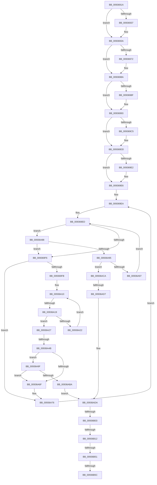

# sub_0093691A

- RVA: `0x0093691A`–`0x00936BA3` (길이 `649` bytes)
- VA: `0x000000014093691A`
- 실행 섹션: `PAGE`
- PDB 이름 있음: `아니요`; PDB Function 태그: `아니요`
- unwind 정보 RVA: `0x0008F3A4`
- 디코드: `152`개 명령, `649/649` bytes 표시
- 미해석 바이트: `0` (있으면 어셈블리에 `.byte`로 보존)

> 이 문서는 커널 이미지의 기계어와 PDB 기호를 분석해 생성했습니다. 4번과 5번은 함수 원형과 자료형을 바이너리 사용 방식에서 추정한 C 해석이며 원본 소스 복구 결과는 아닙니다.

## 1. Dependencies

- 직접 호출 지점: **12**; 고유 호출 대상: **8**
- 직접 호출자로 확인된 함수: **0**
- RIP 상대 이미지 참조: **3**

### Outgoing calls
- `0x00936957` → [KeAbPreAcquire](../../text/21/KeAbPreAcquire_function_00210230.md) (function, `0x00210230`)
- `0x00936985` → [ExfAcquirePushLockSharedEx](../../text/21/ExfAcquirePushLockSharedEx_function_0021044C.md) (function, `0x0021044C`)
- `0x009369B0` → [KeAbPreAcquire](../../text/21/KeAbPreAcquire_function_00210230.md) (function, `0x00210230`)
- `0x009369D8` → [ExfAcquirePushLockSharedEx](../../text/21/ExfAcquirePushLockSharedEx_function_0021044C.md) (function, `0x0021044C`)
- `0x00936A3A` → [ExAllocatePool2](../../poolcode/B8/ExAllocatePool2_function_00B820F0.md) (function, `0x00B820F0`)
- `0x00936A76` → [CmpUnlockContextList](CmpUnlockContextList_function_00936C10.md) (function, `0x00936C10`)
- `0x00936A7E` → [CmpLockContextListExclusive](CmpLockContextListExclusive_function_00936C7C.md) (function, `0x00936C7C`)
- `0x00936B19` → [KeAbPostRelease](../../text/2E/KeAbPostRelease_function_002E1600.md) (function, `0x002E1600`)
- `0x00936B27` → [KeLeaveCriticalRegionThread](../../text/25/KeLeaveCriticalRegionThread_function_0025EFF0.md) (function, `0x0025EFF0`)
- `0x00936B63` → [KeAbPostRelease](../../text/2E/KeAbPostRelease_function_002E1600.md) (function, `0x002E1600`)
- `0x00936B71` → [KeLeaveCriticalRegionThread](../../text/25/KeLeaveCriticalRegionThread_function_0025EFF0.md) (function, `0x0025EFF0`)
- `0x00936B7B` → [CmCleanupThreadInfo](../../text/41/CmCleanupThreadInfo_function_0041FD50.md) (function, `0x0041FD50`)

### Direct callers
- 이 함수 시작 RVA로 연결되는 직접 call은 확인되지 않았습니다. 간접 호출은 완전히 역산할 수 없습니다.

### Static image references
- `0x00936943` → RVA `0x00EF7BD0` (`.data`; read)
- `0x0093699C` → RVA `0x00EF7BC8` (`.data`; read)
- `0x009369FB` → RVA `0x00EF7BE0` (`.data`; read)

## 2. Other-region calls and transfers

- 다른 실행 섹션으로 향하는 call: **10**
  - `0x00936957` → [KeAbPreAcquire](../../text/21/KeAbPreAcquire_function_00210230.md) (`PAGE` → `.text`)
  - `0x00936985` → [ExfAcquirePushLockSharedEx](../../text/21/ExfAcquirePushLockSharedEx_function_0021044C.md) (`PAGE` → `.text`)
  - `0x009369B0` → [KeAbPreAcquire](../../text/21/KeAbPreAcquire_function_00210230.md) (`PAGE` → `.text`)
  - `0x009369D8` → [ExfAcquirePushLockSharedEx](../../text/21/ExfAcquirePushLockSharedEx_function_0021044C.md) (`PAGE` → `.text`)
  - `0x00936A3A` → [ExAllocatePool2](../../poolcode/B8/ExAllocatePool2_function_00B820F0.md) (`PAGE` → `POOLCODE`)
  - `0x00936B19` → [KeAbPostRelease](../../text/2E/KeAbPostRelease_function_002E1600.md) (`PAGE` → `.text`)
  - `0x00936B27` → [KeLeaveCriticalRegionThread](../../text/25/KeLeaveCriticalRegionThread_function_0025EFF0.md) (`PAGE` → `.text`)
  - `0x00936B63` → [KeAbPostRelease](../../text/2E/KeAbPostRelease_function_002E1600.md) (`PAGE` → `.text`)
  - `0x00936B71` → [KeLeaveCriticalRegionThread](../../text/25/KeLeaveCriticalRegionThread_function_0025EFF0.md) (`PAGE` → `.text`)
  - `0x00936B7B` → [CmCleanupThreadInfo](../../text/41/CmCleanupThreadInfo_function_0041FD50.md) (`PAGE` → `.text`)
- call이 아닌 외부 분기/꼬리 이동: **7**
  - `0x00936A13` → [sub_00936BDF](Unknown_function_00936BDF.md) (`tail-transfer`)
  - `0x00936A45` → [sub_00936BDF + 0xA](Unknown_function_00936BDF.md) (`tail-transfer`)
  - `0x00936AD1` → [sub_00936BDF + 0x14](Unknown_function_00936BDF.md) (`tail-transfer`)
  - `0x00936AFD` → [sub_00936BA4](Unknown_function_00936BA4.md) (`tail-transfer`)
  - `0x00936B0C` → [sub_00936BA4](Unknown_function_00936BA4.md) (`tail-transfer`)
  - `0x00936B4F` → [sub_00936BA4 + 0x11](Unknown_function_00936BA4.md) (`tail-transfer`)
  - `0x00936B5A` → [sub_00936BA4 + 0x11](Unknown_function_00936BA4.md) (`tail-transfer`)

## 3. Assembly (complete function range)

```asm
0093691A  48 89 5C 24 78                  mov qword ptr [rsp + 0x78], rbx
0093691F  4C 89 AC 24 80 00 00 00         mov qword ptr [rsp + 0x80], r13
00936927  45 33 ED                        xor r13d, r13d
0093692A  4C 89 BC 24 88 00 00 00         mov qword ptr [rsp + 0x88], r15
00936932  4D 85 C9                        test r9, r9
00936935  74 03                           je 0x14093693a
00936937  4D 89 29                        mov qword ptr [r9], r13
0093693A  65 48 8B 04 25 88 01 00 00      mov rax, qword ptr gs:[0x188]
00936943  48 8D 0D 86 12 5C 00            lea rcx, [rip + 0x5c1286]
0093694A  45 33 C0                        xor r8d, r8d
0093694D  33 D2                           xor edx, edx
0093694F  66 FF 88 E4 01 00 00            dec word ptr [rax + 0x1e4]
00936956  90                              nop
00936957  E8 D4 98 8D FF                  call 0x140210230
0093695C  48 8B D8                        mov rbx, rax
0093695F  41 BF 11 00 00 00               mov r15d, 0x11
00936965  33 C0                           xor eax, eax
00936967  F0 4C 0F B1 3D 60 12 5C 00      lock cmpxchg qword ptr [rip + 0x5c1260], r15
00936970  74 18                           je 0x14093698a
00936972  4C 8D 0D 57 12 5C 00            lea r9, [rip + 0x5c1257]
00936979  4C 8B C3                        mov r8, rbx
0093697C  33 D2                           xor edx, edx
0093697E  48 8D 0D 4B 12 5C 00            lea rcx, [rip + 0x5c124b]
00936985  E8 C2 9A 8D FF                  call 0x14021044c
0093698A  48 85 DB                        test rbx, rbx
0093698D  74 04                           je 0x140936993
0093698F  C6 43 0A 01                     mov byte ptr [rbx + 0xa], 1
00936993  65 48 8B 04 25 88 01 00 00      mov rax, qword ptr gs:[0x188]
0093699C  48 8D 0D 25 12 5C 00            lea rcx, [rip + 0x5c1225]
009369A3  45 33 C0                        xor r8d, r8d
009369A6  33 D2                           xor edx, edx
009369A8  66 FF 88 E4 01 00 00            dec word ptr [rax + 0x1e4]
009369AF  90                              nop
009369B0  E8 7B 98 8D FF                  call 0x140210230
009369B5  48 8B D8                        mov rbx, rax
009369B8  33 C0                           xor eax, eax
009369BA  F0 4C 0F B1 3D 05 12 5C 00      lock cmpxchg qword ptr [rip + 0x5c1205], r15
009369C3  74 18                           je 0x1409369dd
009369C5  4C 8D 0D FC 11 5C 00            lea r9, [rip + 0x5c11fc]
009369CC  4C 8B C3                        mov r8, rbx
009369CF  33 D2                           xor edx, edx
009369D1  48 8D 0D F0 11 5C 00            lea rcx, [rip + 0x5c11f0]
009369D8  E8 6F 9A 8D FF                  call 0x14021044c
009369DD  48 85 DB                        test rbx, rbx
009369E0  74 04                           je 0x1409369e6
009369E2  C6 43 0A 01                     mov byte ptr [rbx + 0xa], 1
009369E6  49 8D 5E 48                     lea rbx, [r14 + 0x48]
009369EA  4C 8B 3B                        mov r15, qword ptr [rbx]
009369ED  4C 3B FB                        cmp r15, rbx
009369F0  0F 85 92 00 00 00               jne 0x140936a88
009369F6  40 84 ED                        test bpl, bpl
009369F9  74 7B                           je 0x140936a76
009369FB  48 8B 1D DE 11 5C 00            mov rbx, qword ptr [rip + 0x5c11de]
00936A02  48 8D 0D D7 11 5C 00            lea rcx, [rip + 0x5c11d7]
00936A09  0F 1F 80 00 00 00 00            nop dword ptr [rax]
00936A10  48 3B D9                        cmp rbx, rcx
00936A13  0F 84 C6 01 00 00               je 0x140936bdf
00936A19  48 8B 43 18                     mov rax, qword ptr [rbx + 0x18]
00936A1D  48 39 07                        cmp qword ptr [rdi], rax
00936A20  74 05                           je 0x140936a27
00936A22  48 8B 1B                        mov rbx, qword ptr [rbx]
00936A25  EB E9                           jmp 0x140936a10
00936A27  BA 40 00 00 00                  mov edx, 0x40
00936A2C  B9 00 01 00 00                  mov ecx, 0x100
00936A31  41 B8 43 4D 63 63               mov r8d, 0x63634d43
00936A37  41 8B F5                        mov esi, r13d
00936A3A  E8 B1 B6 24 00                  call 0x140b820f0
00936A3F  48 8B C8                        mov rcx, rax
00936A42  48 85 C0                        test rax, rax
00936A45  0F 84 9E 01 00 00               je 0x140936be9
00936A4B  48 89 58 28                     mov qword ptr [rax + 0x28], rbx
00936A4F  48 83 C3 40                     add rbx, 0x40
00936A53  48 8B 07                        mov rax, qword ptr [rdi]
00936A56  48 89 41 20                     mov qword ptr [rcx + 0x20], rax
00936A5A  48 8D 41 10                     lea rax, [rcx + 0x10]
00936A5E  4C 89 61 38                     mov qword ptr [rcx + 0x38], r12
00936A62  4C 89 71 30                     mov qword ptr [rcx + 0x30], r14
00936A66  48 8B 53 08                     mov rdx, qword ptr [rbx + 8]
00936A6A  48 39 1A                        cmp qword ptr [rdx], rbx
00936A6D  74 30                           je 0x140936a9f
00936A6F  B9 03 00 00 00                  mov ecx, 3
00936A74  CD 29                           int 0x29
00936A76  E8 95 01 00 00                  call 0x140936c10
00936A7B  40 B5 01                        mov bpl, 1
00936A7E  E8 F9 01 00 00                  call 0x140936c7c
00936A83  E9 62 FF FF FF                  jmp 0x1409369ea
00936A88  49 8B 47 20                     mov rax, qword ptr [r15 + 0x20]
00936A8C  48 3B 07                        cmp rax, qword ptr [rdi]
00936A8F  0F 8C 61 FF FF FF               jl 0x1409369f6
00936A95  74 33                           je 0x140936aca
00936A97  4D 8B 3F                        mov r15, qword ptr [r15]
00936A9A  E9 4E FF FF FF                  jmp 0x1409369ed
00936A9F  48 89 18                        mov qword ptr [rax], rbx
00936AA2  48 89 50 08                     mov qword ptr [rax + 8], rdx
00936AA6  48 89 02                        mov qword ptr [rdx], rax
00936AA9  48 89 43 08                     mov qword ptr [rbx + 8], rax
00936AAD  49 8B 47 08                     mov rax, qword ptr [r15 + 8]
00936AB1  48 8B 10                        mov rdx, qword ptr [rax]
00936AB4  48 39 42 08                     cmp qword ptr [rdx + 8], rax
00936AB8  75 B5                           jne 0x140936a6f
00936ABA  48 89 11                        mov qword ptr [rcx], rdx
00936ABD  48 89 41 08                     mov qword ptr [rcx + 8], rax
00936AC1  48 89 4A 08                     mov qword ptr [rdx + 8], rcx
00936AC5  48 89 08                        mov qword ptr [rax], rcx
00936AC8  EB 10                           jmp 0x140936ada
00936ACA  4D 87 67 38                     xchg qword ptr [r15 + 0x38], r12
00936ACE  48 85 F6                        test rsi, rsi
00936AD1  0F 85 1C 01 00 00               jne 0x140936bf3
00936AD7  41 8B F5                        mov esi, r13d
00936ADA  0F 0D 0D E7 10 5C 00            prefetchw byte ptr [rip + 0x5c10e7]
00936AE1  48 8B 05 E0 10 5C 00            mov rax, qword ptr [rip + 0x5c10e0]
00936AE8  48 8B C8                        mov rcx, rax
00936AEB  48 83 E1 F0                     and rcx, 0xfffffffffffffff0
00936AEF  48 83 F9 10                     cmp rcx, 0x10
00936AF3  48 8D 50 F0                     lea rdx, [rax - 0x10]
00936AF7  49 0F 46 D5                     cmovbe rdx, r13
00936AFB  A8 02                           test al, 2
00936AFD  0F 85 A1 00 00 00               jne 0x140936ba4
00936B03  F0 48 0F B1 15 BC 10 5C 00      lock cmpxchg qword ptr [rip + 0x5c10bc], rdx
00936B0C  0F 85 92 00 00 00               jne 0x140936ba4
00936B12  48 8D 0D AF 10 5C 00            lea rcx, [rip + 0x5c10af]
00936B19  E8 E2 AA 9A FF                  call 0x1402e1600
00936B1E  65 48 8B 0C 25 88 01 00 00      mov rcx, qword ptr gs:[0x188]
00936B27  E8 C4 84 92 FF                  call 0x14025eff0
00936B2C  0F 0D 0D 9D 10 5C 00            prefetchw byte ptr [rip + 0x5c109d]
00936B33  48 8B 05 96 10 5C 00            mov rax, qword ptr [rip + 0x5c1096]
00936B3A  48 8B C8                        mov rcx, rax
00936B3D  48 83 E1 F0                     and rcx, 0xfffffffffffffff0
00936B41  48 83 F9 10                     cmp rcx, 0x10
00936B45  48 8D 50 F0                     lea rdx, [rax - 0x10]
00936B49  49 0F 46 D5                     cmovbe rdx, r13
00936B4D  A8 02                           test al, 2
00936B4F  75 64                           jne 0x140936bb5
00936B51  F0 48 0F B1 15 76 10 5C 00      lock cmpxchg qword ptr [rip + 0x5c1076], rdx
00936B5A  75 59                           jne 0x140936bb5
00936B5C  48 8D 0D 6D 10 5C 00            lea rcx, [rip + 0x5c106d]
00936B63  E8 98 AA 9A FF                  call 0x1402e1600
00936B68  65 48 8B 0C 25 88 01 00 00      mov rcx, qword ptr gs:[0x188]
00936B71  E8 7A 84 92 FF                  call 0x14025eff0
00936B76  48 8D 4C 24 20                  lea rcx, [rsp + 0x20]
00936B7B  E8 D0 91 AE FF                  call 0x14041fd50
00936B80  4C 8B AC 24 80 00 00 00         mov r13, qword ptr [rsp + 0x80]
00936B88  8B C6                           mov eax, esi
00936B8A  48 8B 5C 24 78                  mov rbx, qword ptr [rsp + 0x78]
00936B8F  4C 8B BC 24 88 00 00 00         mov r15, qword ptr [rsp + 0x88]
00936B97  48 83 C4 40                     add rsp, 0x40
00936B9B  41 5E                           pop r14
00936B9D  41 5C                           pop r12
00936B9F  5F                              pop rdi
00936BA0  5E                              pop rsi
00936BA1  5D                              pop rbp
00936BA2  C3                              ret
```

## 4. C-style interpretation (structured pseudocode)

```c
__int64 __fastcall sub_0093691A(__int64 a1, int a2, int a3, __int64 a4, __int64 a5, __int64 a6, __int64 a7, __int64 a8, __int64 a9, __int64 a10, __int64 a11, __int64 a12, __int64 a13, __int64 a14, __int64 a15, __int64 a16, __int64 a17)
{
    __int64 result;
    __int64 v_r13;
    __int64 v_rbx;
    __int64 v_rsp;
    unsigned __int64 v_stack_p20;
    unsigned __int64 v_stack_p78;
    unsigned __int64 v_stack_p80;
    unsigned __int64 v_stack_p88;

    v_stack_p78 = v_rbx;
    v_stack_p80 = v_r13;
    v_r13 = 0;
    v_stack_p88 = v_r15;
    if (a4 != 0) {
        *(unsigned __int64 *)(a4) = 0;
    }
    a3 = 0;
    a2 = 0;
    result = KeAbPreAcquire(v_rip + 6034054, a2, a3, a4);
    result = 0;
    if (!(condition_is_equal)) {
        a4 = v_rip + 6034007;
        a3 = 0;
        a2 = 0;
        a1 = v_rip + 6033995;
        result = ExfAcquirePushLockSharedEx(a1, a2, a3, a4);
    }
    if (result != 0) {
        *(unsigned __int8 *)(result + 10) = 1;
    }
    a3 = 0;
    a2 = 0;
    result = KeAbPreAcquire(v_rip + 6033957, a2, a3, a4);
    result = 0;
    if (!(condition_is_equal)) {
        a4 = v_rip + 6033916;
        a3 = 0;
        a2 = 0;
        a1 = v_rip + 6033904;
        result = ExfAcquirePushLockSharedEx(a1, a2, a3, a4);
    }
    if (result != 0) {
        *(unsigned __int8 *)(result + 10) = 1;
    }
loc_009369EA:
loc_009369ED:
    if ((*(unsigned __int64 *)(v_r14 + 72)) != (v_r14 + 72)) goto loc_00936A88;
loc_009369F6:
    if ((unsigned __int8)(v_rbp) == 0) goto loc_00936A76;
loc_00936A10:
    if ((*(unsigned __int64 *)(v_rdi)) == (*(unsigned __int64 *)(*(unsigned __int64 *)(v_rip + 6033886) + 24))) goto loc_00936A27;
    goto loc_00936A10;
loc_00936A27:
    result = ExAllocatePool2(256, 64, (unsigned int)(0x63634D43ULL), a4);
    *(unsigned __int64 *)(result + 40) = *(unsigned __int64 *)(*(unsigned __int64 *)(v_rip + 6033886));
    v_rbx = (*(unsigned __int64 *)(*(unsigned __int64 *)(v_rip + 6033886))) + (64);
    *(unsigned __int64 *)(result + 32) = *(unsigned __int64 *)(v_rdi);
    *(unsigned __int64 *)(result + 56) = v_r12;
    *(unsigned __int64 *)(result + 48) = v_r14;
    if ((*(unsigned __int64 *)(*(unsigned __int64 *)(v_rbx + 8))) == v_rbx) goto loc_00936A9F;
loc_00936A6F:
loc_00936A76:
    result = CmpUnlockContextList(3, *(unsigned __int64 *)(v_rbx + 8), (unsigned int)(0x63634D43ULL), a4);
    result = CmpLockContextListExclusive(3, *(unsigned __int64 *)(v_rbx + 8), (unsigned int)(0x63634D43ULL), a4);
    goto loc_009369EA;
loc_00936A88:
    if ((*(unsigned __int64 *)(*(unsigned __int64 *)(v_r14 + 72) + 32)) < (*(unsigned __int64 *)(v_rdi))) goto loc_009369F6;
    if ((*(unsigned __int64 *)(*(unsigned __int64 *)(v_r14 + 72) + 32)) == (*(unsigned __int64 *)(v_rdi))) goto loc_00936ACA;
    goto loc_009369ED;
loc_00936A9F:
    *(unsigned __int64 *)(*(unsigned __int64 *)(*(unsigned __int64 *)(v_r14 + 72) + 32)) = v_rbx;
    *(unsigned __int64 *)(*(unsigned __int64 *)(*(unsigned __int64 *)(v_r14 + 72) + 32) + 8) = *(unsigned __int64 *)(v_rbx + 8);
    *(unsigned __int64 *)(*(unsigned __int64 *)(v_rbx + 8)) = *(unsigned __int64 *)(*(unsigned __int64 *)(v_r14 + 72) + 32);
    *(unsigned __int64 *)(v_rbx + 8) = *(unsigned __int64 *)(*(unsigned __int64 *)(v_r14 + 72) + 32);
    if ((*(unsigned __int64 *)(*(unsigned __int64 *)(*(unsigned __int64 *)(*(unsigned __int64 *)(*(unsigned __int64 *)(v_r14 + 72)) + 8)) + 8)) != (*(unsigned __int64 *)(*(unsigned __int64 *)(*(unsigned __int64 *)(v_r14 + 72)) + 8))) goto loc_00936A6F;
    *(unsigned __int64 *)(3) = *(unsigned __int64 *)(*(unsigned __int64 *)(*(unsigned __int64 *)(*(unsigned __int64 *)(v_r14 + 72)) + 8));
    *(unsigned __int64 *)(3 + 8) = *(unsigned __int64 *)(*(unsigned __int64 *)(*(unsigned __int64 *)(v_r14 + 72)) + 8);
    *(unsigned __int64 *)(*(unsigned __int64 *)(*(unsigned __int64 *)(*(unsigned __int64 *)(*(unsigned __int64 *)(v_r14 + 72)) + 8)) + 8) = 3;
    *(unsigned __int64 *)(*(unsigned __int64 *)(*(unsigned __int64 *)(*(unsigned __int64 *)(v_r14 + 72)) + 8)) = 3;
    goto loc_00936ADA;
loc_00936ACA:
loc_00936ADA:
    a1 = (*(unsigned __int64 *)(v_rip + 6033632)) & (-16);
    a2 = *(unsigned __int64 *)(v_rip + 6033632) - 16;
    if (a1 <= 16) { a2 = 0; }
    result = KeAbPostRelease(v_rip + 6033583, a2, (unsigned int)(0x63634D43ULL), a4);
    result = KeLeaveCriticalRegionThread(*(unsigned __int64 *)(gs_base + (0 + 392)), a2, (unsigned int)(0x63634D43ULL), a4);
    a1 = (*(unsigned __int64 *)(v_rip + 6033558)) & (-16);
    a2 = *(unsigned __int64 *)(v_rip + 6033558) - 16;
    if (a1 <= 16) { a2 = 0; }
    result = KeAbPostRelease(v_rip + 6033517, a2, (unsigned int)(0x63634D43ULL), a4);
    result = KeLeaveCriticalRegionThread(*(unsigned __int64 *)(gs_base + (0 + 392)), a2, (unsigned int)(0x63634D43ULL), a4);
    result = CmCleanupThreadInfo(v_stack_p20, a2, (unsigned int)(0x63634D43ULL), a4);
    v_rsp = (v_rsp) + (64);
    return 0;
}
```

## 5. (Beta) C Style

```c
int64_t sub_0093691A(int64_t Arg1, int32_t Arg2, int32_t Arg3, int64_t Arg4, uint64_t Arg5, uint64_t Arg6, uint64_t Arg7, uint64_t Arg8, uint64_t Arg9, uint64_t Arg10, uint64_t Arg11, uint64_t Arg12, uint64_t Arg13, uint64_t Arg14, int64_t Arg15, int64_t Arg16, int64_t Arg17)
{
    int64_t result;
    int64_t local_r13;
    int64_t local_rbx;
    int64_t local_rsp;
    uint64_t v_stack_p20;
    uint64_t v_stack_p78;
    uint64_t v_stack_p80;
    uint64_t v_stack_p88;

    v_stack_p78 = local_rbx;
    v_stack_p80 = local_r13;
    local_r13 = 0;
    v_stack_p88 = local_r15;
    if (Arg4 != 0) {
        *(uint64_t *)(Arg4) = 0;
    }
    Arg3 = 0;
    Arg2 = 0;
    result = KeAbPreAcquire(v_rip + 6034054, Arg2, Arg3, Arg4);
    result = 0;
    if (!(condition_is_equal)) {
        Arg4 = v_rip + 6034007;
        Arg3 = 0;
        Arg2 = 0;
        Arg1 = v_rip + 6033995;
        result = ExfAcquirePushLockSharedEx(Arg1, Arg2, Arg3, Arg4);
    }
    if (result != 0) {
        *(uint8_t *)(result + 0xA) = 1;
    }
    Arg3 = 0;
    Arg2 = 0;
    result = KeAbPreAcquire(v_rip + 6033957, Arg2, Arg3, Arg4);
    result = 0;
    if (!(condition_is_equal)) {
        Arg4 = v_rip + 6033916;
        Arg3 = 0;
        Arg2 = 0;
        Arg1 = v_rip + 6033904;
        result = ExfAcquirePushLockSharedEx(Arg1, Arg2, Arg3, Arg4);
    }
    if (result != 0) {
        *(uint8_t *)(result + 0xA) = 1;
    }
loc_009369EA:
loc_009369ED:
    if ((*(uint64_t *)(local_r14 + 0x48)) != (local_r14 + 72)) goto loc_00936A88;
loc_009369F6:
    if ((uint8_t)(local_rbp) == 0) goto loc_00936A76;
loc_00936A10:
    if ((*(uint64_t *)(local_rdi)) == (*(uint64_t *)(*(uint64_t *)(v_rip + 0x5C11DE) + 0x18))) goto loc_00936A27;
    goto loc_00936A10;
loc_00936A27:
    result = ExAllocatePool2(256, 64, (uint32_t)(0x63634D43ULL), Arg4);
    *(uint64_t *)(result + 0x28) = *(uint64_t *)(*(uint64_t *)(v_rip + 0x5C11DE));
    local_rbx = (*(uint64_t *)(*(uint64_t *)(v_rip + 0x5C11DE))) + (64);
    *(uint64_t *)(result + 0x20) = *(uint64_t *)(local_rdi);
    *(uint64_t *)(result + 0x38) = local_r12;
    *(uint64_t *)(result + 0x30) = local_r14;
    if ((*(uint64_t *)(*(uint64_t *)(local_rbx + 0x8))) == local_rbx) goto loc_00936A9F;
loc_00936A6F:
loc_00936A76:
    result = CmpUnlockContextList(3, *(uint64_t *)(local_rbx + 0x8), (uint32_t)(0x63634D43ULL), Arg4);
    result = CmpLockContextListExclusive(3, *(uint64_t *)(local_rbx + 0x8), (uint32_t)(0x63634D43ULL), Arg4);
    goto loc_009369EA;
loc_00936A88:
    if ((*(uint64_t *)(*(uint64_t *)(local_r14 + 0x48) + 0x20)) < (*(uint64_t *)(local_rdi))) goto loc_009369F6;
    if ((*(uint64_t *)(*(uint64_t *)(local_r14 + 0x48) + 0x20)) == (*(uint64_t *)(local_rdi))) goto loc_00936ACA;
    goto loc_009369ED;
loc_00936A9F:
    *(uint64_t *)(*(uint64_t *)(*(uint64_t *)(local_r14 + 0x48) + 0x20)) = local_rbx;
    *(uint64_t *)(*(uint64_t *)(*(uint64_t *)(local_r14 + 0x48) + 0x20) + 0x8) = *(uint64_t *)(local_rbx + 0x8);
    *(uint64_t *)(*(uint64_t *)(local_rbx + 0x8)) = *(uint64_t *)(*(uint64_t *)(local_r14 + 0x48) + 0x20);
    *(uint64_t *)(local_rbx + 0x8) = *(uint64_t *)(*(uint64_t *)(local_r14 + 0x48) + 0x20);
    if ((*(uint64_t *)(*(uint64_t *)(*(uint64_t *)(*(uint64_t *)(*(uint64_t *)(local_r14 + 0x48)) + 0x8)) + 0x8)) != (*(uint64_t *)(*(uint64_t *)(*(uint64_t *)(local_r14 + 0x48)) + 0x8))) goto loc_00936A6F;
    *(uint64_t *)(3) = *(uint64_t *)(*(uint64_t *)(*(uint64_t *)(*(uint64_t *)(local_r14 + 0x48)) + 0x8));
    *(uint64_t *)(3 + 0x8) = *(uint64_t *)(*(uint64_t *)(*(uint64_t *)(local_r14 + 0x48)) + 0x8);
    *(uint64_t *)(*(uint64_t *)(*(uint64_t *)(*(uint64_t *)(*(uint64_t *)(local_r14 + 0x48)) + 0x8)) + 0x8) = 3;
    *(uint64_t *)(*(uint64_t *)(*(uint64_t *)(*(uint64_t *)(local_r14 + 0x48)) + 0x8)) = 3;
    goto loc_00936ADA;
loc_00936ACA:
loc_00936ADA:
    Arg1 = (*(uint64_t *)(v_rip + 0x5C10E0)) & (-16);
    Arg2 = *(uint64_t *)(v_rip + 0x5C10E0) - 16;
    if (Arg1 <= 16) { Arg2 = 0; }
    result = KeAbPostRelease(v_rip + 6033583, Arg2, (uint32_t)(0x63634D43ULL), Arg4);
    result = KeLeaveCriticalRegionThread(*(uint64_t *)(gs_base + (0 + 0x188)), Arg2, (uint32_t)(0x63634D43ULL), Arg4);
    Arg1 = (*(uint64_t *)(v_rip + 0x5C1096)) & (-16);
    Arg2 = *(uint64_t *)(v_rip + 0x5C1096) - 16;
    if (Arg1 <= 16) { Arg2 = 0; }
    result = KeAbPostRelease(v_rip + 6033517, Arg2, (uint32_t)(0x63634D43ULL), Arg4);
    result = KeLeaveCriticalRegionThread(*(uint64_t *)(gs_base + (0 + 0x188)), Arg2, (uint32_t)(0x63634D43ULL), Arg4);
    result = CmCleanupThreadInfo(v_stack_p20, Arg2, (uint32_t)(0x63634D43ULL), Arg4);
    local_rsp = (local_rsp) + (64);
    return 0;
}
```

## 6. Execution-region graph

[열기: 2D/3D 그래프와 함수 탐색 컨트롤 패널](../../../control-panel.html?section=page&rva=0x0093691A&view=graph)

- 2D 그래프는 위에서 아래로 흐르고, 3D 그래프는 빈 공간을 드래그해 회전합니다. Shift+드래그는 이동, 휠은 확대·축소, 함수 노드 선택은 대상 보고서 이동입니다.

### Static fallback


