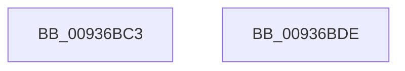

# sub_00936BC3

- RVA: `0x00936BC3`–`0x00936BDF` (길이 `28` bytes)
- VA: `0x0000000140936BC3`
- 실행 섹션: `PAGE`
- PDB 이름 있음: `아니요`; PDB Function 태그: `아니요`
- unwind 정보 RVA: `0x0008F3F0`
- 디코드: `11`개 명령, `28/28` bytes 표시
- 미해석 바이트: `0` (있으면 어셈블리에 `.byte`로 보존)

> 이 문서는 커널 이미지의 기계어와 PDB 기호를 분석해 생성했습니다. 4번과 5번은 함수 원형과 자료형을 바이너리 사용 방식에서 추정한 C 해석이며 원본 소스 복구 결과는 아닙니다.

## 1. Dependencies

- 직접 호출 지점: **1**; 고유 호출 대상: **1**
- 직접 호출자로 확인된 함수: **0**
- RIP 상대 이미지 참조: **0**

### Outgoing calls
- `0x00936BC8` → [CmCleanupThreadInfo](../../text/41/CmCleanupThreadInfo_function_0041FD50.md) (function, `0x0041FD50`)

### Direct callers
- 이 함수 시작 RVA로 연결되는 직접 call은 확인되지 않았습니다. 간접 호출은 완전히 역산할 수 없습니다.

### Static image references
- 디코드된 RIP-relative 메모리 참조가 없습니다.

## 2. Other-region calls and transfers

- 다른 실행 섹션으로 향하는 call: **1**
  - `0x00936BC8` → [CmCleanupThreadInfo](../../text/41/CmCleanupThreadInfo_function_0041FD50.md) (`PAGE` → `.text`)
- 별도 외부 분기/꼬리 이동을 확인하지 못했습니다.

## 3. Assembly (complete function range)

```asm
00936BC3  48 8D 4C 24 20                  lea rcx, [rsp + 0x20]
00936BC8  E8 83 91 AE FF                  call 0x14041fd50
00936BCD  B8 EF 00 00 C0                  mov eax, 0xc00000ef
00936BD2  48 83 C4 40                     add rsp, 0x40
00936BD6  41 5E                           pop r14
00936BD8  41 5C                           pop r12
00936BDA  5F                              pop rdi
00936BDB  5E                              pop rsi
00936BDC  5D                              pop rbp
00936BDD  C3                              ret
00936BDE  CC                              int3
```

## 4. C-style interpretation (structured pseudocode)

```c
__int64 __fastcall sub_00936BC3(void)
{
    __int64 result;
    __int64 v_rsp;
    unsigned __int64 v_stack_p20;

    result = CmCleanupThreadInfo(v_stack_p20, a2, a3, a4);
    v_rsp = (v_rsp) + (64);
    return (unsigned int)(0xC00000EFULL);
}
```

## 5. (Beta) C Style

```c
void sub_00936BC3(void)
{
    int64_t result;
    int64_t local_rsp;
    uint64_t v_stack_p20;

    result = CmCleanupThreadInfo(v_stack_p20, a2, a3, a4);
    local_rsp = (local_rsp) + (64);
    return (uint32_t)(0xC00000EFULL);
}
```

## 6. Execution-region graph

[열기: 2D/3D 그래프와 함수 탐색 컨트롤 패널](../../../control-panel.html?section=page&rva=0x00936BC3&view=graph)

- 2D 그래프는 위에서 아래로 흐르고, 3D 그래프는 빈 공간을 드래그해 회전합니다. Shift+드래그는 이동, 휠은 확대·축소, 함수 노드 선택은 대상 보고서 이동입니다.

### Static fallback


