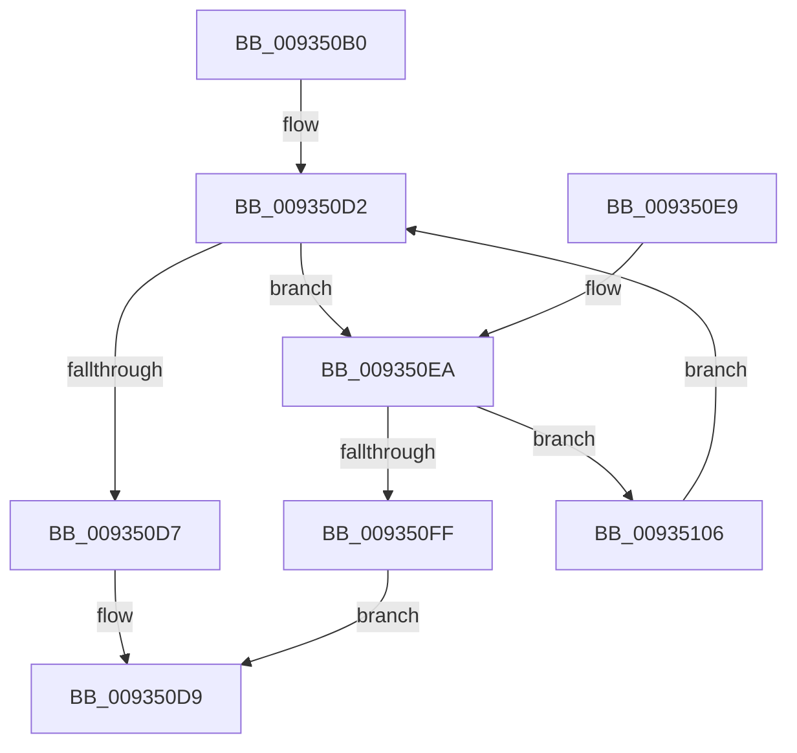

# VRegEnabledInJob

- RVA: `0x009350B0`–`0x00935113` (길이 `99` bytes)
- VA: `0x00000001409350B0`
- 실행 섹션: `PAGE`
- PDB 이름 있음: `예`; PDB Function 태그: `아니요`
- unwind 정보 RVA: `0x000704BC`
- 디코드: `30`개 명령, `99/99` bytes 표시
- 미해석 바이트: `0` (있으면 어셈블리에 `.byte`로 보존)

> 이 문서는 커널 이미지의 기계어와 PDB 기호를 분석해 생성했습니다. 4번과 5번은 함수 원형과 자료형을 바이너리 사용 방식에서 추정한 C 해석이며 원본 소스 복구 결과는 아닙니다.

## 1. Dependencies

- 직접 호출 지점: **4**; 고유 호출 대상: **4**
- 직접 호출자로 확인된 함수: **4**
- RIP 상대 이미지 참조: **1**

### Outgoing calls
- `0x009350C2` → [PsGetCurrentSilo](../../text/40/PsGetCurrentSilo_function_004094A0.md) (function, `0x004094A0`)
- `0x009350CA` → [HalAdjustResourceList](../../text/48/HalAdjustResourceList_function_0048FDC0.md) (function, `0x0048FDC0`)
- `0x009350F6` → [PsGetPermanentSiloContext](../../text/3E/PsGetPermanentSiloContext_function_003EE100.md) (function, `0x003EE100`)
- `0x00935109` → [PsGetParentSilo](../A7/PsGetParentSilo_function_00A70760.md) (function, `0x00A70760`)

### Direct callers
- [VrpHandleIoctlCreateMultipleNamespaceNodes](../83/VrpHandleIoctlCreateMultipleNamespaceNodes_function_0083B17C.md) at `0x0083B234`
- [VrpIoctlDeviceDispatch](VrpIoctlDeviceDispatch_function_00934C50.md) at `0x00934CA4`
- [VrpShouldOperateOnCall](VrpShouldOperateOnCall_function_00934E90.md) at `0x00934FD7`
- [VrpHandleIoctlCreateNamespaceNode](VrpHandleIoctlCreateNamespaceNode_function_0093511C.md) at `0x0093527E`

### Static image references
- `0x009350EA` → RVA `0x00EF02B8` (`.data`; read)

## 2. Other-region calls and transfers

- 다른 실행 섹션으로 향하는 call: **3**
  - `0x009350C2` → [PsGetCurrentSilo](../../text/40/PsGetCurrentSilo_function_004094A0.md) (`PAGE` → `.text`)
  - `0x009350CA` → [HalAdjustResourceList](../../text/48/HalAdjustResourceList_function_0048FDC0.md) (`PAGE` → `.text`)
  - `0x009350F6` → [PsGetPermanentSiloContext](../../text/3E/PsGetPermanentSiloContext_function_003EE100.md) (`PAGE` → `.text`)
- 별도 외부 분기/꼬리 이동을 확인하지 못했습니다.

## 3. Assembly (complete function range)

```asm
009350B0  48 89 5C 24 08                  mov qword ptr [rsp + 8], rbx
009350B5  48 89 74 24 10                  mov qword ptr [rsp + 0x10], rsi
009350BA  57                              push rdi
009350BB  48 83 EC 20                     sub rsp, 0x20
009350BF  48 8B F1                        mov rsi, rcx
009350C2  E8 D9 43 AD FF                  call 0x1404094a0
009350C7  48 8B D8                        mov rbx, rax
009350CA  E8 F1 AC B5 FF                  call 0x14048fdc0
009350CF  48 8B F8                        mov rdi, rax
009350D2  48 3B DF                        cmp rbx, rdi
009350D5  75 13                           jne 0x1409350ea
009350D7  33 C0                           xor eax, eax
009350D9  48 8B 5C 24 30                  mov rbx, qword ptr [rsp + 0x30]
009350DE  48 8B 74 24 38                  mov rsi, qword ptr [rsp + 0x38]
009350E3  48 83 C4 20                     add rsp, 0x20
009350E7  5F                              pop rdi
009350E8  C3                              ret
009350E9  CC                              int3
009350EA  8B 15 C8 B1 5B 00               mov edx, dword ptr [rip + 0x5bb1c8]
009350F0  4C 8B C6                        mov r8, rsi
009350F3  48 8B CB                        mov rcx, rbx
009350F6  E8 05 90 AB FF                  call 0x1403ee100
009350FB  85 C0                           test eax, eax
009350FD  78 07                           js 0x140935106
009350FF  B8 01 00 00 00                  mov eax, 1
00935104  EB D3                           jmp 0x1409350d9
00935106  48 8B CB                        mov rcx, rbx
00935109  E8 52 B6 13 00                  call 0x140a70760
0093510E  48 8B D8                        mov rbx, rax
00935111  EB BF                           jmp 0x1409350d2
```

## 4. C-style interpretation (structured pseudocode)

```c
__int64 __fastcall VRegEnabledInJob(__int64 a1)
{
    __int64 result;
    __int64 v_rsp;
    unsigned __int64 v_stack_p10;
    unsigned __int64 v_stack_p8;

    v_stack_p8 = v_rbx;
    v_stack_p10 = v_rsi;
    v_rsp = (v_rsp) - (32);
    result = PsGetCurrentSilo(a1, a2, a3, a4);
    result = HalAdjustResourceList(a1, a2, a3, a4);
loc_009350D2:
    if (result != result) goto loc_009350EA;
    result = 0;
loc_009350D9:
    v_rsp = (v_rsp) + (32);
    return result;
loc_009350EA:
    result = PsGetPermanentSiloContext(v_stack_p8, (unsigned int)(*(unsigned int *)(v_rip + 6009288)), v_stack_p10, a4);
    if (sign_flag) goto loc_00935106;
    goto loc_009350D9;
loc_00935106:
    result = PsGetParentSilo(v_stack_p8, (unsigned int)(*(unsigned int *)(v_rip + 6009288)), v_stack_p10, a4);
    goto loc_009350D2;
}
```

## 5. (Beta) C Style

```c
int64_t VRegEnabledInJob(int64_t Arg1)
{
    int64_t result;
    int64_t local_rsp;
    uint64_t v_stack_p10;
    uint64_t v_stack_p8;

    v_stack_p8 = local_rbx;
    v_stack_p10 = local_rsi;
    local_rsp = (local_rsp) - (32);
    result = PsGetCurrentSilo(Arg1, a2, a3, a4);
    result = HalAdjustResourceList(Arg1, a2, a3, a4);
loc_009350D2:
    if (result != result) goto loc_009350EA;
    result = 0;
loc_009350D9:
    local_rsp = (local_rsp) + (32);
    return result;
loc_009350EA:
    result = PsGetPermanentSiloContext(v_stack_p8, (uint32_t)(*(uint32_t *)(v_rip + 0x5BB1C8)), v_stack_p10, a4);
    if (sign_flag) goto loc_00935106;
    goto loc_009350D9;
loc_00935106:
    result = PsGetParentSilo(v_stack_p8, (uint32_t)(*(uint32_t *)(v_rip + 0x5BB1C8)), v_stack_p10, a4);
    goto loc_009350D2;
}
```

## 6. Execution-region graph

[열기: 2D/3D 그래프와 함수 탐색 컨트롤 패널](../../../control-panel.html?section=page&rva=0x009350B0&view=graph)

- 2D 그래프는 위에서 아래로 흐르고, 3D 그래프는 빈 공간을 드래그해 회전합니다. Shift+드래그는 이동, 휠은 확대·축소, 함수 노드 선택은 대상 보고서 이동입니다.

### Static fallback


