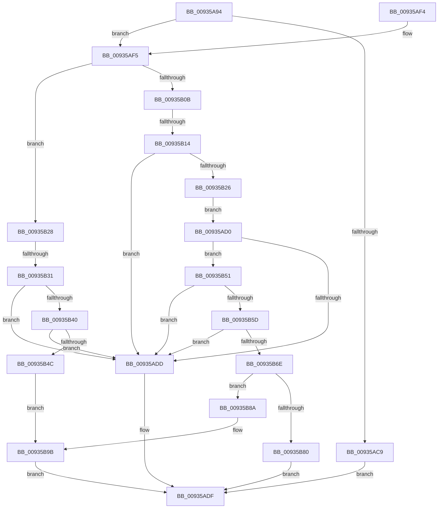

# VrpAddNamespaceNodeToList

- RVA: `0x00935A94`–`0x00935BA6` (길이 `274` bytes)
- VA: `0x0000000140935A94`
- 실행 섹션: `PAGE`
- PDB 이름 있음: `예`; PDB Function 태그: `예`
- unwind 정보 RVA: `0x0008F2D0`
- 디코드: `88`개 명령, `274/274` bytes 표시
- 미해석 바이트: `0` (있으면 어셈블리에 `.byte`로 보존)

> 이 문서는 커널 이미지의 기계어와 PDB 기호를 분석해 생성했습니다. 4번과 5번은 함수 원형과 자료형을 바이너리 사용 방식에서 추정한 C 해석이며 원본 소스 복구 결과는 아닙니다.

## 1. Dependencies

- 직접 호출 지점: **2**; 고유 호출 대상: **2**
- 직접 호출자로 확인된 함수: **3**
- RIP 상대 이미지 참조: **0**

### Outgoing calls
- `0x00935ABF` → [VrpFindExactNamespaceNode](VrpFindExactNamespaceNode_function_00934748.md) (function, `0x00934748`)
- `0x00935B93` → [memcpy](../../text/6C/memcpy_function_006C6840.md) (function, `0x006C6840`)

### Direct callers
- [VrpHandleIoctlCreateMultipleNamespaceNodes](../83/VrpHandleIoctlCreateMultipleNamespaceNodes_function_0083B17C.md) at `0x0083B3C2`
- [VrpHandleIoctlCreateNamespaceNode](VrpHandleIoctlCreateNamespaceNode_function_0093511C.md) at `0x009352E7`
- [sub_00B4588A](../B4/Unknown_function_00B4588A.md) at `0x00B45BAC`

### Static image references
- 디코드된 RIP-relative 메모리 참조가 없습니다.

## 2. Other-region calls and transfers

- 다른 실행 섹션으로 향하는 call: **1**
  - `0x00935B93` → [memcpy](../../text/6C/memcpy_function_006C6840.md) (`PAGE` → `.text`)
- call이 아닌 외부 분기/꼬리 이동: **2**
  - `0x00935B0E` → [sub_00B24B82 + 0xF9](../B2/Unknown_function_00B24B82.md) (`tail-transfer`)
  - `0x00935B2B` → [sub_00B24B82](../B2/Unknown_function_00B24B82.md) (`tail-transfer`)

## 3. Assembly (complete function range)

```asm
00935A94  48 89 5C 24 08                  mov qword ptr [rsp + 8], rbx
00935A99  48 89 54 24 10                  mov qword ptr [rsp + 0x10], rdx
00935A9E  55                              push rbp
00935A9F  56                              push rsi
00935AA0  57                              push rdi
00935AA1  41 54                           push r12
00935AA3  41 55                           push r13
00935AA5  41 56                           push r14
00935AA7  41 57                           push r15
00935AA9  48 8B EC                        mov rbp, rsp
00935AAC  48 83 EC 20                     sub rsp, 0x20
00935AB0  48 83 65 50 00                  and qword ptr [rbp + 0x50], 0
00935AB5  4C 8D 45 50                     lea r8, [rbp + 0x50]
00935AB9  4C 8B F2                        mov r14, rdx
00935ABC  48 8B D9                        mov rbx, rcx
00935ABF  E8 84 EC FF FF                  call 0x140934748
00935AC4  48 85 C0                        test rax, rax
00935AC7  74 2C                           je 0x140935af5
00935AC9  B8 35 00 00 C0                  mov eax, 0xc0000035
00935ACE  EB 0F                           jmp 0x140935adf
00935AD0  48 8B 43 48                     mov rax, qword ptr [rbx + 0x48]
00935AD4  48 8D 34 08                     lea rsi, [rax + rcx]
00935AD8  48 3B F0                        cmp rsi, rax
00935ADB  73 74                           jae 0x140935b51
00935ADD  8B C7                           mov eax, edi
00935ADF  48 8B 5C 24 60                  mov rbx, qword ptr [rsp + 0x60]
00935AE4  48 83 C4 20                     add rsp, 0x20
00935AE8  41 5F                           pop r15
00935AEA  41 5E                           pop r14
00935AEC  41 5D                           pop r13
00935AEE  41 5C                           pop r12
00935AF0  5F                              pop rdi
00935AF1  5E                              pop rsi
00935AF2  5D                              pop rbp
00935AF3  C3                              ret
00935AF4  CC                              int3
00935AF5  48 8B 73 30                     mov rsi, qword ptr [rbx + 0x30]
00935AF9  BF 95 00 00 C0                  mov edi, 0xc0000095
00935AFE  4C 8B 7D 50                     mov r15, qword ptr [rbp + 0x50]
00935B02  48 8B 4B 38                     mov rcx, qword ptr [rbx + 0x38]
00935B06  4C 3B FE                        cmp r15, rsi
00935B09  73 1D                           jae 0x140935b28
00935B0B  48 3B F1                        cmp rsi, rcx
00935B0E  0F 83 67 F1 1E 00               jae 0x140b24c7b
00935B14  4C 8B 43 28                     mov r8, qword ptr [rbx + 0x28]
00935B18  49 8B C7                        mov rax, r15
00935B1B  49 F7 E0                        mul r8
00935B1E  48 8B C8                        mov rcx, rax
00935B21  48 85 D2                        test rdx, rdx
00935B24  75 B7                           jne 0x140935add
00935B26  EB A8                           jmp 0x140935ad0
00935B28  48 3B F1                        cmp rsi, rcx
00935B2B  0F 83 51 F0 1E 00               jae 0x140b24b82
00935B31  48 8B C6                        mov rax, rsi
00935B34  48 F7 63 28                     mul qword ptr [rbx + 0x28]
00935B38  48 8B C8                        mov rcx, rax
00935B3B  48 85 D2                        test rdx, rdx
00935B3E  75 9D                           jne 0x140935add
00935B40  48 8B 43 48                     mov rax, qword ptr [rbx + 0x48]
00935B44  48 03 C8                        add rcx, rax
00935B47  48 3B C8                        cmp rcx, rax
00935B4A  72 91                           jb 0x140935add
00935B4C  4C 89 31                        mov qword ptr [rcx], r14
00935B4F  EB 4A                           jmp 0x140935b9b
00935B51  49 8D 47 01                     lea rax, [r15 + 1]
00935B55  49 F7 E0                        mul r8
00935B58  48 85 D2                        test rdx, rdx
00935B5B  75 80                           jne 0x140935add
00935B5D  48 8B 4B 48                     mov rcx, qword ptr [rbx + 0x48]
00935B61  4C 8D 0C 01                     lea r9, [rcx + rax]
00935B65  4C 3B C9                        cmp r9, rcx
00935B68  0F 82 6F FF FF FF               jb 0x140935add
00935B6E  48 8B 4B 30                     mov rcx, qword ptr [rbx + 0x30]
00935B72  49 8B C0                        mov rax, r8
00935B75  49 2B CF                        sub rcx, r15
00935B78  48 F7 E1                        mul rcx
00935B7B  48 85 D2                        test rdx, rdx
00935B7E  74 0A                           je 0x140935b8a
00935B80  B8 0B 00 00 80                  mov eax, 0x8000000b
00935B85  E9 55 FF FF FF                  jmp 0x140935adf
00935B8A  4C 8B C0                        mov r8, rax
00935B8D  48 8B D6                        mov rdx, rsi
00935B90  49 8B C9                        mov rcx, r9
00935B93  E8 A8 0C D9 FF                  call 0x1406c6840
00935B98  4C 89 36                        mov qword ptr [rsi], r14
00935B9B  48 FF 43 30                     inc qword ptr [rbx + 0x30]
00935B9F  33 C0                           xor eax, eax
00935BA1  E9 39 FF FF FF                  jmp 0x140935adf
```

## 4. C-style interpretation (structured pseudocode)

```c
__int64 __fastcall VrpAddNamespaceNodeToList(__int64 a1, __int64 a2)
{
    __int64 result;
    __int64 v_rsp;
    unsigned __int64 v_stack_p10;
    unsigned __int64 v_stack_p18;
    unsigned __int64 v_stack_p8;

    v_stack_p8 = v_rbx;
    v_stack_p10 = a2;
    v_rsp = (v_rsp) - (32);
    result = VrpFindExactNamespaceNode(a1, a2, v_stack_p18, a4);
    if (result == 0) goto loc_00935AF5;
    goto loc_00935ADF;
loc_00935AD0:
    if ((*(unsigned __int64 *)(a1 + 72) + a1 * 1) >= (*(unsigned __int64 *)(a1 + 72))) goto loc_00935B51;
loc_00935ADD:
loc_00935ADF:
    v_rsp = (v_rsp) + (32);
    return (unsigned int)((unsigned int)(v_rdi));
loc_00935AF5:
    if (v_stack_p18 >= (*(unsigned __int64 *)(v_stack_p8 + 48))) goto loc_00935B28;
    if (a2 != 0) goto loc_00935ADD;
    goto loc_00935AD0;
loc_00935B28:
    if (a2 != 0) goto loc_00935ADD;
    a1 = (*(unsigned __int64 *)(v_stack_p8 + 48)) + (*(unsigned __int64 *)(v_stack_p8 + 72));
    if (a1 < (*(unsigned __int64 *)(v_stack_p8 + 72))) goto loc_00935ADD;
    *(unsigned __int64 *)(a1) = a2;
    goto loc_00935B9B;
loc_00935B51:
    if (a2 != 0) goto loc_00935ADD;
    if ((*(unsigned __int64 *)(v_stack_p8 + 72) + v_stack_p18 + 1 * 1) < (*(unsigned __int64 *)(v_stack_p8 + 72))) goto loc_00935ADD;
    a1 = (*(unsigned __int64 *)(v_stack_p8 + 48)) - (v_stack_p18);
    if (a2 == 0) goto loc_00935B8A;
    goto loc_00935ADF;
loc_00935B8A:
    result = memcpy(*(unsigned __int64 *)(v_stack_p8 + 72) + v_stack_p18 + 1 * 1, *(unsigned __int64 *)(v_stack_p8 + 48), (unsigned int)(0x8000000BULL), *(unsigned __int64 *)(v_stack_p8 + 72) + v_stack_p18 + 1 * 1);
    *(unsigned __int64 *)(*(unsigned __int64 *)(v_stack_p8 + 48)) = a2;
loc_00935B9B:
    result = 0;
    goto loc_00935ADF;
}
```

## 5. (Beta) C Style

```c
int64_t VrpAddNamespaceNodeToList(void *Arg1, int64_t Arg2)
{
    uint8_t *arg1 = (uint8_t *)Arg1;

    int64_t result;
    int64_t local_rsp;
    uint64_t v_stack_p10;
    uint64_t v_stack_p18;
    uint64_t v_stack_p8;

    v_stack_p8 = local_rbx;
    v_stack_p10 = Arg2;
    local_rsp = (local_rsp) - (32);
    result = VrpFindExactNamespaceNode(Arg1, Arg2, v_stack_p18, a4);
    if (result == 0) goto loc_00935AF5;
    goto loc_00935ADF;
loc_00935AD0:
    if ((*(uint64_t *)(arg1 + 0x48) + Arg1 * 1) >= (*(uint64_t *)(arg1 + 0x48))) goto loc_00935B51;
loc_00935ADD:
loc_00935ADF:
    local_rsp = (local_rsp) + (32);
    return (uint32_t)((uint32_t)(local_rdi));
loc_00935AF5:
    if (v_stack_p18 >= (*(uint64_t *)(v_stack_p8 + 0x30))) goto loc_00935B28;
    if (Arg2 != 0) goto loc_00935ADD;
    goto loc_00935AD0;
loc_00935B28:
    if (Arg2 != 0) goto loc_00935ADD;
    Arg1 = (*(uint64_t *)(v_stack_p8 + 0x30)) + (*(uint64_t *)(v_stack_p8 + 0x48));
    if (Arg1 < (*(uint64_t *)(v_stack_p8 + 0x48))) goto loc_00935ADD;
    *(uint64_t *)(arg1) = Arg2;
    goto loc_00935B9B;
loc_00935B51:
    if (Arg2 != 0) goto loc_00935ADD;
    if ((*(uint64_t *)(v_stack_p8 + 0x48) + v_stack_p18 + 1 * 1) < (*(uint64_t *)(v_stack_p8 + 0x48))) goto loc_00935ADD;
    Arg1 = (*(uint64_t *)(v_stack_p8 + 0x30)) - (v_stack_p18);
    if (Arg2 == 0) goto loc_00935B8A;
    goto loc_00935ADF;
loc_00935B8A:
    result = memcpy(*(uint64_t *)(v_stack_p8 + 0x48) + v_stack_p18 + 1 * 1, *(uint64_t *)(v_stack_p8 + 0x30), (uint32_t)(0x8000000BULL), *(uint64_t *)(v_stack_p8 + 0x48) + v_stack_p18 + 1 * 1);
    *(uint64_t *)(*(uint64_t *)(v_stack_p8 + 0x30)) = Arg2;
loc_00935B9B:
    result = 0;
    goto loc_00935ADF;
}
```

### 관측된 메모리 오프셋

구조체 형식이 확인되지 않은 접근은 인자 기준의 오프셋으로만 기록했습니다.

| 기준 인자 | 오프셋 표현 | 폭 (bit) | 접근 |
|---|---:|---:|---|
| `Arg1` | `+ 0x28` | `64` | `R` |
| `Arg1` | `+ 0x30` | `64` | `R` |
| `Arg1` | `+ 0x30` | `64` | `R/W` |
| `Arg1` | `+ 0x38` | `64` | `R` |
| `Arg1` | `+ 0x48` | `64` | `R` |

## 6. Execution-region graph

[열기: 2D/3D 그래프와 함수 탐색 컨트롤 패널](../../../control-panel.html?section=page&rva=0x00935A94&view=graph)

- 2D 그래프는 위에서 아래로 흐르고, 3D 그래프는 빈 공간을 드래그해 회전합니다. Shift+드래그는 이동, 휠은 확대·축소, 함수 노드 선택은 대상 보고서 이동입니다.

### Static fallback


