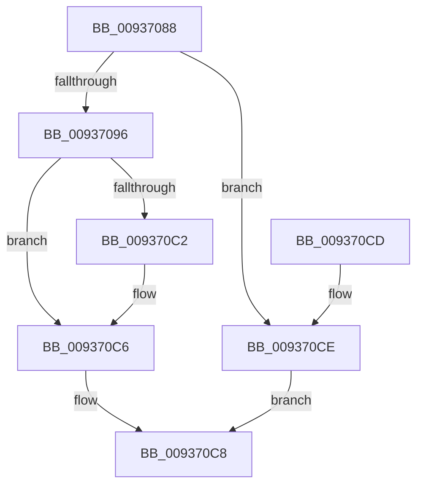

# VrpBecomeDiffHiveEntryTransitionOwner

- RVA: `0x00937088`–`0x009370D2` (길이 `74` bytes)
- VA: `0x0000000140937088`
- 실행 섹션: `PAGE`
- PDB 이름 있음: `예`; PDB Function 태그: `아니요`
- unwind 정보 RVA: `0x00069B1C`
- 디코드: `21`개 명령, `74/74` bytes 표시
- 미해석 바이트: `0` (있으면 어셈블리에 `.byte`로 보존)

> 이 문서는 커널 이미지의 기계어와 PDB 기호를 분석해 생성했습니다. 4번과 5번은 함수 원형과 자료형을 바이너리 사용 방식에서 추정한 C 해석이며 원본 소스 복구 결과는 아닙니다.

## 1. Dependencies

- 직접 호출 지점: **1**; 고유 호출 대상: **1**
- 직접 호출자로 확인된 함수: **2**
- RIP 상대 이미지 참조: **0**

### Outgoing calls
- `0x009370B8` → [KeAbPreAcquire](../../text/21/KeAbPreAcquire_function_00210230.md) (function, `0x00210230`)

### Direct callers
- [VrpLoadDifferencingHive](VrpLoadDifferencingHive_function_00935F40.md) at `0x00936057`
- [VrpUnloadDifferencingHive](VrpUnloadDifferencingHive_function_00936CE0.md) at `0x00936D3A`

### Static image references
- 디코드된 RIP-relative 메모리 참조가 없습니다.

## 2. Other-region calls and transfers

- 다른 실행 섹션으로 향하는 call: **1**
  - `0x009370B8` → [KeAbPreAcquire](../../text/21/KeAbPreAcquire_function_00210230.md) (`PAGE` → `.text`)
- 별도 외부 분기/꼬리 이동을 확인하지 못했습니다.

## 3. Assembly (complete function range)

```asm
00937088  48 83 EC 28                     sub rsp, 0x28
0093708C  48 83 C1 28                     add rcx, 0x28
00937090  48 83 39 00                     cmp qword ptr [rcx], 0
00937094  75 38                           jne 0x1409370ce
00937096  65 48 8B 04 25 88 01 00 00      mov rax, qword ptr gs:[0x188]
0093709F  45 33 C0                        xor r8d, r8d
009370A2  33 D2                           xor edx, edx
009370A4  66 FF 88 E4 01 00 00            dec word ptr [rax + 0x1e4]
009370AB  90                              nop
009370AC  65 48 8B 04 25 88 01 00 00      mov rax, qword ptr gs:[0x188]
009370B5  48 89 01                        mov qword ptr [rcx], rax
009370B8  E8 73 91 8D FF                  call 0x140210230
009370BD  48 85 C0                        test rax, rax
009370C0  74 04                           je 0x1409370c6
009370C2  C6 40 0A 01                     mov byte ptr [rax + 0xa], 1
009370C6  B0 01                           mov al, 1
009370C8  48 83 C4 28                     add rsp, 0x28
009370CC  C3                              ret
009370CD  CC                              int3
009370CE  32 C0                           xor al, al
009370D0  EB F6                           jmp 0x1409370c8
```

## 4. C-style interpretation (structured pseudocode)

```c
__int64 __fastcall VrpBecomeDiffHiveEntryTransitionOwner(__int64 a1, int a2, int a3)
{
    __int64 result;
    __int64 v_rsp;

    v_rsp = (v_rsp) - (40);
    a1 = (a1) + (40);
    if ((*(unsigned __int64 *)(a1)) != 0) goto loc_009370CE;
    a3 = 0;
    a2 = 0;
    *(unsigned __int64 *)(a1) = *(unsigned __int64 *)(gs_base + (0 + 392));
    result = KeAbPreAcquire(a1, a2, a3, a4);
    if (result != 0) {
        *(unsigned __int8 *)(result + 10) = 1;
    }
loc_009370C8:
    v_rsp = (v_rsp) + (40);
    return 1;
loc_009370CE:
    result = 0;
    goto loc_009370C8;
}
```

## 5. (Beta) C Style

```c
int64_t VrpBecomeDiffHiveEntryTransitionOwner(void *Arg1, int32_t Arg2, int32_t Arg3)
{
    uint8_t *arg1 = (uint8_t *)Arg1;

    int64_t result;
    int64_t local_rsp;

    local_rsp = (local_rsp) - (40);
    Arg1 = (Arg1) + (40);
    if ((*(uint64_t *)(arg1)) != 0) goto loc_009370CE;
    Arg3 = 0;
    Arg2 = 0;
    *(uint64_t *)(arg1) = *(uint64_t *)(gs_base + (0 + 0x188));
    result = KeAbPreAcquire(Arg1, Arg2, Arg3, a4);
    if (result != 0) {
        *(uint8_t *)(result + 0xA) = 1;
    }
loc_009370C8:
    local_rsp = (local_rsp) + (40);
    return 1;
loc_009370CE:
    result = 0;
    goto loc_009370C8;
}
```

### 관측된 메모리 오프셋

구조체 형식이 확인되지 않은 접근은 인자 기준의 오프셋으로만 기록했습니다.

| 기준 인자 | 오프셋 표현 | 폭 (bit) | 접근 |
|---|---:|---:|---|
| `Arg1` | `+ 0x0` | `64` | `R` |
| `Arg1` | `+ 0x0` | `64` | `W` |

## 6. Execution-region graph

[열기: 2D/3D 그래프와 함수 탐색 컨트롤 패널](../../../control-panel.html?section=page&rva=0x00937088&view=graph)

- 2D 그래프는 위에서 아래로 흐르고, 3D 그래프는 빈 공간을 드래그해 회전합니다. Shift+드래그는 이동, 휠은 확대·축소, 함수 노드 선택은 대상 보고서 이동입니다.

### Static fallback


