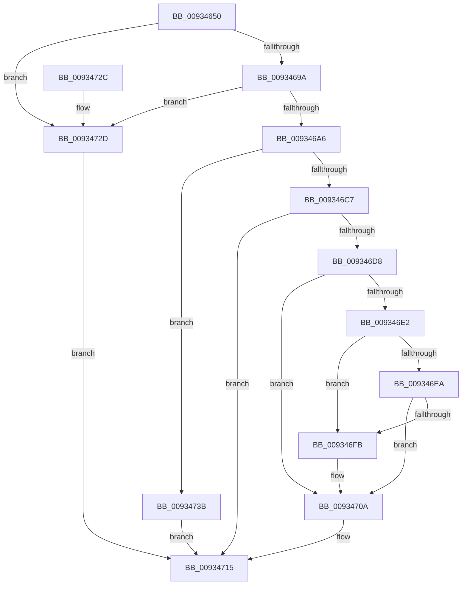

# VrpBuildKeyPath

- RVA: `0x00934650`–`0x00934742` (길이 `242` bytes)
- VA: `0x0000000140934650`
- 실행 섹션: `PAGE`
- PDB 이름 있음: `예`; PDB Function 태그: `아니요`
- unwind 정보 RVA: `0x0008F124`
- 디코드: `67`개 명령, `242/242` bytes 표시
- 미해석 바이트: `0` (있으면 어셈블리에 `.byte`로 보존)

> 이 문서는 커널 이미지의 기계어와 PDB 기호를 분석해 생성했습니다. 4번과 5번은 함수 원형과 자료형을 바이너리 사용 방식에서 추정한 C 해석이며 원본 소스 복구 결과는 아닙니다.

## 1. Dependencies

- 직접 호출 지점: **4**; 고유 호출 대상: **4**
- 직접 호출자로 확인된 함수: **6**
- RIP 상대 이미지 참조: **1**

### Outgoing calls
- `0x009346B9` → [ExAllocatePool2](../../poolcode/B8/ExAllocatePool2_function_00B820F0.md) (function, `0x00B820F0`)
- `0x009346CD` → [RtlCopyUnicodeString](../../text/3F/RtlCopyUnicodeString_function_003FEF30.md) (function, `0x003FEF30`)
- `0x00934705` → [RtlAppendUnicodeToString](../../text/40/RtlAppendUnicodeToString_function_0040F990.md) (function, `0x0040F990`)
- `0x00934710` → [RtlAppendUnicodeStringToString](../../text/40/RtlAppendUnicodeStringToString_function_0040FA50.md) (function, `0x0040FA50`)

### Direct callers
- [VrpPreOpenOrCreate](VrpPreOpenOrCreate_function_00932B84.md) at `0x00932C29`
- [VrpPostEnumerateKey](VrpPostEnumerateKey_function_00933EA8.md) at `0x00934119`
- [VrpCreateNamespaceNode](VrpCreateNamespaceNode_function_00935538.md) at `0x00935747`
- [VrpPostOpenOrCreate](VrpPostOpenOrCreate_function_00936510.md) at `0x009365E0`
- [VrpPostOpenOrCreate](VrpPostOpenOrCreate_function_00936510.md) at `0x00936664`
- [VrpPostOpenOrCreate](VrpPostOpenOrCreate_function_00936510.md) at `0x009366E3`
- [VrpPreLoadKey](../A8/VrpPreLoadKey_function_00A8A43C.md) at `0x00A8A67D`
- [sub_00B4588A](../B4/Unknown_function_00B4588A.md) at `0x00B45E5E`

### Static image references
- `0x009346FB` → RVA `0x00AFC990` (` ?? ::NNGAKEGL::`string'`; read)

## 2. Other-region calls and transfers

- 다른 실행 섹션으로 향하는 call: **4**
  - `0x009346B9` → [ExAllocatePool2](../../poolcode/B8/ExAllocatePool2_function_00B820F0.md) (`PAGE` → `POOLCODE`)
  - `0x009346CD` → [RtlCopyUnicodeString](../../text/3F/RtlCopyUnicodeString_function_003FEF30.md) (`PAGE` → `.text`)
  - `0x00934705` → [RtlAppendUnicodeToString](../../text/40/RtlAppendUnicodeToString_function_0040F990.md) (`PAGE` → `.text`)
  - `0x00934710` → [RtlAppendUnicodeStringToString](../../text/40/RtlAppendUnicodeStringToString_function_0040FA50.md) (`PAGE` → `.text`)
- 별도 외부 분기/꼬리 이동을 확인하지 못했습니다.

## 3. Assembly (complete function range)

```asm
00934650  48 8B C4                        mov rax, rsp
00934653  48 89 58 08                     mov qword ptr [rax + 8], rbx
00934657  48 89 68 10                     mov qword ptr [rax + 0x10], rbp
0093465B  48 89 70 18                     mov qword ptr [rax + 0x18], rsi
0093465F  57                              push rdi
00934660  48 83 EC 30                     sub rsp, 0x30
00934664  33 DB                           xor ebx, ebx
00934666  48 8D 70 E8                     lea rsi, [rax - 0x18]
0093466A  48 85 C9                        test rcx, rcx
0093466D  66 41 89 18                     mov word ptr [r8], bx
00934671  48 89 58 E8                     mov qword ptr [rax - 0x18], rbx
00934675  49 8B F8                        mov rdi, r8
00934678  48 0F 45 F1                     cmovne rsi, rcx
0093467C  48 89 58 F0                     mov qword ptr [rax - 0x10], rbx
00934680  48 8B EA                        mov rbp, rdx
00934683  0F B7 06                        movzx eax, word ptr [rsi]
00934686  0F B7 C8                        movzx ecx, ax
00934689  66 41 89 40 02                  mov word ptr [r8 + 2], ax
0093468E  66 03 0A                        add cx, word ptr [rdx]
00934691  66 3B C8                        cmp cx, ax
00934694  0F 82 93 00 00 00               jb 0x14093472d
0093469A  8D 41 02                        lea eax, [rcx + 2]
0093469D  66 3B C1                        cmp ax, cx
009346A0  0F 82 87 00 00 00               jb 0x14093472d
009346A6  0F B7 D0                        movzx edx, ax
009346A9  B9 00 01 00 00                  mov ecx, 0x100
009346AE  66 41 89 50 02                  mov word ptr [r8 + 2], dx
009346B3  41 B8 56 52 65 67               mov r8d, 0x67655256
009346B9  E8 32 DA 24 00                  call 0x140b820f0
009346BE  48 89 47 08                     mov qword ptr [rdi + 8], rax
009346C2  48 85 C0                        test rax, rax
009346C5  74 74                           je 0x14093473b
009346C7  48 8B D6                        mov rdx, rsi
009346CA  48 8B CF                        mov rcx, rdi
009346CD  E8 5E A8 AC FF                  call 0x1403fef30
009346D2  66 39 5D 00                     cmp word ptr [rbp], bx
009346D6  74 3D                           je 0x140934715
009346D8  48 8B 45 08                     mov rax, qword ptr [rbp + 8]
009346DC  66 83 38 5C                     cmp word ptr [rax], 0x5c
009346E0  74 28                           je 0x14093470a
009346E2  0F B7 06                        movzx eax, word ptr [rsi]
009346E5  66 85 C0                        test ax, ax
009346E8  74 11                           je 0x1409346fb
009346EA  8B C8                           mov ecx, eax
009346EC  48 8B 46 08                     mov rax, qword ptr [rsi + 8]
009346F0  48 D1 E9                        shr rcx, 1
009346F3  66 83 7C 48 FE 5C               cmp word ptr [rax + rcx*2 - 2], 0x5c
009346F9  74 0F                           je 0x14093470a
009346FB  48 8D 15 8E 82 1C 00            lea rdx, [rip + 0x1c828e]
00934702  48 8B CF                        mov rcx, rdi
00934705  E8 86 B2 AD FF                  call 0x14040f990
0093470A  48 8B D5                        mov rdx, rbp
0093470D  48 8B CF                        mov rcx, rdi
00934710  E8 3B B3 AD FF                  call 0x14040fa50
00934715  48 8B 6C 24 48                  mov rbp, qword ptr [rsp + 0x48]
0093471A  8B C3                           mov eax, ebx
0093471C  48 8B 5C 24 40                  mov rbx, qword ptr [rsp + 0x40]
00934721  48 8B 74 24 50                  mov rsi, qword ptr [rsp + 0x50]
00934726  48 83 C4 30                     add rsp, 0x30
0093472A  5F                              pop rdi
0093472B  C3                              ret
0093472C  CC                              int3
0093472D  66 41 81 48 02 FF FF            or word ptr [r8 + 2], 0xffff
00934734  BB 0D 00 00 C0                  mov ebx, 0xc000000d
00934739  EB DA                           jmp 0x140934715
0093473B  BB 9A 00 00 C0                  mov ebx, 0xc000009a
00934740  EB D3                           jmp 0x140934715
```

## 4. C-style interpretation (structured pseudocode)

```c
__int64 __fastcall VrpBuildKeyPath(__int64 a1, __int64 a2, __int64 a3)
{
    __int64 result;
    __int64 v_rbx;
    __int64 v_rsi;
    __int64 v_rsp;
    unsigned __int64 v_stack_p10;
    unsigned __int64 v_stack_p18;
    unsigned __int64 v_stack_p8;

    *(unsigned __int64 *)(v_rsp + 8) = v_rbx;
    *(unsigned __int64 *)(v_rsp + 16) = v_rbp;
    *(unsigned __int64 *)(v_rsp + 24) = v_rsi;
    v_rsp = (v_rsp) - (48);
    v_rbx = 0;
    *(unsigned __int16 *)(a3) = 0;
    *(unsigned __int64 *)(v_rsp - 24) = 0;
    v_rsi = v_rsp - 24;
    if (a1 != 0) { v_rsi = a1; }
    *(unsigned __int64 *)(v_rsp - 16) = 0;
    *(unsigned __int16 *)(a3 + 2) = (unsigned __int16)(*(unsigned __int16 *)(v_rsi));
    a1 = (unsigned __int16)(((unsigned __int16)(*(unsigned __int16 *)(v_rsi))) + (*(unsigned __int16 *)(a2)));
    if (((unsigned __int16)(a1)) < ((unsigned __int16)(*(unsigned __int16 *)(v_rsi)))) goto loc_0093472D;
    if (((unsigned __int16)(a1 + 2)) < ((unsigned __int16)(a1))) goto loc_0093472D;
    *(unsigned __int16 *)(a3 + 2) = (unsigned __int16)((unsigned __int16)(a1 + 2));
    result = ExAllocatePool2(256, (unsigned __int16)(a1 + 2), (unsigned int)(0x67655256ULL), a4);
    *(unsigned __int64 *)(a3 + 8) = result;
    if (result == 0) goto loc_0093473B;
    result = RtlCopyUnicodeString(a3, v_rsi, (unsigned int)(0x67655256ULL), a4);
    if ((*(unsigned __int16 *)(a2)) == 0) goto loc_00934715;
    if ((*(unsigned __int16 *)(*(unsigned __int64 *)(a2 + 8))) == 92) goto loc_0093470A;
    if ((unsigned __int16)(*(unsigned __int16 *)(v_rsi)) == 0) goto loc_009346FB;
    a1 = ((unsigned int)((unsigned int)(*(unsigned __int16 *)(v_rsi)))) >> (1);
    result = *(unsigned __int64 *)(v_rsi + 8);
    if ((*(unsigned __int16 *)(*(unsigned __int64 *)(v_rsi + 8) + a1 * 2 - 2)) != 92) {
        a2 = v_rip + 1868430;
        a1 = a3;
        result = RtlAppendUnicodeToString(a1, a2, (unsigned int)(0x67655256ULL), a4);
    }
    result = RtlAppendUnicodeStringToString(a3, a2, (unsigned int)(0x67655256ULL), a4);
loc_00934715:
    v_rsp = (v_rsp) + (48);
    return 0;
loc_0093472D:
    goto loc_00934715;
loc_0093473B:
    goto loc_00934715;
}
```

## 5. (Beta) C Style

```c
int64_t VrpBuildKeyPath(int64_t Arg1, void *Arg2, void *Arg3)
{
    uint8_t *arg2 = (uint8_t *)Arg2;
    uint8_t *arg3 = (uint8_t *)Arg3;

    int64_t result;
    int64_t local_rbx;
    int64_t local_rsi;
    int64_t local_rsp;
    uint64_t v_stack_p10;
    uint64_t v_stack_p18;
    uint64_t v_stack_p8;

    *(uint64_t *)(local_rsp + 0x8) = local_rbx;
    *(uint64_t *)(local_rsp + 0x10) = local_rbp;
    *(uint64_t *)(local_rsp + 0x18) = local_rsi;
    local_rsp = (local_rsp) - (48);
    local_rbx = 0;
    *(uint16_t *)(arg3) = 0;
    *(uint64_t *)(local_rsp - 0x18) = 0;
    local_rsi = local_rsp - 24;
    if (Arg1 != 0) { local_rsi = Arg1; }
    *(uint64_t *)(local_rsp - 0x10) = 0;
    *(uint16_t *)(arg3 + 0x2) = (uint16_t)(*(uint16_t *)(local_rsi));
    Arg1 = (uint16_t)(((uint16_t)(*(uint16_t *)(local_rsi))) + (*(uint16_t *)(arg2)));
    if (((uint16_t)(Arg1)) < ((uint16_t)(*(uint16_t *)(local_rsi)))) goto loc_0093472D;
    if (((uint16_t)(Arg1 + 2)) < ((uint16_t)(Arg1))) goto loc_0093472D;
    *(uint16_t *)(arg3 + 0x2) = (uint16_t)((uint16_t)(Arg1 + 2));
    result = ExAllocatePool2(256, (uint16_t)(Arg1 + 2), (uint32_t)(0x67655256ULL), a4);
    *(uint64_t *)(arg3 + 0x8) = result;
    if (result == 0) goto loc_0093473B;
    result = RtlCopyUnicodeString(Arg3, local_rsi, (uint32_t)(0x67655256ULL), a4);
    if ((*(uint16_t *)(arg2)) == 0) goto loc_00934715;
    if ((*(uint16_t *)(*(uint64_t *)(arg2 + 0x8))) == 92) goto loc_0093470A;
    if ((uint16_t)(*(uint16_t *)(local_rsi)) == 0) goto loc_009346FB;
    Arg1 = ((uint32_t)((uint32_t)(*(uint16_t *)(local_rsi)))) >> (1);
    result = *(uint64_t *)(local_rsi + 0x8);
    if ((*(uint16_t *)(*(uint64_t *)(local_rsi + 0x8) + Arg1 * 2 - 0x2)) != 92) {
        Arg2 = v_rip + 1868430;
        Arg1 = Arg3;
        result = RtlAppendUnicodeToString(Arg1, Arg2, (uint32_t)(0x67655256ULL), a4);
    }
    result = RtlAppendUnicodeStringToString(Arg3, Arg2, (uint32_t)(0x67655256ULL), a4);
loc_00934715:
    local_rsp = (local_rsp) + (48);
    return 0;
loc_0093472D:
    goto loc_00934715;
loc_0093473B:
    goto loc_00934715;
}
```

### 관측된 메모리 오프셋

구조체 형식이 확인되지 않은 접근은 인자 기준의 오프셋으로만 기록했습니다.

| 기준 인자 | 오프셋 표현 | 폭 (bit) | 접근 |
|---|---:|---:|---|
| `Arg2` | `+ 0x0` | `16` | `R` |
| `Arg2` | `+ 0x8` | `64` | `R` |
| `Arg3` | `+ 0x0` | `16` | `W` |
| `Arg3` | `+ 0x2` | `16` | `R/W` |
| `Arg3` | `+ 0x2` | `16` | `W` |
| `Arg3` | `+ 0x8` | `64` | `W` |

## 6. Execution-region graph

[열기: 2D/3D 그래프와 함수 탐색 컨트롤 패널](../../../control-panel.html?section=page&rva=0x00934650&view=graph)

- 2D 그래프는 위에서 아래로 흐르고, 3D 그래프는 빈 공간을 드래그해 회전합니다. Shift+드래그는 이동, 휠은 확대·축소, 함수 노드 선택은 대상 보고서 이동입니다.

### Static fallback


