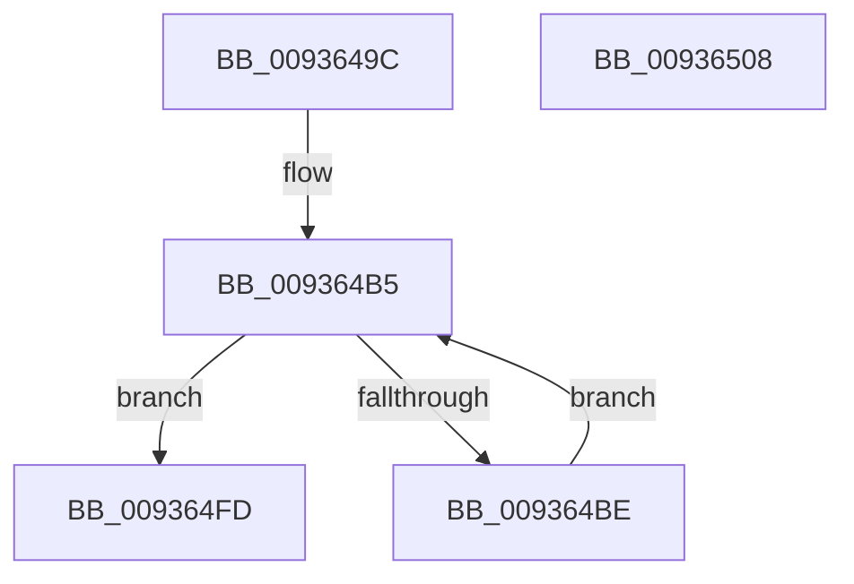

# VrpCleanupNamespace

- RVA: `0x0093649C`–`0x00936509` (길이 `109` bytes)
- VA: `0x000000014093649C`
- 실행 섹션: `PAGE`
- PDB 이름 있음: `예`; PDB Function 태그: `아니요`
- unwind 정보 RVA: `0x0006E5F8`
- 디코드: `29`개 명령, `109/109` bytes 표시
- 미해석 바이트: `0` (있으면 어셈블리에 `.byte`로 보존)

> 이 문서는 커널 이미지의 기계어와 PDB 기호를 분석해 생성했습니다. 4번과 5번은 함수 원형과 자료형을 바이너리 사용 방식에서 추정한 C 해석이며 원본 소스 복구 결과는 아닙니다.

## 1. Dependencies

- 직접 호출 지점: **3**; 고유 호출 대상: **3**
- 직접 호출자로 확인된 함수: **2**
- RIP 상대 이미지 참조: **0**

### Outgoing calls
- `0x009364B0` → [VrpDestroyNamespaceNodeList](VrpDestroyNamespaceNodeList_function_00934BB0.md) (function, `0x00934BB0`)
- `0x009364E9` → [VrpUnloadDifferencingHive](VrpUnloadDifferencingHive_function_00936CE0.md) (function, `0x00936CE0`)
- `0x009364F6` → [ExFreePoolWithTag](../../poolcode/B8/ExFreePoolWithTag_function_00B82870.md) (function, `0x00B82870`)

### Direct callers
- [VrpHandleIoctlUnloadDynamicallyLoadedHives](VrpHandleIoctlUnloadDynamicallyLoadedHives_function_0093778C.md) at `0x009378C9`
- [VrpJobContextDelete](../AB/VrpJobContextDelete_function_00AB7330.md) at `0x00AB734C`

### Static image references
- 디코드된 RIP-relative 메모리 참조가 없습니다.

## 2. Other-region calls and transfers

- 다른 실행 섹션으로 향하는 call: **1**
  - `0x009364F6` → [ExFreePoolWithTag](../../poolcode/B8/ExFreePoolWithTag_function_00B82870.md) (`PAGE` → `POOLCODE`)
- 별도 외부 분기/꼬리 이동을 확인하지 못했습니다.

## 3. Assembly (complete function range)

```asm
0093649C  48 89 5C 24 08                  mov qword ptr [rsp + 8], rbx
009364A1  57                              push rdi
009364A2  48 83 EC 30                     sub rsp, 0x30
009364A6  48 8B F9                        mov rdi, rcx
009364A9  C7 41 54 01 00 00 00            mov dword ptr [rcx + 0x54], 1
009364B0  E8 FB E6 FF FF                  call 0x140934bb0
009364B5  48 8B 5F 18                     mov rbx, qword ptr [rdi + 0x18]
009364B9  48 85 DB                        test rbx, rbx
009364BC  74 3F                           je 0x1409364fd
009364BE  48 8B 03                        mov rax, qword ptr [rbx]
009364C1  48 8D 4C 24 20                  lea rcx, [rsp + 0x20]
009364C6  48 89 47 18                     mov qword ptr [rdi + 0x18], rax
009364CA  0F 57 C0                        xorps xmm0, xmm0
009364CD  0F 11 44 24 20                  movups xmmword ptr [rsp + 0x20], xmm0
009364D2  48 8D 43 0A                     lea rax, [rbx + 0xa]
009364D6  48 89 44 24 28                  mov qword ptr [rsp + 0x28], rax
009364DB  0F B7 43 08                     movzx eax, word ptr [rbx + 8]
009364DF  66 89 44 24 22                  mov word ptr [rsp + 0x22], ax
009364E4  66 89 44 24 20                  mov word ptr [rsp + 0x20], ax
009364E9  E8 F2 07 00 00                  call 0x140936ce0
009364EE  BA 56 52 65 67                  mov edx, 0x67655256
009364F3  48 8B CB                        mov rcx, rbx
009364F6  E8 75 C3 24 00                  call 0x140b82870
009364FB  EB B8                           jmp 0x1409364b5
009364FD  48 8B 5C 24 40                  mov rbx, qword ptr [rsp + 0x40]
00936502  48 83 C4 30                     add rsp, 0x30
00936506  5F                              pop rdi
00936507  C3                              ret
00936508  CC                              int3
```

## 4. C-style interpretation (structured pseudocode)

```c
__int64 __fastcall VrpCleanupNamespace(__int64 a1)
{
    __int64 result;
    __int64 v_rsp;
    unsigned __int64 v_stack_m10;
    unsigned __int16 v_stack_m16;
    unsigned __int64 v_stack_m18;
    unsigned __int64 v_stack_p8;

    v_stack_p8 = v_rbx;
    v_rsp = (v_rsp) - (48);
    *(unsigned int *)(a1 + 84) = 1;
    result = VrpDestroyNamespaceNodeList(a1, a2, a3, a4);
loc_009364B5:
    if (*(unsigned __int64 *)(a1 + 24) == 0) goto loc_009364FD;
    *(unsigned __int64 *)(a1 + 24) = *(unsigned __int64 *)(*(unsigned __int64 *)(a1 + 24));
    v_stack_m18 = v_xmm0;
    v_stack_m10 = *(unsigned __int64 *)(a1 + 24) + 10;
    v_stack_m16 = (unsigned __int16)(*(unsigned __int16 *)(*(unsigned __int64 *)(a1 + 24) + 8));
    v_stack_m18 = (unsigned __int16)(*(unsigned __int16 *)(*(unsigned __int64 *)(a1 + 24) + 8));
    result = VrpUnloadDifferencingHive(v_stack_m18, a2, a3, a4);
    result = ExFreePoolWithTag(*(unsigned __int64 *)(a1 + 24), (unsigned int)(0x67655256ULL), a3, a4);
    goto loc_009364B5;
loc_009364FD:
    v_rsp = (v_rsp) + (48);
    return result;
}
```

## 5. (Beta) C Style

```c
int64_t VrpCleanupNamespace(void *Arg1)
{
    uint8_t *arg1 = (uint8_t *)Arg1;

    int64_t result;
    int64_t local_rsp;
    uint64_t v_stack_m10;
    uint16_t v_stack_m16;
    uint64_t v_stack_m18;
    uint64_t v_stack_p8;

    v_stack_p8 = local_rbx;
    local_rsp = (local_rsp) - (48);
    *(uint32_t *)(arg1 + 0x54) = 1;
    result = VrpDestroyNamespaceNodeList(Arg1, a2, a3, a4);
loc_009364B5:
    if (*(uint64_t *)(arg1 + 0x18) == 0) goto loc_009364FD;
    *(uint64_t *)(arg1 + 0x18) = *(uint64_t *)(*(uint64_t *)(arg1 + 0x18));
    v_stack_m18 = v_xmm0;
    v_stack_m10 = *(uint64_t *)(arg1 + 0x18) + 10;
    v_stack_m16 = (uint16_t)(*(uint16_t *)(*(uint64_t *)(arg1 + 0x18) + 0x8));
    v_stack_m18 = (uint16_t)(*(uint16_t *)(*(uint64_t *)(arg1 + 0x18) + 0x8));
    result = VrpUnloadDifferencingHive(v_stack_m18, a2, a3, a4);
    result = ExFreePoolWithTag(*(uint64_t *)(arg1 + 0x18), (uint32_t)(0x67655256ULL), a3, a4);
    goto loc_009364B5;
loc_009364FD:
    local_rsp = (local_rsp) + (48);
    return result;
}
```

### 관측된 메모리 오프셋

구조체 형식이 확인되지 않은 접근은 인자 기준의 오프셋으로만 기록했습니다.

| 기준 인자 | 오프셋 표현 | 폭 (bit) | 접근 |
|---|---:|---:|---|
| `Arg1` | `+ 0x18` | `64` | `R` |
| `Arg1` | `+ 0x18` | `64` | `W` |
| `Arg1` | `+ 0x54` | `32` | `W` |

## 6. Execution-region graph

[열기: 2D/3D 그래프와 함수 탐색 컨트롤 패널](../../../control-panel.html?section=page&rva=0x0093649C&view=graph)

- 2D 그래프는 위에서 아래로 흐르고, 3D 그래프는 빈 공간을 드래그해 회전합니다. Shift+드래그는 이동, 휠은 확대·축소, 함수 노드 선택은 대상 보고서 이동입니다.

### Static fallback


