# VrpCountPathComponents

- RVA: `0x009358F0`–`0x00935A2D` (길이 `317` bytes)
- VA: `0x00000001409358F0`
- 실행 섹션: `PAGE`
- PDB 이름 있음: `예`; PDB Function 태그: `아니요`
- unwind 정보 RVA: `0x0008F2BC`
- 디코드: `93`개 명령, `317/317` bytes 표시
- 미해석 바이트: `0` (있으면 어셈블리에 `.byte`로 보존)

> 이 문서는 커널 이미지의 기계어와 PDB 기호를 분석해 생성했습니다. 4번과 5번은 함수 원형과 자료형을 바이너리 사용 방식에서 추정한 C 해석이며 원본 소스 복구 결과는 아닙니다.

## 1. Dependencies

- 직접 호출 지점: **1**; 고유 호출 대상: **1**
- 직접 호출자로 확인된 함수: **2**
- RIP 상대 이미지 참조: **0**

### Outgoing calls
- `0x00935916` → [RtlInitUnicodeString](../../text/42/RtlInitUnicodeString_function_0042A780.md) (function, `0x0042A780`)

### Direct callers
- [VrpCreateNamespaceNode](VrpCreateNamespaceNode_function_00935538.md) at `0x00935694`
- [VrpCreateNamespaceNode](VrpCreateNamespaceNode_function_00935538.md) at `0x009356A1`
- [VrpPostOpenOrCreate](VrpPostOpenOrCreate_function_00936510.md) at `0x009365FD`

### Static image references
- 디코드된 RIP-relative 메모리 참조가 없습니다.

## 2. Other-region calls and transfers

- 다른 실행 섹션으로 향하는 call: **1**
  - `0x00935916` → [RtlInitUnicodeString](../../text/42/RtlInitUnicodeString_function_0042A780.md) (`PAGE` → `.text`)
- 별도 외부 분기/꼬리 이동을 확인하지 못했습니다.

## 3. Assembly (complete function range)

```asm
009358F0  48 89 5C 24 08                  mov qword ptr [rsp + 8], rbx
009358F5  48 89 74 24 10                  mov qword ptr [rsp + 0x10], rsi
009358FA  57                              push rdi
009358FB  48 83 EC 30                     sub rsp, 0x30
009358FF  48 8B D9                        mov rbx, rcx
00935902  0F 57 C0                        xorps xmm0, xmm0
00935905  33 F6                           xor esi, esi
00935907  48 8D 4C 24 20                  lea rcx, [rsp + 0x20]
0093590C  33 D2                           xor edx, edx
0093590E  0F B7 FE                        movzx edi, si
00935911  0F 11 44 24 20                  movups xmmword ptr [rsp + 0x20], xmm0
00935916  E8 65 4E AF FF                  call 0x14042a780
0093591B  44 0F B7 03                     movzx r8d, word ptr [rbx]
0093591F  44 0F B7 CE                     movzx r9d, si
00935923  8B D6                           mov edx, esi
00935925  4D 85 C0                        test r8, r8
00935928  74 11                           je 0x14093593b
0093592A  48 8B 4B 08                     mov rcx, qword ptr [rbx + 8]
0093592E  8B C6                           mov eax, esi
00935930  66 83 3C 08 5C                  cmp word ptr [rax + rcx], 0x5c
00935935  0F 84 DD 00 00 00               je 0x140935a18
0093593B  48 8D 04 12                     lea rax, [rdx + rdx]
0093593F  49 3B C0                        cmp rax, r8
00935942  73 1C                           jae 0x140935960
00935944  48 8B 4B 08                     mov rcx, qword ptr [rbx + 8]
00935948  66 83 3C 08 5C                  cmp word ptr [rax + rcx], 0x5c
0093594D  74 11                           je 0x140935960
0093594F  48 FF C2                        inc rdx
00935952  66 41 83 C1 02                  add r9w, 2
00935957  48 8D 04 12                     lea rax, [rdx + rdx]
0093595B  49 3B C0                        cmp rax, r8
0093595E  72 E8                           jb 0x140935948
00935960  48 8D 04 12                     lea rax, [rdx + rdx]
00935964  49 3B C0                        cmp rax, r8
00935967  73 17                           jae 0x140935980
00935969  48 8B 4B 08                     mov rcx, qword ptr [rbx + 8]
0093596D  66 83 3C 08 5C                  cmp word ptr [rax + rcx], 0x5c
00935972  75 0C                           jne 0x140935980
00935974  48 FF C2                        inc rdx
00935977  48 8D 04 12                     lea rax, [rdx + rdx]
0093597B  49 3B C0                        cmp rax, r8
0093597E  72 ED                           jb 0x14093596d
00935980  66 45 85 C9                     test r9w, r9w
00935984  74 70                           je 0x1409359f6
00935986  66 66 0F 1F 84 00 00 00 00 00   nop word ptr [rax + rax]
00935990  66 FF C7                        inc di
00935993  48 8D 04 12                     lea rax, [rdx + rdx]
00935997  0F B7 CE                        movzx ecx, si
0093599A  49 3B C0                        cmp rax, r8
0093599D  73 0C                           jae 0x1409359ab
0093599F  4C 8B 4B 08                     mov r9, qword ptr [rbx + 8]
009359A3  66 41 83 3C 01 5C               cmp word ptr [r9 + rax], 0x5c
009359A9  74 5F                           je 0x140935a0a
009359AB  48 8D 04 12                     lea rax, [rdx + rdx]
009359AF  49 3B C0                        cmp rax, r8
009359B2  73 1C                           jae 0x1409359d0
009359B4  4C 8B 4B 08                     mov r9, qword ptr [rbx + 8]
009359B8  66 41 83 3C 01 5C               cmp word ptr [r9 + rax], 0x5c
009359BE  74 10                           je 0x1409359d0
009359C0  48 FF C2                        inc rdx
009359C3  66 83 C1 02                     add cx, 2
009359C7  48 8D 04 12                     lea rax, [rdx + rdx]
009359CB  49 3B C0                        cmp rax, r8
009359CE  72 E8                           jb 0x1409359b8
009359D0  48 8D 04 12                     lea rax, [rdx + rdx]
009359D4  49 3B C0                        cmp rax, r8
009359D7  73 18                           jae 0x1409359f1
009359D9  4C 8B 4B 08                     mov r9, qword ptr [rbx + 8]
009359DD  66 42 83 3C 08 5C               cmp word ptr [rax + r9], 0x5c
009359E3  75 0C                           jne 0x1409359f1
009359E5  48 FF C2                        inc rdx
009359E8  48 8D 04 12                     lea rax, [rdx + rdx]
009359EC  49 3B C0                        cmp rax, r8
009359EF  72 EC                           jb 0x1409359dd
009359F1  66 85 C9                        test cx, cx
009359F4  75 9A                           jne 0x140935990
009359F6  48 8B 5C 24 40                  mov rbx, qword ptr [rsp + 0x40]
009359FB  0F B7 C7                        movzx eax, di
009359FE  48 8B 74 24 48                  mov rsi, qword ptr [rsp + 0x48]
00935A03  48 83 C4 30                     add rsp, 0x30
00935A07  5F                              pop rdi
00935A08  C3                              ret
00935A09  CC                              int3
00935A0A  48 FF C2                        inc rdx
00935A0D  48 8D 04 12                     lea rax, [rdx + rdx]
00935A11  49 3B C0                        cmp rax, r8
00935A14  72 8D                           jb 0x1409359a3
00935A16  EB 93                           jmp 0x1409359ab
00935A18  48 FF C2                        inc rdx
00935A1B  48 8D 04 12                     lea rax, [rdx + rdx]
00935A1F  49 3B C0                        cmp rax, r8
00935A22  0F 82 08 FF FF FF               jb 0x140935930
00935A28  E9 0E FF FF FF                  jmp 0x14093593b
```

## 4. C-style interpretation (structured pseudocode)

```c
__int64 __fastcall VrpCountPathComponents(__int64 a1, int a2)
{
    __int64 result;
    __int64 v_rdi;
    __int64 v_rsi;
    __int64 v_rsp;
    unsigned __int64 v_stack_m18;
    unsigned __int64 v_stack_p10;
    unsigned __int64 v_stack_p8;

    v_stack_p8 = v_rbx;
    v_stack_p10 = v_rsi;
    v_rsp = (v_rsp) - (48);
    v_rsi = 0;
    a2 = 0;
    v_stack_m18 = v_xmm0;
    result = RtlInitUnicodeString(v_stack_m18, a2, a3, a4);
    if (*(unsigned __int16 *)(a1) == 0) goto loc_0093593B;
loc_00935930:
    if ((*(unsigned __int16 *)(0 + *(unsigned __int64 *)(a1 + 8) * 1)) == 92) goto loc_00935A18;
loc_0093593B:
    if ((0 + 0 * 1) >= (*(unsigned __int16 *)(a1))) goto loc_00935960;
loc_00935948:
    if ((*(unsigned __int16 *)(0 + 0 * 1 + *(unsigned __int64 *)(a1 + 8) * 1)) == 92) goto loc_00935960;
    a2 = (0) + 1;
    a4 = (unsigned __int16)((0) + (2));
    if ((a2 + a2 * 1) < (*(unsigned __int16 *)(a1))) goto loc_00935948;
loc_00935960:
    if ((a2 + a2 * 1) >= (*(unsigned __int16 *)(a1))) goto loc_00935980;
loc_0093596D:
    if ((*(unsigned __int16 *)(a2 + a2 * 1 + *(unsigned __int64 *)(a1 + 8) * 1)) != 92) goto loc_00935980;
    a2 = (a2) + 1;
    if ((a2 + a2 * 1) < (*(unsigned __int16 *)(a1))) goto loc_0093596D;
loc_00935980:
    if ((unsigned __int16)(a4) == 0) goto loc_009359F6;
loc_00935990:
    v_rdi = (unsigned __int16)((0) + 1);
    if ((a2 + a2 * 1) >= (*(unsigned __int16 *)(a1))) goto loc_009359AB;
loc_009359A3:
    if ((*(unsigned __int16 *)(*(unsigned __int64 *)(a1 + 8) + a2 + a2 * 1 * 1)) == 92) goto loc_00935A0A;
loc_009359AB:
    if ((a2 + a2 * 1) >= (*(unsigned __int16 *)(a1))) goto loc_009359D0;
loc_009359B8:
    if ((*(unsigned __int16 *)(*(unsigned __int64 *)(a1 + 8) + a2 + a2 * 1 * 1)) == 92) goto loc_009359D0;
    a2 = (a2) + 1;
    a1 = (unsigned __int16)((0) + (2));
    if ((a2 + a2 * 1) < (*(unsigned __int16 *)(a1))) goto loc_009359B8;
loc_009359D0:
    if ((a2 + a2 * 1) >= (*(unsigned __int16 *)(a1))) goto loc_009359F1;
loc_009359DD:
    if ((*(unsigned __int16 *)(a2 + a2 * 1 + *(unsigned __int64 *)(a1 + 8) * 1)) != 92) goto loc_009359F1;
    a2 = (a2) + 1;
    if ((a2 + a2 * 1) < (*(unsigned __int16 *)(a1))) goto loc_009359DD;
loc_009359F1:
    if ((unsigned __int16)(a1) != 0) goto loc_00935990;
loc_009359F6:
    v_rsp = (v_rsp) + (48);
    return (unsigned __int16)(v_rdi);
loc_00935A0A:
    a2 = (a2) + 1;
    if ((a2 + a2 * 1) < (*(unsigned __int16 *)(a1))) goto loc_009359A3;
    goto loc_009359AB;
loc_00935A18:
    a2 = (a2) + 1;
    if ((a2 + a2 * 1) < (*(unsigned __int16 *)(a1))) goto loc_00935930;
    goto loc_0093593B;
}
```

## 5. (Beta) C Style

```c
int64_t VrpCountPathComponents(void *Arg1, int32_t Arg2)
{
    uint8_t *arg1 = (uint8_t *)Arg1;

    int64_t result;
    int64_t local_rdi;
    int64_t local_rsi;
    int64_t local_rsp;
    uint64_t v_stack_m18;
    uint64_t v_stack_p10;
    uint64_t v_stack_p8;

    v_stack_p8 = local_rbx;
    v_stack_p10 = local_rsi;
    local_rsp = (local_rsp) - (48);
    local_rsi = 0;
    Arg2 = 0;
    v_stack_m18 = v_xmm0;
    result = RtlInitUnicodeString(v_stack_m18, Arg2, a3, a4);
    if (*(uint16_t *)(arg1) == 0) goto loc_0093593B;
loc_00935930:
    if ((*(uint16_t *)(0 + *(uint64_t *)(arg1 + 0x8) * 1)) == 92) goto loc_00935A18;
loc_0093593B:
    if ((0 + 0 * 1) >= (*(uint16_t *)(arg1))) goto loc_00935960;
loc_00935948:
    if ((*(uint16_t *)(0 + 0x0 * 1 + *(uint64_t *)(arg1 + 0x8) * 1)) == 92) goto loc_00935960;
    Arg2 = (0) + 1;
    a4 = (uint16_t)((0) + (2));
    if ((Arg2 + Arg2 * 1) < (*(uint16_t *)(arg1))) goto loc_00935948;
loc_00935960:
    if ((Arg2 + Arg2 * 1) >= (*(uint16_t *)(arg1))) goto loc_00935980;
loc_0093596D:
    if ((*(uint16_t *)(Arg2 + Arg2 * 1 + *(uint64_t *)(arg1 + 0x8) * 1)) != 92) goto loc_00935980;
    Arg2 = (Arg2) + 1;
    if ((Arg2 + Arg2 * 1) < (*(uint16_t *)(arg1))) goto loc_0093596D;
loc_00935980:
    if ((uint16_t)(a4) == 0) goto loc_009359F6;
loc_00935990:
    local_rdi = (uint16_t)((0) + 1);
    if ((Arg2 + Arg2 * 1) >= (*(uint16_t *)(arg1))) goto loc_009359AB;
loc_009359A3:
    if ((*(uint16_t *)(*(uint64_t *)(arg1 + 0x8) + Arg2 + Arg2 * 1 * 1)) == 92) goto loc_00935A0A;
loc_009359AB:
    if ((Arg2 + Arg2 * 1) >= (*(uint16_t *)(arg1))) goto loc_009359D0;
loc_009359B8:
    if ((*(uint16_t *)(*(uint64_t *)(arg1 + 0x8) + Arg2 + Arg2 * 1 * 1)) == 92) goto loc_009359D0;
    Arg2 = (Arg2) + 1;
    Arg1 = (uint16_t)((0) + (2));
    if ((Arg2 + Arg2 * 1) < (*(uint16_t *)(arg1))) goto loc_009359B8;
loc_009359D0:
    if ((Arg2 + Arg2 * 1) >= (*(uint16_t *)(arg1))) goto loc_009359F1;
loc_009359DD:
    if ((*(uint16_t *)(Arg2 + Arg2 * 1 + *(uint64_t *)(arg1 + 0x8) * 1)) != 92) goto loc_009359F1;
    Arg2 = (Arg2) + 1;
    if ((Arg2 + Arg2 * 1) < (*(uint16_t *)(arg1))) goto loc_009359DD;
loc_009359F1:
    if ((uint16_t)(Arg1) != 0) goto loc_00935990;
loc_009359F6:
    local_rsp = (local_rsp) + (48);
    return (uint16_t)(local_rdi);
loc_00935A0A:
    Arg2 = (Arg2) + 1;
    if ((Arg2 + Arg2 * 1) < (*(uint16_t *)(arg1))) goto loc_009359A3;
    goto loc_009359AB;
loc_00935A18:
    Arg2 = (Arg2) + 1;
    if ((Arg2 + Arg2 * 1) < (*(uint16_t *)(arg1))) goto loc_00935930;
    goto loc_0093593B;
}
```

### 관측된 메모리 오프셋

구조체 형식이 확인되지 않은 접근은 인자 기준의 오프셋으로만 기록했습니다.

| 기준 인자 | 오프셋 표현 | 폭 (bit) | 접근 |
|---|---:|---:|---|
| `Arg1` | `+ 0x0` | `16` | `R` |
| `Arg1` | `+ 0x8` | `64` | `R` |

## 6. Execution-region graph

[열기: 2D/3D 그래프와 함수 탐색 컨트롤 패널](../../../control-panel.html?section=page&rva=0x009358F0&view=graph)

- 2D 그래프는 위에서 아래로 흐르고, 3D 그래프는 빈 공간을 드래그해 회전합니다. Shift+드래그는 이동, 휠은 확대·축소, 함수 노드 선택은 대상 보고서 이동입니다.

### Static fallback

```mermaid
flowchart TD
  bb_009358F0[BB_009358F0]
  bb_0093592A[BB_0093592A]
  bb_00935930[BB_00935930]
  bb_0093593B[BB_0093593B]
  bb_00935944[BB_00935944]
  bb_00935948[BB_00935948]
  bb_0093594F[BB_0093594F]
  bb_00935960[BB_00935960]
  bb_00935969[BB_00935969]
  bb_0093596D[BB_0093596D]
  bb_00935974[BB_00935974]
  bb_00935980[BB_00935980]
  bb_00935986[BB_00935986]
  bb_00935990[BB_00935990]
  bb_0093599F[BB_0093599F]
  bb_009359A3[BB_009359A3]
  bb_009359AB[BB_009359AB]
  bb_009359B4[BB_009359B4]
  bb_009359B8[BB_009359B8]
  bb_009359C0[BB_009359C0]
  bb_009359D0[BB_009359D0]
  bb_009359D9[BB_009359D9]
  bb_009359DD[BB_009359DD]
  bb_009359E5[BB_009359E5]
  bb_009359F1[BB_009359F1]
  bb_009359F6[BB_009359F6]
  bb_00935A09[BB_00935A09]
  bb_00935A0A[BB_00935A0A]
  bb_00935A16[BB_00935A16]
  bb_00935A18[BB_00935A18]
  bb_00935A28[BB_00935A28]
  bb_009358F0 -->|branch| bb_0093593B
  bb_009358F0 -->|fallthrough| bb_0093592A
  bb_0093592A -->|flow| bb_00935930
  bb_00935930 -->|branch| bb_00935A18
  bb_00935930 -->|fallthrough| bb_0093593B
  bb_0093593B -->|branch| bb_00935960
  bb_0093593B -->|fallthrough| bb_00935944
  bb_00935944 -->|flow| bb_00935948
  bb_00935948 -->|branch| bb_00935960
  bb_00935948 -->|fallthrough| bb_0093594F
  bb_0093594F -->|branch| bb_00935948
  bb_0093594F -->|fallthrough| bb_00935960
  bb_00935960 -->|branch| bb_00935980
  bb_00935960 -->|fallthrough| bb_00935969
  bb_00935969 -->|flow| bb_0093596D
  bb_0093596D -->|branch| bb_00935980
  bb_0093596D -->|fallthrough| bb_00935974
  bb_00935974 -->|branch| bb_0093596D
  bb_00935974 -->|fallthrough| bb_00935980
  bb_00935980 -->|branch| bb_009359F6
  bb_00935980 -->|fallthrough| bb_00935986
  bb_00935986 -->|flow| bb_00935990
  bb_00935990 -->|branch| bb_009359AB
  bb_00935990 -->|fallthrough| bb_0093599F
  bb_0093599F -->|flow| bb_009359A3
  bb_009359A3 -->|branch| bb_00935A0A
  bb_009359A3 -->|fallthrough| bb_009359AB
  bb_009359AB -->|branch| bb_009359D0
  bb_009359AB -->|fallthrough| bb_009359B4
  bb_009359B4 -->|flow| bb_009359B8
  bb_009359B8 -->|branch| bb_009359D0
  bb_009359B8 -->|fallthrough| bb_009359C0
  bb_009359C0 -->|branch| bb_009359B8
  bb_009359C0 -->|fallthrough| bb_009359D0
  bb_009359D0 -->|branch| bb_009359F1
  bb_009359D0 -->|fallthrough| bb_009359D9
  bb_009359D9 -->|flow| bb_009359DD
  bb_009359DD -->|branch| bb_009359F1
  bb_009359DD -->|fallthrough| bb_009359E5
  bb_009359E5 -->|branch| bb_009359DD
  bb_009359E5 -->|fallthrough| bb_009359F1
  bb_009359F1 -->|branch| bb_00935990
  bb_009359F1 -->|fallthrough| bb_009359F6
  bb_00935A09 -->|flow| bb_00935A0A
  bb_00935A0A -->|branch| bb_009359A3
  bb_00935A0A -->|fallthrough| bb_00935A16
  bb_00935A16 -->|branch| bb_009359AB
  bb_00935A18 -->|branch| bb_00935930
  bb_00935A18 -->|fallthrough| bb_00935A28
  bb_00935A28 -->|branch| bb_0093593B
```


