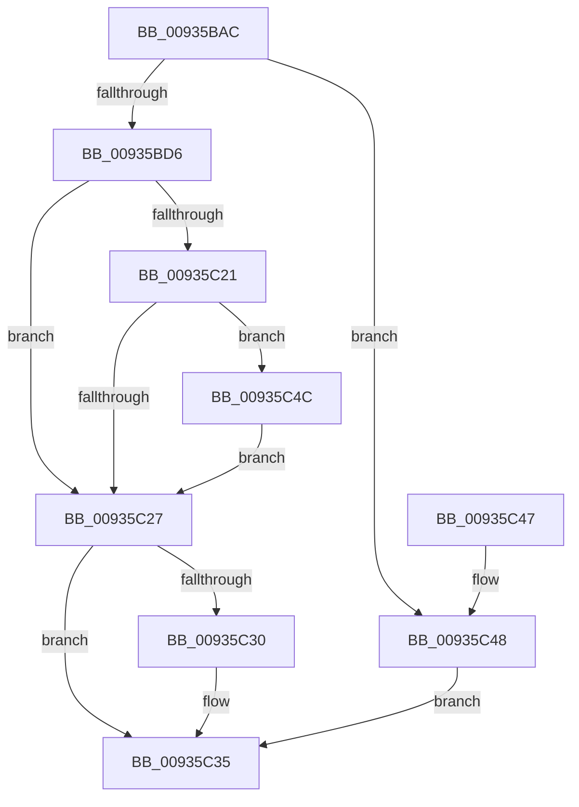

# VrpCreateNamespaceNodePlaceholderKey

- RVA: `0x00935BAC`–`0x00935C53` (길이 `167` bytes)
- VA: `0x0000000140935BAC`
- 실행 섹션: `PAGE`
- PDB 이름 있음: `예`; PDB Function 태그: `아니요`
- unwind 정보 RVA: `0x0008F2FC`
- 디코드: `51`개 명령, `167/167` bytes 표시
- 미해석 바이트: `0` (있으면 어셈블리에 `.byte`로 보존)

> 이 문서는 커널 이미지의 기계어와 PDB 기호를 분석해 생성했습니다. 4번과 5번은 함수 원형과 자료형을 바이너리 사용 방식에서 추정한 C 해석이며 원본 소스 복구 결과는 아닙니다.

## 1. Dependencies

- 직접 호출 지점: **2**; 고유 호출 대상: **2**
- 직접 호출자로 확인된 함수: **3**
- RIP 상대 이미지 참조: **0**

### Outgoing calls
- `0x00935C16` → [ZwCreateKey](../../text/6A/ZwCreateKey_function_006AD470.md) (function, `0x006AD470`)
- `0x00935C30` → [ZwClose](../../text/6A/ZwClose_function_006AD2B0.md) (function, `0x006AD2B0`)

### Direct callers
- [VrpHandleIoctlCreateMultipleNamespaceNodes](../83/VrpHandleIoctlCreateMultipleNamespaceNodes_function_0083B17C.md) at `0x0083B3DE`
- [VrpHandleIoctlCreateNamespaceNode](VrpHandleIoctlCreateNamespaceNode_function_0093511C.md) at `0x009352F5`
- [sub_00B4588A](../B4/Unknown_function_00B4588A.md) at `0x00B45BBE`

### Static image references
- 디코드된 RIP-relative 메모리 참조가 없습니다.

## 2. Other-region calls and transfers

- 다른 실행 섹션으로 향하는 call: **2**
  - `0x00935C16` → [ZwCreateKey](../../text/6A/ZwCreateKey_function_006AD470.md) (`PAGE` → `.text`)
  - `0x00935C30` → [ZwClose](../../text/6A/ZwClose_function_006AD2B0.md) (`PAGE` → `.text`)
- 별도 외부 분기/꼬리 이동을 확인하지 못했습니다.

## 3. Assembly (complete function range)

```asm
00935BAC  48 89 5C 24 18                  mov qword ptr [rsp + 0x18], rbx
00935BB1  55                              push rbp
00935BB2  56                              push rsi
00935BB3  57                              push rdi
00935BB4  48 8B EC                        mov rbp, rsp
00935BB7  48 83 EC 70                     sub rsp, 0x70
00935BBB  33 F6                           xor esi, esi
00935BBD  48 8D 41 28                     lea rax, [rcx + 0x28]
00935BC1  48 8B D9                        mov rbx, rcx
00935BC4  89 75 20                        mov dword ptr [rbp + 0x20], esi
00935BC7  89 75 D4                        mov dword ptr [rbp - 0x2c], esi
00935BCA  89 75 EC                        mov dword ptr [rbp - 0x14], esi
00935BCD  48 89 75 28                     mov qword ptr [rbp + 0x28], rsi
00935BD1  66 39 30                        cmp word ptr [rax], si
00935BD4  74 72                           je 0x140935c48
00935BD6  48 89 45 E0                     mov qword ptr [rbp - 0x20], rax
00935BDA  4C 8D 45 D0                     lea r8, [rbp - 0x30]
00935BDE  48 8D 45 20                     lea rax, [rbp + 0x20]
00935BE2  C7 45 D0 30 00 00 00            mov dword ptr [rbp - 0x30], 0x30
00935BE9  48 89 44 24 30                  mov qword ptr [rsp + 0x30], rax
00935BEE  48 8D 4D 28                     lea rcx, [rbp + 0x28]
00935BF2  0F 57 C0                        xorps xmm0, xmm0
00935BF5  89 74 24 28                     mov dword ptr [rsp + 0x28], esi
00935BF9  45 33 C9                        xor r9d, r9d
00935BFC  48 89 74 24 20                  mov qword ptr [rsp + 0x20], rsi
00935C01  BA 3F 00 0F 00                  mov edx, 0xf003f
00935C06  48 89 75 D8                     mov qword ptr [rbp - 0x28], rsi
00935C0A  C7 45 E8 40 02 00 00            mov dword ptr [rbp - 0x18], 0x240
00935C11  F3 0F 7F 45 F0                  movdqu xmmword ptr [rbp - 0x10], xmm0
00935C16  E8 55 78 D7 FF                  call 0x1406ad470
00935C1B  8B F8                           mov edi, eax
00935C1D  85 C0                           test eax, eax
00935C1F  78 06                           js 0x140935c27
00935C21  83 7D 20 01                     cmp dword ptr [rbp + 0x20], 1
00935C25  74 25                           je 0x140935c4c
00935C27  48 8B 4D 28                     mov rcx, qword ptr [rbp + 0x28]
00935C2B  48 85 C9                        test rcx, rcx
00935C2E  74 05                           je 0x140935c35
00935C30  E8 7B 76 D7 FF                  call 0x1406ad2b0
00935C35  48 8B 9C 24 A0 00 00 00         mov rbx, qword ptr [rsp + 0xa0]
00935C3D  8B C7                           mov eax, edi
00935C3F  48 83 C4 70                     add rsp, 0x70
00935C43  5F                              pop rdi
00935C44  5E                              pop rsi
00935C45  5D                              pop rbp
00935C46  C3                              ret
00935C47  CC                              int3
00935C48  8B FE                           mov edi, esi
00935C4A  EB E9                           jmp 0x140935c35
00935C4C  0F BA 6B 38 1E                  bts dword ptr [rbx + 0x38], 0x1e
00935C51  EB D4                           jmp 0x140935c27
```

## 4. C-style interpretation (structured pseudocode)

```c
__int64 __fastcall VrpCreateNamespaceNodePlaceholderKey(__int64 a1, __int64 a2, __int64 a3, int a4)
{
    __int64 result;
    __int64 v_rsi;
    __int64 v_rsp;
    unsigned __int64 v_stack_m28;
    unsigned int v_stack_m2C;
    unsigned int v_stack_m30;
    unsigned __int64 v_stack_m38;
    unsigned __int64 v_stack_m40;
    unsigned int v_stack_m44;
    unsigned __int64 v_stack_m48;
    unsigned __int64 v_stack_m58;
    unsigned int v_stack_m60;
    unsigned __int64 v_stack_m68;
    unsigned __int64 v_stack_p10;
    unsigned __int64 v_stack_p18;
    unsigned int v_stack_p8;

    v_stack_p18 = v_rbx;
    v_rsp = (v_rsp) - (112);
    v_rsi = 0;
    v_stack_p8 = 0;
    v_stack_m44 = 0;
    v_stack_m2C = 0;
    v_stack_p10 = 0;
    if ((*(unsigned __int16 *)(a1 + 40)) == 0) goto loc_00935C48;
    v_stack_m38 = a1 + 40;
    v_stack_m48 = 48;
    v_stack_m58 = v_stack_p8;
    v_stack_m60 = 0;
    a4 = 0;
    v_stack_m68 = 0;
    v_stack_m40 = 0;
    v_stack_m30 = 576;
    v_stack_m28 = v_xmm0;
    result = ZwCreateKey(v_stack_p10, (unsigned int)(0xF003FULL), v_stack_m48, a4);
    if (sign_flag) goto loc_00935C27;
    if (v_stack_p8 == 1) goto loc_00935C4C;
loc_00935C27:
    if (v_stack_p10 != 0) {
        result = ZwClose(v_stack_p10, (unsigned int)(0xF003FULL), v_stack_m48, a4);
    }
    v_rsp = (v_rsp) + (112);
    return (unsigned int)((unsigned int)((unsigned int)((unsigned int)(result))));
loc_00935C48:
    goto loc_00935C35;
loc_00935C4C:
    goto loc_00935C27;
}
```

## 5. (Beta) C Style

```c
int64_t VrpCreateNamespaceNodePlaceholderKey(void *Arg1, int64_t Arg2, int64_t Arg3, int32_t Arg4)
{
    uint8_t *arg1 = (uint8_t *)Arg1;

    int64_t result;
    int64_t local_rsi;
    int64_t local_rsp;
    uint64_t v_stack_m28;
    uint32_t v_stack_m2C;
    uint32_t v_stack_m30;
    uint64_t v_stack_m38;
    uint64_t v_stack_m40;
    uint32_t v_stack_m44;
    uint64_t v_stack_m48;
    uint64_t v_stack_m58;
    uint32_t v_stack_m60;
    uint64_t v_stack_m68;
    uint64_t v_stack_p10;
    uint64_t v_stack_p18;
    uint32_t v_stack_p8;

    v_stack_p18 = local_rbx;
    local_rsp = (local_rsp) - (112);
    local_rsi = 0;
    v_stack_p8 = 0;
    v_stack_m44 = 0;
    v_stack_m2C = 0;
    v_stack_p10 = 0;
    if ((*(uint16_t *)(arg1 + 0x28)) == 0) goto loc_00935C48;
    v_stack_m38 = Arg1 + 40;
    v_stack_m48 = 48;
    v_stack_m58 = v_stack_p8;
    v_stack_m60 = 0;
    Arg4 = 0;
    v_stack_m68 = 0;
    v_stack_m40 = 0;
    v_stack_m30 = 576;
    v_stack_m28 = v_xmm0;
    result = ZwCreateKey(v_stack_p10, (uint32_t)(0xF003FULL), v_stack_m48, Arg4);
    if (sign_flag) goto loc_00935C27;
    if (v_stack_p8 == 1) goto loc_00935C4C;
loc_00935C27:
    if (v_stack_p10 != 0) {
        result = ZwClose(v_stack_p10, (uint32_t)(0xF003FULL), v_stack_m48, Arg4);
    }
    local_rsp = (local_rsp) + (112);
    return (uint32_t)((uint32_t)((uint32_t)((uint32_t)(result))));
loc_00935C48:
    goto loc_00935C35;
loc_00935C4C:
    goto loc_00935C27;
}
```

### 관측된 메모리 오프셋

구조체 형식이 확인되지 않은 접근은 인자 기준의 오프셋으로만 기록했습니다.

| 기준 인자 | 오프셋 표현 | 폭 (bit) | 접근 |
|---|---:|---:|---|
| `Arg1` | `+ 0x0` | `16` | `R` |
| `Arg1` | `+ 0x28` | `64` | `R` |
| `Arg1` | `+ 0x38` | `32` | `R/W` |

## 6. Execution-region graph

[열기: 2D/3D 그래프와 함수 탐색 컨트롤 패널](../../../control-panel.html?section=page&rva=0x00935BAC&view=graph)

- 2D 그래프는 위에서 아래로 흐르고, 3D 그래프는 빈 공간을 드래그해 회전합니다. Shift+드래그는 이동, 휠은 확대·축소, 함수 노드 선택은 대상 보고서 이동입니다.

### Static fallback


