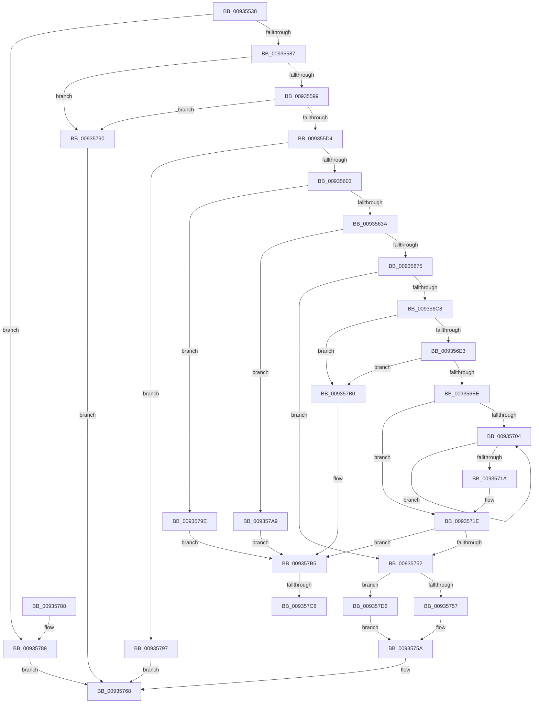

# VrpCreateNamespaceNode

- RVA: `0x00935538`–`0x009357E8` (길이 `688` bytes)
- VA: `0x0000000140935538`
- 실행 섹션: `PAGE`
- PDB 이름 있음: `예`; PDB Function 태그: `예`
- unwind 정보 RVA: `0x0008F280`
- 디코드: `186`개 명령, `688/688` bytes 표시
- 미해석 바이트: `0` (있으면 어셈블리에 `.byte`로 보존)

> 이 문서는 커널 이미지의 기계어와 PDB 기호를 분석해 생성했습니다. 4번과 5번은 함수 원형과 자료형을 바이너리 사용 방식에서 추정한 C 해석이며 원본 소스 복구 결과는 아닙니다.

## 1. Dependencies

- 직접 호출 지점: **18**; 고유 호출 대상: **10**
- 직접 호출자로 확인된 함수: **3**
- RIP 상대 이미지 참조: **1**

### Outgoing calls
- `0x0093559C` → [VrpStripTrailingCharacters](VrpStripTrailingCharacters_function_009358B0.md) (function, `0x009358B0`)
- `0x009355A4` → [VrpStripTrailingCharacters](VrpStripTrailingCharacters_function_009358B0.md) (function, `0x009358B0`)
- `0x009355B4` → [VrpGetNextToken](VrpGetNextToken_function_009357F0.md) (function, `0x009357F0`)
- `0x009355C7` → [RtlEqualUnicodeString](RtlEqualUnicodeString_function_00932A20.md) (function, `0x00932A20`)
- `0x009355DF` → [VrpGetNextToken](VrpGetNextToken_function_009357F0.md) (function, `0x009357F0`)
- `0x009355F2` → [ExAllocatePool2](../../poolcode/B8/ExAllocatePool2_function_00B820F0.md) (function, `0x00B820F0`)
- `0x00935625` → [ExAllocatePool2](../../poolcode/B8/ExAllocatePool2_function_00B820F0.md) (function, `0x00B820F0`)
- `0x0093564D` → [memcpy](../../text/6C/memcpy_function_006C6840.md) (function, `0x006C6840`)
- `0x0093565D` → [ExAllocatePool2](../../poolcode/B8/ExAllocatePool2_function_00B820F0.md) (function, `0x00B820F0`)
- `0x0093568C` → [memcpy](../../text/6C/memcpy_function_006C6840.md) (function, `0x006C6840`)
- `0x00935694` → [VrpCountPathComponents](VrpCountPathComponents_function_009358F0.md) (function, `0x009358F0`)
- `0x009356A1` → [VrpCountPathComponents](VrpCountPathComponents_function_009358F0.md) (function, `0x009358F0`)
- `0x009356B5` → [VrpGetNextToken](VrpGetNextToken_function_009357F0.md) (function, `0x009357F0`)
- `0x009356D2` → [VrpFindBestMatchNamespaceNode](VrpFindBestMatchNamespaceNode_function_00934C2C.md) (function, `0x00934C2C`)
- `0x0093570F` → [VrpGetNextToken](VrpGetNextToken_function_009357F0.md) (function, `0x009357F0`)
- `0x00935747` → [VrpBuildKeyPath](VrpBuildKeyPath_function_00934650.md) (function, `0x00934650`)
- `0x009357CB` → [ExFreePoolWithTag](../../poolcode/B8/ExFreePoolWithTag_function_00B82870.md) (function, `0x00B82870`)
- `0x009357DE` → [ObfReferenceObjectWithTag](../../text/21/ObfReferenceObjectWithTag_function_00210710.md) (function, `0x00210710`)

### Direct callers
- [VrpHandleIoctlCreateMultipleNamespaceNodes](../83/VrpHandleIoctlCreateMultipleNamespaceNodes_function_0083B17C.md) at `0x0083B37E`
- [VrpHandleIoctlCreateNamespaceNode](VrpHandleIoctlCreateNamespaceNode_function_0093511C.md) at `0x009352D2`
- [sub_00B4588A](../B4/Unknown_function_00B4588A.md) at `0x00B45B8D`

### Static image references
- `0x009355BC` → RVA `0x000021F0` (`.rdata`; read)

## 2. Other-region calls and transfers

- 다른 실행 섹션으로 향하는 call: **7**
  - `0x009355F2` → [ExAllocatePool2](../../poolcode/B8/ExAllocatePool2_function_00B820F0.md) (`PAGE` → `POOLCODE`)
  - `0x00935625` → [ExAllocatePool2](../../poolcode/B8/ExAllocatePool2_function_00B820F0.md) (`PAGE` → `POOLCODE`)
  - `0x0093564D` → [memcpy](../../text/6C/memcpy_function_006C6840.md) (`PAGE` → `.text`)
  - `0x0093565D` → [ExAllocatePool2](../../poolcode/B8/ExAllocatePool2_function_00B820F0.md) (`PAGE` → `POOLCODE`)
  - `0x0093568C` → [memcpy](../../text/6C/memcpy_function_006C6840.md) (`PAGE` → `.text`)
  - `0x009357CB` → [ExFreePoolWithTag](../../poolcode/B8/ExFreePoolWithTag_function_00B82870.md) (`PAGE` → `POOLCODE`)
  - `0x009357DE` → [ObfReferenceObjectWithTag](../../text/21/ObfReferenceObjectWithTag_function_00210710.md) (`PAGE` → `.text`)
- call이 아닌 외부 분기/꼬리 이동: **2**
  - `0x009357C2` → [sub_00B24B50](../B2/Unknown_function_00B24B50.md) (`tail-transfer`)
  - `0x009357D1` → [sub_00B24B50](../B2/Unknown_function_00B24B50.md) (`tail-transfer`)

## 3. Assembly (complete function range)

```asm
00935538  48 89 5C 24 10                  mov qword ptr [rsp + 0x10], rbx
0093553D  48 89 74 24 18                  mov qword ptr [rsp + 0x18], rsi
00935542  48 89 7C 24 20                  mov qword ptr [rsp + 0x20], rdi
00935547  55                              push rbp
00935548  41 54                           push r12
0093554A  41 55                           push r13
0093554C  41 56                           push r14
0093554E  41 57                           push r15
00935550  48 8B EC                        mov rbp, rsp
00935553  48 83 EC 50                     sub rsp, 0x50
00935557  8B 75 58                        mov esi, dword ptr [rbp + 0x58]
0093555A  33 FF                           xor edi, edi
0093555C  0F 57 C0                        xorps xmm0, xmm0
0093555F  0F 57 C9                        xorps xmm1, xmm1
00935562  4D 8B E1                        mov r12, r9
00935565  4D 8B F0                        mov r14, r8
00935568  4C 8B FA                        mov r15, rdx
0093556B  4C 8B E9                        mov r13, rcx
0093556E  0F 11 45 E8                     movups xmmword ptr [rbp - 0x18], xmm0
00935572  48 89 7D 30                     mov qword ptr [rbp + 0x30], rdi
00935576  0F 11 4D D8                     movups xmmword ptr [rbp - 0x28], xmm1
0093557A  48 89 7D D0                     mov qword ptr [rbp - 0x30], rdi
0093557E  39 79 54                        cmp dword ptr [rcx + 0x54], edi
00935581  0F 85 02 02 00 00               jne 0x140935789
00935587  8B 5D 50                        mov ebx, dword ptr [rbp + 0x50]
0093558A  8B C3                           mov eax, ebx
0093558C  25 07 00 00 E0                  and eax, 0xe0000007
00935591  3B C3                           cmp eax, ebx
00935593  0F 85 F7 01 00 00               jne 0x140935790
00935599  48 8B CA                        mov rcx, rdx
0093559C  E8 0F 03 00 00                  call 0x1409358b0
009355A1  49 8B CC                        mov rcx, r12
009355A4  E8 07 03 00 00                  call 0x1409358b0
009355A9  4C 8D 45 D8                     lea r8, [rbp - 0x28]
009355AD  49 8B CF                        mov rcx, r15
009355B0  48 8D 55 30                     lea rdx, [rbp + 0x30]
009355B4  E8 37 02 00 00                  call 0x1409357f0
009355B9  41 B0 01                        mov r8b, 1
009355BC  48 8D 15 2D CC 6C FF            lea rdx, [rip - 0x9333d3]
009355C3  48 8D 4D D8                     lea rcx, [rbp - 0x28]
009355C7  E8 54 D4 FF FF                  call 0x140932a20
009355CC  84 C0                           test al, al
009355CE  0F 84 BC 01 00 00               je 0x140935790
009355D4  4C 8D 45 D8                     lea r8, [rbp - 0x28]
009355D8  49 8B CF                        mov rcx, r15
009355DB  48 8D 55 30                     lea rdx, [rbp + 0x30]
009355DF  E8 0C 02 00 00                  call 0x1409357f0
009355E4  8D 57 48                        lea edx, [rdi + 0x48]
009355E7  B9 00 01 00 00                  mov ecx, 0x100
009355EC  41 B8 56 52 65 67               mov r8d, 0x67655256
009355F2  E8 F9 CA 24 00                  call 0x140b820f0
009355F7  48 8B F8                        mov rdi, rax
009355FA  48 85 C0                        test rax, rax
009355FD  0F 84 94 01 00 00               je 0x140935797
00935603  89 58 38                        mov dword ptr [rax + 0x38], ebx
00935606  83 C8 FF                        or eax, 0xffffffff
00935609  85 F6                           test esi, esi
0093560B  BB 56 52 65 67                  mov ebx, 0x67655256
00935610  44 8B C3                        mov r8d, ebx
00935613  0F 45 C6                        cmovne eax, esi
00935616  BE 00 01 00 00                  mov esi, 0x100
0093561B  89 47 3C                        mov dword ptr [rdi + 0x3c], eax
0093561E  8B CE                           mov ecx, esi
00935620  41 0F B7 57 02                  movzx edx, word ptr [r15 + 2]
00935625  E8 C6 CA 24 00                  call 0x140b820f0
0093562A  48 89 47 08                     mov qword ptr [rdi + 8], rax
0093562E  48 8B C8                        mov rcx, rax
00935631  48 85 C0                        test rax, rax
00935634  0F 84 64 01 00 00               je 0x14093579e
0093563A  41 0F B7 07                     movzx eax, word ptr [r15]
0093563E  66 89 47 02                     mov word ptr [rdi + 2], ax
00935642  66 89 07                        mov word ptr [rdi], ax
00935645  45 0F B7 07                     movzx r8d, word ptr [r15]
00935649  49 8B 57 08                     mov rdx, qword ptr [r15 + 8]
0093564D  E8 EE 11 D9 FF                  call 0x1406c6840
00935652  41 0F B7 54 24 02               movzx edx, word ptr [r12 + 2]
00935658  44 8B C3                        mov r8d, ebx
0093565B  8B CE                           mov ecx, esi
0093565D  E8 8E CA 24 00                  call 0x140b820f0
00935662  48 8D 77 20                     lea rsi, [rdi + 0x20]
00935666  48 8B C8                        mov rcx, rax
00935669  48 89 06                        mov qword ptr [rsi], rax
0093566C  48 85 C0                        test rax, rax
0093566F  0F 84 34 01 00 00               je 0x1409357a9
00935675  41 0F B7 04 24                  movzx eax, word ptr [r12]
0093567A  66 89 47 18                     mov word ptr [rdi + 0x18], ax
0093567E  66 89 47 1A                     mov word ptr [rdi + 0x1a], ax
00935682  45 0F B7 04 24                  movzx r8d, word ptr [r12]
00935687  49 8B 54 24 08                  mov rdx, qword ptr [r12 + 8]
0093568C  E8 AF 11 D9 FF                  call 0x1406c6840
00935691  48 8B CF                        mov rcx, rdi
00935694  E8 57 02 00 00                  call 0x1409358f0
00935699  48 8D 4F 18                     lea rcx, [rdi + 0x18]
0093569D  66 89 47 40                     mov word ptr [rdi + 0x40], ax
009356A1  E8 4A 02 00 00                  call 0x1409358f0
009356A6  4C 8D 45 D8                     lea r8, [rbp - 0x28]
009356AA  66 89 47 42                     mov word ptr [rdi + 0x42], ax
009356AE  48 8D 55 30                     lea rdx, [rbp + 0x30]
009356B2  49 8B CF                        mov rcx, r15
009356B5  E8 36 01 00 00                  call 0x1409357f0
009356BA  45 33 E4                        xor r12d, r12d
009356BD  66 44 39 65 D8                  cmp word ptr [rbp - 0x28], r12w
009356C2  0F 86 8A 00 00 00               jbe 0x140935752
009356C8  4C 8D 45 D0                     lea r8, [rbp - 0x30]
009356CC  48 8B D7                        mov rdx, rdi
009356CF  49 8B CD                        mov rcx, r13
009356D2  E8 55 F5 FF FF                  call 0x140934c2c
009356D7  4C 8B F8                        mov r15, rax
009356DA  48 85 C0                        test rax, rax
009356DD  0F 84 CD 00 00 00               je 0x1409357b0
009356E3  8B 40 38                        mov eax, dword ptr [rax + 0x38]
009356E6  A8 04                           test al, 4
009356E8  0F 85 C2 00 00 00               jne 0x1409357b0
009356EE  48 8B 5D D0                     mov rbx, qword ptr [rbp - 0x30]
009356F2  83 E0 02                        and eax, 2
009356F5  09 47 38                        or dword ptr [rdi + 0x38], eax
009356F8  41 8B D4                        mov edx, r12d
009356FB  48 89 55 30                     mov qword ptr [rbp + 0x30], rdx
009356FF  48 85 DB                        test rbx, rbx
00935702  74 1A                           je 0x14093571e
00935704  4C 8D 45 D8                     lea r8, [rbp - 0x28]
00935708  48 8B CF                        mov rcx, rdi
0093570B  48 8D 55 30                     lea rdx, [rbp + 0x30]
0093570F  E8 DC 00 00 00                  call 0x1409357f0
00935714  48 83 EB 01                     sub rbx, 1
00935718  75 EA                           jne 0x140935704
0093571A  48 8B 55 30                     mov rdx, qword ptr [rbp + 0x30]
0093571E  48 8B 47 08                     mov rax, qword ptr [rdi + 8]
00935722  4C 8D 47 28                     lea r8, [rdi + 0x28]
00935726  48 8D 0C 50                     lea rcx, [rax + rdx*2]
0093572A  0F B7 07                        movzx eax, word ptr [rdi]
0093572D  66 03 D2                        add dx, dx
00935730  48 89 4D F0                     mov qword ptr [rbp - 0x10], rcx
00935734  66 2B C2                        sub ax, dx
00935737  49 8D 4F 18                     lea rcx, [r15 + 0x18]
0093573B  48 8D 55 E8                     lea rdx, [rbp - 0x18]
0093573F  66 89 45 E8                     mov word ptr [rbp - 0x18], ax
00935743  66 89 45 EA                     mov word ptr [rbp - 0x16], ax
00935747  E8 04 EF FF FF                  call 0x140934650
0093574C  8B D8                           mov ebx, eax
0093574E  85 C0                           test eax, eax
00935750  78 63                           js 0x1409357b5
00935752  4D 85 F6                        test r14, r14
00935755  75 7F                           jne 0x1409357d6
00935757  4D 8B F4                        mov r14, r12
0093575A  48 8B 45 60                     mov rax, qword ptr [rbp + 0x60]
0093575E  41 8B DC                        mov ebx, r12d
00935761  4C 89 77 10                     mov qword ptr [rdi + 0x10], r14
00935765  48 89 38                        mov qword ptr [rax], rdi
00935768  4C 8D 5C 24 50                  lea r11, [rsp + 0x50]
0093576D  8B C3                           mov eax, ebx
0093576F  49 8B 5B 38                     mov rbx, qword ptr [r11 + 0x38]
00935773  49 8B 73 40                     mov rsi, qword ptr [r11 + 0x40]
00935777  49 8B 7B 48                     mov rdi, qword ptr [r11 + 0x48]
0093577B  49 8B E3                        mov rsp, r11
0093577E  41 5F                           pop r15
00935780  41 5E                           pop r14
00935782  41 5D                           pop r13
00935784  41 5C                           pop r12
00935786  5D                              pop rbp
00935787  C3                              ret
00935788  CC                              int3
00935789  BB 56 00 00 C0                  mov ebx, 0xc0000056
0093578E  EB D8                           jmp 0x140935768
00935790  BB 0D 00 00 C0                  mov ebx, 0xc000000d
00935795  EB D1                           jmp 0x140935768
00935797  BB 9A 00 00 C0                  mov ebx, 0xc000009a
0093579C  EB CA                           jmp 0x140935768
0093579E  BB 9A 00 00 C0                  mov ebx, 0xc000009a
009357A3  48 8D 77 20                     lea rsi, [rdi + 0x20]
009357A7  EB 0C                           jmp 0x1409357b5
009357A9  BB 9A 00 00 C0                  mov ebx, 0xc000009a
009357AE  EB 05                           jmp 0x1409357b5
009357B0  BB 0D 00 00 C0                  mov ebx, 0xc000000d
009357B5  48 8B 4F 08                     mov rcx, qword ptr [rdi + 8]
009357B9  41 BE 56 52 65 67               mov r14d, 0x67655256
009357BF  48 85 C9                        test rcx, rcx
009357C2  0F 84 88 F3 1E 00               je 0x140b24b50
009357C8  41 8B D6                        mov edx, r14d
009357CB  E8 A0 D0 24 00                  call 0x140b82870
009357D0  90                              nop
009357D1  E9 7A F3 1E 00                  jmp 0x140b24b50
009357D6  BA 56 52 65 67                  mov edx, 0x67655256
009357DB  49 8B CE                        mov rcx, r14
009357DE  E8 2D AF 8D FF                  call 0x140210710
009357E3  E9 72 FF FF FF                  jmp 0x14093575a
```

## 4. C-style interpretation (structured pseudocode)

```c
__int64 __fastcall VrpCreateNamespaceNode(__int64 a1, __int64 a2, __int64 a3, __int64 a4, unsigned int a5, unsigned int a6, __int64 a7)
{
    __int64 result;
    __int64 v_r12;
    __int64 v_rbx;
    __int64 v_rdi;
    __int64 v_rsp;
    unsigned __int64 v_stack_m28;
    unsigned __int64 v_stack_m38;
    unsigned __int16 v_stack_m3E;
    unsigned __int64 v_stack_m40;
    unsigned __int64 v_stack_m50;
    unsigned __int64 v_stack_m58;
    unsigned __int64 v_stack_p10;
    unsigned __int64 v_stack_p18;
    unsigned __int64 v_stack_p20;
    unsigned __int64 v_stack_p8;

    v_stack_p10 = v_rbx;
    v_stack_p18 = v_rsi;
    v_stack_p20 = v_rdi;
    v_rsp = (v_rsp) - (80);
    v_rdi = 0;
    v_stack_m40 = v_xmm0;
    v_stack_p8 = 0;
    v_stack_m50 = v_xmm1;
    v_stack_m58 = 0;
    if ((*(unsigned int *)(a1 + 84)) != 0) goto loc_00935789;
    result = (unsigned int)(((unsigned int)((unsigned int)((unsigned int)(a5)))) & (0xE0000007ULL));
    if (((unsigned int)(result)) != ((unsigned int)((unsigned int)(a5)))) goto loc_00935790;
    result = VrpStripTrailingCharacters(a2, a2, a3, a4);
    result = VrpStripTrailingCharacters(a4, a2, a3, a4);
    result = VrpGetNextToken(a2, v_stack_p8, v_stack_m50, a4);
    result = RtlEqualUnicodeString(v_stack_m50, v_rip - 9647059, 1, a4);
    if ((unsigned __int8)(result) == 0) goto loc_00935790;
    result = VrpGetNextToken(a2, v_stack_p8, v_stack_m50, a4);
    result = ExAllocatePool2(256, v_rdi + 72, (unsigned int)(0x67655256ULL), a4);
    if (result == 0) goto loc_00935797;
    *(unsigned int *)(result + 56) = (unsigned int)((unsigned int)(a5));
    result = (unsigned int)((result) | (0xFFFFFFFFULL));
    if ((unsigned int)((unsigned int)(a6)) != 0) { result = (unsigned int)((unsigned int)(a6)); }
    *(unsigned int *)(result + 60) = (unsigned int)(result);
    result = ExAllocatePool2(256, *(unsigned __int16 *)(a2 + 2), (unsigned int)((unsigned int)((unsigned int)(0x67655256ULL))), a4);
    *(unsigned __int64 *)(result + 8) = result;
    if (result == 0) goto loc_0093579E;
    *(unsigned __int16 *)(result + 2) = (unsigned __int16)(*(unsigned __int16 *)(a2));
    *(unsigned __int16 *)(result) = (unsigned __int16)(*(unsigned __int16 *)(a2));
    result = memcpy(result, *(unsigned __int64 *)(a2 + 8), *(unsigned __int16 *)(a2), a4);
    result = ExAllocatePool2(256, *(unsigned __int16 *)(a4 + 2), (unsigned int)((unsigned int)((unsigned int)(0x67655256ULL))), a4);
    *(unsigned __int64 *)(result + 32) = result;
    if (result == 0) goto loc_009357A9;
    *(unsigned __int16 *)(result + 24) = (unsigned __int16)(*(unsigned __int16 *)(a4));
    *(unsigned __int16 *)(result + 26) = (unsigned __int16)(*(unsigned __int16 *)(a4));
    result = memcpy(result, *(unsigned __int64 *)(a4 + 8), *(unsigned __int16 *)(a4), a4);
    result = VrpCountPathComponents(result, *(unsigned __int64 *)(a4 + 8), *(unsigned __int16 *)(a4), a4);
    *(unsigned __int16 *)(result + 64) = (unsigned __int16)(result);
    result = VrpCountPathComponents(result + 24, *(unsigned __int64 *)(a4 + 8), *(unsigned __int16 *)(a4), a4);
    *(unsigned __int16 *)(result + 66) = (unsigned __int16)(result);
    result = VrpGetNextToken(a2, v_stack_p8, v_stack_m50, a4);
    v_r12 = 0;
    if (v_stack_m50 <= 0) goto loc_00935752;
    result = VrpFindBestMatchNamespaceNode(a1, result, v_stack_m58, a4);
    if (result == 0) goto loc_009357B0;
    if ((((unsigned __int8)((unsigned int)(*(unsigned int *)(result + 56)))) & (4)) != 0) goto loc_009357B0;
    result = (unsigned int)(((unsigned int)(*(unsigned int *)(result + 56))) & (2));
    v_stack_p8 = 0;
    if (v_stack_m58 == 0) goto loc_0093571E;
loc_00935704:
    result = VrpGetNextToken(result, v_stack_p8, v_stack_m50, a4);
    v_rbx = (v_stack_m58) - (1);
    if (condition_is_not_equal) goto loc_00935704;
loc_0093571E:
    a2 = (unsigned __int16)((v_stack_p8) + ((unsigned __int16)(v_stack_p8)));
    v_stack_m38 = *(unsigned __int64 *)(result + 8) + v_stack_p8 * 2;
    result = (unsigned __int16)((*(unsigned __int16 *)(result)) - ((unsigned __int16)(a2)));
    v_stack_m40 = (unsigned __int16)(result);
    v_stack_m3E = (unsigned __int16)(result);
    result = VrpBuildKeyPath(result + 24, v_stack_m40, result + 40, a4);
    if (sign_flag) goto loc_009357B5;
loc_00935752:
    if (a3 != 0) goto loc_009357D6;
loc_0093575A:
    *(unsigned __int64 *)(result + 16) = 0;
    *(unsigned __int64 *)(a7) = result;
loc_00935768:
    return 0;
loc_00935789:
    goto loc_00935768;
loc_00935790:
    goto loc_00935768;
loc_00935797:
    goto loc_00935768;
loc_0093579E:
    goto loc_009357B5;
loc_009357A9:
    goto loc_009357B5;
loc_009357B0:
loc_009357B5:
    result = ExFreePoolWithTag(*(unsigned __int64 *)(*(unsigned __int64 *)(v_stack_m28 + 72) + 8), (unsigned int)((unsigned int)((unsigned int)(0x67655256ULL))), result + 40, a4);
loc_009357D6:
    result = ObfReferenceObjectWithTag((unsigned int)(0x67655256ULL), (unsigned int)(0x67655256ULL), result + 40, a4);
    goto loc_0093575A;
}
```

## 5. (Beta) C Style

```c
int64_t VrpCreateNamespaceNode(void *Arg1, void *Arg2, int64_t Arg3, void *Arg4, uint32_t Arg5, uint32_t Arg6, void *Arg7)
{
    uint8_t *arg1 = (uint8_t *)Arg1;
    uint8_t *arg2 = (uint8_t *)Arg2;
    uint8_t *arg4 = (uint8_t *)Arg4;
    uint8_t *arg7 = (uint8_t *)Arg7;

    int64_t result;
    int64_t local_r12;
    int64_t local_rbx;
    int64_t local_rdi;
    int64_t local_rsp;
    uint64_t v_stack_m28;
    uint64_t v_stack_m38;
    uint16_t v_stack_m3E;
    uint64_t v_stack_m40;
    uint64_t v_stack_m50;
    uint64_t v_stack_m58;
    uint64_t v_stack_p10;
    uint64_t v_stack_p18;
    uint64_t v_stack_p20;
    uint64_t v_stack_p8;

    v_stack_p10 = local_rbx;
    v_stack_p18 = local_rsi;
    v_stack_p20 = local_rdi;
    local_rsp = (local_rsp) - (80);
    local_rdi = 0;
    v_stack_m40 = v_xmm0;
    v_stack_p8 = 0;
    v_stack_m50 = v_xmm1;
    v_stack_m58 = 0;
    if ((*(uint32_t *)(arg1 + 0x54)) != 0) goto loc_00935789;
    result = (uint32_t)(((uint32_t)((uint32_t)((uint32_t)(Arg5)))) & (0xE0000007ULL));
    if (((uint32_t)(result)) != ((uint32_t)((uint32_t)(Arg5)))) goto loc_00935790;
    result = VrpStripTrailingCharacters(Arg2, Arg2, Arg3, Arg4);
    result = VrpStripTrailingCharacters(Arg4, Arg2, Arg3, Arg4);
    result = VrpGetNextToken(Arg2, v_stack_p8, v_stack_m50, Arg4);
    result = RtlEqualUnicodeString(v_stack_m50, v_rip - 9647059, 1, Arg4);
    if ((uint8_t)(result) == 0) goto loc_00935790;
    result = VrpGetNextToken(Arg2, v_stack_p8, v_stack_m50, Arg4);
    result = ExAllocatePool2(256, local_rdi + 72, (uint32_t)(0x67655256ULL), Arg4);
    if (result == 0) goto loc_00935797;
    *(uint32_t *)(result + 0x38) = (uint32_t)((uint32_t)(Arg5));
    result = (uint32_t)((result) | (0xFFFFFFFFULL));
    if ((uint32_t)((uint32_t)(Arg6)) != 0) { result = (uint32_t)((uint32_t)(Arg6)); }
    *(uint32_t *)(result + 0x3C) = (uint32_t)(result);
    result = ExAllocatePool2(256, *(uint16_t *)(arg2 + 0x2), (uint32_t)((uint32_t)((uint32_t)(0x67655256ULL))), Arg4);
    *(uint64_t *)(result + 0x8) = result;
    if (result == 0) goto loc_0093579E;
    *(uint16_t *)(result + 0x2) = (uint16_t)(*(uint16_t *)(arg2));
    *(uint16_t *)(result) = (uint16_t)(*(uint16_t *)(arg2));
    result = memcpy(result, *(uint64_t *)(arg2 + 0x8), *(uint16_t *)(arg2), Arg4);
    result = ExAllocatePool2(256, *(uint16_t *)(arg4 + 0x2), (uint32_t)((uint32_t)((uint32_t)(0x67655256ULL))), Arg4);
    *(uint64_t *)(result + 0x20) = result;
    if (result == 0) goto loc_009357A9;
    *(uint16_t *)(result + 0x18) = (uint16_t)(*(uint16_t *)(arg4));
    *(uint16_t *)(result + 0x1A) = (uint16_t)(*(uint16_t *)(arg4));
    result = memcpy(result, *(uint64_t *)(arg4 + 0x8), *(uint16_t *)(arg4), Arg4);
    result = VrpCountPathComponents(result, *(uint64_t *)(arg4 + 0x8), *(uint16_t *)(arg4), Arg4);
    *(uint16_t *)(result + 0x40) = (uint16_t)(result);
    result = VrpCountPathComponents(result + 24, *(uint64_t *)(arg4 + 0x8), *(uint16_t *)(arg4), Arg4);
    *(uint16_t *)(result + 0x42) = (uint16_t)(result);
    result = VrpGetNextToken(Arg2, v_stack_p8, v_stack_m50, Arg4);
    local_r12 = 0;
    if (v_stack_m50 <= 0) goto loc_00935752;
    result = VrpFindBestMatchNamespaceNode(Arg1, result, v_stack_m58, Arg4);
    if (result == 0) goto loc_009357B0;
    if ((((uint8_t)((uint32_t)(*(uint32_t *)(result + 0x38)))) & (4)) != 0) goto loc_009357B0;
    result = (uint32_t)(((uint32_t)(*(uint32_t *)(result + 0x38))) & (2));
    v_stack_p8 = 0;
    if (v_stack_m58 == 0) goto loc_0093571E;
loc_00935704:
    result = VrpGetNextToken(result, v_stack_p8, v_stack_m50, Arg4);
    local_rbx = (v_stack_m58) - (1);
    if (condition_is_not_equal) goto loc_00935704;
loc_0093571E:
    Arg2 = (uint16_t)((v_stack_p8) + ((uint16_t)(v_stack_p8)));
    v_stack_m38 = *(uint64_t *)(result + 0x8) + v_stack_p8 * 2;
    result = (uint16_t)((*(uint16_t *)(result)) - ((uint16_t)(Arg2)));
    v_stack_m40 = (uint16_t)(result);
    v_stack_m3E = (uint16_t)(result);
    result = VrpBuildKeyPath(result + 24, v_stack_m40, result + 40, Arg4);
    if (sign_flag) goto loc_009357B5;
loc_00935752:
    if (Arg3 != 0) goto loc_009357D6;
loc_0093575A:
    *(uint64_t *)(result + 0x10) = 0;
    *(uint64_t *)(arg7) = result;
loc_00935768:
    return 0;
loc_00935789:
    goto loc_00935768;
loc_00935790:
    goto loc_00935768;
loc_00935797:
    goto loc_00935768;
loc_0093579E:
    goto loc_009357B5;
loc_009357A9:
    goto loc_009357B5;
loc_009357B0:
loc_009357B5:
    result = ExFreePoolWithTag(*(uint64_t *)(*(uint64_t *)(v_stack_m28 + 0x48) + 0x8), (uint32_t)((uint32_t)((uint32_t)(0x67655256ULL))), result + 40, Arg4);
loc_009357D6:
    result = ObfReferenceObjectWithTag((uint32_t)(0x67655256ULL), (uint32_t)(0x67655256ULL), result + 40, Arg4);
    goto loc_0093575A;
}
```

### 관측된 메모리 오프셋

구조체 형식이 확인되지 않은 접근은 인자 기준의 오프셋으로만 기록했습니다.

| 기준 인자 | 오프셋 표현 | 폭 (bit) | 접근 |
|---|---:|---:|---|
| `Arg1` | `+ 0x54` | `32` | `R` |
| `Arg2` | `+ 0x0` | `16` | `R` |
| `Arg2` | `+ 0x2` | `16` | `R` |
| `Arg2` | `+ 0x8` | `64` | `R` |
| `Arg4` | `+ 0x0` | `16` | `R` |
| `Arg4` | `+ 0x2` | `16` | `R` |
| `Arg4` | `+ 0x8` | `64` | `R` |
| `Arg7` | `+ 0x0` | `64` | `W` |

## 6. Execution-region graph

[열기: 2D/3D 그래프와 함수 탐색 컨트롤 패널](../../../control-panel.html?section=page&rva=0x00935538&view=graph)

- 2D 그래프는 위에서 아래로 흐르고, 3D 그래프는 빈 공간을 드래그해 회전합니다. Shift+드래그는 이동, 휠은 확대·축소, 함수 노드 선택은 대상 보고서 이동입니다.

### Static fallback


