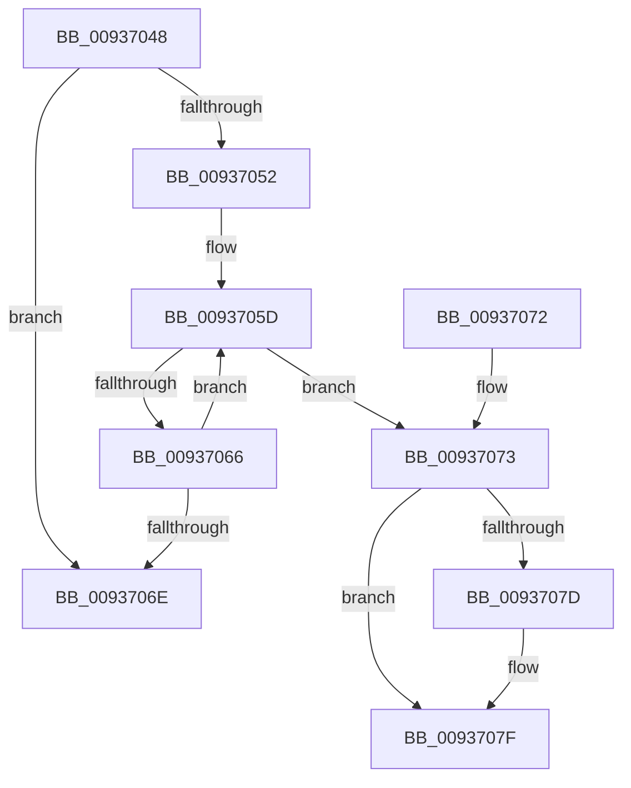

# VrpDecrementDiffHiveEntryHardRefCount

- RVA: `0x00937048`–`0x00937081` (길이 `57` bytes)
- VA: `0x0000000140937048`
- 실행 섹션: `PAGE`
- PDB 이름 있음: `예`; PDB Function 태그: `아니요`
- unwind 정보 RVA: `0x000DB714`
- 디코드: `19`개 명령, `57/57` bytes 표시
- 미해석 바이트: `0` (있으면 어셈블리에 `.byte`로 보존)

> 이 문서는 커널 이미지의 기계어와 PDB 기호를 분석해 생성했습니다. 4번과 5번은 함수 원형과 자료형을 바이너리 사용 방식에서 추정한 C 해석이며 원본 소스 복구 결과는 아닙니다.

## 1. Dependencies

- 직접 호출 지점: **0**; 고유 호출 대상: **0**
- 직접 호출자로 확인된 함수: **2**
- RIP 상대 이미지 참조: **0**

### Outgoing calls
- 직접 디코드된 call 명령이 없습니다.

### Direct callers
- [VrpLoadDifferencingHive](VrpLoadDifferencingHive_function_00935F40.md) at `0x009361EB`
- [VrpUnloadDifferencingHive](VrpUnloadDifferencingHive_function_00936CE0.md) at `0x00936D2A`

### Static image references
- 디코드된 RIP-relative 메모리 참조가 없습니다.

## 2. Other-region calls and transfers

- 다른 실행 섹션으로 향하는 call: **0**
- 별도 외부 분기/꼬리 이동을 확인하지 못했습니다.

## 3. Assembly (complete function range)

```asm
00937048  45 32 C0                        xor r8b, r8b
0093704B  48 83 69 20 01                  sub qword ptr [rcx + 0x20], 1
00937050  75 1C                           jne 0x14093706e
00937052  41 B0 01                        mov r8b, 1
00937055  0F 0D 49 10                     prefetchw byte ptr [rcx + 0x10]
00937059  48 8B 41 10                     mov rax, qword ptr [rcx + 0x10]
0093705D  48 8D 50 FF                     lea rdx, [rax - 1]
00937061  48 85 D2                        test rdx, rdx
00937064  7E 0D                           jle 0x140937073
00937066  F0 48 0F B1 51 10               lock cmpxchg qword ptr [rcx + 0x10], rdx
0093706C  75 EF                           jne 0x14093705d
0093706E  41 8A C0                        mov al, r8b
00937071  C3                              ret
00937072  CC                              int3
00937073  B9 0E 00 00 00                  mov ecx, 0xe
00937078  48 85 D2                        test rdx, rdx
0093707B  74 02                           je 0x14093707f
0093707D  CD 29                           int 0x29
0093707F  CD 29                           int 0x29
```

## 4. C-style interpretation (structured pseudocode)

```c
__int64 __fastcall VrpDecrementDiffHiveEntryHardRefCount(__int64 a1, __int64 a2, unsigned __int8 a3)
{
    a3 = 0;
    if (condition_is_not_equal) goto loc_0093706E;
loc_0093705D:
    if (condition_is_less_or_equal) goto loc_00937073;
    if (*(unsigned __int64 *)(a1 + 16) - 1 != 0) goto loc_0093705D;
loc_0093706E:
    return 1;
loc_00937073:
    if (*(unsigned __int64 *)(a1 + 16) - 1 != 0) {
    }
    return 1;
}
```

## 5. (Beta) C Style

```c
int64_t VrpDecrementDiffHiveEntryHardRefCount(void *Arg1, int64_t Arg2, uint8_t Arg3)
{
    uint8_t *arg1 = (uint8_t *)Arg1;

    Arg3 = 0;
    if (condition_is_not_equal) goto loc_0093706E;
loc_0093705D:
    if (condition_is_less_or_equal) goto loc_00937073;
    if (*(uint64_t *)(arg1 + 0x10) - 1 != 0) goto loc_0093705D;
loc_0093706E:
    return 1;
loc_00937073:
    if (*(uint64_t *)(arg1 + 0x10) - 1 != 0) {
    }
    return 1;
}
```

### 관측된 메모리 오프셋

구조체 형식이 확인되지 않은 접근은 인자 기준의 오프셋으로만 기록했습니다.

| 기준 인자 | 오프셋 표현 | 폭 (bit) | 접근 |
|---|---:|---:|---|
| `Arg1` | `+ 0x10` | `8` | `R` |
| `Arg1` | `+ 0x10` | `64` | `R` |
| `Arg1` | `+ 0x20` | `64` | `R/W` |

## 6. Execution-region graph

[열기: 2D/3D 그래프와 함수 탐색 컨트롤 패널](../../../control-panel.html?section=page&rva=0x00937048&view=graph)

- 2D 그래프는 위에서 아래로 흐르고, 3D 그래프는 빈 공간을 드래그해 회전합니다. Shift+드래그는 이동, 휠은 확대·축소, 함수 노드 선택은 대상 보고서 이동입니다.

### Static fallback


