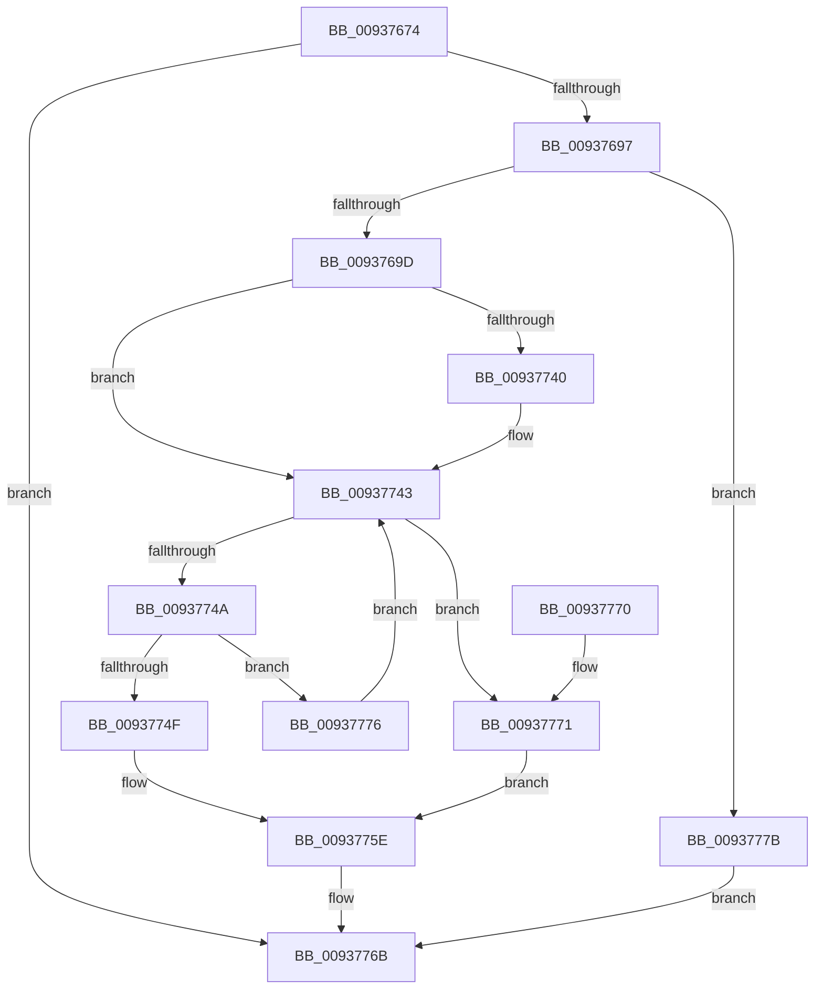

# VrpDereferenceDiffHiveEntryWithLock

- RVA: `0x00937674`–`0x00937784` (길이 `272` bytes)
- VA: `0x0000000140937674`
- 실행 섹션: `PAGE`
- PDB 이름 있음: `예`; PDB Function 태그: `아니요`
- unwind 정보 RVA: `0x00068D6C`
- 디코드: `73`개 명령, `272/272` bytes 표시
- 미해석 바이트: `0` (있으면 어셈블리에 `.byte`로 보존)

> 이 문서는 커널 이미지의 기계어와 PDB 기호를 분석해 생성했습니다. 4번과 5번은 함수 원형과 자료형을 바이너리 사용 방식에서 추정한 C 해석이며 원본 소스 복구 결과는 아닙니다.

## 1. Dependencies

- 직접 호출 지점: **1**; 고유 호출 대상: **1**
- 직접 호출자로 확인된 함수: **1**
- RIP 상대 이미지 참조: **3**

### Outgoing calls
- `0x00937766` → [ExFreePoolWithTag](../../poolcode/B8/ExFreePoolWithTag_function_00B82870.md) (function, `0x00B82870`)

### Direct callers
- [VrpDereferenceDiffHiveEntry](VrpDereferenceDiffHiveEntry_function_0093644C.md) at `0x0093647F`

### Static image references
- `0x0093769D` → RVA `0x00EF02A4` (`.data`; read)
- `0x00937720` → RVA `0x00EF02A8` (`.data`; read)
- `0x00937755` → RVA `0x00EF02A0` (`.data`; read/write)

## 2. Other-region calls and transfers

- 다른 실행 섹션으로 향하는 call: **1**
  - `0x00937766` → [ExFreePoolWithTag](../../poolcode/B8/ExFreePoolWithTag_function_00B82870.md) (`PAGE` → `POOLCODE`)
- 별도 외부 분기/꼬리 이동을 확인하지 못했습니다.

## 3. Assembly (complete function range)

```asm
00937674  48 83 EC 28                     sub rsp, 0x28
00937678  48 83 CA FF                     or rdx, 0xffffffffffffffff
0093767C  4C 8B D1                        mov r10, rcx
0093767F  48 8B C2                        mov rax, rdx
00937682  F0 48 0F C1 41 10               lock xadd qword ptr [rcx + 0x10], rax
00937688  48 03 C2                        add rax, rdx
0093768B  45 33 DB                        xor r11d, r11d
0093768E  48 85 C0                        test rax, rax
00937691  0F 8F D4 00 00 00               jg 0x14093776b
00937697  0F 85 DE 00 00 00               jne 0x14093777b
0093769D  44 8B 0D 00 8C 5B 00            mov r9d, dword ptr [rip + 0x5b8c00]
009376A4  41 8B C9                        mov ecx, r9d
009376A7  83 E1 1F                        and ecx, 0x1f
009376AA  41 C1 E9 05                     shr r9d, 5
009376AE  48 D3 E2                        shl rdx, cl
009376B1  49 23 52 08                     and rdx, qword ptr [r10 + 8]
009376B5  48 89 54 24 30                  mov qword ptr [rsp + 0x30], rdx
009376BA  0F B6 C2                        movzx eax, dl
009376BD  48 05 CB 5D B1 00               add rax, 0xb15dcb
009376C3  48 6B C8 25                     imul rcx, rax, 0x25
009376C7  0F B6 44 24 31                  movzx eax, byte ptr [rsp + 0x31]
009376CC  48 03 C8                        add rcx, rax
009376CF  0F B6 44 24 32                  movzx eax, byte ptr [rsp + 0x32]
009376D4  48 6B D1 25                     imul rdx, rcx, 0x25
009376D8  48 03 D0                        add rdx, rax
009376DB  0F B6 44 24 33                  movzx eax, byte ptr [rsp + 0x33]
009376E0  48 6B CA 25                     imul rcx, rdx, 0x25
009376E4  48 03 C8                        add rcx, rax
009376E7  0F B6 44 24 34                  movzx eax, byte ptr [rsp + 0x34]
009376EC  48 6B D1 25                     imul rdx, rcx, 0x25
009376F0  48 03 D0                        add rdx, rax
009376F3  0F B6 44 24 35                  movzx eax, byte ptr [rsp + 0x35]
009376F8  48 6B CA 25                     imul rcx, rdx, 0x25
009376FC  48 03 C8                        add rcx, rax
009376FF  0F B6 44 24 36                  movzx eax, byte ptr [rsp + 0x36]
00937704  48 6B D1 25                     imul rdx, rcx, 0x25
00937708  41 8D 49 FF                     lea ecx, [r9 - 1]
0093770C  48 03 D0                        add rdx, rax
0093770F  0F B6 44 24 37                  movzx eax, byte ptr [rsp + 0x37]
00937714  4C 6B C2 25                     imul r8, rdx, 0x25
00937718  49 03 C0                        add rax, r8
0093771B  8B C0                           mov eax, eax
0093771D  48 23 C8                        and rcx, rax
00937720  48 8B 05 81 8B 5B 00            mov rax, qword ptr [rip + 0x5b8b81]
00937727  48 8D 14 C8                     lea rdx, [rax + rcx*8]
0093772B  49 8B 02                        mov rax, qword ptr [r10]
0093772E  48 B9 02 00 00 00 00 00 00 80   movabs rcx, 0x8000000000000002
00937738  48 23 C1                        and rax, rcx
0093773B  48 3B C1                        cmp rax, rcx
0093773E  75 03                           jne 0x140937743
00937740  49 8B 03                        mov rax, qword ptr [r11]
00937743  48 8B 02                        mov rax, qword ptr [rdx]
00937746  A8 01                           test al, 1
00937748  75 27                           jne 0x140937771
0093774A  49 3B C2                        cmp rax, r10
0093774D  75 27                           jne 0x140937776
0093774F  49 8B 02                        mov rax, qword ptr [r10]
00937752  48 89 02                        mov qword ptr [rdx], rax
00937755  FF 0D 45 8B 5B 00               dec dword ptr [rip + 0x5b8b45]
0093775B  49 09 0A                        or qword ptr [r10], rcx
0093775E  BA 56 52 65 67                  mov edx, 0x67655256
00937763  49 8B CA                        mov rcx, r10
00937766  E8 05 B1 24 00                  call 0x140b82870
0093776B  48 83 C4 28                     add rsp, 0x28
0093776F  C3                              ret
00937770  CC                              int3
00937771  49 8B 03                        mov rax, qword ptr [r11]
00937774  EB E8                           jmp 0x14093775e
00937776  48 8B D0                        mov rdx, rax
00937779  EB C8                           jmp 0x140937743
0093777B  B9 0E 00 00 00                  mov ecx, 0xe
00937780  CD 29                           int 0x29
00937782  EB E7                           jmp 0x14093776b
```

## 4. C-style interpretation (structured pseudocode)

```c
__int64 __fastcall VrpDereferenceDiffHiveEntryWithLock(__int64 a1, __int64 a2)
{
    __int64 result;
    __int64 v_r11;
    __int64 v_rsp;
    unsigned __int64 v_stack_p8;
    unsigned __int8 v_stack_p9;
    unsigned __int8 v_stack_pA;
    unsigned __int8 v_stack_pB;
    unsigned __int8 v_stack_pC;
    unsigned __int8 v_stack_pD;
    unsigned __int8 v_stack_pE;
    unsigned __int8 v_stack_pF;

    v_rsp = (v_rsp) - (40);
    a2 = (a2) | (-1);
    result = (a2) + (a2);
    v_r11 = 0;
    if (condition_is_greater) goto loc_0093776B;
    if (result != 0) goto loc_0093777B;
    a1 = (unsigned int)(((unsigned int)((unsigned int)((unsigned int)(*(unsigned int *)(v_rip + 5999616))))) & (31));
    a4 = (unsigned int)(((unsigned int)(*(unsigned int *)(v_rip + 5999616))) >> (5));
    a2 = (a2) << ((unsigned __int8)(a1));
    a2 = (a2) & (*(unsigned __int64 *)(a1 + 8));
    v_stack_p8 = a2;
    result = ((unsigned __int8)(a2)) + (0xB15DCBULL);
    a1 = (a1) * (result);
    a1 = (a1) + (v_stack_p9);
    a2 = (a2) * (a1);
    a2 = (a2) + (v_stack_pA);
    a1 = (a1) * (a2);
    a1 = (a1) + (v_stack_pB);
    a2 = (a2) * (a1);
    a2 = (a2) + (v_stack_pC);
    a1 = (a1) * (a2);
    a1 = (a1) + (v_stack_pD);
    a2 = (a2) * (a1);
    a2 = (a2) + (v_stack_pE);
    a3 = (a3) * (a2);
    result = (v_stack_pF) + (a3);
    a1 = (a4 - 1) & ((unsigned int)((unsigned int)(result)));
    result = (*(unsigned __int64 *)(a1)) & (a1);
    if (result == a1) {
        result = *(unsigned __int64 *)(v_r11);
    }
    if ((((unsigned __int8)(*(unsigned __int64 *)(*(unsigned __int64 *)(v_rip + 5999489) + a1 * 8))) & (1)) != 0) goto loc_00937771;
    if ((*(unsigned __int64 *)(*(unsigned __int64 *)(v_rip + 5999489) + a1 * 8)) != a1) goto loc_00937776;
    *(unsigned __int64 *)(*(unsigned __int64 *)(v_rip + 5999489) + a1 * 8) = *(unsigned __int64 *)(a1);
loc_0093775E:
    result = ExFreePoolWithTag(a1, (unsigned int)(0x67655256ULL), a3, a4);
loc_0093776B:
    v_rsp = (v_rsp) + (40);
    return result;
loc_00937771:
    goto loc_0093775E;
loc_00937776:
    goto loc_00937743;
loc_0093777B:
    goto loc_0093776B;
}
```

## 5. (Beta) C Style

```c
int64_t VrpDereferenceDiffHiveEntryWithLock(void *Arg1, int64_t Arg2)
{
    uint8_t *arg1 = (uint8_t *)Arg1;

    int64_t result;
    int64_t local_r11;
    int64_t local_rsp;
    uint64_t v_stack_p8;
    uint8_t v_stack_p9;
    uint8_t v_stack_pA;
    uint8_t v_stack_pB;
    uint8_t v_stack_pC;
    uint8_t v_stack_pD;
    uint8_t v_stack_pE;
    uint8_t v_stack_pF;

    local_rsp = (local_rsp) - (40);
    Arg2 = (Arg2) | (-1);
    result = (Arg2) + (Arg2);
    local_r11 = 0;
    if (condition_is_greater) goto loc_0093776B;
    if (result != 0) goto loc_0093777B;
    Arg1 = (uint32_t)(((uint32_t)((uint32_t)((uint32_t)(*(uint32_t *)(v_rip + 0x5B8C00))))) & (31));
    a4 = (uint32_t)(((uint32_t)(*(uint32_t *)(v_rip + 0x5B8C00))) >> (5));
    Arg2 = (Arg2) << ((uint8_t)(Arg1));
    Arg2 = (Arg2) & (*(uint64_t *)(arg1 + 0x8));
    v_stack_p8 = Arg2;
    result = ((uint8_t)(Arg2)) + (0xB15DCBULL);
    Arg1 = (Arg1) * (result);
    Arg1 = (Arg1) + (v_stack_p9);
    Arg2 = (Arg2) * (Arg1);
    Arg2 = (Arg2) + (v_stack_pA);
    Arg1 = (Arg1) * (Arg2);
    Arg1 = (Arg1) + (v_stack_pB);
    Arg2 = (Arg2) * (Arg1);
    Arg2 = (Arg2) + (v_stack_pC);
    Arg1 = (Arg1) * (Arg2);
    Arg1 = (Arg1) + (v_stack_pD);
    Arg2 = (Arg2) * (Arg1);
    Arg2 = (Arg2) + (v_stack_pE);
    a3 = (a3) * (Arg2);
    result = (v_stack_pF) + (a3);
    Arg1 = (a4 - 1) & ((uint32_t)((uint32_t)(result)));
    result = (*(uint64_t *)(arg1)) & (Arg1);
    if (result == Arg1) {
        result = *(uint64_t *)(local_r11);
    }
    if ((((uint8_t)(*(uint64_t *)(*(uint64_t *)(v_rip + 0x5B8B81) + arg1 * 8))) & (1)) != 0) goto loc_00937771;
    if ((*(uint64_t *)(*(uint64_t *)(v_rip + 0x5B8B81) + arg1 * 8)) != Arg1) goto loc_00937776;
    *(uint64_t *)(*(uint64_t *)(v_rip + 0x5B8B81) + arg1 * 8) = *(uint64_t *)(arg1);
loc_0093775E:
    result = ExFreePoolWithTag(Arg1, (uint32_t)(0x67655256ULL), a3, a4);
loc_0093776B:
    local_rsp = (local_rsp) + (40);
    return result;
loc_00937771:
    goto loc_0093775E;
loc_00937776:
    goto loc_00937743;
loc_0093777B:
    goto loc_0093776B;
}
```

### 관측된 메모리 오프셋

구조체 형식이 확인되지 않은 접근은 인자 기준의 오프셋으로만 기록했습니다.

| 기준 인자 | 오프셋 표현 | 폭 (bit) | 접근 |
|---|---:|---:|---|
| `Arg1` | `+ 0x0` | `64` | `R` |
| `Arg1` | `+ 0x0` | `64` | `R/W` |
| `Arg1` | `+ 0x8` | `64` | `R` |
| `Arg1` | `+ 0x10` | `64` | `R/W` |

## 6. Execution-region graph

[열기: 2D/3D 그래프와 함수 탐색 컨트롤 패널](../../../control-panel.html?section=page&rva=0x00937674&view=graph)

- 2D 그래프는 위에서 아래로 흐르고, 3D 그래프는 빈 공간을 드래그해 회전합니다. Shift+드래그는 이동, 휠은 확대·축소, 함수 노드 선택은 대상 보고서 이동입니다.

### Static fallback


