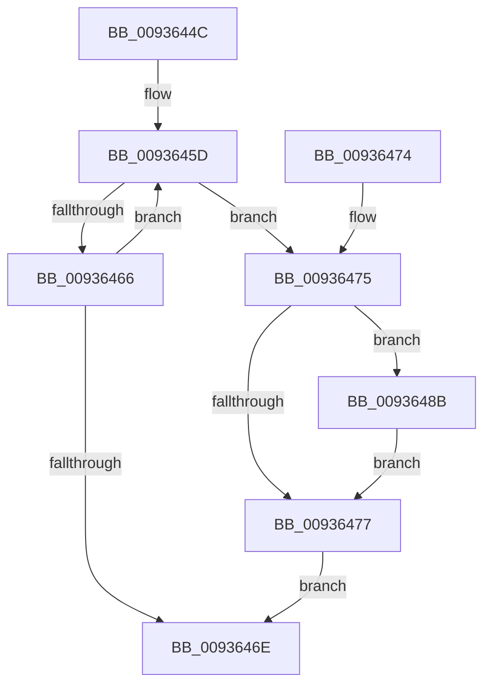

# VrpDereferenceDiffHiveEntry

- RVA: `0x0093644C`–`0x00936494` (길이 `72` bytes)
- VA: `0x000000014093644C`
- 실행 섹션: `PAGE`
- PDB 이름 있음: `예`; PDB Function 태그: `아니요`
- unwind 정보 RVA: `0x00065B84`
- 디코드: `23`개 명령, `72/72` bytes 표시
- 미해석 바이트: `0` (있으면 어셈블리에 `.byte`로 보존)

> 이 문서는 커널 이미지의 기계어와 PDB 기호를 분석해 생성했습니다. 4번과 5번은 함수 원형과 자료형을 바이너리 사용 방식에서 추정한 C 해석이며 원본 소스 복구 결과는 아닙니다.

## 1. Dependencies

- 직접 호출 지점: **3**; 고유 호출 대상: **3**
- 직접 호출자로 확인된 함수: **2**
- RIP 상대 이미지 참조: **0**

### Outgoing calls
- `0x00936477` → [VrpLockDiffHiveTableExclusive](VrpLockDiffHiveTableExclusive_function_00936F10.md) (function, `0x00936F10`)
- `0x0093647F` → [VrpDereferenceDiffHiveEntryWithLock](VrpDereferenceDiffHiveEntryWithLock_function_00937674.md) (function, `0x00937674`)
- `0x00936484` → [VrpUnlockDiffHiveTable](VrpUnlockDiffHiveTable_function_00936E40.md) (function, `0x00936E40`)

### Direct callers
- [VrpLoadDifferencingHive](VrpLoadDifferencingHive_function_00935F40.md) at `0x00935FEC`
- [VrpUnloadDifferencingHive](VrpUnloadDifferencingHive_function_00936CE0.md) at `0x00936D98`

### Static image references
- 디코드된 RIP-relative 메모리 참조가 없습니다.

## 2. Other-region calls and transfers

- 다른 실행 섹션으로 향하는 call: **0**
- 별도 외부 분기/꼬리 이동을 확인하지 못했습니다.

## 3. Assembly (complete function range)

```asm
0093644C  40 53                           push rbx
0093644E  48 83 EC 20                     sub rsp, 0x20
00936452  48 8B D9                        mov rbx, rcx
00936455  0F 0D 49 10                     prefetchw byte ptr [rcx + 0x10]
00936459  48 8B 41 10                     mov rax, qword ptr [rcx + 0x10]
0093645D  48 8D 48 FF                     lea rcx, [rax - 1]
00936461  48 85 C9                        test rcx, rcx
00936464  7E 0F                           jle 0x140936475
00936466  F0 48 0F B1 4B 10               lock cmpxchg qword ptr [rbx + 0x10], rcx
0093646C  75 EF                           jne 0x14093645d
0093646E  48 83 C4 20                     add rsp, 0x20
00936472  5B                              pop rbx
00936473  C3                              ret
00936474  CC                              int3
00936475  75 14                           jne 0x14093648b
00936477  E8 94 0A 00 00                  call 0x140936f10
0093647C  48 8B CB                        mov rcx, rbx
0093647F  E8 F0 11 00 00                  call 0x140937674
00936484  E8 B7 09 00 00                  call 0x140936e40
00936489  EB E3                           jmp 0x14093646e
0093648B  B9 0E 00 00 00                  mov ecx, 0xe
00936490  CD 29                           int 0x29
00936492  EB E3                           jmp 0x140936477
```

## 4. C-style interpretation (structured pseudocode)

```c
__int64 __fastcall VrpDereferenceDiffHiveEntry(__int64 a1)
{
    __int64 result;
    __int64 v_rsp;

    v_rsp = (v_rsp) - (32);
loc_0093645D:
    if (condition_is_less_or_equal) goto loc_00936475;
    if (*(unsigned __int64 *)(a1 + 16) - 1 != 0) goto loc_0093645D;
loc_0093646E:
    v_rsp = (v_rsp) + (32);
    return *(unsigned __int64 *)(a1 + 16);
loc_00936475:
    if (condition_is_not_equal) goto loc_0093648B;
loc_00936477:
    result = VrpLockDiffHiveTableExclusive(*(unsigned __int64 *)(a1 + 16) - 1, a2, a3, a4);
    result = VrpDereferenceDiffHiveEntryWithLock(a1, a2, a3, a4);
    result = VrpUnlockDiffHiveTable(a1, a2, a3, a4);
    goto loc_0093646E;
loc_0093648B:
    goto loc_00936477;
}
```

## 5. (Beta) C Style

```c
int64_t VrpDereferenceDiffHiveEntry(void *Arg1)
{
    uint8_t *arg1 = (uint8_t *)Arg1;

    int64_t result;
    int64_t local_rsp;

    local_rsp = (local_rsp) - (32);
loc_0093645D:
    if (condition_is_less_or_equal) goto loc_00936475;
    if (*(uint64_t *)(arg1 + 0x10) - 1 != 0) goto loc_0093645D;
loc_0093646E:
    local_rsp = (local_rsp) + (32);
    return *(uint64_t *)(arg1 + 0x10);
loc_00936475:
    if (condition_is_not_equal) goto loc_0093648B;
loc_00936477:
    result = VrpLockDiffHiveTableExclusive(*(uint64_t *)(arg1 + 0x10) - 1, a2, a3, a4);
    result = VrpDereferenceDiffHiveEntryWithLock(Arg1, a2, a3, a4);
    result = VrpUnlockDiffHiveTable(Arg1, a2, a3, a4);
    goto loc_0093646E;
loc_0093648B:
    goto loc_00936477;
}
```

### 관측된 메모리 오프셋

구조체 형식이 확인되지 않은 접근은 인자 기준의 오프셋으로만 기록했습니다.

| 기준 인자 | 오프셋 표현 | 폭 (bit) | 접근 |
|---|---:|---:|---|
| `Arg1` | `+ 0x10` | `8` | `R` |
| `Arg1` | `+ 0x10` | `64` | `R` |

## 6. Execution-region graph

[열기: 2D/3D 그래프와 함수 탐색 컨트롤 패널](../../../control-panel.html?section=page&rva=0x0093644C&view=graph)

- 2D 그래프는 위에서 아래로 흐르고, 3D 그래프는 빈 공간을 드래그해 회전합니다. Shift+드래그는 이동, 휠은 확대·축소, 함수 노드 선택은 대상 보고서 이동입니다.

### Static fallback


