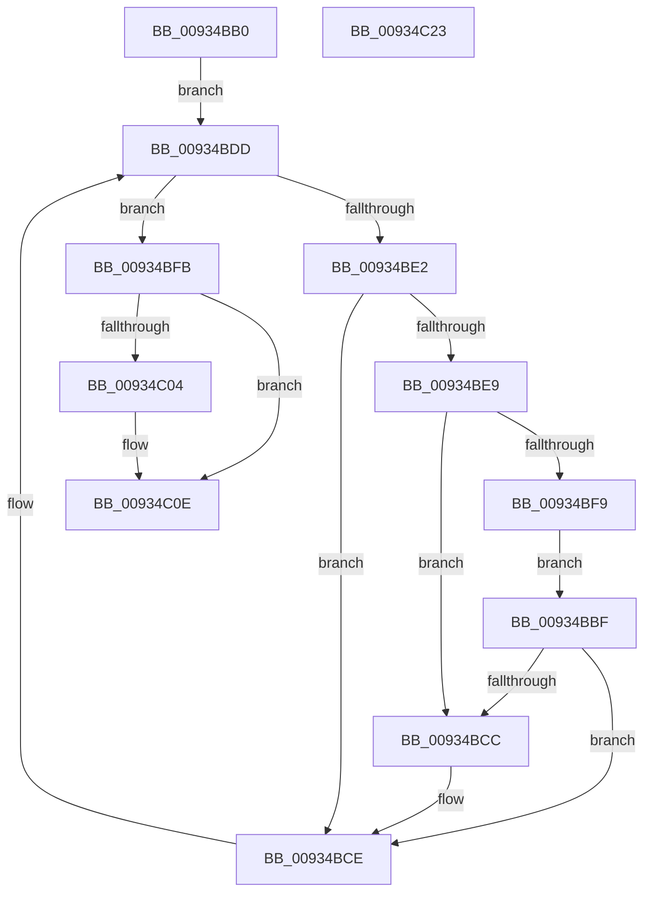

# VrpDestroyNamespaceNodeList

- RVA: `0x00934BB0`–`0x00934C24` (길이 `116` bytes)
- VA: `0x0000000140934BB0`
- 실행 섹션: `PAGE`
- PDB 이름 있음: `예`; PDB Function 태그: `아니요`
- unwind 정보 RVA: `0x0005CF00`
- 디코드: `38`개 명령, `116/116` bytes 표시
- 미해석 바이트: `0` (있으면 어셈블리에 `.byte`로 보존)

> 이 문서는 커널 이미지의 기계어와 PDB 기호를 분석해 생성했습니다. 4번과 5번은 함수 원형과 자료형을 바이너리 사용 방식에서 추정한 C 해석이며 원본 소스 복구 결과는 아닙니다.

## 1. Dependencies

- 직접 호출 지점: **2**; 고유 호출 대상: **2**
- 직접 호출자로 확인된 함수: **1**
- RIP 상대 이미지 참조: **0**

### Outgoing calls
- `0x00934BD4` → [VrpDestroyNamespaceNode](VrpDestroyNamespaceNode_function_00934A50.md) (function, `0x00934A50`)
- `0x00934C09` → [ExFreePoolWithTag](../../poolcode/B8/ExFreePoolWithTag_function_00B82870.md) (function, `0x00B82870`)

### Direct callers
- [VrpCleanupNamespace](VrpCleanupNamespace_function_0093649C.md) at `0x009364B0`

### Static image references
- 디코드된 RIP-relative 메모리 참조가 없습니다.

## 2. Other-region calls and transfers

- 다른 실행 섹션으로 향하는 call: **1**
  - `0x00934C09` → [ExFreePoolWithTag](../../poolcode/B8/ExFreePoolWithTag_function_00B82870.md) (`PAGE` → `POOLCODE`)
- 별도 외부 분기/꼬리 이동을 확인하지 못했습니다.

## 3. Assembly (complete function range)

```asm
00934BB0  40 53                           push rbx
00934BB2  48 83 EC 20                     sub rsp, 0x20
00934BB6  48 8B 41 30                     mov rax, qword ptr [rcx + 0x30]
00934BBA  48 8B D9                        mov rbx, rcx
00934BBD  EB 1E                           jmp 0x140934bdd
00934BBF  48 8B 4B 48                     mov rcx, qword ptr [rbx + 0x48]
00934BC3  48 8D 14 01                     lea rdx, [rcx + rax]
00934BC7  48 3B D1                        cmp rdx, rcx
00934BCA  73 02                           jae 0x140934bce
00934BCC  33 D2                           xor edx, edx
00934BCE  48 8B 12                        mov rdx, qword ptr [rdx]
00934BD1  48 8B CB                        mov rcx, rbx
00934BD4  E8 77 FE FF FF                  call 0x140934a50
00934BD9  48 8B 43 30                     mov rax, qword ptr [rbx + 0x30]
00934BDD  48 85 C0                        test rax, rax
00934BE0  74 19                           je 0x140934bfb
00934BE2  33 D2                           xor edx, edx
00934BE4  48 85 C0                        test rax, rax
00934BE7  74 E5                           je 0x140934bce
00934BE9  48 21 54 24 30                  and qword ptr [rsp + 0x30], rdx
00934BEE  33 C0                           xor eax, eax
00934BF0  48 F7 63 28                     mul qword ptr [rbx + 0x28]
00934BF4  48 85 D2                        test rdx, rdx
00934BF7  75 D3                           jne 0x140934bcc
00934BF9  EB C4                           jmp 0x140934bbf
00934BFB  48 8B 4B 48                     mov rcx, qword ptr [rbx + 0x48]
00934BFF  48 85 C9                        test rcx, rcx
00934C02  74 0A                           je 0x140934c0e
00934C04  BA 52 54 61 72                  mov edx, 0x72615452
00934C09  E8 62 DC 24 00                  call 0x140b82870
00934C0E  0F 57 C0                        xorps xmm0, xmm0
00934C11  0F 11 43 20                     movups xmmword ptr [rbx + 0x20], xmm0
00934C15  0F 11 43 30                     movups xmmword ptr [rbx + 0x30], xmm0
00934C19  0F 11 43 40                     movups xmmword ptr [rbx + 0x40], xmm0
00934C1D  48 83 C4 20                     add rsp, 0x20
00934C21  5B                              pop rbx
00934C22  C3                              ret
00934C23  CC                              int3
```

## 4. C-style interpretation (structured pseudocode)

```c
__int64 __fastcall VrpDestroyNamespaceNodeList(__int64 a1)
{
    __int64 result;
    __int64 v_rsp;
    unsigned __int64 v_stack_p8;

    v_rsp = (v_rsp) - (32);
    goto loc_00934BDD;
loc_00934BBF:
    if ((*(unsigned __int64 *)(a1 + 72) + *(unsigned __int64 *)(a1 + 48) * 1) < (*(unsigned __int64 *)(a1 + 72))) {
        a2 = 0;
    }
    result = VrpDestroyNamespaceNode(a1, *(unsigned __int64 *)(a2), a3, a4);
loc_00934BDD:
    if (*(unsigned __int64 *)(a1 + 48) == 0) goto loc_00934BFB;
    a2 = 0;
    if (*(unsigned __int64 *)(a1 + 48) == 0) goto loc_00934BCE;
    result = 0;
    if (0 != 0) goto loc_00934BCC;
    goto loc_00934BBF;
loc_00934BFB:
    if (*(unsigned __int64 *)(a1 + 72) != 0) {
        a2 = 0x72615452ULL;
        result = ExFreePoolWithTag(*(unsigned __int64 *)(a1 + 72), a2, a3, a4);
    }
    *(unsigned __int64 *)(a1 + 32) = v_xmm0;
    *(unsigned __int64 *)(a1 + 48) = v_xmm0;
    *(unsigned __int64 *)(a1 + 64) = v_xmm0;
    v_rsp = (v_rsp) + (32);
    return result;
}
```

## 5. (Beta) C Style

```c
int64_t VrpDestroyNamespaceNodeList(void *Arg1)
{
    uint8_t *arg1 = (uint8_t *)Arg1;

    int64_t result;
    int64_t local_rsp;
    uint64_t v_stack_p8;

    local_rsp = (local_rsp) - (32);
    goto loc_00934BDD;
loc_00934BBF:
    if ((*(uint64_t *)(arg1 + 0x48) + *(uint64_t *)(arg1 + 0x30) * 1) < (*(uint64_t *)(arg1 + 0x48))) {
        a2 = 0;
    }
    result = VrpDestroyNamespaceNode(Arg1, *(uint64_t *)(a2), a3, a4);
loc_00934BDD:
    if (*(uint64_t *)(arg1 + 0x30) == 0) goto loc_00934BFB;
    a2 = 0;
    if (*(uint64_t *)(arg1 + 0x30) == 0) goto loc_00934BCE;
    result = 0;
    if (0 != 0) goto loc_00934BCC;
    goto loc_00934BBF;
loc_00934BFB:
    if (*(uint64_t *)(arg1 + 0x48) != 0) {
        a2 = 0x72615452ULL;
        result = ExFreePoolWithTag(*(uint64_t *)(arg1 + 0x48), a2, a3, a4);
    }
    *(uint64_t *)(arg1 + 0x20) = v_xmm0;
    *(uint64_t *)(arg1 + 0x30) = v_xmm0;
    *(uint64_t *)(arg1 + 0x40) = v_xmm0;
    local_rsp = (local_rsp) + (32);
    return result;
}
```

### 관측된 메모리 오프셋

구조체 형식이 확인되지 않은 접근은 인자 기준의 오프셋으로만 기록했습니다.

| 기준 인자 | 오프셋 표현 | 폭 (bit) | 접근 |
|---|---:|---:|---|
| `Arg1` | `+ 0x20` | `128` | `R` |
| `Arg1` | `+ 0x28` | `64` | `R` |
| `Arg1` | `+ 0x30` | `64` | `R` |
| `Arg1` | `+ 0x30` | `128` | `R` |
| `Arg1` | `+ 0x40` | `128` | `R` |
| `Arg1` | `+ 0x48` | `64` | `R` |

## 6. Execution-region graph

[열기: 2D/3D 그래프와 함수 탐색 컨트롤 패널](../../../control-panel.html?section=page&rva=0x00934BB0&view=graph)

- 2D 그래프는 위에서 아래로 흐르고, 3D 그래프는 빈 공간을 드래그해 회전합니다. Shift+드래그는 이동, 휠은 확대·축소, 함수 노드 선택은 대상 보고서 이동입니다.

### Static fallback


