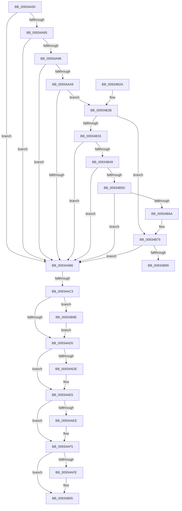

# VrpDestroyNamespaceNode

- RVA: `0x00934A50`–`0x00934BAA` (길이 `346` bytes)
- VA: `0x0000000140934A50`
- 실행 섹션: `PAGE`
- PDB 이름 있음: `예`; PDB Function 태그: `예`
- unwind 정보 RVA: `0x0008F1CC`
- 디코드: `104`개 명령, `346/346` bytes 표시
- 미해석 바이트: `0` (있으면 어셈블리에 `.byte`로 보존)

> 이 문서는 커널 이미지의 기계어와 PDB 기호를 분석해 생성했습니다. 4번과 5번은 함수 원형과 자료형을 바이너리 사용 방식에서 추정한 C 해석이며 원본 소스 복구 결과는 아닙니다.

## 1. Dependencies

- 직접 호출 지점: **8**; 고유 호출 대상: **5**
- 직접 호출자로 확인된 함수: **6**
- RIP 상대 이미지 참조: **0**

### Outgoing calls
- `0x00934A7B` → [VrpFindExactNamespaceNode](VrpFindExactNamespaceNode_function_00934748.md) (function, `0x00934748`)
- `0x00934AE0` → [ExFreePoolWithTag](../../poolcode/B8/ExFreePoolWithTag_function_00B82870.md) (function, `0x00B82870`)
- `0x00934AF0` → [ExFreePoolWithTag](../../poolcode/B8/ExFreePoolWithTag_function_00B82870.md) (function, `0x00B82870`)
- `0x00934B00` → [ExFreePoolWithTag](../../poolcode/B8/ExFreePoolWithTag_function_00B82870.md) (function, `0x00B82870`)
- `0x00934B0A` → [ExFreePoolWithTag](../../poolcode/B8/ExFreePoolWithTag_function_00B82870.md) (function, `0x00B82870`)
- `0x00934B70` → [memcpy](../../text/6C/memcpy_function_006C6840.md) (function, `0x006C6840`)
- `0x00934B7F` → [memset](../../text/6C/memset_function_006C6C40.md) (function, `0x006C6C40`)
- `0x00934BA0` → [ObDereferenceObjectDeferDeleteWithTag](../../text/26/ObDereferenceObjectDeferDeleteWithTag_function_00263EA0.md) (function, `0x00263EA0`)

### Direct callers
- [VrpHandleIoctlCreateMultipleNamespaceNodes](../83/VrpHandleIoctlCreateMultipleNamespaceNodes_function_0083B17C.md) at `0x0083B40C`
- [VrpDestroyNamespaceNodeList](VrpDestroyNamespaceNodeList_function_00934BB0.md) at `0x00934BD4`
- [VrpHandleIoctlCreateNamespaceNode](VrpHandleIoctlCreateNamespaceNode_function_0093511C.md) at `0x00935366`
- [VrpHandleIoctlUnloadDynamicallyLoadedHives](VrpHandleIoctlUnloadDynamicallyLoadedHives_function_0093778C.md) at `0x0093793E`
- [VrpPreLoadKey](../A8/VrpPreLoadKey_function_00A8A43C.md) at `0x00A8A7A2`
- [VrpPostUnloadKey](../AD/VrpPostUnloadKey_function_00AD60DC.md) at `0x00AD6124`

### Static image references
- 디코드된 RIP-relative 메모리 참조가 없습니다.

## 2. Other-region calls and transfers

- 다른 실행 섹션으로 향하는 call: **7**
  - `0x00934AE0` → [ExFreePoolWithTag](../../poolcode/B8/ExFreePoolWithTag_function_00B82870.md) (`PAGE` → `POOLCODE`)
  - `0x00934AF0` → [ExFreePoolWithTag](../../poolcode/B8/ExFreePoolWithTag_function_00B82870.md) (`PAGE` → `POOLCODE`)
  - `0x00934B00` → [ExFreePoolWithTag](../../poolcode/B8/ExFreePoolWithTag_function_00B82870.md) (`PAGE` → `POOLCODE`)
  - `0x00934B0A` → [ExFreePoolWithTag](../../poolcode/B8/ExFreePoolWithTag_function_00B82870.md) (`PAGE` → `POOLCODE`)
  - `0x00934B70` → [memcpy](../../text/6C/memcpy_function_006C6840.md) (`PAGE` → `.text`)
  - `0x00934B7F` → [memset](../../text/6C/memset_function_006C6C40.md) (`PAGE` → `.text`)
  - `0x00934BA0` → [ObDereferenceObjectDeferDeleteWithTag](../../text/26/ObDereferenceObjectDeferDeleteWithTag_function_00263EA0.md) (`PAGE` → `.text`)
- call이 아닌 외부 분기/꼬리 이동: **2**
  - `0x00934ABD` → [sub_00B24914 + 0xF0](../B2/Unknown_function_00B24914.md) (`tail-transfer`)
  - `0x00934B99` → [sub_00B24914](../B2/Unknown_function_00B24914.md) (`tail-transfer`)

## 3. Assembly (complete function range)

```asm
00934A50  48 89 5C 24 08                  mov qword ptr [rsp + 8], rbx
00934A55  55                              push rbp
00934A56  56                              push rsi
00934A57  57                              push rdi
00934A58  41 54                           push r12
00934A5A  41 55                           push r13
00934A5C  41 56                           push r14
00934A5E  41 57                           push r15
00934A60  48 8B EC                        mov rbp, rsp
00934A63  48 83 EC 50                     sub rsp, 0x50
00934A67  45 33 ED                        xor r13d, r13d
00934A6A  4C 8D 45 48                     lea r8, [rbp + 0x48]
00934A6E  4C 89 6D 48                     mov qword ptr [rbp + 0x48], r13
00934A72  45 8B E5                        mov r12d, r13d
00934A75  48 8B FA                        mov rdi, rdx
00934A78  48 8B D9                        mov rbx, rcx
00934A7B  E8 C8 FC FF FF                  call 0x140934748
00934A80  48 3B C7                        cmp rax, rdi
00934A83  75 31                           jne 0x140934ab6
00934A85  48 8B 73 30                     mov rsi, qword ptr [rbx + 0x30]
00934A89  45 8D 65 01                     lea r12d, [r13 + 1]
00934A8D  48 8B 4D 48                     mov rcx, qword ptr [rbp + 0x48]
00934A91  48 3B CE                        cmp rcx, rsi
00934A94  73 20                           jae 0x140934ab6
00934A96  4C 8B 4B 28                     mov r9, qword ptr [rbx + 0x28]
00934A9A  48 8B C1                        mov rax, rcx
00934A9D  49 F7 E1                        mul r9
00934AA0  4C 89 6D 48                     mov qword ptr [rbp + 0x48], r13
00934AA4  48 85 D2                        test rdx, rdx
00934AA7  75 0D                           jne 0x140934ab6
00934AA9  4C 8B 43 48                     mov r8, qword ptr [rbx + 0x48]
00934AAD  4D 8D 34 00                     lea r14, [r8 + rax]
00934AB1  4D 3B F0                        cmp r14, r8
00934AB4  73 75                           jae 0x140934b2b
00934AB6  8B 47 38                        mov eax, dword ptr [rdi + 0x38]
00934AB9  0F BA E0 1E                     bt eax, 0x1e
00934ABD  0F 82 41 FF 1E 00               jb 0x140b24a04
00934AC3  48 8B 4F 10                     mov rcx, qword ptr [rdi + 0x10]
00934AC7  BB 56 52 65 67                  mov ebx, 0x67655256
00934ACC  48 85 C9                        test rcx, rcx
00934ACF  0F 85 C9 00 00 00               jne 0x140934b9e
00934AD5  48 8B 4F 08                     mov rcx, qword ptr [rdi + 8]
00934AD9  48 85 C9                        test rcx, rcx
00934ADC  74 07                           je 0x140934ae5
00934ADE  8B D3                           mov edx, ebx
00934AE0  E8 8B DD 24 00                  call 0x140b82870
00934AE5  48 8B 4F 20                     mov rcx, qword ptr [rdi + 0x20]
00934AE9  48 85 C9                        test rcx, rcx
00934AEC  74 07                           je 0x140934af5
00934AEE  8B D3                           mov edx, ebx
00934AF0  E8 7B DD 24 00                  call 0x140b82870
00934AF5  48 8B 4F 30                     mov rcx, qword ptr [rdi + 0x30]
00934AF9  48 85 C9                        test rcx, rcx
00934AFC  74 07                           je 0x140934b05
00934AFE  8B D3                           mov edx, ebx
00934B00  E8 6B DD 24 00                  call 0x140b82870
00934B05  8B D3                           mov edx, ebx
00934B07  48 8B CF                        mov rcx, rdi
00934B0A  E8 61 DD 24 00                  call 0x140b82870
00934B0F  48 8B 9C 24 90 00 00 00         mov rbx, qword ptr [rsp + 0x90]
00934B17  41 8B C4                        mov eax, r12d
00934B1A  48 83 C4 50                     add rsp, 0x50
00934B1E  41 5F                           pop r15
00934B20  41 5E                           pop r14
00934B22  41 5D                           pop r13
00934B24  41 5C                           pop r12
00934B26  5F                              pop rdi
00934B27  5E                              pop rsi
00934B28  5D                              pop rbp
00934B29  C3                              ret
00934B2A  CC                              int3
00934B2B  48 2B F1                        sub rsi, rcx
00934B2E  49 2B F4                        sub rsi, r12
00934B31  74 42                           je 0x140934b75
00934B33  49 8B C1                        mov rax, r9
00934B36  4C 89 6D 48                     mov qword ptr [rbp + 0x48], r13
00934B3A  48 F7 E6                        mul rsi
00934B3D  48 8B F0                        mov rsi, rax
00934B40  48 85 D2                        test rdx, rdx
00934B43  0F 85 6D FF FF FF               jne 0x140934ab6
00934B49  48 8D 41 01                     lea rax, [rcx + 1]
00934B4D  4C 89 6D 48                     mov qword ptr [rbp + 0x48], r13
00934B51  49 F7 E1                        mul r9
00934B54  48 85 D2                        test rdx, rdx
00934B57  0F 85 59 FF FF FF               jne 0x140934ab6
00934B5D  49 8D 14 00                     lea rdx, [r8 + rax]
00934B61  49 3B D0                        cmp rdx, r8
00934B64  0F 82 4C FF FF FF               jb 0x140934ab6
00934B6A  4C 8B C6                        mov r8, rsi
00934B6D  49 8B CE                        mov rcx, r14
00934B70  E8 CB 1C D9 FF                  call 0x1406c6840
00934B75  4C 8B 43 28                     mov r8, qword ptr [rbx + 0x28]
00934B79  4A 8D 0C 36                     lea rcx, [rsi + r14]
00934B7D  33 D2                           xor edx, edx
00934B7F  E8 BC 20 D9 FF                  call 0x1406c6c40
00934B84  4C 8B 43 30                     mov r8, qword ptr [rbx + 0x30]
00934B88  49 FF C8                        dec r8
00934B8B  4C 89 43 30                     mov qword ptr [rbx + 0x30], r8
00934B8F  49 83 F8 10                     cmp r8, 0x10
00934B93  0F 86 1D FF FF FF               jbe 0x140934ab6
00934B99  E9 76 FD 1E 00                  jmp 0x140b24914
00934B9E  8B D3                           mov edx, ebx
00934BA0  E8 FB F2 92 FF                  call 0x140263ea0
00934BA5  E9 2B FF FF FF                  jmp 0x140934ad5
```

## 4. C-style interpretation (structured pseudocode)

```c
__int64 __fastcall VrpDestroyNamespaceNode(__int64 a1, __int64 a2)
{
    __int64 result;
    __int64 v_r13;
    __int64 v_rsi;
    __int64 v_rsp;
    unsigned __int64 v_stack_p10;
    unsigned __int64 v_stack_p8;

    v_stack_p8 = v_rbx;
    v_rsp = (v_rsp) - (80);
    v_r13 = 0;
    v_stack_p10 = 0;
    result = VrpFindExactNamespaceNode(a1, a2, v_stack_p10, a4);
    if (result != a2) goto loc_00934AB6;
    if (v_stack_p10 >= (*(unsigned __int64 *)(a1 + 48))) goto loc_00934AB6;
    v_stack_p10 = 0;
    if (a2 != 0) goto loc_00934AB6;
    if ((*(unsigned __int64 *)(a1 + 72) + v_stack_p10 * 1) >= (*(unsigned __int64 *)(a1 + 72))) goto loc_00934B2B;
loc_00934AB6:
    if (*(unsigned __int64 *)(a2 + 16) != 0) goto loc_00934B9E;
loc_00934AD5:
    result = (unsigned int)(*(unsigned int *)(a2 + 56));
    if (*(unsigned __int64 *)(a2 + 8) != 0) {
        a2 = (unsigned int)((unsigned int)(0x67655256ULL));
        result = ExFreePoolWithTag(*(unsigned __int64 *)(a2 + 8), a2, *(unsigned __int64 *)(a1 + 72), *(unsigned __int64 *)(a1 + 40));
    }
    if (*(unsigned __int64 *)(a2 + 32) != 0) {
        a2 = (unsigned int)((unsigned int)(0x67655256ULL));
        result = ExFreePoolWithTag(*(unsigned __int64 *)(a2 + 32), a2, *(unsigned __int64 *)(a1 + 72), *(unsigned __int64 *)(a1 + 40));
    }
    if (*(unsigned __int64 *)(a2 + 48) != 0) {
        a2 = (unsigned int)((unsigned int)(0x67655256ULL));
        result = ExFreePoolWithTag(*(unsigned __int64 *)(a2 + 48), a2, *(unsigned __int64 *)(a1 + 72), *(unsigned __int64 *)(a1 + 40));
    }
    result = ExFreePoolWithTag(a2, (unsigned int)((unsigned int)((unsigned int)(0x67655256ULL))), *(unsigned __int64 *)(a1 + 72), *(unsigned __int64 *)(a1 + 40));
    v_rsp = (v_rsp) + (80);
    return (unsigned int)((unsigned int)(v_r13 + 1));
loc_00934B2B:
    v_rsi = (*(unsigned __int64 *)(a1 + 48)) - (a2);
    v_rsi = (v_rsi) - (v_r13 + 1);
    if (condition_is_equal) goto loc_00934B75;
    v_stack_p10 = 0;
    if ((unsigned int)((unsigned int)((unsigned int)(0x67655256ULL))) != 0) goto loc_00934AB6;
    v_stack_p10 = 0;
    if ((unsigned int)((unsigned int)((unsigned int)(0x67655256ULL))) != 0) goto loc_00934AB6;
    if ((*(unsigned __int64 *)(a1 + 72) + a2 + 1 * 1) < (*(unsigned __int64 *)(a1 + 72))) goto loc_00934AB6;
    result = memcpy(*(unsigned __int64 *)(a1 + 72) + v_stack_p10 * 1, *(unsigned __int64 *)(a1 + 72) + a2 + 1 * 1, *(unsigned __int64 *)(a1 + 40), *(unsigned __int64 *)(a1 + 40));
loc_00934B75:
    a2 = 0;
    result = memset(*(unsigned __int64 *)(a1 + 40) + *(unsigned __int64 *)(a1 + 72) + v_stack_p10 * 1 * 1, a2, *(unsigned __int64 *)(v_stack_p8 + 40), *(unsigned __int64 *)(a1 + 40));
    a3 = (*(unsigned __int64 *)(v_stack_p8 + 48)) - 1;
    *(unsigned __int64 *)(v_stack_p8 + 48) = a3;
    if (a3 <= 16) goto loc_00934AB6;
loc_00934B9E:
    result = ObDereferenceObjectDeferDeleteWithTag(*(unsigned __int64 *)(a1 + 40) + *(unsigned __int64 *)(a1 + 72) + v_stack_p10 * 1 * 1, (unsigned int)((unsigned int)(v_stack_p8)), a3, *(unsigned __int64 *)(a1 + 40));
    goto loc_00934AD5;
}
```

## 5. (Beta) C Style

```c
int64_t VrpDestroyNamespaceNode(void *Arg1, void *Arg2)
{
    uint8_t *arg1 = (uint8_t *)Arg1;
    uint8_t *arg2 = (uint8_t *)Arg2;

    int64_t result;
    int64_t local_r13;
    int64_t local_rsi;
    int64_t local_rsp;
    uint64_t v_stack_p10;
    uint64_t v_stack_p8;

    v_stack_p8 = local_rbx;
    local_rsp = (local_rsp) - (80);
    local_r13 = 0;
    v_stack_p10 = 0;
    result = VrpFindExactNamespaceNode(Arg1, Arg2, v_stack_p10, a4);
    if (result != Arg2) goto loc_00934AB6;
    if (v_stack_p10 >= (*(uint64_t *)(arg1 + 0x30))) goto loc_00934AB6;
    v_stack_p10 = 0;
    if (Arg2 != NULL) goto loc_00934AB6;
    if ((*(uint64_t *)(arg1 + 0x48) + v_stack_p10 * 1) >= (*(uint64_t *)(arg1 + 0x48))) goto loc_00934B2B;
loc_00934AB6:
    if (*(uint64_t *)(arg2 + 0x10) != 0) goto loc_00934B9E;
loc_00934AD5:
    result = (uint32_t)(*(uint32_t *)(arg2 + 0x38));
    if (*(uint64_t *)(arg2 + 0x8) != 0) {
        Arg2 = (uint32_t)((uint32_t)(0x67655256ULL));
        result = ExFreePoolWithTag(*(uint64_t *)(arg2 + 0x8), Arg2, *(uint64_t *)(arg1 + 0x48), *(uint64_t *)(arg1 + 0x28));
    }
    if (*(uint64_t *)(arg2 + 0x20) != 0) {
        Arg2 = (uint32_t)((uint32_t)(0x67655256ULL));
        result = ExFreePoolWithTag(*(uint64_t *)(arg2 + 0x20), Arg2, *(uint64_t *)(arg1 + 0x48), *(uint64_t *)(arg1 + 0x28));
    }
    if (*(uint64_t *)(arg2 + 0x30) != 0) {
        Arg2 = (uint32_t)((uint32_t)(0x67655256ULL));
        result = ExFreePoolWithTag(*(uint64_t *)(arg2 + 0x30), Arg2, *(uint64_t *)(arg1 + 0x48), *(uint64_t *)(arg1 + 0x28));
    }
    result = ExFreePoolWithTag(Arg2, (uint32_t)((uint32_t)((uint32_t)(0x67655256ULL))), *(uint64_t *)(arg1 + 0x48), *(uint64_t *)(arg1 + 0x28));
    local_rsp = (local_rsp) + (80);
    return (uint32_t)((uint32_t)(local_r13 + 1));
loc_00934B2B:
    local_rsi = (*(uint64_t *)(arg1 + 0x30)) - (Arg2);
    local_rsi = (local_rsi) - (local_r13 + 1);
    if (condition_is_equal) goto loc_00934B75;
    v_stack_p10 = 0;
    if ((uint32_t)((uint32_t)((uint32_t)(0x67655256ULL))) != 0) goto loc_00934AB6;
    v_stack_p10 = 0;
    if ((uint32_t)((uint32_t)((uint32_t)(0x67655256ULL))) != 0) goto loc_00934AB6;
    if ((*(uint64_t *)(arg1 + 0x48) + Arg2 + 1 * 1) < (*(uint64_t *)(arg1 + 0x48))) goto loc_00934AB6;
    result = memcpy(*(uint64_t *)(arg1 + 0x48) + v_stack_p10 * 1, *(uint64_t *)(arg1 + 0x48) + Arg2 + 1 * 1, *(uint64_t *)(arg1 + 0x28), *(uint64_t *)(arg1 + 0x28));
loc_00934B75:
    Arg2 = 0;
    result = memset(*(uint64_t *)(arg1 + 0x28) + *(uint64_t *)(arg1 + 0x48) + v_stack_p10 * 1 * 1, Arg2, *(uint64_t *)(v_stack_p8 + 0x28), *(uint64_t *)(arg1 + 0x28));
    a3 = (*(uint64_t *)(v_stack_p8 + 0x30)) - 1;
    *(uint64_t *)(v_stack_p8 + 0x30) = a3;
    if (a3 <= 16) goto loc_00934AB6;
loc_00934B9E:
    result = ObDereferenceObjectDeferDeleteWithTag(*(uint64_t *)(arg1 + 0x28) + *(uint64_t *)(arg1 + 0x48) + v_stack_p10 * 1 * 1, (uint32_t)((uint32_t)(v_stack_p8)), a3, *(uint64_t *)(arg1 + 0x28));
    goto loc_00934AD5;
}
```

### 관측된 메모리 오프셋

구조체 형식이 확인되지 않은 접근은 인자 기준의 오프셋으로만 기록했습니다.

| 기준 인자 | 오프셋 표현 | 폭 (bit) | 접근 |
|---|---:|---:|---|
| `Arg1` | `+ 0x28` | `64` | `R` |
| `Arg1` | `+ 0x30` | `64` | `R` |
| `Arg1` | `+ 0x30` | `64` | `W` |
| `Arg1` | `+ 0x48` | `64` | `R` |
| `Arg2` | `+ 0x8` | `64` | `R` |
| `Arg2` | `+ 0x10` | `64` | `R` |
| `Arg2` | `+ 0x20` | `64` | `R` |
| `Arg2` | `+ 0x30` | `64` | `R` |
| `Arg2` | `+ 0x38` | `32` | `R` |

## 6. Execution-region graph

[열기: 2D/3D 그래프와 함수 탐색 컨트롤 패널](../../../control-panel.html?section=page&rva=0x00934A50&view=graph)

- 2D 그래프는 위에서 아래로 흐르고, 3D 그래프는 빈 공간을 드래그해 회전합니다. Shift+드래그는 이동, 휠은 확대·축소, 함수 노드 선택은 대상 보고서 이동입니다.

### Static fallback


