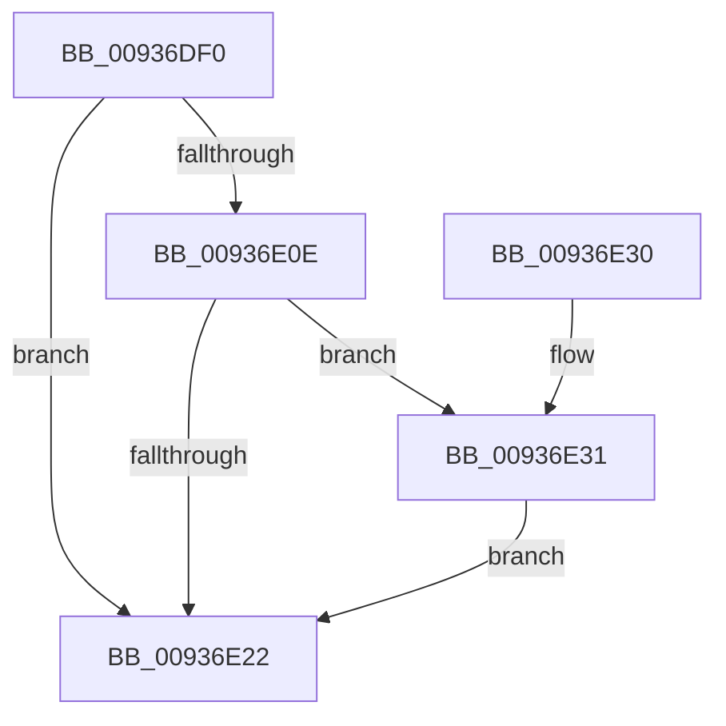

# VrpFindDiffHiveEntryForMountPoint

- RVA: `0x00936DF0`–`0x00936E3A` (길이 `74` bytes)
- VA: `0x0000000140936DF0`
- 실행 섹션: `PAGE`
- PDB 이름 있음: `예`; PDB Function 태그: `아니요`
- unwind 정보 RVA: `0x00060BD8`
- 디코드: `23`개 명령, `74/74` bytes 표시
- 미해석 바이트: `0` (있으면 어셈블리에 `.byte`로 보존)

> 이 문서는 커널 이미지의 기계어와 PDB 기호를 분석해 생성했습니다. 4번과 5번은 함수 원형과 자료형을 바이너리 사용 방식에서 추정한 C 해석이며 원본 소스 복구 결과는 아닙니다.

## 1. Dependencies

- 직접 호출 지점: **3**; 고유 호출 대상: **3**
- 직접 호출자로 확인된 함수: **1**
- RIP 상대 이미지 참조: **0**

### Outgoing calls
- `0x00936DF9` → [VrpLockDiffHiveTableShared](VrpLockDiffHiveTableShared_function_00936EA4.md) (function, `0x00936EA4`)
- `0x00936E01` → [VrpFindDiffHiveEntryForMountPointWithLock](../85/VrpFindDiffHiveEntryForMountPointWithLock_function_0085E484.md) (function, `0x0085E484`)
- `0x00936E22` → [VrpUnlockDiffHiveTable](VrpUnlockDiffHiveTable_function_00936E40.md) (function, `0x00936E40`)

### Direct callers
- [VrpUnloadDifferencingHive](VrpUnloadDifferencingHive_function_00936CE0.md) at `0x00936D0E`

### Static image references
- 디코드된 RIP-relative 메모리 참조가 없습니다.

## 2. Other-region calls and transfers

- 다른 실행 섹션으로 향하는 call: **0**
- 별도 외부 분기/꼬리 이동을 확인하지 못했습니다.

## 3. Assembly (complete function range)

```asm
00936DF0  40 53                           push rbx
00936DF2  48 83 EC 20                     sub rsp, 0x20
00936DF6  48 8B D9                        mov rbx, rcx
00936DF9  E8 A6 00 00 00                  call 0x140936ea4
00936DFE  48 8B CB                        mov rcx, rbx
00936E01  E8 7E 76 F2 FF                  call 0x14085e484
00936E06  48 8B D8                        mov rbx, rax
00936E09  48 85 C0                        test rax, rax
00936E0C  74 14                           je 0x140936e22
00936E0E  B9 01 00 00 00                  mov ecx, 1
00936E13  F0 48 0F C1 48 10               lock xadd qword ptr [rax + 0x10], rcx
00936E19  48 FF C1                        inc rcx
00936E1C  48 83 F9 01                     cmp rcx, 1
00936E20  7E 0F                           jle 0x140936e31
00936E22  E8 19 00 00 00                  call 0x140936e40
00936E27  48 8B C3                        mov rax, rbx
00936E2A  48 83 C4 20                     add rsp, 0x20
00936E2E  5B                              pop rbx
00936E2F  C3                              ret
00936E30  CC                              int3
00936E31  B9 0E 00 00 00                  mov ecx, 0xe
00936E36  CD 29                           int 0x29
00936E38  EB E8                           jmp 0x140936e22
```

## 4. C-style interpretation (structured pseudocode)

```c
__int64 __fastcall VrpFindDiffHiveEntryForMountPoint(__int64 a1)
{
    __int64 result;
    __int64 v_rsp;

    v_rsp = (v_rsp) - (32);
    result = VrpLockDiffHiveTableShared(a1, a2, a3, a4);
    result = VrpFindDiffHiveEntryForMountPointWithLock(a1, a2, a3, a4);
    if (result == 0) goto loc_00936E22;
    a1 = (1) + 1;
    if (a1 <= 1) goto loc_00936E31;
loc_00936E22:
    result = VrpUnlockDiffHiveTable(a1, a2, a3, a4);
    v_rsp = (v_rsp) + (32);
    return result;
loc_00936E31:
    goto loc_00936E22;
}
```

## 5. (Beta) C Style

```c
int64_t VrpFindDiffHiveEntryForMountPoint(int64_t Arg1)
{
    int64_t result;
    int64_t local_rsp;

    local_rsp = (local_rsp) - (32);
    result = VrpLockDiffHiveTableShared(Arg1, a2, a3, a4);
    result = VrpFindDiffHiveEntryForMountPointWithLock(Arg1, a2, a3, a4);
    if (result == 0) goto loc_00936E22;
    Arg1 = (1) + 1;
    if (Arg1 <= 1) goto loc_00936E31;
loc_00936E22:
    result = VrpUnlockDiffHiveTable(Arg1, a2, a3, a4);
    local_rsp = (local_rsp) + (32);
    return result;
loc_00936E31:
    goto loc_00936E22;
}
```

## 6. Execution-region graph

[열기: 2D/3D 그래프와 함수 탐색 컨트롤 패널](../../../control-panel.html?section=page&rva=0x00936DF0&view=graph)

- 2D 그래프는 위에서 아래로 흐르고, 3D 그래프는 빈 공간을 드래그해 회전합니다. Shift+드래그는 이동, 휠은 확대·축소, 함수 노드 선택은 대상 보고서 이동입니다.

### Static fallback


