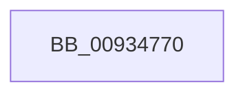

# VrpFindNamespaceNode

- RVA: `0x00934770`–`0x00934787` (길이 `23` bytes)
- VA: `0x0000000140934770`
- 실행 섹션: `PAGE`
- PDB 이름 있음: `예`; PDB Function 태그: `아니요`
- unwind 정보 RVA: `0x0008F13C`
- 디코드: `7`개 명령, `23/23` bytes 표시
- 미해석 바이트: `0` (있으면 어셈블리에 `.byte`로 보존)

> 이 문서는 커널 이미지의 기계어와 PDB 기호를 분석해 생성했습니다. 4번과 5번은 함수 원형과 자료형을 바이너리 사용 방식에서 추정한 C 해석이며 원본 소스 복구 결과는 아닙니다.

## 1. Dependencies

- 직접 호출 지점: **0**; 고유 호출 대상: **0**
- 직접 호출자로 확인된 함수: **2**
- RIP 상대 이미지 참조: **0**

### Outgoing calls
- 직접 디코드된 call 명령이 없습니다.

### Direct callers
- [VrpFindExactNamespaceNode](VrpFindExactNamespaceNode_function_00934748.md) at `0x00934758`
- [VrpFindBestMatchNamespaceNode](VrpFindBestMatchNamespaceNode_function_00934C2C.md) at `0x00934C3C`

### Static image references
- 디코드된 RIP-relative 메모리 참조가 없습니다.

## 2. Other-region calls and transfers

- 다른 실행 섹션으로 향하는 call: **0**
- 별도 외부 분기/꼬리 이동을 확인하지 못했습니다.

## 3. Assembly (complete function range)

```asm
00934770  4C 8B DC                        mov r11, rsp
00934773  4D 89 4B 20                     mov qword ptr [r11 + 0x20], r9
00934777  45 89 43 18                     mov dword ptr [r11 + 0x18], r8d
0093477B  49 89 4B 08                     mov qword ptr [r11 + 8], rcx
0093477F  41 54                           push r12
00934781  41 55                           push r13
00934783  48 83 EC 68                     sub rsp, 0x68
```

## 4. C-style interpretation (structured pseudocode)

```c
void __fastcall VrpFindNamespaceNode(__int64 a1, __int64 a2, int a3, __int64 a4)
{
    __int64 v_rsp;

    *(unsigned __int64 *)(v_rsp + 32) = a4;
    *(unsigned int *)(v_rsp + 24) = a3;
    *(unsigned __int64 *)(v_rsp + 8) = a1;
    v_rsp = (v_rsp) - (104);
    return;
}
```

## 5. (Beta) C Style

```c
void VrpFindNamespaceNode(int64_t Arg1, int64_t Arg2, int32_t Arg3, int64_t Arg4)
{
    int64_t local_rsp;

    *(uint64_t *)(local_rsp + 0x20) = Arg4;
    *(uint32_t *)(local_rsp + 0x18) = Arg3;
    *(uint64_t *)(local_rsp + 0x8) = Arg1;
    local_rsp = (local_rsp) - (104);
    return;
}
```

## 6. Execution-region graph

[열기: 2D/3D 그래프와 함수 탐색 컨트롤 패널](../../../control-panel.html?section=page&rva=0x00934770&view=graph)

- 2D 그래프는 위에서 아래로 흐르고, 3D 그래프는 빈 공간을 드래그해 회전합니다. Shift+드래그는 이동, 휠은 확대·축소, 함수 노드 선택은 대상 보고서 이동입니다.

### Static fallback


