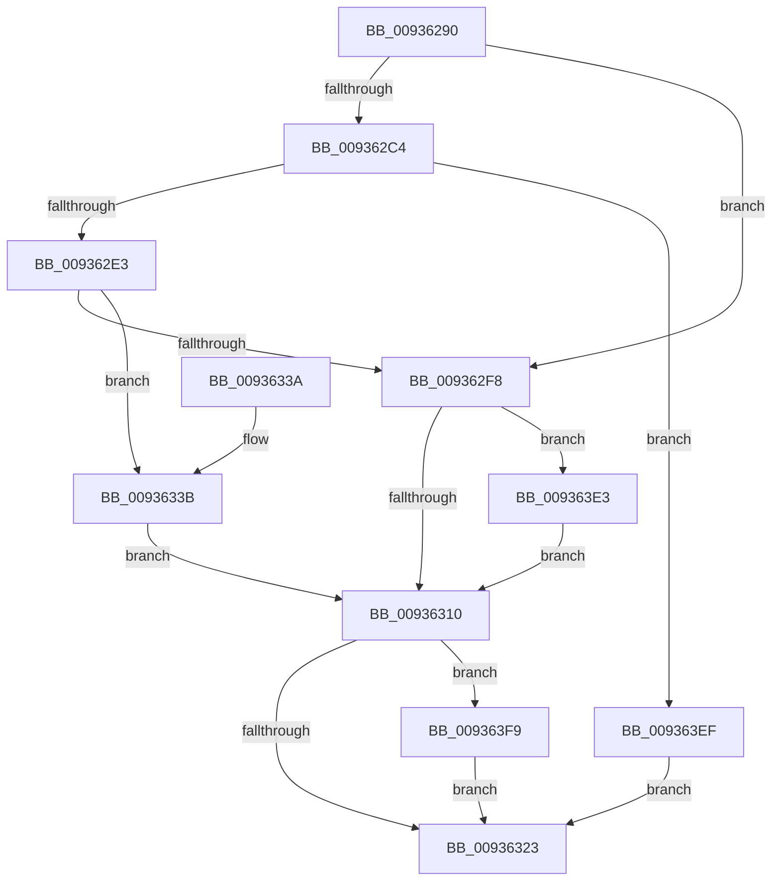

# VrpFindOrCreateDiffHiveEntryForMountPoint

- RVA: `0x00936290`–`0x0093640B` (길이 `379` bytes)
- VA: `0x0000000140936290`
- 실행 섹션: `PAGE`
- PDB 이름 있음: `예`; PDB Function 태그: `아니요`
- unwind 정보 RVA: `0x0008F344`
- 디코드: `98`개 명령, `379/379` bytes 표시
- 미해석 바이트: `0` (있으면 어셈블리에 `.byte`로 보존)

> 이 문서는 커널 이미지의 기계어와 PDB 기호를 분석해 생성했습니다. 4번과 5번은 함수 원형과 자료형을 바이너리 사용 방식에서 추정한 C 해석이며 원본 소스 복구 결과는 아닙니다.

## 1. Dependencies

- 직접 호출 지점: **8**; 고유 호출 대상: **6**
- 직접 호출자로 확인된 함수: **1**
- RIP 상대 이미지 참조: **3**

### Outgoing calls
- `0x009362AF` → [VrpLockDiffHiveTableShared](VrpLockDiffHiveTableShared_function_00936EA4.md) (function, `0x00936EA4`)
- `0x009362B7` → [VrpFindDiffHiveEntryForMountPointWithLock](../85/VrpFindDiffHiveEntryForMountPointWithLock_function_0085E484.md) (function, `0x0085E484`)
- `0x009362C4` → [VrpUnlockDiffHiveTable](VrpUnlockDiffHiveTable_function_00936E40.md) (function, `0x00936E40`)
- `0x009362CF` → [VrpAllocateDiffHiveEntry](../85/VrpAllocateDiffHiveEntry_function_0085E320.md) (function, `0x0085E320`)
- `0x009362E3` → [VrpLockDiffHiveTableExclusive](VrpLockDiffHiveTableExclusive_function_00936F10.md) (function, `0x00936F10`)
- `0x009362EB` → [VrpFindDiffHiveEntryForMountPointWithLock](../85/VrpFindDiffHiveEntryForMountPointWithLock_function_0085E484.md) (function, `0x0085E484`)
- `0x00936315` → [VrpUnlockDiffHiveTable](VrpUnlockDiffHiveTable_function_00936E40.md) (function, `0x00936E40`)
- `0x00936401` → [ExFreePoolWithTag](../../poolcode/B8/ExFreePoolWithTag_function_00B82870.md) (function, `0x00B82870`)

### Direct callers
- [VrpLoadDifferencingHive](VrpLoadDifferencingHive_function_00935F40.md) at `0x00935FD5`

### Static image references
- `0x0093633B` → RVA `0x00EF02A4` (`.data`; read)
- `0x009363BF` → RVA `0x00EF02A8` (`.data`; read)
- `0x009363D6` → RVA `0x00EF02A0` (`.data`; read/write)

## 2. Other-region calls and transfers

- 다른 실행 섹션으로 향하는 call: **1**
  - `0x00936401` → [ExFreePoolWithTag](../../poolcode/B8/ExFreePoolWithTag_function_00B82870.md) (`PAGE` → `POOLCODE`)
- 별도 외부 분기/꼬리 이동을 확인하지 못했습니다.

## 3. Assembly (complete function range)

```asm
00936290  48 89 5C 24 08                  mov qword ptr [rsp + 8], rbx
00936295  48 89 6C 24 10                  mov qword ptr [rsp + 0x10], rbp
0093629A  48 89 74 24 18                  mov qword ptr [rsp + 0x18], rsi
0093629F  57                              push rdi
009362A0  48 83 EC 20                     sub rsp, 0x20
009362A4  49 8B F0                        mov rsi, r8
009362A7  48 8B EA                        mov rbp, rdx
009362AA  48 8B F9                        mov rdi, rcx
009362AD  33 DB                           xor ebx, ebx
009362AF  E8 F0 0B 00 00                  call 0x140936ea4
009362B4  48 8B CF                        mov rcx, rdi
009362B7  E8 C8 81 F2 FF                  call 0x14085e484
009362BC  4C 8B C8                        mov r9, rax
009362BF  48 85 C0                        test rax, rax
009362C2  75 34                           jne 0x1409362f8
009362C4  E8 77 0B 00 00                  call 0x140936e40
009362C9  48 8B D5                        mov rdx, rbp
009362CC  48 8B CF                        mov rcx, rdi
009362CF  E8 4C 80 F2 FF                  call 0x14085e320
009362D4  48 8B D8                        mov rbx, rax
009362D7  48 8B E8                        mov rbp, rax
009362DA  48 85 C0                        test rax, rax
009362DD  0F 84 0C 01 00 00               je 0x1409363ef
009362E3  E8 28 0C 00 00                  call 0x140936f10
009362E8  48 8B CF                        mov rcx, rdi
009362EB  E8 94 81 F2 FF                  call 0x14085e484
009362F0  4C 8B C8                        mov r9, rax
009362F3  48 85 C0                        test rax, rax
009362F6  74 43                           je 0x14093633b
009362F8  B8 01 00 00 00                  mov eax, 1
009362FD  F0 49 0F C1 41 10               lock xadd qword ptr [r9 + 0x10], rax
00936303  48 FF C0                        inc rax
00936306  48 83 F8 01                     cmp rax, 1
0093630A  0F 8E D3 00 00 00               jle 0x1409363e3
00936310  33 FF                           xor edi, edi
00936312  4C 89 0E                        mov qword ptr [rsi], r9
00936315  E8 26 0B 00 00                  call 0x140936e40
0093631A  48 85 DB                        test rbx, rbx
0093631D  0F 85 D6 00 00 00               jne 0x1409363f9
00936323  48 8B 5C 24 30                  mov rbx, qword ptr [rsp + 0x30]
00936328  8B C7                           mov eax, edi
0093632A  48 8B 6C 24 38                  mov rbp, qword ptr [rsp + 0x38]
0093632F  48 8B 74 24 40                  mov rsi, qword ptr [rsp + 0x40]
00936334  48 83 C4 20                     add rsp, 0x20
00936338  5F                              pop rdi
00936339  C3                              ret
0093633A  CC                              int3
0093633B  8B 0D 63 9F 5B 00               mov ecx, dword ptr [rip + 0x5b9f63]
00936341  48 83 C8 FF                     or rax, 0xffffffffffffffff
00936345  44 8B C1                        mov r8d, ecx
00936348  4C 8B CD                        mov r9, rbp
0093634B  83 E1 1F                        and ecx, 0x1f
0093634E  41 C1 E8 05                     shr r8d, 5
00936352  48 D3 E0                        shl rax, cl
00936355  48 23 43 08                     and rax, qword ptr [rbx + 8]
00936359  48 89 44 24 48                  mov qword ptr [rsp + 0x48], rax
0093635E  0F B6 C0                        movzx eax, al
00936361  48 05 CB 5D B1 00               add rax, 0xb15dcb
00936367  48 6B C8 25                     imul rcx, rax, 0x25
0093636B  0F B6 44 24 49                  movzx eax, byte ptr [rsp + 0x49]
00936370  48 03 C8                        add rcx, rax
00936373  0F B6 44 24 4A                  movzx eax, byte ptr [rsp + 0x4a]
00936378  48 6B D1 25                     imul rdx, rcx, 0x25
0093637C  48 03 D0                        add rdx, rax
0093637F  0F B6 44 24 4B                  movzx eax, byte ptr [rsp + 0x4b]
00936384  48 6B CA 25                     imul rcx, rdx, 0x25
00936388  48 03 C8                        add rcx, rax
0093638B  0F B6 44 24 4C                  movzx eax, byte ptr [rsp + 0x4c]
00936390  48 6B D1 25                     imul rdx, rcx, 0x25
00936394  48 03 D0                        add rdx, rax
00936397  0F B6 44 24 4D                  movzx eax, byte ptr [rsp + 0x4d]
0093639C  48 6B CA 25                     imul rcx, rdx, 0x25
009363A0  48 03 C8                        add rcx, rax
009363A3  0F B6 44 24 4E                  movzx eax, byte ptr [rsp + 0x4e]
009363A8  48 6B D1 25                     imul rdx, rcx, 0x25
009363AC  48 03 D0                        add rdx, rax
009363AF  0F B6 44 24 4F                  movzx eax, byte ptr [rsp + 0x4f]
009363B4  48 6B CA 25                     imul rcx, rdx, 0x25
009363B8  41 8D 50 FF                     lea edx, [r8 - 1]
009363BC  48 03 C1                        add rax, rcx
009363BF  48 8B 0D E2 9E 5B 00            mov rcx, qword ptr [rip + 0x5b9ee2]
009363C6  8B C0                           mov eax, eax
009363C8  48 23 D0                        and rdx, rax
009363CB  48 8B 04 D1                     mov rax, qword ptr [rcx + rdx*8]
009363CF  48 89 03                        mov qword ptr [rbx], rax
009363D2  48 89 1C D1                     mov qword ptr [rcx + rdx*8], rbx
009363D6  FF 05 C4 9E 5B 00               inc dword ptr [rip + 0x5b9ec4]
009363DC  33 DB                           xor ebx, ebx
009363DE  E9 2D FF FF FF                  jmp 0x140936310
009363E3  B9 0E 00 00 00                  mov ecx, 0xe
009363E8  CD 29                           int 0x29
009363EA  E9 21 FF FF FF                  jmp 0x140936310
009363EF  BF 9A 00 00 C0                  mov edi, 0xc000009a
009363F4  E9 2A FF FF FF                  jmp 0x140936323
009363F9  BA 56 52 65 67                  mov edx, 0x67655256
009363FE  48 8B CB                        mov rcx, rbx
00936401  E8 6A C4 24 00                  call 0x140b82870
00936406  E9 18 FF FF FF                  jmp 0x140936323
```

## 4. C-style interpretation (structured pseudocode)

```c
__int64 __fastcall VrpFindOrCreateDiffHiveEntryForMountPoint(__int64 a1, __int64 a2, __int64 a3)
{
    __int64 result;
    __int64 v_rbx;
    __int64 v_rdi;
    __int64 v_rsp;
    unsigned __int64 v_stack_p10;
    unsigned __int64 v_stack_p18;
    unsigned __int64 v_stack_p48;
    unsigned __int8 v_stack_p49;
    unsigned __int8 v_stack_p4A;
    unsigned __int8 v_stack_p4B;
    unsigned __int8 v_stack_p4C;
    unsigned __int8 v_stack_p4D;
    unsigned __int8 v_stack_p4E;
    unsigned __int8 v_stack_p4F;
    unsigned __int64 v_stack_p8;

    v_stack_p8 = v_rbx;
    v_stack_p10 = v_rbp;
    v_stack_p18 = v_rsi;
    v_rsp = (v_rsp) - (32);
    v_rbx = 0;
    result = VrpLockDiffHiveTableShared(a1, a2, a3, a4);
    result = VrpFindDiffHiveEntryForMountPointWithLock(a1, a2, a3, a4);
    if (result != 0) goto loc_009362F8;
    result = VrpUnlockDiffHiveTable(a1, a2, a3, result);
    result = VrpAllocateDiffHiveEntry(a1, a2, a3, result);
    if (result == 0) goto loc_009363EF;
    result = VrpLockDiffHiveTableExclusive(a1, a2, a3, result);
    result = VrpFindDiffHiveEntryForMountPointWithLock(a1, a2, a3, result);
    if (result == 0) goto loc_0093633B;
loc_009362F8:
    result = (1) + 1;
    if (result <= 1) goto loc_009363E3;
loc_00936310:
    v_rdi = 0;
    *(unsigned __int64 *)(a3) = result;
    result = VrpUnlockDiffHiveTable(a1, a2, a3, result);
    if (result != 0) goto loc_009363F9;
loc_00936323:
    v_rsp = (v_rsp) + (32);
    return 0;
loc_0093633B:
    result = (0) | (-1);
    a1 = (unsigned int)(((unsigned int)(*(unsigned int *)(v_rip + 6004579))) & (31));
    a3 = (unsigned int)(((unsigned int)((unsigned int)((unsigned int)(*(unsigned int *)(v_rip + 6004579))))) >> (5));
    result = (result) << ((unsigned __int8)(a1));
    result = (result) & (*(unsigned __int64 *)(v_stack_p8 + 8));
    v_stack_p48 = result;
    result = ((unsigned __int8)(result)) + (0xB15DCBULL);
    a1 = (a1) * (result);
    a1 = (a1) + (v_stack_p49);
    a2 = (a2) * (a1);
    a2 = (a2) + (v_stack_p4A);
    a1 = (a1) * (a2);
    a1 = (a1) + (v_stack_p4B);
    a2 = (a2) * (a1);
    a2 = (a2) + (v_stack_p4C);
    a1 = (a1) * (a2);
    a1 = (a1) + (v_stack_p4D);
    a2 = (a2) * (a1);
    a2 = (a2) + (v_stack_p4E);
    a1 = (a1) * (a2);
    result = (v_stack_p4F) + (a1);
    a2 = (a3 - 1) & ((unsigned int)((unsigned int)(result)));
    *(unsigned __int64 *)(v_stack_p8) = *(unsigned __int64 *)(*(unsigned __int64 *)(v_rip + 6004450) + a2 * 8);
    *(unsigned __int64 *)(*(unsigned __int64 *)(v_rip + 6004450) + a2 * 8) = v_stack_p8;
    v_rbx = 0;
    goto loc_00936310;
loc_009363E3:
    goto loc_00936310;
loc_009363EF:
    goto loc_00936323;
loc_009363F9:
    result = ExFreePoolWithTag(0, (unsigned int)(0x67655256ULL), a3, v_stack_p10);
    goto loc_00936323;
}
```

## 5. (Beta) C Style

```c
int64_t VrpFindOrCreateDiffHiveEntryForMountPoint(int64_t Arg1, int64_t Arg2, void *Arg3)
{
    uint8_t *arg3 = (uint8_t *)Arg3;

    int64_t result;
    int64_t local_rbx;
    int64_t local_rdi;
    int64_t local_rsp;
    uint64_t v_stack_p10;
    uint64_t v_stack_p18;
    uint64_t v_stack_p48;
    uint8_t v_stack_p49;
    uint8_t v_stack_p4A;
    uint8_t v_stack_p4B;
    uint8_t v_stack_p4C;
    uint8_t v_stack_p4D;
    uint8_t v_stack_p4E;
    uint8_t v_stack_p4F;
    uint64_t v_stack_p8;

    v_stack_p8 = local_rbx;
    v_stack_p10 = local_rbp;
    v_stack_p18 = local_rsi;
    local_rsp = (local_rsp) - (32);
    local_rbx = 0;
    result = VrpLockDiffHiveTableShared(Arg1, Arg2, Arg3, a4);
    result = VrpFindDiffHiveEntryForMountPointWithLock(Arg1, Arg2, Arg3, a4);
    if (result != 0) goto loc_009362F8;
    result = VrpUnlockDiffHiveTable(Arg1, Arg2, Arg3, result);
    result = VrpAllocateDiffHiveEntry(Arg1, Arg2, Arg3, result);
    if (result == 0) goto loc_009363EF;
    result = VrpLockDiffHiveTableExclusive(Arg1, Arg2, Arg3, result);
    result = VrpFindDiffHiveEntryForMountPointWithLock(Arg1, Arg2, Arg3, result);
    if (result == 0) goto loc_0093633B;
loc_009362F8:
    result = (1) + 1;
    if (result <= 1) goto loc_009363E3;
loc_00936310:
    local_rdi = 0;
    *(uint64_t *)(arg3) = result;
    result = VrpUnlockDiffHiveTable(Arg1, Arg2, Arg3, result);
    if (result != 0) goto loc_009363F9;
loc_00936323:
    local_rsp = (local_rsp) + (32);
    return 0;
loc_0093633B:
    result = (0) | (-1);
    Arg1 = (uint32_t)(((uint32_t)(*(uint32_t *)(v_rip + 0x5B9F63))) & (31));
    Arg3 = (uint32_t)(((uint32_t)((uint32_t)((uint32_t)(*(uint32_t *)(v_rip + 0x5B9F63))))) >> (5));
    result = (result) << ((uint8_t)(Arg1));
    result = (result) & (*(uint64_t *)(v_stack_p8 + 0x8));
    v_stack_p48 = result;
    result = ((uint8_t)(result)) + (0xB15DCBULL);
    Arg1 = (Arg1) * (result);
    Arg1 = (Arg1) + (v_stack_p49);
    Arg2 = (Arg2) * (Arg1);
    Arg2 = (Arg2) + (v_stack_p4A);
    Arg1 = (Arg1) * (Arg2);
    Arg1 = (Arg1) + (v_stack_p4B);
    Arg2 = (Arg2) * (Arg1);
    Arg2 = (Arg2) + (v_stack_p4C);
    Arg1 = (Arg1) * (Arg2);
    Arg1 = (Arg1) + (v_stack_p4D);
    Arg2 = (Arg2) * (Arg1);
    Arg2 = (Arg2) + (v_stack_p4E);
    Arg1 = (Arg1) * (Arg2);
    result = (v_stack_p4F) + (Arg1);
    Arg2 = (Arg3 - 1) & ((uint32_t)((uint32_t)(result)));
    *(uint64_t *)(v_stack_p8) = *(uint64_t *)(*(uint64_t *)(v_rip + 0x5B9EE2) + Arg2 * 8);
    *(uint64_t *)(*(uint64_t *)(v_rip + 0x5B9EE2) + Arg2 * 8) = v_stack_p8;
    local_rbx = 0;
    goto loc_00936310;
loc_009363E3:
    goto loc_00936310;
loc_009363EF:
    goto loc_00936323;
loc_009363F9:
    result = ExFreePoolWithTag(0, (uint32_t)(0x67655256ULL), Arg3, v_stack_p10);
    goto loc_00936323;
}
```

### 관측된 메모리 오프셋

구조체 형식이 확인되지 않은 접근은 인자 기준의 오프셋으로만 기록했습니다.

| 기준 인자 | 오프셋 표현 | 폭 (bit) | 접근 |
|---|---:|---:|---|
| `Arg3` | `+ 0x0` | `64` | `W` |

## 6. Execution-region graph

[열기: 2D/3D 그래프와 함수 탐색 컨트롤 패널](../../../control-panel.html?section=page&rva=0x00936290&view=graph)

- 2D 그래프는 위에서 아래로 흐르고, 3D 그래프는 빈 공간을 드래그해 회전합니다. Shift+드래그는 이동, 휠은 확대·축소, 함수 노드 선택은 대상 보고서 이동입니다.

### Static fallback


