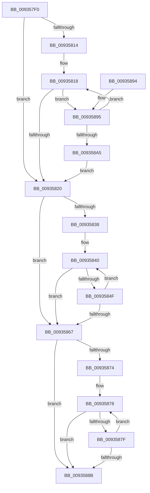

# VrpGetNextToken

- RVA: `0x009357F0`–`0x009358AA` (길이 `186` bytes)
- VA: `0x00000001409357F0`
- 실행 섹션: `PAGE`
- PDB 이름 있음: `예`; PDB Function 태그: `아니요`
- unwind 정보 RVA: `0x0008F2B0`
- 디코드: `54`개 명령, `186/186` bytes 표시
- 미해석 바이트: `0` (있으면 어셈블리에 `.byte`로 보존)

> 이 문서는 커널 이미지의 기계어와 PDB 기호를 분석해 생성했습니다. 4번과 5번은 함수 원형과 자료형을 바이너리 사용 방식에서 추정한 C 해석이며 원본 소스 복구 결과는 아닙니다.

## 1. Dependencies

- 직접 호출 지점: **0**; 고유 호출 대상: **0**
- 직접 호출자로 확인된 함수: **2**
- RIP 상대 이미지 참조: **0**

### Outgoing calls
- 직접 디코드된 call 명령이 없습니다.

### Direct callers
- [VrpCreateNamespaceNode](VrpCreateNamespaceNode_function_00935538.md) at `0x009355B4`
- [VrpCreateNamespaceNode](VrpCreateNamespaceNode_function_00935538.md) at `0x009355DF`
- [VrpCreateNamespaceNode](VrpCreateNamespaceNode_function_00935538.md) at `0x009356B5`
- [VrpCreateNamespaceNode](VrpCreateNamespaceNode_function_00935538.md) at `0x0093570F`
- [sub_00B4588A](../B4/Unknown_function_00B4588A.md) at `0x00B4592A`

### Static image references
- 디코드된 RIP-relative 메모리 참조가 없습니다.

## 2. Other-region calls and transfers

- 다른 실행 섹션으로 향하는 call: **0**
- 별도 외부 분기/꼬리 이동을 확인하지 못했습니다.

## 3. Assembly (complete function range)

```asm
009357F0  48 89 5C 24 08                  mov qword ptr [rsp + 8], rbx
009357F5  33 C0                           xor eax, eax
009357F7  4C 8B C9                        mov r9, rcx
009357FA  66 41 89 00                     mov word ptr [r8], ax
009357FE  4D 8B D0                        mov r10, r8
00935801  44 0F B7 19                     movzx r11d, word ptr [rcx]
00935805  48 8B DA                        mov rbx, rdx
00935808  48 8B 02                        mov rax, qword ptr [rdx]
0093580B  48 8D 0C 00                     lea rcx, [rax + rax]
0093580F  49 3B CB                        cmp rcx, r11
00935812  73 0C                           jae 0x140935820
00935814  4D 8B 41 08                     mov r8, qword ptr [r9 + 8]
00935818  66 41 83 3C 08 5C               cmp word ptr [r8 + rcx], 0x5c
0093581E  74 75                           je 0x140935895
00935820  49 8B 51 08                     mov rdx, qword ptr [r9 + 8]
00935824  4C 8D 04 00                     lea r8, [rax + rax]
00935828  49 03 D0                        add rdx, r8
0093582B  49 89 52 08                     mov qword ptr [r10 + 8], rdx
0093582F  41 0F B7 11                     movzx edx, word ptr [r9]
00935833  4C 3B C2                        cmp r8, rdx
00935836  73 2F                           jae 0x140935867
00935838  0F B7 CA                        movzx ecx, dx
0093583B  0F 1F 44 00 00                  nop dword ptr [rax + rax]
00935840  0F B7 D1                        movzx edx, cx
00935843  49 8B 49 08                     mov rcx, qword ptr [r9 + 8]
00935847  66 41 83 3C 08 5C               cmp word ptr [r8 + rcx], 0x5c
0093584D  74 18                           je 0x140935867
0093584F  66 41 83 02 02                  add word ptr [r10], 2
00935854  48 FF C0                        inc rax
00935857  41 0F B7 09                     movzx ecx, word ptr [r9]
0093585B  0F B7 D1                        movzx edx, cx
0093585E  4C 8D 04 00                     lea r8, [rax + rax]
00935862  4C 3B C1                        cmp r8, rcx
00935865  72 D9                           jb 0x140935840
00935867  44 0F B7 C2                     movzx r8d, dx
0093586B  48 8D 0C 00                     lea rcx, [rax + rax]
0093586F  49 3B C8                        cmp rcx, r8
00935872  73 17                           jae 0x14093588b
00935874  49 8B 51 08                     mov rdx, qword ptr [r9 + 8]
00935878  66 83 3C 0A 5C                  cmp word ptr [rdx + rcx], 0x5c
0093587D  75 0C                           jne 0x14093588b
0093587F  48 FF C0                        inc rax
00935882  48 8D 0C 00                     lea rcx, [rax + rax]
00935886  49 3B C8                        cmp rcx, r8
00935889  72 ED                           jb 0x140935878
0093588B  48 89 03                        mov qword ptr [rbx], rax
0093588E  48 8B 5C 24 08                  mov rbx, qword ptr [rsp + 8]
00935893  C3                              ret
00935894  CC                              int3
00935895  48 FF C0                        inc rax
00935898  48 8D 0C 00                     lea rcx, [rax + rax]
0093589C  49 3B CB                        cmp rcx, r11
0093589F  0F 82 73 FF FF FF               jb 0x140935818
009358A5  E9 76 FF FF FF                  jmp 0x140935820
```

## 4. C-style interpretation (structured pseudocode)

```c
__int64 __fastcall VrpGetNextToken(__int64 a1, __int64 a2, __int64 a3)
{
    __int64 result;
    unsigned __int64 v_stack_p8;

    v_stack_p8 = v_rbx;
    result = 0;
    *(unsigned __int16 *)(a3) = 0;
    if ((*(unsigned __int64 *)(a2) + *(unsigned __int64 *)(a2) * 1) >= (*(unsigned __int16 *)(a1))) goto loc_00935820;
loc_00935818:
    if ((*(unsigned __int16 *)(*(unsigned __int64 *)(a1 + 8) + *(unsigned __int64 *)(a2) + *(unsigned __int64 *)(a2) * 1 * 1)) == 92) goto loc_00935895;
loc_00935820:
    a2 = (*(unsigned __int64 *)(a1 + 8)) + (*(unsigned __int64 *)(a2) + *(unsigned __int64 *)(a2) * 1);
    *(unsigned __int64 *)(a3 + 8) = a2;
    if ((*(unsigned __int64 *)(a2) + *(unsigned __int64 *)(a2) * 1) >= (*(unsigned __int16 *)(a1))) goto loc_00935867;
loc_00935840:
    if ((*(unsigned __int16 *)(*(unsigned __int64 *)(a2) + *(unsigned __int64 *)(a2) * 1 + *(unsigned __int64 *)(a1 + 8) * 1)) == 92) goto loc_00935867;
    result = (*(unsigned __int64 *)(a2)) + 1;
    if ((result + result * 1) < (*(unsigned __int16 *)(a1))) goto loc_00935840;
loc_00935867:
    if ((result + result * 1) >= ((unsigned __int16)((unsigned __int16)(*(unsigned __int16 *)(a1))))) goto loc_0093588B;
loc_00935878:
    if ((*(unsigned __int16 *)(*(unsigned __int64 *)(a1 + 8) + result + result * 1 * 1)) != 92) goto loc_0093588B;
    result = (result) + 1;
    if ((result + result * 1) < ((unsigned __int16)((unsigned __int16)(*(unsigned __int16 *)(a1))))) goto loc_00935878;
loc_0093588B:
    *(unsigned __int64 *)(a2) = result;
    return result;
loc_00935895:
    result = (result) + 1;
    if ((result + result * 1) < (*(unsigned __int16 *)(a1))) goto loc_00935818;
    goto loc_00935820;
}
```

## 5. (Beta) C Style

```c
int64_t VrpGetNextToken(void *Arg1, void *Arg2, void *Arg3)
{
    uint8_t *arg1 = (uint8_t *)Arg1;
    uint8_t *arg2 = (uint8_t *)Arg2;
    uint8_t *arg3 = (uint8_t *)Arg3;

    int64_t result;
    uint64_t v_stack_p8;

    v_stack_p8 = local_rbx;
    result = 0;
    *(uint16_t *)(arg3) = 0;
    if ((*(uint64_t *)(arg2) + *(uint64_t *)(arg2) * 1) >= (*(uint16_t *)(arg1))) goto loc_00935820;
loc_00935818:
    if ((*(uint16_t *)(*(uint64_t *)(arg1 + 0x8) + *(uint64_t *)(arg2) + *(uint64_t *)(arg2) * 1 * 1)) == 92) goto loc_00935895;
loc_00935820:
    Arg2 = (*(uint64_t *)(arg1 + 0x8)) + (*(uint64_t *)(arg2) + *(uint64_t *)(arg2) * 1);
    *(void **)(arg3 + 0x8) = Arg2;
    if ((*(uint64_t *)(arg2) + *(uint64_t *)(arg2) * 1) >= (*(uint16_t *)(arg1))) goto loc_00935867;
loc_00935840:
    if ((*(uint16_t *)(*(uint64_t *)(arg2) + *(uint64_t *)(arg2) * 1 + *(uint64_t *)(arg1 + 0x8) * 1)) == 92) goto loc_00935867;
    result = (*(uint64_t *)(arg2)) + 1;
    if ((result + result * 1) < (*(uint16_t *)(arg1))) goto loc_00935840;
loc_00935867:
    if ((result + result * 1) >= ((uint16_t)((uint16_t)(*(uint16_t *)(arg1))))) goto loc_0093588B;
loc_00935878:
    if ((*(uint16_t *)(*(uint64_t *)(arg1 + 0x8) + result + result * 1 * 1)) != 92) goto loc_0093588B;
    result = (result) + 1;
    if ((result + result * 1) < ((uint16_t)((uint16_t)(*(uint16_t *)(arg1))))) goto loc_00935878;
loc_0093588B:
    *(uint64_t *)(arg2) = result;
    return result;
loc_00935895:
    result = (result) + 1;
    if ((result + result * 1) < (*(uint16_t *)(arg1))) goto loc_00935818;
    goto loc_00935820;
}
```

### 관측된 메모리 오프셋

구조체 형식이 확인되지 않은 접근은 인자 기준의 오프셋으로만 기록했습니다.

| 기준 인자 | 오프셋 표현 | 폭 (bit) | 접근 |
|---|---:|---:|---|
| `Arg1` | `+ 0x0` | `16` | `R` |
| `Arg1` | `+ 0x8` | `64` | `R` |
| `Arg2` | `+ 0x0` | `64` | `R` |
| `Arg2` | `+ 0x0` | `64` | `W` |
| `Arg3` | `+ 0x0` | `16` | `R/W` |
| `Arg3` | `+ 0x0` | `16` | `W` |
| `Arg3` | `+ 0x8` | `64` | `W` |

## 6. Execution-region graph

[열기: 2D/3D 그래프와 함수 탐색 컨트롤 패널](../../../control-panel.html?section=page&rva=0x009357F0&view=graph)

- 2D 그래프는 위에서 아래로 흐르고, 3D 그래프는 빈 공간을 드래그해 회전합니다. Shift+드래그는 이동, 휠은 확대·축소, 함수 노드 선택은 대상 보고서 이동입니다.

### Static fallback


