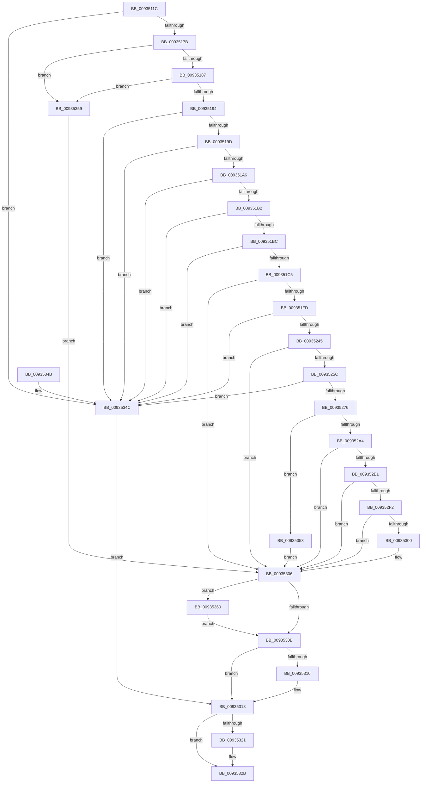

# VrpHandleIoctlCreateNamespaceNode

- RVA: `0x0093511C`–`0x0093536D` (길이 `593` bytes)
- VA: `0x000000014093511C`
- 실행 섹션: `PAGE`
- PDB 이름 있음: `예`; PDB Function 태그: `아니요`
- unwind 정보 RVA: `0x0008F248`
- 디코드: `163`개 명령, `593/593` bytes 표시
- 미해석 바이트: `0` (있으면 어셈블리에 `.byte`로 보존)

> 이 문서는 커널 이미지의 기계어와 PDB 기호를 분석해 생성했습니다. 4번과 5번은 함수 원형과 자료형을 바이너리 사용 방식에서 추정한 C 해석이며 원본 소스 복구 결과는 아닙니다.

## 1. Dependencies

- 직접 호출 지점: **12**; 고유 호출 대상: **12**
- 직접 호출자로 확인된 함수: **1**
- RIP 상대 이미지 참조: **2**

### Outgoing calls
- `0x009351EE` → [ObpReferenceObjectByHandleWithTag](../86/ObpReferenceObjectByHandleWithTag_function_00869650.md) (function, `0x00869650`)
- `0x0093524D` → [PsGetJobSilo](../../text/41/PsGetJobSilo_function_00418630.md) (function, `0x00418630`)
- `0x00935269` → [PsIsThreadInSilo](../../text/41/PsIsThreadInSilo_function_0041859C.md) (function, `0x0041859C`)
- `0x0093527E` → [VRegEnabledInJob](VRegEnabledInJob_function_009350B0.md) (function, `0x009350B0`)
- `0x00935291` → [PsGetPermanentSiloContext](../../text/3E/PsGetPermanentSiloContext_function_003EE100.md) (function, `0x003EE100`)
- `0x009352A7` → [VrpLockJobContextExclusive](VrpLockJobContextExclusive_function_00935A34.md) (function, `0x00935A34`)
- `0x009352D2` → [VrpCreateNamespaceNode](VrpCreateNamespaceNode_function_00935538.md) (function, `0x00935538`)
- `0x009352E7` → [VrpAddNamespaceNodeToList](VrpAddNamespaceNodeToList_function_00935A94.md) (function, `0x00935A94`)
- `0x009352F5` → [VrpCreateNamespaceNodePlaceholderKey](VrpCreateNamespaceNodePlaceholderKey_function_00935BAC.md) (function, `0x00935BAC`)
- `0x00935313` → [VrpUnlockJobContextExclusive](VrpUnlockJobContextExclusive_function_009354FC.md) (function, `0x009354FC`)
- `0x00935326` → [ObfDereferenceObjectWithTag](../../text/2F/ObfDereferenceObjectWithTag_function_002F78E0.md) (function, `0x002F78E0`)
- `0x00935366` → [VrpDestroyNamespaceNode](VrpDestroyNamespaceNode_function_00934A50.md) (function, `0x00934A50`)

### Direct callers
- [VrpIoctlDeviceDispatch](VrpIoctlDeviceDispatch_function_00934C50.md) at `0x00934CF9`

### Static image references
- `0x009351C5` → RVA `0x00FC6C58` (`ALMOSTRO`; read)
- `0x00935283` → RVA `0x00EF02B8` (`.data`; read)

## 2. Other-region calls and transfers

- 다른 실행 섹션으로 향하는 call: **4**
  - `0x0093524D` → [PsGetJobSilo](../../text/41/PsGetJobSilo_function_00418630.md) (`PAGE` → `.text`)
  - `0x00935269` → [PsIsThreadInSilo](../../text/41/PsIsThreadInSilo_function_0041859C.md) (`PAGE` → `.text`)
  - `0x00935291` → [PsGetPermanentSiloContext](../../text/3E/PsGetPermanentSiloContext_function_003EE100.md) (`PAGE` → `.text`)
  - `0x00935326` → [ObfDereferenceObjectWithTag](../../text/2F/ObfDereferenceObjectWithTag_function_002F78E0.md) (`PAGE` → `.text`)
- 별도 외부 분기/꼬리 이동을 확인하지 못했습니다.

## 3. Assembly (complete function range)

```asm
0093511C  4C 8B DC                        mov r11, rsp
0093511F  49 89 5B 08                     mov qword ptr [r11 + 8], rbx
00935123  49 89 73 10                     mov qword ptr [r11 + 0x10], rsi
00935127  49 89 7B 18                     mov qword ptr [r11 + 0x18], rdi
0093512B  4D 89 4B 20                     mov qword ptr [r11 + 0x20], r9
0093512F  55                              push rbp
00935130  41 54                           push r12
00935132  41 55                           push r13
00935134  41 56                           push r14
00935136  41 57                           push r15
00935138  48 8B EC                        mov rbp, rsp
0093513B  48 83 EC 70                     sub rsp, 0x70
0093513F  45 33 ED                        xor r13d, r13d
00935142  0F 57 C0                        xorps xmm0, xmm0
00935145  4C 89 6D D0                     mov qword ptr [rbp - 0x30], r13
00935149  0F 57 C9                        xorps xmm1, xmm1
0093514C  4C 89 6D 58                     mov qword ptr [rbp + 0x58], r13
00935150  45 8A D0                        mov r10b, r8b
00935153  4C 89 6D 48                     mov qword ptr [rbp + 0x48], r13
00935157  44 8B CA                        mov r9d, edx
0093515A  4C 89 6D 50                     mov qword ptr [rbp + 0x50], r13
0093515E  4C 8B F1                        mov r14, rcx
00935161  41 8B F5                        mov esi, r13d
00935164  45 8B E5                        mov r12d, r13d
00935167  41 8B FD                        mov edi, r13d
0093516A  0F 11 45 F0                     movups xmmword ptr [rbp - 0x10], xmm0
0093516E  0F 11 4D E0                     movups xmmword ptr [rbp - 0x20], xmm1
00935172  83 FA 18                        cmp edx, 0x18
00935175  0F 82 D1 01 00 00               jb 0x14093534c
0093517B  0F B7 41 08                     movzx eax, word ptr [rcx + 8]
0093517F  A8 01                           test al, 1
00935181  0F 85 D2 01 00 00               jne 0x140935359
00935187  0F B7 51 0A                     movzx edx, word ptr [rcx + 0xa]
0093518B  F6 C2 01                        test dl, 1
0093518E  0F 85 C5 01 00 00               jne 0x140935359
00935194  66 85 C0                        test ax, ax
00935197  0F 84 AF 01 00 00               je 0x14093534c
0093519D  66 85 D2                        test dx, dx
009351A0  0F 84 A6 01 00 00               je 0x14093534c
009351A6  8D 48 14                        lea ecx, [rax + 0x14]
009351A9  83 F9 14                        cmp ecx, 0x14
009351AC  0F 82 9A 01 00 00               jb 0x14093534c
009351B2  03 D1                           add edx, ecx
009351B4  3B CA                           cmp ecx, edx
009351B6  0F 87 90 01 00 00               ja 0x14093534c
009351BC  44 3B CA                        cmp r9d, edx
009351BF  0F 82 87 01 00 00               jb 0x14093534c
009351C5  4C 8B 05 8C 1A 69 00            mov r8, qword ptr [rip + 0x691a8c]
009351CC  48 8D 45 D0                     lea rax, [rbp - 0x30]
009351D0  49 8B 0E                        mov rcx, qword ptr [r14]
009351D3  41 8D 55 06                     lea edx, [r13 + 6]
009351D7  4D 89 6B A0                     mov qword ptr [r11 - 0x60], r13
009351DB  45 8A CA                        mov r9b, r10b
009351DE  4D 89 6B 98                     mov qword ptr [r11 - 0x68], r13
009351E2  49 89 43 90                     mov qword ptr [r11 - 0x70], rax
009351E6  C7 44 24 20 43 6D 56 52         mov dword ptr [rsp + 0x20], 0x52566d43
009351EE  E8 5D 44 F3 FF                  call 0x140869650
009351F3  8B D8                           mov ebx, eax
009351F5  85 C0                           test eax, eax
009351F7  0F 88 09 01 00 00               js 0x140935306
009351FD  45 8B 7E 0C                     mov r15d, dword ptr [r14 + 0xc]
00935201  49 8D 46 14                     lea rax, [r14 + 0x14]
00935205  48 89 45 F8                     mov qword ptr [rbp - 8], rax
00935209  41 0F B7 46 08                  movzx eax, word ptr [r14 + 8]
0093520E  66 89 45 F2                     mov word ptr [rbp - 0xe], ax
00935212  66 89 45 F0                     mov word ptr [rbp - 0x10], ax
00935216  48 D1 E8                        shr rax, 1
00935219  48 83 C0 0A                     add rax, 0xa
0093521D  49 8D 04 46                     lea rax, [r14 + rax*2]
00935221  48 89 45 E8                     mov qword ptr [rbp - 0x18], rax
00935225  41 0F B7 46 0A                  movzx eax, word ptr [r14 + 0xa]
0093522A  45 8B 76 10                     mov r14d, dword ptr [r14 + 0x10]
0093522E  66 89 45 E2                     mov word ptr [rbp - 0x1e], ax
00935232  66 89 45 E0                     mov word ptr [rbp - 0x20], ax
00935236  41 8B C7                        mov eax, r15d
00935239  83 E0 07                        and eax, 7
0093523C  41 3B C7                        cmp eax, r15d
0093523F  0F 85 07 01 00 00               jne 0x14093534c
00935245  48 8B 4D D0                     mov rcx, qword ptr [rbp - 0x30]
00935249  48 8D 55 50                     lea rdx, [rbp + 0x50]
0093524D  E8 DE 33 AE FF                  call 0x140418630
00935252  8B D8                           mov ebx, eax
00935254  85 C0                           test eax, eax
00935256  0F 88 AA 00 00 00               js 0x140935306
0093525C  65 48 8B 0C 25 88 01 00 00      mov rcx, qword ptr gs:[0x188]
00935265  48 8B 55 50                     mov rdx, qword ptr [rbp + 0x50]
00935269  E8 2E 33 AE FF                  call 0x14041859c
0093526E  84 C0                           test al, al
00935270  0F 85 D6 00 00 00               jne 0x14093534c
00935276  48 8D 4D D8                     lea rcx, [rbp - 0x28]
0093527A  4C 89 6D D8                     mov qword ptr [rbp - 0x28], r13
0093527E  E8 2D FE FF FF                  call 0x1409350b0
00935283  8B 15 2F B0 5B 00               mov edx, dword ptr [rip + 0x5bb02f]
00935289  4C 8D 45 58                     lea r8, [rbp + 0x58]
0093528D  48 8B 4D 50                     mov rcx, qword ptr [rbp + 0x50]
00935291  E8 6A 8E AB FF                  call 0x1403ee100
00935296  48 8B 75 58                     mov rsi, qword ptr [rbp + 0x58]
0093529A  8B D8                           mov ebx, eax
0093529C  85 C0                           test eax, eax
0093529E  0F 88 AF 00 00 00               js 0x140935353
009352A4  48 8B CE                        mov rcx, rsi
009352A7  E8 88 07 00 00                  call 0x140935a34
009352AC  4C 8B 45 D8                     mov r8, qword ptr [rbp - 0x28]
009352B0  48 8D 45 48                     lea rax, [rbp + 0x48]
009352B4  48 89 44 24 30                  mov qword ptr [rsp + 0x30], rax
009352B9  4C 8D 4D E0                     lea r9, [rbp - 0x20]
009352BD  44 89 74 24 28                  mov dword ptr [rsp + 0x28], r14d
009352C2  48 8D 55 F0                     lea rdx, [rbp - 0x10]
009352C6  48 8B CE                        mov rcx, rsi
009352C9  44 89 7C 24 20                  mov dword ptr [rsp + 0x20], r15d
009352CE  45 8D 65 01                     lea r12d, [r13 + 1]
009352D2  E8 61 02 00 00                  call 0x140935538
009352D7  48 8B 7D 48                     mov rdi, qword ptr [rbp + 0x48]
009352DB  8B D8                           mov ebx, eax
009352DD  85 C0                           test eax, eax
009352DF  78 25                           js 0x140935306
009352E1  48 8B D7                        mov rdx, rdi
009352E4  48 8B CE                        mov rcx, rsi
009352E7  E8 A8 07 00 00                  call 0x140935a94
009352EC  8B D8                           mov ebx, eax
009352EE  85 C0                           test eax, eax
009352F0  78 14                           js 0x140935306
009352F2  48 8B CF                        mov rcx, rdi
009352F5  E8 B2 08 00 00                  call 0x140935bac
009352FA  8B D8                           mov ebx, eax
009352FC  85 C0                           test eax, eax
009352FE  78 06                           js 0x140935306
00935300  41 8B DD                        mov ebx, r13d
00935303  41 8B FD                        mov edi, r13d
00935306  48 85 FF                        test rdi, rdi
00935309  75 55                           jne 0x140935360
0093530B  45 85 E4                        test r12d, r12d
0093530E  74 08                           je 0x140935318
00935310  48 8B CE                        mov rcx, rsi
00935313  E8 E4 01 00 00                  call 0x1409354fc
00935318  48 8B 4D D0                     mov rcx, qword ptr [rbp - 0x30]
0093531C  48 85 C9                        test rcx, rcx
0093531F  74 0A                           je 0x14093532b
00935321  BA 43 6D 56 52                  mov edx, 0x52566d43
00935326  E8 B5 25 9C FF                  call 0x1402f78e0
0093532B  4C 8D 5C 24 70                  lea r11, [rsp + 0x70]
00935330  8B C3                           mov eax, ebx
00935332  49 8B 5B 30                     mov rbx, qword ptr [r11 + 0x30]
00935336  49 8B 73 38                     mov rsi, qword ptr [r11 + 0x38]
0093533A  49 8B 7B 40                     mov rdi, qword ptr [r11 + 0x40]
0093533E  49 8B E3                        mov rsp, r11
00935341  41 5F                           pop r15
00935343  41 5E                           pop r14
00935345  41 5D                           pop r13
00935347  41 5C                           pop r12
00935349  5D                              pop rbp
0093534A  C3                              ret
0093534B  CC                              int3
0093534C  BB 0D 00 00 C0                  mov ebx, 0xc000000d
00935351  EB C5                           jmp 0x140935318
00935353  48 8B 7D 48                     mov rdi, qword ptr [rbp + 0x48]
00935357  EB AD                           jmp 0x140935306
00935359  BB 0D 00 00 C0                  mov ebx, 0xc000000d
0093535E  EB A6                           jmp 0x140935306
00935360  48 8B D7                        mov rdx, rdi
00935363  48 8B CE                        mov rcx, rsi
00935366  E8 E5 F6 FF FF                  call 0x140934a50
0093536B  EB 9E                           jmp 0x14093530b
```

## 4. C-style interpretation (structured pseudocode)

```c
__int64 __fastcall VrpHandleIoctlCreateNamespaceNode(__int64 a1, int a2, unsigned __int8 a3, __int64 a4, __int64 a5, __int64 a6)
{
    __int64 result;
    __int64 v_r13;
    __int64 v_rbx;
    __int64 v_rdi;
    __int64 v_rsp;
    unsigned __int64 v_stack_m28;
    unsigned __int64 v_stack_m30;
    unsigned __int16 v_stack_m36;
    unsigned __int64 v_stack_m38;
    unsigned __int64 v_stack_m40;
    unsigned __int16 v_stack_m46;
    unsigned __int64 v_stack_m48;
    unsigned __int64 v_stack_m50;
    unsigned __int64 v_stack_m58;
    unsigned __int64 v_stack_m68;
    unsigned int v_stack_m70;
    unsigned int v_stack_m78;
    unsigned __int64 v_stack_p20;
    unsigned __int64 v_stack_p28;
    unsigned __int64 v_stack_p30;

    *(unsigned __int64 *)(v_rsp + 8) = v_rbx;
    *(unsigned __int64 *)(v_rsp + 16) = v_rsi;
    *(unsigned __int64 *)(v_rsp + 24) = v_rdi;
    *(unsigned __int64 *)(v_rsp + 32) = a4;
    v_rsp = (v_rsp) - (112);
    v_r13 = 0;
    v_stack_m58 = 0;
    v_stack_p30 = 0;
    v_stack_p20 = 0;
    v_stack_p28 = 0;
    v_stack_m38 = v_xmm0;
    v_stack_m48 = v_xmm1;
    if (a2 < 24) goto loc_0093534C;
    if ((((unsigned __int8)(*(unsigned __int16 *)(a1 + 8))) & (1)) != 0) goto loc_00935359;
    if ((((unsigned __int8)(*(unsigned __int16 *)(a1 + 10))) & (1)) != 0) goto loc_00935359;
    if ((unsigned __int16)(*(unsigned __int16 *)(a1 + 8)) == 0) goto loc_0093534C;
    if ((unsigned __int16)(*(unsigned __int16 *)(a1 + 10)) == 0) goto loc_0093534C;
    if (((unsigned int)(*(unsigned __int16 *)(a1 + 8) + 20)) < 20) goto loc_0093534C;
    a2 = (unsigned int)((*(unsigned __int16 *)(a1 + 10)) + ((unsigned int)(*(unsigned __int16 *)(a1 + 8) + 20)));
    if (((unsigned int)(*(unsigned __int16 *)(a1 + 8) + 20)) > a2) goto loc_0093534C;
    if (((unsigned int)((unsigned int)(a2))) < a2) goto loc_0093534C;
    *(unsigned __int64 *)(v_rsp - 96) = 0;
    *(unsigned __int64 *)(v_rsp - 104) = 0;
    *(unsigned __int64 *)(v_rsp - 112) = v_stack_m58;
    v_stack_m78 = 0x52566D43ULL;
    result = ObpReferenceObjectByHandleWithTag(*(unsigned __int64 *)(a1), v_r13 + 6, *(unsigned __int64 *)(v_rip + 6888076), a3);
    if (sign_flag) goto loc_00935306;
    v_stack_m30 = a1 + 20;
    v_stack_m36 = (unsigned __int16)(*(unsigned __int16 *)(a1 + 8));
    v_stack_m38 = (unsigned __int16)(*(unsigned __int16 *)(a1 + 8));
    result = (*(unsigned __int16 *)(a1 + 8)) >> (1);
    result = (result) + (10);
    v_stack_m40 = a1 + result * 2;
    v_stack_m46 = (unsigned __int16)(*(unsigned __int16 *)(a1 + 10));
    v_stack_m48 = (unsigned __int16)(*(unsigned __int16 *)(a1 + 10));
    result = (unsigned int)(((unsigned int)((unsigned int)((unsigned int)(*(unsigned int *)(a1 + 12))))) & (7));
    if (((unsigned int)(result)) != ((unsigned int)((unsigned int)(*(unsigned int *)(a1 + 12))))) goto loc_0093534C;
    result = PsGetJobSilo(v_stack_m58, a5, *(unsigned __int64 *)(v_rip + 6888076), a3);
    if (sign_flag) goto loc_00935306;
    result = PsIsThreadInSilo(*(unsigned __int64 *)(gs_base + (0 + 392)), a5, *(unsigned __int64 *)(v_rip + 6888076), a3);
    if ((unsigned __int8)(result) != 0) goto loc_0093534C;
    v_stack_m50 = 0;
    result = VRegEnabledInJob(v_stack_m50, a5, *(unsigned __int64 *)(v_rip + 6888076), a3);
    result = PsGetPermanentSiloContext(a5, (unsigned int)(*(unsigned int *)(v_rip + 6008879)), a6, a3);
    if (sign_flag) goto loc_00935353;
    result = VrpLockJobContextExclusive(a6, (unsigned int)(*(unsigned int *)(v_rip + 6008879)), a6, a3);
    v_stack_m68 = v_stack_p20;
    v_stack_m70 = (unsigned int)((unsigned int)(*(unsigned int *)(a1 + 16)));
    v_stack_m78 = (unsigned int)((unsigned int)(*(unsigned int *)(a1 + 12)));
    result = VrpCreateNamespaceNode(a6, v_stack_m38, v_stack_m50, v_stack_m48);
    if (sign_flag) goto loc_00935306;
    result = VrpAddNamespaceNodeToList(a6, v_stack_p20, v_stack_m50, v_stack_m48);
    if (sign_flag) goto loc_00935306;
    result = VrpCreateNamespaceNodePlaceholderKey(v_stack_p20, v_stack_p20, v_stack_m50, v_stack_m48);
    v_rbx = (unsigned int)((unsigned int)(result));
    v_rdi = v_stack_p20;
    if (!(sign_flag)) {
        v_rbx = 0;
        v_rdi = 0;
    }
    if (v_rdi != 0) goto loc_00935360;
loc_0093530B:
    if ((unsigned int)(v_r13 + 1) != 0) {
        a1 = a6;
        result = VrpUnlockJobContextExclusive(a1, v_stack_p20, v_stack_m50, v_stack_m48);
    }
    if (v_stack_m58 != 0) {
        a2 = 0x52566D43ULL;
        result = ObfDereferenceObjectWithTag(v_stack_m58, a2, v_stack_m50, v_stack_m48);
    }
    return (unsigned int)((unsigned int)(v_rbx));
loc_0093534C:
    goto loc_00935318;
loc_00935353:
    goto loc_00935306;
loc_00935359:
    goto loc_00935306;
loc_00935360:
    result = VrpDestroyNamespaceNode(*(unsigned __int64 *)(v_stack_m28 + 56), v_stack_p20, v_stack_m50, v_stack_m48);
    goto loc_0093530B;
}
```

## 5. (Beta) C Style

```c
int64_t VrpHandleIoctlCreateNamespaceNode(void *Arg1, int32_t Arg2, uint8_t Arg3, int64_t Arg4, int64_t Arg5, int64_t Arg6)
{
    uint8_t *arg1 = (uint8_t *)Arg1;

    int64_t result;
    int64_t local_r13;
    int64_t local_rbx;
    int64_t local_rdi;
    int64_t local_rsp;
    uint64_t v_stack_m28;
    uint64_t v_stack_m30;
    uint16_t v_stack_m36;
    uint64_t v_stack_m38;
    uint64_t v_stack_m40;
    uint16_t v_stack_m46;
    uint64_t v_stack_m48;
    uint64_t v_stack_m50;
    uint64_t v_stack_m58;
    uint64_t v_stack_m68;
    uint32_t v_stack_m70;
    uint32_t v_stack_m78;
    uint64_t v_stack_p20;
    uint64_t v_stack_p28;
    uint64_t v_stack_p30;

    *(uint64_t *)(local_rsp + 0x8) = local_rbx;
    *(uint64_t *)(local_rsp + 0x10) = local_rsi;
    *(uint64_t *)(local_rsp + 0x18) = local_rdi;
    *(uint64_t *)(local_rsp + 0x20) = Arg4;
    local_rsp = (local_rsp) - (112);
    local_r13 = 0;
    v_stack_m58 = 0;
    v_stack_p30 = 0;
    v_stack_p20 = 0;
    v_stack_p28 = 0;
    v_stack_m38 = v_xmm0;
    v_stack_m48 = v_xmm1;
    if (Arg2 < 24) goto loc_0093534C;
    if ((((uint8_t)(*(uint16_t *)(arg1 + 0x8))) & (1)) != 0) goto loc_00935359;
    if ((((uint8_t)(*(uint16_t *)(arg1 + 0xA))) & (1)) != 0) goto loc_00935359;
    if ((uint16_t)(*(uint16_t *)(arg1 + 0x8)) == 0) goto loc_0093534C;
    if ((uint16_t)(*(uint16_t *)(arg1 + 0xA)) == 0) goto loc_0093534C;
    if (((uint32_t)(*(uint16_t *)(arg1 + 0x8) + 20)) < 20) goto loc_0093534C;
    Arg2 = (uint32_t)((*(uint16_t *)(arg1 + 0xA)) + ((uint32_t)(*(uint16_t *)(arg1 + 0x8) + 20)));
    if (((uint32_t)(*(uint16_t *)(arg1 + 0x8) + 20)) > Arg2) goto loc_0093534C;
    if (((uint32_t)((uint32_t)(Arg2))) < Arg2) goto loc_0093534C;
    *(uint64_t *)(local_rsp - 0x60) = 0;
    *(uint64_t *)(local_rsp - 0x68) = 0;
    *(uint64_t *)(local_rsp - 0x70) = v_stack_m58;
    v_stack_m78 = 0x52566D43ULL;
    result = ObpReferenceObjectByHandleWithTag(*(uint64_t *)(arg1), local_r13 + 6, *(uint64_t *)(v_rip + 0x691A8C), Arg3);
    if (sign_flag) goto loc_00935306;
    v_stack_m30 = Arg1 + 20;
    v_stack_m36 = (uint16_t)(*(uint16_t *)(arg1 + 0x8));
    v_stack_m38 = (uint16_t)(*(uint16_t *)(arg1 + 0x8));
    result = (*(uint16_t *)(arg1 + 0x8)) >> (1);
    result = (result) + (10);
    v_stack_m40 = Arg1 + result * 2;
    v_stack_m46 = (uint16_t)(*(uint16_t *)(arg1 + 0xA));
    v_stack_m48 = (uint16_t)(*(uint16_t *)(arg1 + 0xA));
    result = (uint32_t)(((uint32_t)((uint32_t)((uint32_t)(*(uint32_t *)(arg1 + 0xC))))) & (7));
    if (((uint32_t)(result)) != ((uint32_t)((uint32_t)(*(uint32_t *)(arg1 + 0xC))))) goto loc_0093534C;
    result = PsGetJobSilo(v_stack_m58, Arg5, *(uint64_t *)(v_rip + 0x691A8C), Arg3);
    if (sign_flag) goto loc_00935306;
    result = PsIsThreadInSilo(*(uint64_t *)(gs_base + (0 + 0x188)), Arg5, *(uint64_t *)(v_rip + 0x691A8C), Arg3);
    if ((uint8_t)(result) != 0) goto loc_0093534C;
    v_stack_m50 = 0;
    result = VRegEnabledInJob(v_stack_m50, Arg5, *(uint64_t *)(v_rip + 0x691A8C), Arg3);
    result = PsGetPermanentSiloContext(Arg5, (uint32_t)(*(uint32_t *)(v_rip + 0x5BB02F)), Arg6, Arg3);
    if (sign_flag) goto loc_00935353;
    result = VrpLockJobContextExclusive(Arg6, (uint32_t)(*(uint32_t *)(v_rip + 0x5BB02F)), Arg6, Arg3);
    v_stack_m68 = v_stack_p20;
    v_stack_m70 = (uint32_t)((uint32_t)(*(uint32_t *)(arg1 + 0x10)));
    v_stack_m78 = (uint32_t)((uint32_t)(*(uint32_t *)(arg1 + 0xC)));
    result = VrpCreateNamespaceNode(Arg6, v_stack_m38, v_stack_m50, v_stack_m48);
    if (sign_flag) goto loc_00935306;
    result = VrpAddNamespaceNodeToList(Arg6, v_stack_p20, v_stack_m50, v_stack_m48);
    if (sign_flag) goto loc_00935306;
    result = VrpCreateNamespaceNodePlaceholderKey(v_stack_p20, v_stack_p20, v_stack_m50, v_stack_m48);
    local_rbx = (uint32_t)((uint32_t)(result));
    local_rdi = v_stack_p20;
    if (!(sign_flag)) {
        local_rbx = 0;
        local_rdi = 0;
    }
    if (local_rdi != 0) goto loc_00935360;
loc_0093530B:
    if ((uint32_t)(local_r13 + 1) != 0) {
        Arg1 = Arg6;
        result = VrpUnlockJobContextExclusive(Arg1, v_stack_p20, v_stack_m50, v_stack_m48);
    }
    if (v_stack_m58 != 0) {
        Arg2 = 0x52566D43ULL;
        result = ObfDereferenceObjectWithTag(v_stack_m58, Arg2, v_stack_m50, v_stack_m48);
    }
    return (uint32_t)((uint32_t)(local_rbx));
loc_0093534C:
    goto loc_00935318;
loc_00935353:
    goto loc_00935306;
loc_00935359:
    goto loc_00935306;
loc_00935360:
    result = VrpDestroyNamespaceNode(*(uint64_t *)(v_stack_m28 + 0x38), v_stack_p20, v_stack_m50, v_stack_m48);
    goto loc_0093530B;
}
```

### 관측된 메모리 오프셋

구조체 형식이 확인되지 않은 접근은 인자 기준의 오프셋으로만 기록했습니다.

| 기준 인자 | 오프셋 표현 | 폭 (bit) | 접근 |
|---|---:|---:|---|
| `Arg1` | `+ 0x0` | `64` | `R` |
| `Arg1` | `+ 0x0 + rax*2` | `64` | `R` |
| `Arg1` | `+ 0x8` | `16` | `R` |
| `Arg1` | `+ 0xA` | `16` | `R` |
| `Arg1` | `+ 0xC` | `32` | `R` |
| `Arg1` | `+ 0x10` | `32` | `R` |
| `Arg1` | `+ 0x14` | `64` | `R` |

## 6. Execution-region graph

[열기: 2D/3D 그래프와 함수 탐색 컨트롤 패널](../../../control-panel.html?section=page&rva=0x0093511C&view=graph)

- 2D 그래프는 위에서 아래로 흐르고, 3D 그래프는 빈 공간을 드래그해 회전합니다. Shift+드래그는 이동, 휠은 확대·축소, 함수 노드 선택은 대상 보고서 이동입니다.

### Static fallback


