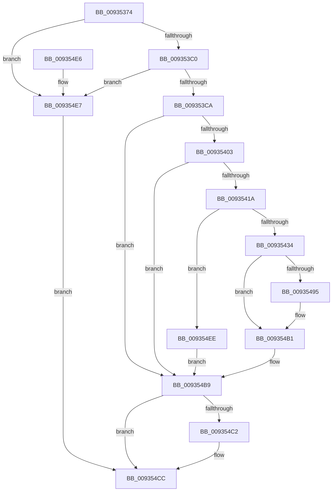

# VrpHandleIoctlGetVirtualRootKey

- RVA: `0x00935374`–`0x009354F5` (길이 `385` bytes)
- VA: `0x0000000140935374`
- 실행 섹션: `PAGE`
- PDB 이름 있음: `예`; PDB Function 태그: `아니요`
- unwind 정보 RVA: `0x0008F268`
- 디코드: `100`개 명령, `385/385` bytes 표시
- 미해석 바이트: `0` (있으면 어셈블리에 `.byte`로 보존)

> 이 문서는 커널 이미지의 기계어와 PDB 기호를 분석해 생성했습니다. 4번과 5번은 함수 원형과 자료형을 바이너리 사용 방식에서 추정한 C 해석이며 원본 소스 복구 결과는 아닙니다.

## 1. Dependencies

- 직접 호출 지점: **7**; 고유 호출 대상: **7**
- 직접 호출자로 확인된 함수: **1**
- RIP 상대 이미지 참조: **2**

### Outgoing calls
- `0x009353F4` → [ObpReferenceObjectByHandleWithTag](../86/ObpReferenceObjectByHandleWithTag_function_00869650.md) (function, `0x00869650`)
- `0x0093540B` → [PsGetJobSilo](../../text/41/PsGetJobSilo_function_00418630.md) (function, `0x00418630`)
- `0x00935427` → [PsIsThreadInSilo](../../text/41/PsIsThreadInSilo_function_0041859C.md) (function, `0x0041859C`)
- `0x00935437` → [PsAttachSiloToCurrentThread](../../text/44/PsAttachSiloToCurrentThread_function_004428C0.md) (function, `0x004428C0`)
- `0x0093548A` → [ZwOpenKey](../../text/6A/ZwOpenKey_function_006AD310.md) (function, `0x006AD310`)
- `0x009354B4` → [PsDetachSiloFromCurrentThread](../../text/44/PsDetachSiloFromCurrentThread_function_00449AC0.md) (function, `0x00449AC0`)
- `0x009354C7` → [ObfDereferenceObjectWithTag](../../text/2F/ObfDereferenceObjectWithTag_function_002F78E0.md) (function, `0x002F78E0`)

### Direct callers
- [VrpIoctlDeviceDispatch](VrpIoctlDeviceDispatch_function_00934C50.md) at `0x00934D7B`

### Static image references
- `0x009353DA` → RVA `0x00FC6C58` (`ALMOSTRO`; read)
- `0x00935468` → RVA `0x00002210` (`.rdata`; read)

## 2. Other-region calls and transfers

- 다른 실행 섹션으로 향하는 call: **6**
  - `0x0093540B` → [PsGetJobSilo](../../text/41/PsGetJobSilo_function_00418630.md) (`PAGE` → `.text`)
  - `0x00935427` → [PsIsThreadInSilo](../../text/41/PsIsThreadInSilo_function_0041859C.md) (`PAGE` → `.text`)
  - `0x00935437` → [PsAttachSiloToCurrentThread](../../text/44/PsAttachSiloToCurrentThread_function_004428C0.md) (`PAGE` → `.text`)
  - `0x0093548A` → [ZwOpenKey](../../text/6A/ZwOpenKey_function_006AD310.md) (`PAGE` → `.text`)
  - `0x009354B4` → [PsDetachSiloFromCurrentThread](../../text/44/PsDetachSiloFromCurrentThread_function_00449AC0.md) (`PAGE` → `.text`)
  - `0x009354C7` → [ObfDereferenceObjectWithTag](../../text/2F/ObfDereferenceObjectWithTag_function_002F78E0.md) (`PAGE` → `.text`)
- 별도 외부 분기/꼬리 이동을 확인하지 못했습니다.

## 3. Assembly (complete function range)

```asm
00935374  4C 8B DC                        mov r11, rsp
00935377  49 89 5B 08                     mov qword ptr [r11 + 8], rbx
0093537B  49 89 73 10                     mov qword ptr [r11 + 0x10], rsi
0093537F  4D 89 4B 20                     mov qword ptr [r11 + 0x20], r9
00935383  55                              push rbp
00935384  57                              push rdi
00935385  41 56                           push r14
00935387  48 8B EC                        mov rbp, rsp
0093538A  48 81 EC 80 00 00 00            sub rsp, 0x80
00935391  33 C0                           xor eax, eax
00935393  0F 57 C0                        xorps xmm0, xmm0
00935396  48 21 45 C8                     and qword ptr [rbp - 0x38], rax
0093539A  41 8A F0                        mov sil, r8b
0093539D  48 21 45 C0                     and qword ptr [rbp - 0x40], rax
009353A1  48 8B F9                        mov rdi, rcx
009353A4  48 21 45 38                     and qword ptr [rbp + 0x38], rax
009353A8  48 89 45 F0                     mov qword ptr [rbp - 0x10], rax
009353AC  89 45 F8                        mov dword ptr [rbp - 8], eax
009353AF  0F 11 45 D0                     movups xmmword ptr [rbp - 0x30], xmm0
009353B3  0F 11 45 E0                     movups xmmword ptr [rbp - 0x20], xmm0
009353B7  83 FA 10                        cmp edx, 0x10
009353BA  0F 82 27 01 00 00               jb 0x1409354e7
009353C0  83 79 08 02                     cmp dword ptr [rcx + 8], 2
009353C4  0F 87 1D 01 00 00               ja 0x1409354e7
009353CA  49 21 43 A0                     and qword ptr [r11 - 0x60], rax
009353CE  44 8A CE                        mov r9b, sil
009353D1  49 21 43 98                     and qword ptr [r11 - 0x68], rax
009353D5  BA 04 00 00 00                  mov edx, 4
009353DA  4C 8B 05 77 18 69 00            mov r8, qword ptr [rip + 0x691877]
009353E1  48 8D 45 C0                     lea rax, [rbp - 0x40]
009353E5  48 8B 09                        mov rcx, qword ptr [rcx]
009353E8  49 89 43 90                     mov qword ptr [r11 - 0x70], rax
009353EC  C7 44 24 20 43 6D 56 52         mov dword ptr [rsp + 0x20], 0x52566d43
009353F4  E8 57 42 F3 FF                  call 0x140869650
009353F9  8B D8                           mov ebx, eax
009353FB  85 C0                           test eax, eax
009353FD  0F 88 B6 00 00 00               js 0x1409354b9
00935403  48 8B 4D C0                     mov rcx, qword ptr [rbp - 0x40]
00935407  48 8D 55 C8                     lea rdx, [rbp - 0x38]
0093540B  E8 20 32 AE FF                  call 0x140418630
00935410  8B D8                           mov ebx, eax
00935412  85 C0                           test eax, eax
00935414  0F 88 9F 00 00 00               js 0x1409354b9
0093541A  65 48 8B 0C 25 88 01 00 00      mov rcx, qword ptr gs:[0x188]
00935423  48 8B 55 C8                     mov rdx, qword ptr [rbp - 0x38]
00935427  E8 70 31 AE FF                  call 0x14041859c
0093542C  84 C0                           test al, al
0093542E  0F 85 BA 00 00 00               jne 0x1409354ee
00935434  48 8B CA                        mov rcx, rdx
00935437  E8 84 D4 B0 FF                  call 0x1404428c0
0093543C  48 83 65 D8 00                  and qword ptr [rbp - 0x28], 0
00935441  4C 8D 45 D0                     lea r8, [rbp - 0x30]
00935445  4C 8B F0                        mov r14, rax
00935448  C7 45 D0 30 00 00 00            mov dword ptr [rbp - 0x30], 0x30
0093544F  B9 40 04 00 00                  mov ecx, 0x440
00935454  B8 40 02 00 00                  mov eax, 0x240
00935459  0F 57 C0                        xorps xmm0, xmm0
0093545C  40 80 FE 01                     cmp sil, 1
00935460  BA 00 00 00 80                  mov edx, 0x80000000
00935465  0F 45 C8                        cmovne ecx, eax
00935468  48 8D 05 A1 CD 6C FF            lea rax, [rip - 0x93325f]
0093546F  89 4D E8                        mov dword ptr [rbp - 0x18], ecx
00935472  48 63 4F 08                     movsxd rcx, dword ptr [rdi + 8]
00935476  48 C1 E1 04                     shl rcx, 4
0093547A  48 03 C8                        add rcx, rax
0093547D  48 89 4D E0                     mov qword ptr [rbp - 0x20], rcx
00935481  48 8D 4D 38                     lea rcx, [rbp + 0x38]
00935485  F3 0F 7F 45 F0                  movdqu xmmword ptr [rbp - 0x10], xmm0
0093548A  E8 81 7E D7 FF                  call 0x1406ad310
0093548F  8B D8                           mov ebx, eax
00935491  85 C0                           test eax, eax
00935493  78 1C                           js 0x1409354b1
00935495  48 8B 45 48                     mov rax, qword ptr [rbp + 0x48]
00935499  48 8B 4D 38                     mov rcx, qword ptr [rbp + 0x38]
0093549D  48 83 65 38 00                  and qword ptr [rbp + 0x38], 0
009354A2  33 DB                           xor ebx, ebx
009354A4  C7 00 08 00 00 00               mov dword ptr [rax], 8
009354AA  48 8B 45 40                     mov rax, qword ptr [rbp + 0x40]
009354AE  48 89 08                        mov qword ptr [rax], rcx
009354B1  49 8B CE                        mov rcx, r14
009354B4  E8 07 46 B1 FF                  call 0x140449ac0
009354B9  48 8B 4D C0                     mov rcx, qword ptr [rbp - 0x40]
009354BD  48 85 C9                        test rcx, rcx
009354C0  74 0A                           je 0x1409354cc
009354C2  BA 43 6D 56 52                  mov edx, 0x52566d43
009354C7  E8 14 24 9C FF                  call 0x1402f78e0
009354CC  4C 8D 9C 24 80 00 00 00         lea r11, [rsp + 0x80]
009354D4  8B C3                           mov eax, ebx
009354D6  49 8B 5B 20                     mov rbx, qword ptr [r11 + 0x20]
009354DA  49 8B 73 28                     mov rsi, qword ptr [r11 + 0x28]
009354DE  49 8B E3                        mov rsp, r11
009354E1  41 5E                           pop r14
009354E3  5F                              pop rdi
009354E4  5D                              pop rbp
009354E5  C3                              ret
009354E6  CC                              int3
009354E7  BB 0D 00 00 C0                  mov ebx, 0xc000000d
009354EC  EB DE                           jmp 0x1409354cc
009354EE  BB 0D 00 00 C0                  mov ebx, 0xc000000d
009354F3  EB C4                           jmp 0x1409354b9
```

## 4. C-style interpretation (structured pseudocode)

```c
__int64 __fastcall VrpHandleIoctlGetVirtualRootKey(__int64 a1, int a2, unsigned __int8 a3, __int64 a4, __int64 a5, __int64 a6)
{
    __int64 result;
    __int64 v_rbx;
    __int64 v_rsp;
    unsigned __int64 v_stack_m18;
    unsigned int v_stack_m20;
    unsigned __int64 v_stack_m28;
    unsigned int v_stack_m30;
    unsigned __int64 v_stack_m38;
    unsigned __int64 v_stack_m40;
    unsigned __int64 v_stack_m48;
    unsigned __int64 v_stack_m50;
    unsigned __int64 v_stack_m58;
    unsigned int v_stack_m78;
    unsigned __int64 v_stack_p20;

    *(unsigned __int64 *)(v_rsp + 8) = v_rbx;
    *(unsigned __int64 *)(v_rsp + 16) = v_rsi;
    *(unsigned __int64 *)(v_rsp + 32) = a4;
    v_rsp = (v_rsp) - (128);
    result = 0;
    v_stack_m28 = 0;
    v_stack_m20 = 0;
    v_stack_m48 = v_xmm0;
    v_stack_m38 = v_xmm0;
    if (a2 < 16) goto loc_009354E7;
    if ((*(unsigned int *)(a1 + 8)) > 2) goto loc_009354E7;
    *(unsigned __int64 *)(v_rsp - 112) = v_stack_m58;
    v_stack_m78 = 0x52566D43ULL;
    result = ObpReferenceObjectByHandleWithTag(*(unsigned __int64 *)(a1), 4, *(unsigned __int64 *)(v_rip + 6887543), a3);
    if (sign_flag) goto loc_009354B9;
    result = PsGetJobSilo(v_stack_m58, v_stack_m50, *(unsigned __int64 *)(v_rip + 6887543), a3);
    if (sign_flag) goto loc_009354B9;
    result = PsIsThreadInSilo(*(unsigned __int64 *)(gs_base + (0 + 392)), v_stack_m50, *(unsigned __int64 *)(v_rip + 6887543), a3);
    if ((unsigned __int8)(result) != 0) goto loc_009354EE;
    result = PsAttachSiloToCurrentThread(v_stack_m50, v_stack_m50, *(unsigned __int64 *)(v_rip + 6887543), a3);
    v_stack_m48 = 48;
    a1 = (unsigned int)(0x440ULL);
    if (a3 != 1) { a1 = 576; }
    v_stack_m30 = (unsigned int)(a1);
    a1 = ((int)(*(unsigned int *)(a1 + 8))) << (4);
    a1 = (a1) + (v_rip - 9646687);
    v_stack_m38 = a1;
    v_stack_m28 = v_xmm0;
    result = ZwOpenKey(v_stack_p20, (unsigned int)(0x80000000ULL), v_stack_m48, a3);
    v_rbx = (unsigned int)((unsigned int)(result));
    if (!(sign_flag)) {
        result = a6;
        a1 = v_stack_p20;
        v_rbx = 0;
        *(unsigned int *)(result) = 8;
        result = a5;
        *(unsigned __int64 *)(result) = a1;
    }
    result = PsDetachSiloFromCurrentThread(result, (unsigned int)(0x80000000ULL), v_stack_m48, a3);
loc_009354B9:
    if (v_stack_m58 != 0) {
        a2 = 0x52566D43ULL;
        result = ObfDereferenceObjectWithTag(v_stack_m58, a2, v_stack_m48, a3);
    }
    return 0;
loc_009354E7:
    goto loc_009354CC;
loc_009354EE:
    goto loc_009354B9;
}
```

## 5. (Beta) C Style

```c
int64_t VrpHandleIoctlGetVirtualRootKey(void *Arg1, int32_t Arg2, uint8_t Arg3, int64_t Arg4, void *Arg5, void *Arg6)
{
    uint8_t *arg1 = (uint8_t *)Arg1;
    uint8_t *arg5 = (uint8_t *)Arg5;
    uint8_t *arg6 = (uint8_t *)Arg6;

    int64_t result;
    int64_t local_rbx;
    int64_t local_rsp;
    uint64_t v_stack_m18;
    uint32_t v_stack_m20;
    uint64_t v_stack_m28;
    uint32_t v_stack_m30;
    uint64_t v_stack_m38;
    uint64_t v_stack_m40;
    uint64_t v_stack_m48;
    uint64_t v_stack_m50;
    uint64_t v_stack_m58;
    uint32_t v_stack_m78;
    uint64_t v_stack_p20;

    *(uint64_t *)(local_rsp + 0x8) = local_rbx;
    *(uint64_t *)(local_rsp + 0x10) = local_rsi;
    *(uint64_t *)(local_rsp + 0x20) = Arg4;
    local_rsp = (local_rsp) - (128);
    result = 0;
    v_stack_m28 = 0;
    v_stack_m20 = 0;
    v_stack_m48 = v_xmm0;
    v_stack_m38 = v_xmm0;
    if (Arg2 < 16) goto loc_009354E7;
    if ((*(uint32_t *)(arg1 + 0x8)) > 2) goto loc_009354E7;
    *(uint64_t *)(local_rsp - 0x70) = v_stack_m58;
    v_stack_m78 = 0x52566D43ULL;
    result = ObpReferenceObjectByHandleWithTag(*(uint64_t *)(arg1), 4, *(uint64_t *)(v_rip + 0x691877), Arg3);
    if (sign_flag) goto loc_009354B9;
    result = PsGetJobSilo(v_stack_m58, v_stack_m50, *(uint64_t *)(v_rip + 0x691877), Arg3);
    if (sign_flag) goto loc_009354B9;
    result = PsIsThreadInSilo(*(uint64_t *)(gs_base + (0 + 0x188)), v_stack_m50, *(uint64_t *)(v_rip + 0x691877), Arg3);
    if ((uint8_t)(result) != 0) goto loc_009354EE;
    result = PsAttachSiloToCurrentThread(v_stack_m50, v_stack_m50, *(uint64_t *)(v_rip + 0x691877), Arg3);
    v_stack_m48 = 48;
    Arg1 = (uint32_t)(0x440ULL);
    if (Arg3 != 1) { Arg1 = 576; }
    v_stack_m30 = (uint32_t)(Arg1);
    Arg1 = ((int32_t)(*(uint32_t *)(arg1 + 0x8))) << (4);
    Arg1 = (Arg1) + (v_rip - 9646687);
    v_stack_m38 = Arg1;
    v_stack_m28 = v_xmm0;
    result = ZwOpenKey(v_stack_p20, (uint32_t)(0x80000000ULL), v_stack_m48, Arg3);
    local_rbx = (uint32_t)((uint32_t)(result));
    if (!(sign_flag)) {
        result = Arg6;
        Arg1 = v_stack_p20;
        local_rbx = 0;
        *(uint32_t *)(result) = 8;
        result = Arg5;
        *(void **)(result) = Arg1;
    }
    result = PsDetachSiloFromCurrentThread(result, (uint32_t)(0x80000000ULL), v_stack_m48, Arg3);
loc_009354B9:
    if (v_stack_m58 != 0) {
        Arg2 = 0x52566D43ULL;
        result = ObfDereferenceObjectWithTag(v_stack_m58, Arg2, v_stack_m48, Arg3);
    }
    return 0;
loc_009354E7:
    goto loc_009354CC;
loc_009354EE:
    goto loc_009354B9;
}
```

### 관측된 메모리 오프셋

구조체 형식이 확인되지 않은 접근은 인자 기준의 오프셋으로만 기록했습니다.

| 기준 인자 | 오프셋 표현 | 폭 (bit) | 접근 |
|---|---:|---:|---|
| `Arg1` | `+ 0x0` | `64` | `R` |
| `Arg1` | `+ 0x8` | `32` | `R` |
| `Arg5` | `+ 0x0` | `64` | `W` |
| `Arg6` | `+ 0x0` | `32` | `W` |

## 6. Execution-region graph

[열기: 2D/3D 그래프와 함수 탐색 컨트롤 패널](../../../control-panel.html?section=page&rva=0x00935374&view=graph)

- 2D 그래프는 위에서 아래로 흐르고, 3D 그래프는 빈 공간을 드래그해 회전합니다. Shift+드래그는 이동, 휠은 확대·축소, 함수 노드 선택은 대상 보고서 이동입니다.

### Static fallback


