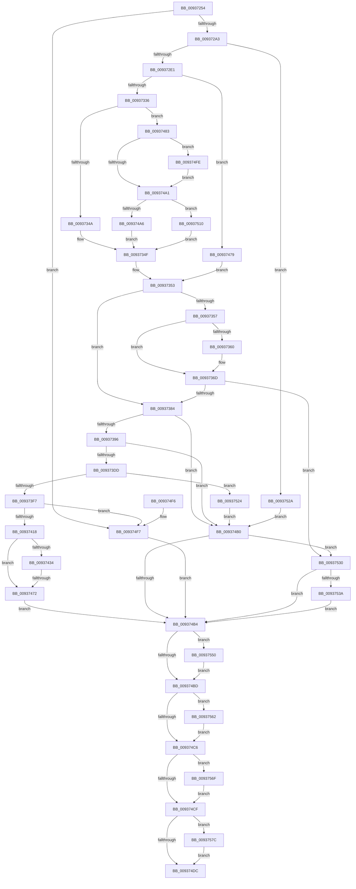

# VrpHandleIoctlInitializeJobForVreg

- RVA: `0x00937254`–`0x0093758B` (길이 `823` bytes)
- VA: `0x0000000140937254`
- 실행 섹션: `PAGE`
- PDB 이름 있음: `예`; PDB Function 태그: `예`
- unwind 정보 RVA: `0x0008F438`
- 디코드: `214`개 명령, `823/823` bytes 표시
- 미해석 바이트: `0` (있으면 어셈블리에 `.byte`로 보존)

> 이 문서는 커널 이미지의 기계어와 PDB 기호를 분석해 생성했습니다. 4번과 5번은 함수 원형과 자료형을 바이너리 사용 방식에서 추정한 C 해석이며 원본 소스 복구 결과는 아닙니다.

## 1. Dependencies

- 직접 호출 지점: **16**; 고유 호출 대상: **14**
- 직접 호출자로 확인된 함수: **1**
- RIP 상대 이미지 참조: **4**

### Outgoing calls
- `0x009372CF` → [ObCreateObjectEx](../89/ObCreateObjectEx_function_0089B1E0.md) (function, `0x0089B1E0`)
- `0x009372ED` → [memset](../../text/6C/memset_function_006C6C40.md) (function, `0x006C6C40`)
- `0x00937365` → [ExFreePoolWithTag](../../poolcode/B8/ExFreePoolWithTag_function_00B82870.md) (function, `0x00B82870`)
- `0x00937384` → [VrpIncrementSiloCount](VrpIncrementSiloCount_function_00937594.md) (function, `0x00937594`)
- `0x009373CB` → [ObpReferenceObjectByHandleWithTag](../86/ObpReferenceObjectByHandleWithTag_function_00869650.md) (function, `0x00869650`)
- `0x009373E5` → [PsGetJobSilo](../../text/41/PsGetJobSilo_function_00418630.md) (function, `0x00418630`)
- `0x00937407` → [PsIsThreadInSilo](../../text/41/PsIsThreadInSilo_function_0041859C.md) (function, `0x0041859C`)
- `0x00937427` → [VrpAllocateKeyContext](VrpAllocateKeyContext_function_00937204.md) (function, `0x00937204`)
- `0x0093745D` → [ExAllocatePool2](../../poolcode/B8/ExAllocatePool2_function_00B820F0.md) (function, `0x00B820F0`)
- `0x00937491` → [ExAllocatePoolWithTag](../../poolcode/B8/ExAllocatePoolWithTag_function_00B82010.md) (function, `0x00B82010`)
- `0x00937506` → [memset](../../text/6C/memset_function_006C6C40.md) (function, `0x006C6C40`)
- `0x00937546` → [PsRemoveSiloContext](../77/PsRemoveSiloContext_function_0077F450.md) (function, `0x0077F450`)
- `0x00937558` → [ObfDereferenceObjectWithTag](../../text/2F/ObfDereferenceObjectWithTag_function_002F78E0.md) (function, `0x002F78E0`)
- `0x00937565` → [ObfDereferenceObject](../../text/2F/ObfDereferenceObject_function_002F9350.md) (function, `0x002F9350`)
- `0x00937572` → [VrpFreeKeyContext](../9F/VrpFreeKeyContext_function_009FEED4.md) (function, `0x009FEED4`)
- `0x00937581` → [ObfDereferenceObjectWithTag](../../text/2F/ObfDereferenceObjectWithTag_function_002F78E0.md) (function, `0x002F78E0`)

### Direct callers
- [VrpIoctlDeviceDispatch](VrpIoctlDeviceDispatch_function_00934C50.md) at `0x00934DBA`

### Static image references
- `0x009372A3` → RVA `0x00EF0018` (`.data`; read)
- `0x009373B3` → RVA `0x00FC6C58` (`ALMOSTRO`; read)
- `0x00937456` → RVA `0x00FD9F98` (`PAGEDATA`; read)
- `0x0093753A` → RVA `0x00EF02B8` (`.data`; read)

## 2. Other-region calls and transfers

- 다른 실행 섹션으로 향하는 call: **10**
  - `0x009372ED` → [memset](../../text/6C/memset_function_006C6C40.md) (`PAGE` → `.text`)
  - `0x00937365` → [ExFreePoolWithTag](../../poolcode/B8/ExFreePoolWithTag_function_00B82870.md) (`PAGE` → `POOLCODE`)
  - `0x009373E5` → [PsGetJobSilo](../../text/41/PsGetJobSilo_function_00418630.md) (`PAGE` → `.text`)
  - `0x00937407` → [PsIsThreadInSilo](../../text/41/PsIsThreadInSilo_function_0041859C.md) (`PAGE` → `.text`)
  - `0x0093745D` → [ExAllocatePool2](../../poolcode/B8/ExAllocatePool2_function_00B820F0.md) (`PAGE` → `POOLCODE`)
  - `0x00937491` → [ExAllocatePoolWithTag](../../poolcode/B8/ExAllocatePoolWithTag_function_00B82010.md) (`PAGE` → `POOLCODE`)
  - `0x00937506` → [memset](../../text/6C/memset_function_006C6C40.md) (`PAGE` → `.text`)
  - `0x00937558` → [ObfDereferenceObjectWithTag](../../text/2F/ObfDereferenceObjectWithTag_function_002F78E0.md) (`PAGE` → `.text`)
  - `0x00937565` → [ObfDereferenceObject](../../text/2F/ObfDereferenceObject_function_002F9350.md) (`PAGE` → `.text`)
  - `0x00937581` → [ObfDereferenceObjectWithTag](../../text/2F/ObfDereferenceObjectWithTag_function_002F78E0.md) (`PAGE` → `.text`)
- call이 아닌 외부 분기/꼬리 이동: **1**
  - `0x0093746C` → [sub_00B24EA0](../B2/Unknown_function_00B24EA0.md) (`tail-transfer`)

## 3. Assembly (complete function range)

```asm
00937254  4C 8B DC                        mov r11, rsp
00937257  49 89 5B 18                     mov qword ptr [r11 + 0x18], rbx
0093725B  4D 89 4B 20                     mov qword ptr [r11 + 0x20], r9
0093725F  49 89 4B 08                     mov qword ptr [r11 + 8], rcx
00937263  55                              push rbp
00937264  56                              push rsi
00937265  57                              push rdi
00937266  41 54                           push r12
00937268  41 55                           push r13
0093726A  41 56                           push r14
0093726C  41 57                           push r15
0093726E  48 8B EC                        mov rbp, rsp
00937271  48 83 EC 60                     sub rsp, 0x60
00937275  45 33 C9                        xor r9d, r9d
00937278  45 8A E8                        mov r13b, r8b
0093727B  4C 89 4D 68                     mov qword ptr [rbp + 0x68], r9
0093727F  4C 8B E1                        mov r12, rcx
00937282  4C 89 4D 58                     mov qword ptr [rbp + 0x58], r9
00937286  41 8B F9                        mov edi, r9d
00937289  44 89 4D 48                     mov dword ptr [rbp + 0x48], r9d
0093728D  41 8B F1                        mov esi, r9d
00937290  4C 89 4D 60                     mov qword ptr [rbp + 0x60], r9
00937294  45 8B F9                        mov r15d, r9d
00937297  45 8B F1                        mov r14d, r9d
0093729A  83 FA 08                        cmp edx, 8
0093729D  0F 82 54 02 00 00               jb 0x1409374f7
009372A3  48 8B 15 6E 8D 5B 00            mov rdx, qword ptr [rip + 0x5b8d6e]
009372AA  41 8D 79 60                     lea edi, [r9 + 0x60]
009372AE  4D 89 4B B0                     mov qword ptr [r11 - 0x50], r9
009372B2  48 8D 45 58                     lea rax, [rbp + 0x58]
009372B6  49 89 43 A8                     mov qword ptr [r11 - 0x58], rax
009372BA  45 33 C0                        xor r8d, r8d
009372BD  45 89 4B A0                     mov dword ptr [r11 - 0x60], r9d
009372C1  33 C9                           xor ecx, ecx
009372C3  45 89 4B 98                     mov dword ptr [r11 - 0x68], r9d
009372C7  45 8D 4E 01                     lea r9d, [r14 + 1]
009372CB  89 7C 24 28                     mov dword ptr [rsp + 0x28], edi
009372CF  E8 0C 3F F6 FF                  call 0x14089b1e0
009372D4  45 33 C9                        xor r9d, r9d
009372D7  8B D8                           mov ebx, eax
009372D9  85 C0                           test eax, eax
009372DB  0F 88 49 02 00 00               js 0x14093752a
009372E1  44 8B C7                        mov r8d, edi
009372E4  33 D2                           xor edx, edx
009372E6  48 8B 7D 58                     mov rdi, qword ptr [rbp + 0x58]
009372EA  48 8B CF                        mov rcx, rdi
009372ED  E8 4E F9 D8 FF                  call 0x1406c6c40
009372F2  45 33 C9                        xor r9d, r9d
009372F5  41 8D 4E 08                     lea ecx, [r14 + 8]
009372F9  4C 89 4F 10                     mov qword ptr [rdi + 0x10], r9
009372FD  0F 57 C0                        xorps xmm0, xmm0
00937300  0F 11 47 20                     movups xmmword ptr [rdi + 0x20], xmm0
00937304  8B C1                           mov eax, ecx
00937306  0F 11 47 30                     movups xmmword ptr [rdi + 0x30], xmm0
0093730A  0F 11 47 40                     movups xmmword ptr [rdi + 0x40], xmm0
0093730E  4C 89 4F 20                     mov qword ptr [rdi + 0x20], r9
00937312  49 F7 E1                        mul r9
00937315  48 C7 47 40 10 00 00 00         mov qword ptr [rdi + 0x40], 0x10
0093731D  4C 89 4F 30                     mov qword ptr [rdi + 0x30], r9
00937321  4C 89 4F 38                     mov qword ptr [rdi + 0x38], r9
00937325  4C 89 4F 48                     mov qword ptr [rdi + 0x48], r9
00937329  48 89 4F 28                     mov qword ptr [rdi + 0x28], rcx
0093732D  48 85 D2                        test rdx, rdx
00937330  0F 85 43 01 00 00               jne 0x140937479
00937336  8D 51 18                        lea edx, [rcx + 0x18]
00937339  8B C1                           mov eax, ecx
0093733B  48 F7 E2                        mul rdx
0093733E  4C 8B E0                        mov r12, rax
00937341  48 85 D2                        test rdx, rdx
00937344  0F 84 39 01 00 00               je 0x140937483
0093734A  BB 95 00 00 C0                  mov ebx, 0xc0000095
0093734F  4C 8B 65 40                     mov r12, qword ptr [rbp + 0x40]
00937353  85 DB                           test ebx, ebx
00937355  74 2D                           je 0x140937384
00937357  48 8B 4F 48                     mov rcx, qword ptr [rdi + 0x48]
0093735B  48 85 C9                        test rcx, rcx
0093735E  74 0D                           je 0x14093736d
00937360  BA 52 54 61 72                  mov edx, 0x72615452
00937365  E8 06 B5 24 00                  call 0x140b82870
0093736A  45 33 C9                        xor r9d, r9d
0093736D  0F 57 C0                        xorps xmm0, xmm0
00937370  0F 11 47 20                     movups xmmword ptr [rdi + 0x20], xmm0
00937374  0F 11 47 30                     movups xmmword ptr [rdi + 0x30], xmm0
00937378  0F 11 47 40                     movups xmmword ptr [rdi + 0x40], xmm0
0093737C  85 DB                           test ebx, ebx
0093737E  0F 88 AC 01 00 00               js 0x140937530
00937384  E8 0B 02 00 00                  call 0x140937594
00937389  45 33 C9                        xor r9d, r9d
0093738C  8B D8                           mov ebx, eax
0093738E  85 C0                           test eax, eax
00937390  0F 88 1A 01 00 00               js 0x1409374b0
00937396  4C 89 4C 24 38                  mov qword ptr [rsp + 0x38], r9
0093739B  48 8D 45 68                     lea rax, [rbp + 0x68]
0093739F  4C 89 4C 24 30                  mov qword ptr [rsp + 0x30], r9
009373A4  BA 06 00 00 00                  mov edx, 6
009373A9  C7 47 58 01 00 00 00            mov dword ptr [rdi + 0x58], 1
009373B0  45 8A CD                        mov r9b, r13b
009373B3  4C 8B 05 9E F8 68 00            mov r8, qword ptr [rip + 0x68f89e]
009373BA  49 8B 0C 24                     mov rcx, qword ptr [r12]
009373BE  48 89 44 24 28                  mov qword ptr [rsp + 0x28], rax
009373C3  C7 44 24 20 43 6D 56 52         mov dword ptr [rsp + 0x20], 0x52566d43
009373CB  E8 80 22 F3 FF                  call 0x140869650
009373D0  45 33 C9                        xor r9d, r9d
009373D3  8B D8                           mov ebx, eax
009373D5  85 C0                           test eax, eax
009373D7  0F 88 D3 00 00 00               js 0x1409374b0
009373DD  48 8B 4D 68                     mov rcx, qword ptr [rbp + 0x68]
009373E1  48 8D 55 60                     lea rdx, [rbp + 0x60]
009373E5  E8 46 12 AE FF                  call 0x140418630
009373EA  45 33 C9                        xor r9d, r9d
009373ED  8B D8                           mov ebx, eax
009373EF  85 C0                           test eax, eax
009373F1  0F 88 2D 01 00 00               js 0x140937524
009373F7  65 48 8B 0C 25 88 01 00 00      mov rcx, qword ptr gs:[0x188]
00937400  4C 8B 75 60                     mov r14, qword ptr [rbp + 0x60]
00937404  49 8B D6                        mov rdx, r14
00937407  E8 90 11 AE FF                  call 0x14041859c
0093740C  48 8B 7D 58                     mov rdi, qword ptr [rbp + 0x58]
00937410  84 C0                           test al, al
00937412  0F 85 DF 00 00 00               jne 0x1409374f7
00937418  41 0F 10 86 C0 05 00 00         movups xmm0, xmmword ptr [r14 + 0x5c0]
00937420  48 8B CF                        mov rcx, rdi
00937423  F3 0F 7F 07                     movdqu xmmword ptr [rdi], xmm0
00937427  E8 D8 FD FF FF                  call 0x140937204
0093742C  48 8B F0                        mov rsi, rax
0093742F  48 85 C0                        test rax, rax
00937432  74 3E                           je 0x140937472
00937434  41 0F 10 86 C0 05 00 00         movups xmm0, xmmword ptr [r14 + 0x5c0]
0093743C  41 BC 01 00 00 00               mov r12d, 1
00937442  B9 00 01 00 00                  mov ecx, 0x100
00937447  66 44 89 60 20                  mov word ptr [rax + 0x20], r12w
0093744C  41 B8 56 52 65 67               mov r8d, 0x67655256
00937452  F3 0F 7F 00                     movdqu xmmword ptr [rax], xmm0
00937456  0F B7 15 3B 2B 6A 00            movzx edx, word ptr [rip + 0x6a2b3b]
0093745D  E8 8E AC 24 00                  call 0x140b820f0
00937462  45 33 C9                        xor r9d, r9d
00937465  48 89 46 18                     mov qword ptr [rsi + 0x18], rax
00937469  48 85 C0                        test rax, rax
0093746C  0F 85 2E DA 1E 00               jne 0x140b24ea0
00937472  BB 9A 00 00 C0                  mov ebx, 0xc000009a
00937477  EB 3B                           jmp 0x1409374b4
00937479  BB 95 00 00 C0                  mov ebx, 0xc0000095
0093747E  E9 D0 FE FF FF                  jmp 0x140937353
00937483  41 B8 52 54 61 72               mov r8d, 0x72615452
00937489  49 8B D4                        mov rdx, r12
0093748C  B9 01 00 00 00                  mov ecx, 1
00937491  E8 7A AB 24 00                  call 0x140b82010
00937496  45 33 C9                        xor r9d, r9d
00937499  48 8B D8                        mov rbx, rax
0093749C  48 85 C0                        test rax, rax
0093749F  75 5D                           jne 0x1409374fe
009374A1  48 85 DB                        test rbx, rbx
009374A4  75 6A                           jne 0x140937510
009374A6  BB 17 00 00 C0                  mov ebx, 0xc0000017
009374AB  E9 9F FE FF FF                  jmp 0x14093734f
009374B0  85 DB                           test ebx, ebx
009374B2  78 7C                           js 0x140937530
009374B4  48 85 FF                        test rdi, rdi
009374B7  0F 85 93 00 00 00               jne 0x140937550
009374BD  4D 85 FF                        test r15, r15
009374C0  0F 85 9C 00 00 00               jne 0x140937562
009374C6  48 85 F6                        test rsi, rsi
009374C9  0F 85 A0 00 00 00               jne 0x14093756f
009374CF  48 8B 4D 68                     mov rcx, qword ptr [rbp + 0x68]
009374D3  48 85 C9                        test rcx, rcx
009374D6  0F 85 A0 00 00 00               jne 0x14093757c
009374DC  8B C3                           mov eax, ebx
009374DE  48 8B 9C 24 B0 00 00 00         mov rbx, qword ptr [rsp + 0xb0]
009374E6  48 83 C4 60                     add rsp, 0x60
009374EA  41 5F                           pop r15
009374EC  41 5E                           pop r14
009374EE  41 5D                           pop r13
009374F0  41 5C                           pop r12
009374F2  5F                              pop rdi
009374F3  5E                              pop rsi
009374F4  5D                              pop rbp
009374F5  C3                              ret
009374F6  CC                              int3
009374F7  BB 0D 00 00 C0                  mov ebx, 0xc000000d
009374FC  EB B6                           jmp 0x1409374b4
009374FE  4D 8B C4                        mov r8, r12
00937501  33 D2                           xor edx, edx
00937503  48 8B CB                        mov rcx, rbx
00937506  E8 35 F7 D8 FF                  call 0x1406c6c40
0093750B  45 33 C9                        xor r9d, r9d
0093750E  EB 91                           jmp 0x1409374a1
00937510  48 89 5F 48                     mov qword ptr [rdi + 0x48], rbx
00937514  41 8B D9                        mov ebx, r9d
00937517  48 C7 47 38 20 00 00 00         mov qword ptr [rdi + 0x38], 0x20
0093751F  E9 2B FE FF FF                  jmp 0x14093734f
00937524  4C 8B 75 60                     mov r14, qword ptr [rbp + 0x60]
00937528  EB 86                           jmp 0x1409374b0
0093752A  48 8B 7D 58                     mov rdi, qword ptr [rbp + 0x58]
0093752E  EB 80                           jmp 0x1409374b0
00937530  44 39 4D 48                     cmp dword ptr [rbp + 0x48], r9d
00937534  0F 84 7A FF FF FF               je 0x1409374b4
0093753A  8B 15 78 8D 5B 00               mov edx, dword ptr [rip + 0x5b8d78]
00937540  45 33 C0                        xor r8d, r8d
00937543  49 8B CE                        mov rcx, r14
00937546  E8 05 7F E4 FF                  call 0x14077f450
0093754B  E9 64 FF FF FF                  jmp 0x1409374b4
00937550  BA 56 52 65 67                  mov edx, 0x67655256
00937555  48 8B CF                        mov rcx, rdi
00937558  E8 83 03 9C FF                  call 0x1402f78e0
0093755D  E9 5B FF FF FF                  jmp 0x1409374bd
00937562  49 8B CF                        mov rcx, r15
00937565  E8 E6 1D 9C FF                  call 0x1402f9350
0093756A  E9 57 FF FF FF                  jmp 0x1409374c6
0093756F  48 8B CE                        mov rcx, rsi
00937572  E8 5D 79 0C 00                  call 0x1409feed4
00937577  E9 53 FF FF FF                  jmp 0x1409374cf
0093757C  BA 43 6D 56 52                  mov edx, 0x52566d43
00937581  E8 5A 03 9C FF                  call 0x1402f78e0
00937586  E9 51 FF FF FF                  jmp 0x1409374dc
```

## 4. C-style interpretation (structured pseudocode)

```c
__int64 __fastcall VrpHandleIoctlInitializeJobForVreg(__int64 a1, int a2, int a3, __int64 a4, __int64 a5, __int64 a6)
{
    __int64 result;
    __int64 v_rsp;
    unsigned __int64 v_stack_m60;
    unsigned __int64 v_stack_m68;
    unsigned int v_stack_m70;
    unsigned int v_stack_m78;
    unsigned int v_stack_p10;
    unsigned __int64 v_stack_p18;
    unsigned __int64 v_stack_p20;
    unsigned __int64 v_stack_p28;
    unsigned __int64 v_stack_p30;
    unsigned __int64 v_stack_p8;

    *(unsigned __int64 *)(v_rsp + 24) = v_rbx;
    *(unsigned __int64 *)(v_rsp + 32) = a4;
    *(unsigned __int64 *)(v_rsp + 8) = a1;
    v_rsp = (v_rsp) - (96);
    a4 = 0;
    v_stack_p30 = 0;
    v_stack_p20 = 0;
    v_stack_p10 = 0;
    v_stack_p28 = 0;
    if (a2 < 8) goto loc_009374F7;
    *(unsigned __int64 *)(v_rsp - 80) = 0;
    *(unsigned __int64 *)(v_rsp - 88) = v_stack_p20;
    a3 = 0;
    *(unsigned int *)(v_rsp - 96) = 0;
    a1 = 0;
    *(unsigned int *)(v_rsp - 104) = 0;
    v_stack_m70 = (unsigned int)(a4 + 96);
    result = ObCreateObjectEx(a1, *(unsigned __int64 *)(v_rip + 5999982), a3, 0 + 1);
    a4 = 0;
    if (sign_flag) goto loc_0093752A;
    a2 = 0;
    result = memset(v_stack_p20, a2, (unsigned int)((unsigned int)(a4 + 96)), a4);
    a4 = 0;
    *(unsigned __int64 *)(v_stack_p20 + 16) = 0;
    *(unsigned __int64 *)(v_stack_p20 + 32) = v_xmm0;
    *(unsigned __int64 *)(v_stack_p20 + 48) = v_xmm0;
    *(unsigned __int64 *)(v_stack_p20 + 64) = v_xmm0;
    *(unsigned __int64 *)(v_stack_p20 + 32) = 0;
    *(unsigned __int64 *)(v_stack_p20 + 64) = 16;
    *(unsigned __int64 *)(v_stack_p20 + 48) = 0;
    *(unsigned __int64 *)(v_stack_p20 + 56) = 0;
    *(unsigned __int64 *)(v_stack_p20 + 72) = 0;
    *(unsigned __int64 *)(v_stack_p20 + 40) = 0 + 8;
    if (0 != 0) goto loc_00937479;
    if (0 + 8 + 24 == 0) goto loc_00937483;
loc_0093734F:
loc_00937353:
    if ((unsigned int)((unsigned int)(0xC0000095ULL)) == 0) goto loc_00937384;
    result = (unsigned int)((unsigned int)(0 + 8));
    if (*(unsigned __int64 *)(v_stack_p20 + 72) != 0) {
        a2 = 0x72615452ULL;
        result = ExFreePoolWithTag(*(unsigned __int64 *)(v_stack_p20 + 72), a2, (unsigned int)((unsigned int)(a4 + 96)), a4);
        a4 = 0;
    }
    *(unsigned __int64 *)(v_stack_p20 + 32) = v_xmm0;
    *(unsigned __int64 *)(v_stack_p20 + 48) = v_xmm0;
    *(unsigned __int64 *)(v_stack_p20 + 64) = v_xmm0;
    if (sign_flag) goto loc_00937530;
loc_00937384:
    result = VrpIncrementSiloCount(*(unsigned __int64 *)(v_stack_p20 + 72), a2, (unsigned int)((unsigned int)(a4 + 96)), a4);
    a4 = 0;
    if (sign_flag) goto loc_009374B0;
    v_stack_m60 = 0;
    v_stack_m68 = 0;
    *(unsigned int *)(v_stack_p20 + 88) = 1;
    v_stack_m70 = a6;
    v_stack_m78 = 0x52566D43ULL;
    result = ObpReferenceObjectByHandleWithTag(*(unsigned __int64 *)(v_stack_p8), 6, *(unsigned __int64 *)(v_rip + 6879390), (unsigned __int8)((unsigned __int8)(a3)));
    a4 = 0;
    if (sign_flag) goto loc_009374B0;
    result = PsGetJobSilo(a6, a5, *(unsigned __int64 *)(v_rip + 6879390), a4);
    a4 = 0;
    if (sign_flag) goto loc_00937524;
    result = PsIsThreadInSilo(*(unsigned __int64 *)(gs_base + (0 + 392)), a5, *(unsigned __int64 *)(v_rip + 6879390), a4);
    if ((unsigned __int8)(result) != 0) goto loc_009374F7;
    *(unsigned __int64 *)(v_stack_p20) = v_xmm0;
    result = VrpAllocateKeyContext(v_stack_p20, a5, *(unsigned __int64 *)(v_rip + 6879390), a4);
    if (result == 0) goto loc_00937472;
    *(unsigned __int16 *)(result + 32) = 1;
    *(unsigned __int64 *)(result) = v_xmm0;
    result = ExAllocatePool2(256, *(unsigned __int16 *)(v_rip + 6957883), (unsigned int)(0x67655256ULL), a4);
    a4 = 0;
    *(unsigned __int64 *)(result + 24) = result;
loc_00937472:
    goto loc_009374B4;
loc_00937479:
    goto loc_00937353;
loc_00937483:
    result = ExAllocatePoolWithTag(1, 1, (unsigned int)(0x72615452ULL), a4);
    a4 = 0;
    if (result != 0) goto loc_009374FE;
loc_009374A1:
    if (result != 0) goto loc_00937510;
    goto loc_0093734F;
loc_009374B0:
    if (sign_flag) goto loc_00937530;
loc_009374B4:
    if (v_stack_p20 != 0) goto loc_00937550;
loc_009374BD:
    if (0 != 0) goto loc_00937562;
loc_009374C6:
    if (result != 0) goto loc_0093756F;
loc_009374CF:
    if (a6 != 0) goto loc_0093757C;
loc_009374DC:
    v_rsp = (v_rsp) + (96);
    return (unsigned int)((unsigned int)((unsigned int)(0xC0000017ULL)));
loc_009374F7:
    goto loc_009374B4;
loc_009374FE:
    a2 = 0;
    result = memset((unsigned int)(0xC000000DULL), a2, 1, a4);
    a4 = 0;
    goto loc_009374A1;
loc_00937510:
    *(unsigned __int64 *)(v_stack_p20 + 72) = (unsigned int)(0xC000000DULL);
    *(unsigned __int64 *)(v_stack_p20 + 56) = 32;
    goto loc_0093734F;
loc_00937524:
    goto loc_009374B0;
loc_0093752A:
    goto loc_009374B0;
loc_00937530:
    if (v_stack_p10 == 0) goto loc_009374B4;
    a3 = 0;
    result = PsRemoveSiloContext(a5, (unsigned int)(*(unsigned int *)(v_rip + 5999992)), a3, a4);
    goto loc_009374B4;
loc_00937550:
    result = ObfDereferenceObjectWithTag(v_stack_p20, (unsigned int)(0x67655256ULL), a3, a4);
    goto loc_009374BD;
loc_00937562:
    result = ObfDereferenceObject(0, (unsigned int)(0x67655256ULL), a3, a4);
    goto loc_009374C6;
loc_0093756F:
    result = VrpFreeKeyContext(result, (unsigned int)(0x67655256ULL), a3, a4);
    goto loc_009374CF;
loc_0093757C:
    result = ObfDereferenceObjectWithTag(result, (unsigned int)(0x52566D43ULL), a3, a4);
    goto loc_009374DC;
}
```

## 5. (Beta) C Style

```c
int64_t VrpHandleIoctlInitializeJobForVreg(int64_t Arg1, int32_t Arg2, int32_t Arg3, int64_t Arg4, void *Arg5, int64_t Arg6)
{
    uint8_t *arg5 = (uint8_t *)Arg5;

    int64_t result;
    int64_t local_rsp;
    uint64_t v_stack_m60;
    uint64_t v_stack_m68;
    uint32_t v_stack_m70;
    uint32_t v_stack_m78;
    uint32_t v_stack_p10;
    uint64_t v_stack_p18;
    uint64_t v_stack_p20;
    uint64_t v_stack_p28;
    uint64_t v_stack_p30;
    uint64_t v_stack_p8;

    *(uint64_t *)(local_rsp + 0x18) = local_rbx;
    *(uint64_t *)(local_rsp + 0x20) = Arg4;
    *(uint64_t *)(local_rsp + 0x8) = Arg1;
    local_rsp = (local_rsp) - (96);
    Arg4 = 0;
    v_stack_p30 = 0;
    v_stack_p20 = 0;
    v_stack_p10 = 0;
    v_stack_p28 = 0;
    if (Arg2 < 8) goto loc_009374F7;
    *(uint64_t *)(local_rsp - 0x50) = 0;
    *(uint64_t *)(local_rsp - 0x58) = v_stack_p20;
    Arg3 = 0;
    *(uint32_t *)(local_rsp - 0x60) = 0;
    Arg1 = 0;
    *(uint32_t *)(local_rsp - 0x68) = 0;
    v_stack_m70 = (uint32_t)(Arg4 + 96);
    result = ObCreateObjectEx(Arg1, *(uint64_t *)(v_rip + 0x5B8D6E), Arg3, 0 + 1);
    Arg4 = 0;
    if (sign_flag) goto loc_0093752A;
    Arg2 = 0;
    result = memset(v_stack_p20, Arg2, (uint32_t)((uint32_t)(Arg4 + 96)), Arg4);
    Arg4 = 0;
    *(uint64_t *)(v_stack_p20 + 0x10) = 0;
    *(uint64_t *)(v_stack_p20 + 0x20) = v_xmm0;
    *(uint64_t *)(v_stack_p20 + 0x30) = v_xmm0;
    *(uint64_t *)(v_stack_p20 + 0x40) = v_xmm0;
    *(uint64_t *)(v_stack_p20 + 0x20) = 0;
    *(uint64_t *)(v_stack_p20 + 0x40) = 16;
    *(uint64_t *)(v_stack_p20 + 0x30) = 0;
    *(uint64_t *)(v_stack_p20 + 0x38) = 0;
    *(uint64_t *)(v_stack_p20 + 0x48) = 0;
    *(uint64_t *)(v_stack_p20 + 0x28) = 0 + 8;
    if (0 != 0) goto loc_00937479;
    if (0 + 8 + 24 == 0) goto loc_00937483;
loc_0093734F:
loc_00937353:
    if ((uint32_t)((uint32_t)(0xC0000095ULL)) == 0) goto loc_00937384;
    result = (uint32_t)((uint32_t)(0 + 8));
    if (*(uint64_t *)(v_stack_p20 + 0x48) != 0) {
        Arg2 = 0x72615452ULL;
        result = ExFreePoolWithTag(*(uint64_t *)(v_stack_p20 + 0x48), Arg2, (uint32_t)((uint32_t)(Arg4 + 96)), Arg4);
        Arg4 = 0;
    }
    *(uint64_t *)(v_stack_p20 + 0x20) = v_xmm0;
    *(uint64_t *)(v_stack_p20 + 0x30) = v_xmm0;
    *(uint64_t *)(v_stack_p20 + 0x40) = v_xmm0;
    if (sign_flag) goto loc_00937530;
loc_00937384:
    result = VrpIncrementSiloCount(*(uint64_t *)(v_stack_p20 + 0x48), Arg2, (uint32_t)((uint32_t)(Arg4 + 96)), Arg4);
    Arg4 = 0;
    if (sign_flag) goto loc_009374B0;
    v_stack_m60 = 0;
    v_stack_m68 = 0;
    *(uint32_t *)(v_stack_p20 + 0x58) = 1;
    v_stack_m70 = Arg6;
    v_stack_m78 = 0x52566D43ULL;
    result = ObpReferenceObjectByHandleWithTag(*(uint64_t *)(v_stack_p8), 6, *(uint64_t *)(v_rip + 0x68F89E), (uint8_t)((uint8_t)(Arg3)));
    Arg4 = 0;
    if (sign_flag) goto loc_009374B0;
    result = PsGetJobSilo(Arg6, Arg5, *(uint64_t *)(v_rip + 0x68F89E), Arg4);
    Arg4 = 0;
    if (sign_flag) goto loc_00937524;
    result = PsIsThreadInSilo(*(uint64_t *)(gs_base + (0 + 0x188)), Arg5, *(uint64_t *)(v_rip + 0x68F89E), Arg4);
    if ((uint8_t)(result) != 0) goto loc_009374F7;
    *(uint64_t *)(v_stack_p20) = v_xmm0;
    result = VrpAllocateKeyContext(v_stack_p20, Arg5, *(uint64_t *)(v_rip + 0x68F89E), Arg4);
    if (result == 0) goto loc_00937472;
    *(uint16_t *)(result + 0x20) = 1;
    *(uint64_t *)(result) = v_xmm0;
    result = ExAllocatePool2(256, *(uint16_t *)(v_rip + 0x6A2B3B), (uint32_t)(0x67655256ULL), Arg4);
    Arg4 = 0;
    *(uint64_t *)(result + 0x18) = result;
loc_00937472:
    goto loc_009374B4;
loc_00937479:
    goto loc_00937353;
loc_00937483:
    result = ExAllocatePoolWithTag(1, 1, (uint32_t)(0x72615452ULL), Arg4);
    Arg4 = 0;
    if (result != 0) goto loc_009374FE;
loc_009374A1:
    if (result != 0) goto loc_00937510;
    goto loc_0093734F;
loc_009374B0:
    if (sign_flag) goto loc_00937530;
loc_009374B4:
    if (v_stack_p20 != 0) goto loc_00937550;
loc_009374BD:
    if (0 != 0) goto loc_00937562;
loc_009374C6:
    if (result != 0) goto loc_0093756F;
loc_009374CF:
    if (Arg6 != 0) goto loc_0093757C;
loc_009374DC:
    local_rsp = (local_rsp) + (96);
    return (uint32_t)((uint32_t)((uint32_t)(0xC0000017ULL)));
loc_009374F7:
    goto loc_009374B4;
loc_009374FE:
    Arg2 = 0;
    result = memset((uint32_t)(0xC000000DULL), Arg2, 1, Arg4);
    Arg4 = 0;
    goto loc_009374A1;
loc_00937510:
    *(uint64_t *)(v_stack_p20 + 0x48) = (uint32_t)(0xC000000DULL);
    *(uint64_t *)(v_stack_p20 + 0x38) = 32;
    goto loc_0093734F;
loc_00937524:
    goto loc_009374B0;
loc_0093752A:
    goto loc_009374B0;
loc_00937530:
    if (v_stack_p10 == 0) goto loc_009374B4;
    Arg3 = 0;
    result = PsRemoveSiloContext(Arg5, (uint32_t)(*(uint32_t *)(v_rip + 0x5B8D78)), Arg3, Arg4);
    goto loc_009374B4;
loc_00937550:
    result = ObfDereferenceObjectWithTag(v_stack_p20, (uint32_t)(0x67655256ULL), Arg3, Arg4);
    goto loc_009374BD;
loc_00937562:
    result = ObfDereferenceObject(0, (uint32_t)(0x67655256ULL), Arg3, Arg4);
    goto loc_009374C6;
loc_0093756F:
    result = VrpFreeKeyContext(result, (uint32_t)(0x67655256ULL), Arg3, Arg4);
    goto loc_009374CF;
loc_0093757C:
    result = ObfDereferenceObjectWithTag(result, (uint32_t)(0x52566D43ULL), Arg3, Arg4);
    goto loc_009374DC;
}
```

### 관측된 메모리 오프셋

구조체 형식이 확인되지 않은 접근은 인자 기준의 오프셋으로만 기록했습니다.

| 기준 인자 | 오프셋 표현 | 폭 (bit) | 접근 |
|---|---:|---:|---|
| `Arg5` | `+ 0x5C0` | `128` | `R` |

## 6. Execution-region graph

[열기: 2D/3D 그래프와 함수 탐색 컨트롤 패널](../../../control-panel.html?section=page&rva=0x00937254&view=graph)

- 2D 그래프는 위에서 아래로 흐르고, 3D 그래프는 빈 공간을 드래그해 회전합니다. Shift+드래그는 이동, 휠은 확대·축소, 함수 노드 선택은 대상 보고서 이동입니다.

### Static fallback


