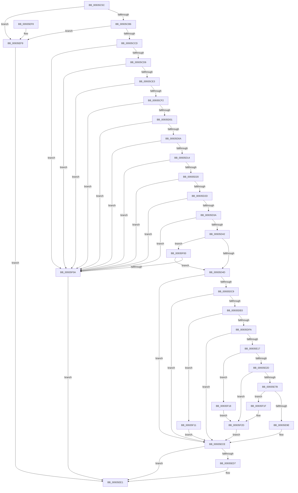

# VrpHandleIoctlLoadDifferencingHive

- RVA: `0x00935C5C`–`0x00935F37` (길이 `731` bytes)
- VA: `0x0000000140935C5C`
- 실행 섹션: `PAGE`
- PDB 이름 있음: `예`; PDB Function 태그: `아니요`
- unwind 정보 RVA: `0x0008F310`
- 디코드: `183`개 명령, `731/731` bytes 표시
- 미해석 바이트: `0` (있으면 어셈블리에 `.byte`로 보존)

> 이 문서는 커널 이미지의 기계어와 PDB 기호를 분석해 생성했습니다. 4번과 5번은 함수 원형과 자료형을 바이너리 사용 방식에서 추정한 C 해석이며 원본 소스 복구 결과는 아닙니다.

## 1. Dependencies

- 직접 호출 지점: **14**; 고유 호출 대상: **12**
- 직접 호출자로 확인된 함수: **1**
- RIP 상대 이미지 참조: **4**

### Outgoing calls
- `0x00935CA9` → [SeSinglePrivilegeCheck](../87/SeSinglePrivilegeCheck_function_00871E20.md) (function, `0x00871E20`)
- `0x00935CC0` → [SeSinglePrivilegeCheck](../87/SeSinglePrivilegeCheck_function_00871E20.md) (function, `0x00871E20`)
- `0x00935DBA` → [ObpReferenceObjectByHandleWithTag](../86/ObpReferenceObjectByHandleWithTag_function_00869650.md) (function, `0x00869650`)
- `0x00935DD1` → [PsGetJobSilo](../../text/41/PsGetJobSilo_function_00418630.md) (function, `0x00418630`)
- `0x00935DED` → [PsIsThreadInSilo](../../text/41/PsIsThreadInSilo_function_0041859C.md) (function, `0x0041859C`)
- `0x00935E08` → [PsGetPermanentSiloContext](../../text/3E/PsGetPermanentSiloContext_function_003EE100.md) (function, `0x003EE100`)
- `0x00935E1E` → [VrpLockJobContextExclusive](VrpLockJobContextExclusive_function_00935A34.md) (function, `0x00935A34`)
- `0x00935E6C` → [VrpLoadDifferencingHive](VrpLoadDifferencingHive_function_00935F40.md) (function, `0x00935F40`)
- `0x00935E8D` → [ExAllocatePool2](../../poolcode/B8/ExAllocatePool2_function_00B820F0.md) (function, `0x00B820F0`)
- `0x00935EB3` → [memcpy](../../text/6C/memcpy_function_006C6840.md) (function, `0x006C6840`)
- `0x00935EC6` → [VrpUnlockJobContextExclusive](VrpUnlockJobContextExclusive_function_009354FC.md) (function, `0x009354FC`)
- `0x00935EDC` → [ObfDereferenceObjectWithTag](../../text/2F/ObfDereferenceObjectWithTag_function_002F78E0.md) (function, `0x002F78E0`)
- `0x00935F28` → [VrpUnloadDifferencingHive](VrpUnloadDifferencingHive_function_00936CE0.md) (function, `0x00936CE0`)
- `0x00935F30` → [VrpUnlockJobContextExclusive](VrpUnlockJobContextExclusive_function_009354FC.md) (function, `0x009354FC`)

### Direct callers
- [VrpIoctlDeviceDispatch](VrpIoctlDeviceDispatch_function_00934C50.md) at `0x00934D90`

### Static image references
- `0x00935C89` → RVA `0x00FD9AC0` (`PAGEDATA`; read)
- `0x00935CB6` → RVA `0x00FD9AE0` (`PAGEDATA`; read)
- `0x00935D83` → RVA `0x00FC6C58` (`ALMOSTRO`; read)
- `0x00935DFA` → RVA `0x00EF02B8` (`.data`; read)

## 2. Other-region calls and transfers

- 다른 실행 섹션으로 향하는 call: **6**
  - `0x00935DD1` → [PsGetJobSilo](../../text/41/PsGetJobSilo_function_00418630.md) (`PAGE` → `.text`)
  - `0x00935DED` → [PsIsThreadInSilo](../../text/41/PsIsThreadInSilo_function_0041859C.md) (`PAGE` → `.text`)
  - `0x00935E08` → [PsGetPermanentSiloContext](../../text/3E/PsGetPermanentSiloContext_function_003EE100.md) (`PAGE` → `.text`)
  - `0x00935E8D` → [ExAllocatePool2](../../poolcode/B8/ExAllocatePool2_function_00B820F0.md) (`PAGE` → `POOLCODE`)
  - `0x00935EB3` → [memcpy](../../text/6C/memcpy_function_006C6840.md) (`PAGE` → `.text`)
  - `0x00935EDC` → [ObfDereferenceObjectWithTag](../../text/2F/ObfDereferenceObjectWithTag_function_002F78E0.md) (`PAGE` → `.text`)
- 별도 외부 분기/꼬리 이동을 확인하지 못했습니다.

## 3. Assembly (complete function range)

```asm
00935C5C  48 89 5C 24 08                  mov qword ptr [rsp + 8], rbx
00935C61  48 89 74 24 10                  mov qword ptr [rsp + 0x10], rsi
00935C66  4C 89 4C 24 20                  mov qword ptr [rsp + 0x20], r9
00935C6B  55                              push rbp
00935C6C  57                              push rdi
00935C6D  41 56                           push r14
00935C6F  48 8B EC                        mov rbp, rsp
00935C72  48 83 EC 70                     sub rsp, 0x70
00935C76  0F 57 C0                        xorps xmm0, xmm0
00935C79  45 33 F6                        xor r14d, r14d
00935C7C  8B DA                           mov ebx, edx
00935C7E  4C 89 75 40                     mov qword ptr [rbp + 0x40], r14
00935C82  48 8B F1                        mov rsi, rcx
00935C85  4C 89 75 48                     mov qword ptr [rbp + 0x48], r14
00935C89  48 8B 0D 30 3E 6A 00            mov rcx, qword ptr [rip + 0x6a3e30]
00935C90  0F 57 C9                        xorps xmm1, xmm1
00935C93  41 8A D0                        mov dl, r8b
00935C96  4C 89 75 38                     mov qword ptr [rbp + 0x38], r14
00935C9A  0F 11 45 E0                     movups xmmword ptr [rbp - 0x20], xmm0
00935C9E  41 8A F8                        mov dil, r8b
00935CA1  0F 11 4D F0                     movups xmmword ptr [rbp - 0x10], xmm1
00935CA5  0F 11 45 D0                     movups xmmword ptr [rbp - 0x30], xmm0
00935CA9  E8 72 C1 F3 FF                  call 0x140871e20
00935CAE  84 C0                           test al, al
00935CB0  0F 84 43 02 00 00               je 0x140935ef9
00935CB6  48 8B 0D 23 3E 6A 00            mov rcx, qword ptr [rip + 0x6a3e23]
00935CBD  40 8A D7                        mov dl, dil
00935CC0  E8 5B C1 F3 FF                  call 0x140871e20
00935CC5  84 C0                           test al, al
00935CC7  0F 84 2C 02 00 00               je 0x140935ef9
00935CCD  83 FB 30                        cmp ebx, 0x30
00935CD0  0F 82 34 02 00 00               jb 0x140935f0a
00935CD6  0F B7 56 14                     movzx edx, word ptr [rsi + 0x14]
00935CDA  F6 C2 01                        test dl, 1
00935CDD  0F 85 27 02 00 00               jne 0x140935f0a
00935CE3  44 0F B7 46 16                  movzx r8d, word ptr [rsi + 0x16]
00935CE8  41 F6 C0 01                     test r8b, 1
00935CEC  0F 85 18 02 00 00               jne 0x140935f0a
00935CF2  44 0F B7 4E 18                  movzx r9d, word ptr [rsi + 0x18]
00935CF7  41 F6 C1 01                     test r9b, 1
00935CFB  0F 85 09 02 00 00               jne 0x140935f0a
00935D01  66 85 D2                        test dx, dx
00935D04  0F 84 00 02 00 00               je 0x140935f0a
00935D0A  66 45 85 C0                     test r8w, r8w
00935D0E  0F 84 F6 01 00 00               je 0x140935f0a
00935D14  8D 4A 28                        lea ecx, [rdx + 0x28]
00935D17  83 F9 28                        cmp ecx, 0x28
00935D1A  0F 82 EA 01 00 00               jb 0x140935f0a
00935D20  46 8D 14 01                     lea r10d, [rcx + r8]
00935D24  41 3B CA                        cmp ecx, r10d
00935D27  0F 87 DD 01 00 00               ja 0x140935f0a
00935D2D  43 8D 0C 0A                     lea ecx, [r10 + r9]
00935D31  44 3B D1                        cmp r10d, ecx
00935D34  0F 87 D0 01 00 00               ja 0x140935f0a
00935D3A  3B D9                           cmp ebx, ecx
00935D3C  0F 82 C8 01 00 00               jb 0x140935f0a
00935D42  8B 46 0C                        mov eax, dword ptr [rsi + 0xc]
00935D45  A8 01                           test al, 1
00935D47  0F 85 B3 01 00 00               jne 0x140935f00
00935D4D  48 8B C2                        mov rax, rdx
00935D50  66 89 55 D2                     mov word ptr [rbp - 0x2e], dx
00935D54  48 D1 E8                        shr rax, 1
00935D57  48 8D 4E 28                     lea rcx, [rsi + 0x28]
00935D5B  66 89 55 D0                     mov word ptr [rbp - 0x30], dx
00935D5F  4C 89 74 24 38                  mov qword ptr [rsp + 0x38], r14
00935D64  48 89 4D D8                     mov qword ptr [rbp - 0x28], rcx
00935D68  48 8D 14 41                     lea rdx, [rcx + rax*2]
00935D6C  66 44 89 45 F2                  mov word ptr [rbp - 0xe], r8w
00935D71  48 8B 0E                        mov rcx, qword ptr [rsi]
00935D74  49 8B C0                        mov rax, r8
00935D77  48 D1 E8                        shr rax, 1
00935D7A  48 89 55 F8                     mov qword ptr [rbp - 8], rdx
00935D7E  66 44 89 45 F0                  mov word ptr [rbp - 0x10], r8w
00935D83  4C 8B 05 CE 0E 69 00            mov r8, qword ptr [rip + 0x690ece]
00935D8A  48 8D 04 42                     lea rax, [rdx + rax*2]
00935D8E  66 44 89 4D E2                  mov word ptr [rbp - 0x1e], r9w
00935D93  48 89 45 E8                     mov qword ptr [rbp - 0x18], rax
00935D97  BA 06 00 00 00                  mov edx, 6
00935D9C  48 8D 45 40                     lea rax, [rbp + 0x40]
00935DA0  66 44 89 4D E0                  mov word ptr [rbp - 0x20], r9w
00935DA5  4C 89 74 24 30                  mov qword ptr [rsp + 0x30], r14
00935DAA  44 8A CF                        mov r9b, dil
00935DAD  48 89 44 24 28                  mov qword ptr [rsp + 0x28], rax
00935DB2  C7 44 24 20 43 6D 56 52         mov dword ptr [rsp + 0x20], 0x52566d43
00935DBA  E8 91 38 F3 FF                  call 0x140869650
00935DBF  8B D8                           mov ebx, eax
00935DC1  85 C0                           test eax, eax
00935DC3  0F 88 05 01 00 00               js 0x140935ece
00935DC9  48 8B 4D 40                     mov rcx, qword ptr [rbp + 0x40]
00935DCD  48 8D 55 38                     lea rdx, [rbp + 0x38]
00935DD1  E8 5A 28 AE FF                  call 0x140418630
00935DD6  8B D8                           mov ebx, eax
00935DD8  85 C0                           test eax, eax
00935DDA  0F 88 EE 00 00 00               js 0x140935ece
00935DE0  65 48 8B 0C 25 88 01 00 00      mov rcx, qword ptr gs:[0x188]
00935DE9  48 8B 55 38                     mov rdx, qword ptr [rbp + 0x38]
00935DED  E8 AA 27 AE FF                  call 0x14041859c
00935DF2  84 C0                           test al, al
00935DF4  0F 85 17 01 00 00               jne 0x140935f11
00935DFA  8B 15 B8 A4 5B 00               mov edx, dword ptr [rip + 0x5ba4b8]
00935E00  4C 8D 45 48                     lea r8, [rbp + 0x48]
00935E04  48 8B 4D 38                     mov rcx, qword ptr [rbp + 0x38]
00935E08  E8 F3 82 AB FF                  call 0x1403ee100
00935E0D  8B D8                           mov ebx, eax
00935E0F  85 C0                           test eax, eax
00935E11  0F 88 B7 00 00 00               js 0x140935ece
00935E17  48 8B 7D 48                     mov rdi, qword ptr [rbp + 0x48]
00935E1B  48 8B CF                        mov rcx, rdi
00935E1E  E8 11 FC FF FF                  call 0x140935a34
00935E23  44 39 77 54                     cmp dword ptr [rdi + 0x54], r14d
00935E27  0F 85 EB 00 00 00               jne 0x140935f18
00935E2D  44 8B 46 0C                     mov r8d, dword ptr [rsi + 0xc]
00935E31  41 8B D0                        mov edx, r8d
00935E34  48 8B 46 20                     mov rax, qword ptr [rsi + 0x20]
00935E38  41 8B C8                        mov ecx, r8d
00935E3B  44 8B 4E 10                     mov r9d, dword ptr [rsi + 0x10]
00935E3F  41 83 E0 01                     and r8d, 1
00935E43  48 89 44 24 38                  mov qword ptr [rsp + 0x38], rax
00935E48  C1 EA 02                        shr edx, 2
00935E4B  D1 E9                           shr ecx, 1
00935E4D  83 E2 01                        and edx, 1
00935E50  89 54 24 30                     mov dword ptr [rsp + 0x30], edx
00935E54  83 E1 01                        and ecx, 1
00935E57  89 4C 24 28                     mov dword ptr [rsp + 0x28], ecx
00935E5B  48 8D 55 F0                     lea rdx, [rbp - 0x10]
00935E5F  44 89 44 24 20                  mov dword ptr [rsp + 0x20], r8d
00935E64  48 8D 4D D0                     lea rcx, [rbp - 0x30]
00935E68  4C 8D 45 E0                     lea r8, [rbp - 0x20]
00935E6C  E8 CF 00 00 00                  call 0x140935f40
00935E71  8B D8                           mov ebx, eax
00935E73  85 C0                           test eax, eax
00935E75  0F 88 B2 00 00 00               js 0x140935f2d
00935E7B  0F B7 55 D0                     movzx edx, word ptr [rbp - 0x30]
00935E7F  B9 00 01 00 00                  mov ecx, 0x100
00935E84  83 C2 0A                        add edx, 0xa
00935E87  41 B8 56 52 65 67               mov r8d, 0x67655256
00935E8D  E8 5E C2 24 00                  call 0x140b820f0
00935E92  48 8B D8                        mov rbx, rax
00935E95  48 85 C0                        test rax, rax
00935E98  0F 84 81 00 00 00               je 0x140935f1f
00935E9E  0F B7 45 D0                     movzx eax, word ptr [rbp - 0x30]
00935EA2  48 8D 4B 0A                     lea rcx, [rbx + 0xa]
00935EA6  66 89 43 08                     mov word ptr [rbx + 8], ax
00935EAA  44 0F B7 45 D0                  movzx r8d, word ptr [rbp - 0x30]
00935EAF  48 8B 55 D8                     mov rdx, qword ptr [rbp - 0x28]
00935EB3  E8 88 09 D9 FF                  call 0x1406c6840
00935EB8  48 8B 47 18                     mov rax, qword ptr [rdi + 0x18]
00935EBC  48 8B CF                        mov rcx, rdi
00935EBF  48 89 03                        mov qword ptr [rbx], rax
00935EC2  48 89 5F 18                     mov qword ptr [rdi + 0x18], rbx
00935EC6  E8 31 F6 FF FF                  call 0x1409354fc
00935ECB  41 8B DE                        mov ebx, r14d
00935ECE  48 8B 4D 40                     mov rcx, qword ptr [rbp + 0x40]
00935ED2  48 85 C9                        test rcx, rcx
00935ED5  74 0A                           je 0x140935ee1
00935ED7  BA 43 6D 56 52                  mov edx, 0x52566d43
00935EDC  E8 FF 19 9C FF                  call 0x1402f78e0
00935EE1  4C 8D 5C 24 70                  lea r11, [rsp + 0x70]
00935EE6  8B C3                           mov eax, ebx
00935EE8  49 8B 5B 20                     mov rbx, qword ptr [r11 + 0x20]
00935EEC  49 8B 73 28                     mov rsi, qword ptr [r11 + 0x28]
00935EF0  49 8B E3                        mov rsp, r11
00935EF3  41 5E                           pop r14
00935EF5  5F                              pop rdi
00935EF6  5D                              pop rbp
00935EF7  C3                              ret
00935EF8  CC                              int3
00935EF9  BB 61 00 00 C0                  mov ebx, 0xc0000061
00935EFE  EB E1                           jmp 0x140935ee1
00935F00  66 45 85 C9                     test r9w, r9w
00935F04  0F 85 43 FE FF FF               jne 0x140935d4d
00935F0A  BB 0D 00 00 C0                  mov ebx, 0xc000000d
00935F0F  EB D0                           jmp 0x140935ee1
00935F11  BB 0D 00 00 C0                  mov ebx, 0xc000000d
00935F16  EB B6                           jmp 0x140935ece
00935F18  BB 56 00 00 C0                  mov ebx, 0xc0000056
00935F1D  EB 0E                           jmp 0x140935f2d
00935F1F  48 8D 4D D0                     lea rcx, [rbp - 0x30]
00935F23  BB 9A 00 00 C0                  mov ebx, 0xc000009a
00935F28  E8 B3 0D 00 00                  call 0x140936ce0
00935F2D  48 8B CF                        mov rcx, rdi
00935F30  E8 C7 F5 FF FF                  call 0x1409354fc
00935F35  EB 97                           jmp 0x140935ece
```

## 4. C-style interpretation (structured pseudocode)

```c
__int64 __fastcall VrpHandleIoctlLoadDifferencingHive(__int64 a1, int a2, unsigned __int8 a3, __int64 a4, __int64 a5, __int64 a6)
{
    __int64 result;
    __int64 v_r14;
    __int64 v_rsp;
    unsigned __int64 v_stack_m18;
    unsigned __int64 v_stack_m20;
    unsigned __int16 v_stack_m26;
    unsigned __int64 v_stack_m28;
    unsigned __int64 v_stack_m30;
    unsigned __int16 v_stack_m36;
    unsigned __int64 v_stack_m38;
    unsigned __int64 v_stack_m40;
    unsigned __int16 v_stack_m46;
    unsigned __int64 v_stack_m48;
    unsigned __int64 v_stack_m50;
    unsigned __int64 v_stack_m58;
    unsigned __int64 v_stack_m60;
    unsigned int v_stack_m68;
    unsigned __int64 v_stack_p10;
    unsigned __int64 v_stack_p20;
    unsigned __int64 v_stack_p28;
    unsigned __int64 v_stack_p30;
    unsigned __int64 v_stack_p8;

    v_stack_p8 = v_rbx;
    v_stack_p10 = v_rsi;
    v_stack_p20 = a4;
    v_rsp = (v_rsp) - (112);
    v_r14 = 0;
    v_stack_p28 = 0;
    v_stack_p30 = 0;
    v_stack_p20 = 0;
    v_stack_m38 = v_xmm0;
    v_stack_m28 = v_xmm1;
    v_stack_m48 = v_xmm0;
    result = SeSinglePrivilegeCheck(*(unsigned __int64 *)(v_rip + 6962736), a3, a3, a4);
    if ((unsigned __int8)(result) == 0) goto loc_00935EF9;
    result = SeSinglePrivilegeCheck(*(unsigned __int64 *)(v_rip + 6962723), a3, a3, a4);
    if ((unsigned __int8)(result) == 0) goto loc_00935EF9;
    if (((unsigned int)((unsigned int)(a2))) < 48) goto loc_00935F0A;
    if ((((unsigned __int8)(*(unsigned __int16 *)(a1 + 20))) & (1)) != 0) goto loc_00935F0A;
    if ((((unsigned __int8)(*(unsigned __int16 *)(a1 + 22))) & (1)) != 0) goto loc_00935F0A;
    if ((((unsigned __int8)(*(unsigned __int16 *)(a1 + 24))) & (1)) != 0) goto loc_00935F0A;
    if ((unsigned __int16)(*(unsigned __int16 *)(a1 + 20)) == 0) goto loc_00935F0A;
    if ((unsigned __int16)(*(unsigned __int16 *)(a1 + 22)) == 0) goto loc_00935F0A;
    if (((unsigned int)(*(unsigned __int16 *)(a1 + 20) + 40)) < 40) goto loc_00935F0A;
    if (((unsigned int)(*(unsigned __int16 *)(a1 + 20) + 40)) > ((unsigned int)(*(unsigned __int16 *)(a1 + 20) + 40 + *(unsigned __int16 *)(a1 + 22) * 1))) goto loc_00935F0A;
    if (((unsigned int)(*(unsigned __int16 *)(a1 + 20) + 40 + *(unsigned __int16 *)(a1 + 22) * 1)) > ((unsigned int)(*(unsigned __int16 *)(a1 + 20) + 40 + *(unsigned __int16 *)(a1 + 22) * 1 + *(unsigned __int16 *)(a1 + 24) * 1))) goto loc_00935F0A;
    if (((unsigned int)((unsigned int)(a2))) < ((unsigned int)(*(unsigned __int16 *)(a1 + 20) + 40 + *(unsigned __int16 *)(a1 + 22) * 1 + *(unsigned __int16 *)(a1 + 24) * 1))) goto loc_00935F0A;
    if ((((unsigned __int8)((unsigned int)(*(unsigned int *)(a1 + 12)))) & (1)) != 0) goto loc_00935F00;
loc_00935D4D:
    v_stack_m46 = (unsigned __int16)(*(unsigned __int16 *)(a1 + 20));
    result = (*(unsigned __int16 *)(a1 + 20)) >> (1);
    v_stack_m48 = (unsigned __int16)(*(unsigned __int16 *)(a1 + 20));
    v_stack_m50 = 0;
    v_stack_m40 = a1 + 40;
    v_stack_m26 = (unsigned __int16)(*(unsigned __int16 *)(a1 + 22));
    result = (*(unsigned __int16 *)(a1 + 22)) >> (1);
    v_stack_m20 = a1 + 40 + result * 2;
    v_stack_m28 = (unsigned __int16)(*(unsigned __int16 *)(a1 + 22));
    v_stack_m36 = (unsigned __int16)(*(unsigned __int16 *)(a1 + 24));
    v_stack_m30 = a1 + 40 + result * 2 + result * 2;
    v_stack_m38 = (unsigned __int16)(*(unsigned __int16 *)(a1 + 24));
    v_stack_m58 = 0;
    v_stack_m60 = a5;
    v_stack_m68 = 0x52566D43ULL;
    result = ObpReferenceObjectByHandleWithTag(*(unsigned __int64 *)(a1), 6, *(unsigned __int64 *)(v_rip + 6885070), a3);
    if (sign_flag) goto loc_00935ECE;
    result = PsGetJobSilo(a5, v_stack_p20, *(unsigned __int64 *)(v_rip + 6885070), a3);
    if (sign_flag) goto loc_00935ECE;
    result = PsIsThreadInSilo(*(unsigned __int64 *)(gs_base + (0 + 392)), v_stack_p20, *(unsigned __int64 *)(v_rip + 6885070), a3);
    if ((unsigned __int8)(result) != 0) goto loc_00935F11;
    result = PsGetPermanentSiloContext(v_stack_p20, (unsigned int)(*(unsigned int *)(v_rip + 6005944)), a6, a3);
    if (sign_flag) goto loc_00935ECE;
    result = VrpLockJobContextExclusive(a6, (unsigned int)(*(unsigned int *)(v_rip + 6005944)), a6, a3);
    if ((*(unsigned int *)(a6 + 84)) != 0) goto loc_00935F18;
    a3 = (unsigned int)(((unsigned int)(*(unsigned int *)(a1 + 12))) & (1));
    v_stack_m50 = *(unsigned __int64 *)(a1 + 32);
    a2 = (unsigned int)(((unsigned int)((unsigned int)((unsigned int)(*(unsigned int *)(a1 + 12))))) >> (2));
    a1 = (unsigned int)(((unsigned int)((unsigned int)((unsigned int)(*(unsigned int *)(a1 + 12))))) >> (1));
    a2 = (unsigned int)((a2) & (1));
    v_stack_m58 = a2;
    a1 = (unsigned int)((a1) & (1));
    v_stack_m60 = (unsigned int)(a1);
    v_stack_m68 = a3;
    result = VrpLoadDifferencingHive(v_stack_m48, v_stack_m28, v_stack_m38, (unsigned int)(*(unsigned int *)(a1 + 16)));
    if (sign_flag) goto loc_00935F2D;
    a2 = (unsigned int)((v_stack_m48) + (10));
    result = ExAllocatePool2(256, a2, (unsigned int)(0x67655256ULL), (unsigned int)(*(unsigned int *)(a1 + 16)));
    if (result == 0) goto loc_00935F1F;
    *(unsigned __int16 *)(result + 8) = (unsigned __int16)(v_stack_m48);
    result = memcpy(result + 10, v_stack_m40, v_stack_m48, (unsigned int)(*(unsigned int *)(a1 + 16)));
    *(unsigned __int64 *)(result) = *(unsigned __int64 *)(a6 + 24);
    *(unsigned __int64 *)(a6 + 24) = result;
    result = VrpUnlockJobContextExclusive(a6, v_stack_m40, v_stack_m48, (unsigned int)(*(unsigned int *)(a1 + 16)));
loc_00935ECE:
    if (a5 != 0) {
        a2 = 0x52566D43ULL;
        result = ObfDereferenceObjectWithTag(a5, a2, v_stack_m48, (unsigned int)(*(unsigned int *)(a1 + 16)));
    }
    return 0;
loc_00935EF9:
    goto loc_00935EE1;
loc_00935F00:
    if ((unsigned __int16)((unsigned int)(*(unsigned int *)(a1 + 16))) != 0) goto loc_00935D4D;
loc_00935F0A:
    goto loc_00935EE1;
loc_00935F11:
    goto loc_00935ECE;
loc_00935F18:
    goto loc_00935F2D;
loc_00935F1F:
    result = VrpUnloadDifferencingHive(v_stack_m48, a2, v_stack_m48, (unsigned int)(*(unsigned int *)(a1 + 16)));
loc_00935F2D:
    result = VrpUnlockJobContextExclusive(a6, a2, v_stack_m48, (unsigned int)(*(unsigned int *)(a1 + 16)));
    goto loc_00935ECE;
}
```

## 5. (Beta) C Style

```c
int64_t VrpHandleIoctlLoadDifferencingHive(void *Arg1, int32_t Arg2, uint8_t Arg3, int64_t Arg4, int64_t Arg5, void *Arg6)
{
    uint8_t *arg1 = (uint8_t *)Arg1;
    uint8_t *arg6 = (uint8_t *)Arg6;

    int64_t result;
    int64_t local_r14;
    int64_t local_rsp;
    uint64_t v_stack_m18;
    uint64_t v_stack_m20;
    uint16_t v_stack_m26;
    uint64_t v_stack_m28;
    uint64_t v_stack_m30;
    uint16_t v_stack_m36;
    uint64_t v_stack_m38;
    uint64_t v_stack_m40;
    uint16_t v_stack_m46;
    uint64_t v_stack_m48;
    uint64_t v_stack_m50;
    uint64_t v_stack_m58;
    uint64_t v_stack_m60;
    uint32_t v_stack_m68;
    uint64_t v_stack_p10;
    uint64_t v_stack_p20;
    uint64_t v_stack_p28;
    uint64_t v_stack_p30;
    uint64_t v_stack_p8;

    v_stack_p8 = local_rbx;
    v_stack_p10 = local_rsi;
    v_stack_p20 = Arg4;
    local_rsp = (local_rsp) - (112);
    local_r14 = 0;
    v_stack_p28 = 0;
    v_stack_p30 = 0;
    v_stack_p20 = 0;
    v_stack_m38 = v_xmm0;
    v_stack_m28 = v_xmm1;
    v_stack_m48 = v_xmm0;
    result = SeSinglePrivilegeCheck(*(uint64_t *)(v_rip + 0x6A3E30), Arg3, Arg3, Arg4);
    if ((uint8_t)(result) == 0) goto loc_00935EF9;
    result = SeSinglePrivilegeCheck(*(uint64_t *)(v_rip + 0x6A3E23), Arg3, Arg3, Arg4);
    if ((uint8_t)(result) == 0) goto loc_00935EF9;
    if (((uint32_t)((uint32_t)(Arg2))) < 48) goto loc_00935F0A;
    if ((((uint8_t)(*(uint16_t *)(arg1 + 0x14))) & (1)) != 0) goto loc_00935F0A;
    if ((((uint8_t)(*(uint16_t *)(arg1 + 0x16))) & (1)) != 0) goto loc_00935F0A;
    if ((((uint8_t)(*(uint16_t *)(arg1 + 0x18))) & (1)) != 0) goto loc_00935F0A;
    if ((uint16_t)(*(uint16_t *)(arg1 + 0x14)) == 0) goto loc_00935F0A;
    if ((uint16_t)(*(uint16_t *)(arg1 + 0x16)) == 0) goto loc_00935F0A;
    if (((uint32_t)(*(uint16_t *)(arg1 + 0x14) + 40)) < 40) goto loc_00935F0A;
    if (((uint32_t)(*(uint16_t *)(arg1 + 0x14) + 40)) > ((uint32_t)(*(uint16_t *)(arg1 + 0x14) + 40 + *(uint16_t *)(arg1 + 0x16) * 1))) goto loc_00935F0A;
    if (((uint32_t)(*(uint16_t *)(arg1 + 0x14) + 40 + *(uint16_t *)(arg1 + 0x16) * 1)) > ((uint32_t)(*(uint16_t *)(arg1 + 0x14) + 40 + *(uint16_t *)(arg1 + 0x16) * 1 + *(uint16_t *)(arg1 + 0x18) * 1))) goto loc_00935F0A;
    if (((uint32_t)((uint32_t)(Arg2))) < ((uint32_t)(*(uint16_t *)(arg1 + 0x14) + 40 + *(uint16_t *)(arg1 + 0x16) * 1 + *(uint16_t *)(arg1 + 0x18) * 1))) goto loc_00935F0A;
    if ((((uint8_t)((uint32_t)(*(uint32_t *)(arg1 + 0xC)))) & (1)) != 0) goto loc_00935F00;
loc_00935D4D:
    v_stack_m46 = (uint16_t)(*(uint16_t *)(arg1 + 0x14));
    result = (*(uint16_t *)(arg1 + 0x14)) >> (1);
    v_stack_m48 = (uint16_t)(*(uint16_t *)(arg1 + 0x14));
    v_stack_m50 = 0;
    v_stack_m40 = Arg1 + 40;
    v_stack_m26 = (uint16_t)(*(uint16_t *)(arg1 + 0x16));
    result = (*(uint16_t *)(arg1 + 0x16)) >> (1);
    v_stack_m20 = Arg1 + 40 + result * 2;
    v_stack_m28 = (uint16_t)(*(uint16_t *)(arg1 + 0x16));
    v_stack_m36 = (uint16_t)(*(uint16_t *)(arg1 + 0x18));
    v_stack_m30 = Arg1 + 40 + result * 2 + result * 2;
    v_stack_m38 = (uint16_t)(*(uint16_t *)(arg1 + 0x18));
    v_stack_m58 = 0;
    v_stack_m60 = Arg5;
    v_stack_m68 = 0x52566D43ULL;
    result = ObpReferenceObjectByHandleWithTag(*(uint64_t *)(arg1), 6, *(uint64_t *)(v_rip + 0x690ECE), Arg3);
    if (sign_flag) goto loc_00935ECE;
    result = PsGetJobSilo(Arg5, v_stack_p20, *(uint64_t *)(v_rip + 0x690ECE), Arg3);
    if (sign_flag) goto loc_00935ECE;
    result = PsIsThreadInSilo(*(uint64_t *)(gs_base + (0 + 0x188)), v_stack_p20, *(uint64_t *)(v_rip + 0x690ECE), Arg3);
    if ((uint8_t)(result) != 0) goto loc_00935F11;
    result = PsGetPermanentSiloContext(v_stack_p20, (uint32_t)(*(uint32_t *)(v_rip + 0x5BA4B8)), Arg6, Arg3);
    if (sign_flag) goto loc_00935ECE;
    result = VrpLockJobContextExclusive(Arg6, (uint32_t)(*(uint32_t *)(v_rip + 0x5BA4B8)), Arg6, Arg3);
    if ((*(uint32_t *)(arg6 + 0x54)) != 0) goto loc_00935F18;
    Arg3 = (uint32_t)(((uint32_t)(*(uint32_t *)(arg1 + 0xC))) & (1));
    v_stack_m50 = *(uint64_t *)(arg1 + 0x20);
    Arg2 = (uint32_t)(((uint32_t)((uint32_t)((uint32_t)(*(uint32_t *)(arg1 + 0xC))))) >> (2));
    Arg1 = (uint32_t)(((uint32_t)((uint32_t)((uint32_t)(*(uint32_t *)(arg1 + 0xC))))) >> (1));
    Arg2 = (uint32_t)((Arg2) & (1));
    v_stack_m58 = Arg2;
    Arg1 = (uint32_t)((Arg1) & (1));
    v_stack_m60 = (uint32_t)(Arg1);
    v_stack_m68 = Arg3;
    result = VrpLoadDifferencingHive(v_stack_m48, v_stack_m28, v_stack_m38, (uint32_t)(*(uint32_t *)(arg1 + 0x10)));
    if (sign_flag) goto loc_00935F2D;
    Arg2 = (uint32_t)((v_stack_m48) + (10));
    result = ExAllocatePool2(256, Arg2, (uint32_t)(0x67655256ULL), (uint32_t)(*(uint32_t *)(arg1 + 0x10)));
    if (result == 0) goto loc_00935F1F;
    *(uint16_t *)(result + 0x8) = (uint16_t)(v_stack_m48);
    result = memcpy(result + 10, v_stack_m40, v_stack_m48, (uint32_t)(*(uint32_t *)(arg1 + 0x10)));
    *(uint64_t *)(result) = *(uint64_t *)(arg6 + 0x18);
    *(uint64_t *)(arg6 + 0x18) = result;
    result = VrpUnlockJobContextExclusive(Arg6, v_stack_m40, v_stack_m48, (uint32_t)(*(uint32_t *)(arg1 + 0x10)));
loc_00935ECE:
    if (Arg5 != 0) {
        Arg2 = 0x52566D43ULL;
        result = ObfDereferenceObjectWithTag(Arg5, Arg2, v_stack_m48, (uint32_t)(*(uint32_t *)(arg1 + 0x10)));
    }
    return 0;
loc_00935EF9:
    goto loc_00935EE1;
loc_00935F00:
    if ((uint16_t)((uint32_t)(*(uint32_t *)(arg1 + 0x10))) != 0) goto loc_00935D4D;
loc_00935F0A:
    goto loc_00935EE1;
loc_00935F11:
    goto loc_00935ECE;
loc_00935F18:
    goto loc_00935F2D;
loc_00935F1F:
    result = VrpUnloadDifferencingHive(v_stack_m48, Arg2, v_stack_m48, (uint32_t)(*(uint32_t *)(arg1 + 0x10)));
loc_00935F2D:
    result = VrpUnlockJobContextExclusive(Arg6, Arg2, v_stack_m48, (uint32_t)(*(uint32_t *)(arg1 + 0x10)));
    goto loc_00935ECE;
}
```

### 관측된 메모리 오프셋

구조체 형식이 확인되지 않은 접근은 인자 기준의 오프셋으로만 기록했습니다.

| 기준 인자 | 오프셋 표현 | 폭 (bit) | 접근 |
|---|---:|---:|---|
| `Arg1` | `+ 0x0` | `64` | `R` |
| `Arg1` | `+ 0x0 + rax*2` | `64` | `R` |
| `Arg1` | `+ 0xC` | `32` | `R` |
| `Arg1` | `+ 0x10` | `32` | `R` |
| `Arg1` | `+ 0x14` | `16` | `R` |
| `Arg1` | `+ 0x16` | `16` | `R` |
| `Arg1` | `+ 0x18` | `16` | `R` |
| `Arg1` | `+ 0x20` | `64` | `R` |
| `Arg1` | `+ 0x28` | `64` | `R` |
| `Arg6` | `+ 0x18` | `64` | `R` |
| `Arg6` | `+ 0x18` | `64` | `W` |
| `Arg6` | `+ 0x54` | `32` | `R` |

## 6. Execution-region graph

[열기: 2D/3D 그래프와 함수 탐색 컨트롤 패널](../../../control-panel.html?section=page&rva=0x00935C5C&view=graph)

- 2D 그래프는 위에서 아래로 흐르고, 3D 그래프는 빈 공간을 드래그해 회전합니다. Shift+드래그는 이동, 휠은 확대·축소, 함수 노드 선택은 대상 보고서 이동입니다.

### Static fallback


