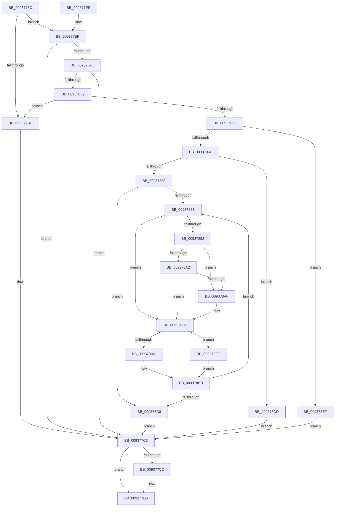

# VrpHandleIoctlUnloadDynamicallyLoadedHives

- RVA: `0x0093778C`–`0x00937948` (길이 `444` bytes)
- VA: `0x000000014093778C`
- 실행 섹션: `PAGE`
- PDB 이름 있음: `예`; PDB Function 태그: `아니요`
- unwind 정보 RVA: `0x0008F47C`
- 디코드: `117`개 명령, `444/444` bytes 표시
- 미해석 바이트: `0` (있으면 어셈블리에 `.byte`로 보존)

> 이 문서는 커널 이미지의 기계어와 PDB 기호를 분석해 생성했습니다. 4번과 5번은 함수 원형과 자료형을 바이너리 사용 방식에서 추정한 C 해석이며 원본 소스 복구 결과는 아닙니다.

## 1. Dependencies

- 직접 호출 지점: **11**; 고유 호출 대상: **10**
- 직접 호출자로 확인된 함수: **1**
- RIP 상대 이미지 참조: **2**

### Outgoing calls
- `0x009377D1` → [ObfDereferenceObjectWithTag](../../text/2F/ObfDereferenceObjectWithTag_function_002F78E0.md) (function, `0x002F78E0`)
- `0x0093781B` → [ObpReferenceObjectByHandleWithTag](../86/ObpReferenceObjectByHandleWithTag_function_00869650.md) (function, `0x00869650`)
- `0x0093782E` → [PsGetJobSilo](../../text/41/PsGetJobSilo_function_00418630.md) (function, `0x00418630`)
- `0x00937846` → [PsIsThreadInSilo](../../text/41/PsIsThreadInSilo_function_0041859C.md) (function, `0x0041859C`)
- `0x00937861` → [PsGetPermanentSiloContext](../../text/3E/PsGetPermanentSiloContext_function_003EE100.md) (function, `0x003EE100`)
- `0x00937875` → [VrpLockJobContextExclusive](VrpLockJobContextExclusive_function_00935A34.md) (function, `0x00935A34`)
- `0x009378C9` → [VrpCleanupNamespace](VrpCleanupNamespace_function_0093649C.md) (function, `0x0093649C`)
- `0x009378D1` → [VrpUnlockJobContextExclusive](VrpUnlockJobContextExclusive_function_009354FC.md) (function, `0x009354FC`)
- `0x009378E5` → [VrpUnlockJobContextExclusive](VrpUnlockJobContextExclusive_function_009354FC.md) (function, `0x009354FC`)
- `0x00937933` → [ZwUnloadKey2](../../text/6B/ZwUnloadKey2_function_006B0C50.md) (function, `0x006B0C50`)
- `0x0093793E` → [VrpDestroyNamespaceNode](VrpDestroyNamespaceNode_function_00934A50.md) (function, `0x00934A50`)

### Direct callers
- [VrpIoctlDeviceDispatch](VrpIoctlDeviceDispatch_function_00934C50.md) at `0x00934DA5`

### Static image references
- `0x00937804` → RVA `0x00FC6C58` (`ALMOSTRO`; read)
- `0x00937853` → RVA `0x00EF02B8` (`.data`; read)

## 2. Other-region calls and transfers

- 다른 실행 섹션으로 향하는 call: **5**
  - `0x009377D1` → [ObfDereferenceObjectWithTag](../../text/2F/ObfDereferenceObjectWithTag_function_002F78E0.md) (`PAGE` → `.text`)
  - `0x0093782E` → [PsGetJobSilo](../../text/41/PsGetJobSilo_function_00418630.md) (`PAGE` → `.text`)
  - `0x00937846` → [PsIsThreadInSilo](../../text/41/PsIsThreadInSilo_function_0041859C.md) (`PAGE` → `.text`)
  - `0x00937861` → [PsGetPermanentSiloContext](../../text/3E/PsGetPermanentSiloContext_function_003EE100.md) (`PAGE` → `.text`)
  - `0x00937933` → [ZwUnloadKey2](../../text/6B/ZwUnloadKey2_function_006B0C50.md) (`PAGE` → `.text`)
- 별도 외부 분기/꼬리 이동을 확인하지 못했습니다.

## 3. Assembly (complete function range)

```asm
0093778C  48 8B C4                        mov rax, rsp
0093778F  48 89 58 08                     mov qword ptr [rax + 8], rbx
00937793  48 89 70 10                     mov qword ptr [rax + 0x10], rsi
00937797  48 89 78 18                     mov qword ptr [rax + 0x18], rdi
0093779B  4C 89 48 20                     mov qword ptr [rax + 0x20], r9
0093779F  55                              push rbp
009377A0  48 8B EC                        mov rbp, rsp
009377A3  48 83 EC 70                     sub rsp, 0x70
009377A7  48 83 65 30 00                  and qword ptr [rbp + 0x30], 0
009377AC  45 8A C8                        mov r9b, r8b
009377AF  48 83 65 38 00                  and qword ptr [rbp + 0x38], 0
009377B4  48 83 65 28 00                  and qword ptr [rbp + 0x28], 0
009377B9  83 FA 08                        cmp edx, 8
009377BC  73 31                           jae 0x1409377ef
009377BE  BB 0D 00 00 C0                  mov ebx, 0xc000000d
009377C3  48 8B 4D 30                     mov rcx, qword ptr [rbp + 0x30]
009377C7  48 85 C9                        test rcx, rcx
009377CA  74 0A                           je 0x1409377d6
009377CC  BA 43 6D 56 52                  mov edx, 0x52566d43
009377D1  E8 0A 01 9C FF                  call 0x1402f78e0
009377D6  4C 8D 5C 24 70                  lea r11, [rsp + 0x70]
009377DB  8B C3                           mov eax, ebx
009377DD  49 8B 5B 10                     mov rbx, qword ptr [r11 + 0x10]
009377E1  49 8B 73 18                     mov rsi, qword ptr [r11 + 0x18]
009377E5  49 8B 7B 20                     mov rdi, qword ptr [r11 + 0x20]
009377E9  49 8B E3                        mov rsp, r11
009377EC  5D                              pop rbp
009377ED  C3                              ret
009377EE  CC                              int3
009377EF  48 83 64 24 38 00               and qword ptr [rsp + 0x38], 0
009377F5  48 8D 45 30                     lea rax, [rbp + 0x30]
009377F9  48 83 64 24 30 00               and qword ptr [rsp + 0x30], 0
009377FF  BA 06 00 00 00                  mov edx, 6
00937804  4C 8B 05 4D F4 68 00            mov r8, qword ptr [rip + 0x68f44d]
0093780B  48 8B 09                        mov rcx, qword ptr [rcx]
0093780E  48 89 44 24 28                  mov qword ptr [rsp + 0x28], rax
00937813  C7 44 24 20 43 6D 56 52         mov dword ptr [rsp + 0x20], 0x52566d43
0093781B  E8 30 1E F3 FF                  call 0x140869650
00937820  8B D8                           mov ebx, eax
00937822  85 C0                           test eax, eax
00937824  78 9D                           js 0x1409377c3
00937826  48 8B 4D 30                     mov rcx, qword ptr [rbp + 0x30]
0093782A  48 8D 55 28                     lea rdx, [rbp + 0x28]
0093782E  E8 FD 0D AE FF                  call 0x140418630
00937833  8B D8                           mov ebx, eax
00937835  85 C0                           test eax, eax
00937837  78 8A                           js 0x1409377c3
00937839  65 48 8B 0C 25 88 01 00 00      mov rcx, qword ptr gs:[0x188]
00937842  48 8B 55 28                     mov rdx, qword ptr [rbp + 0x28]
00937846  E8 51 0D AE FF                  call 0x14041859c
0093784B  84 C0                           test al, al
0093784D  0F 85 6B FF FF FF               jne 0x1409377be
00937853  8B 15 5F 8A 5B 00               mov edx, dword ptr [rip + 0x5b8a5f]
00937859  4C 8D 45 38                     lea r8, [rbp + 0x38]
0093785D  48 8B 4D 28                     mov rcx, qword ptr [rbp + 0x28]
00937861  E8 9A 68 AB FF                  call 0x1403ee100
00937866  85 C0                           test eax, eax
00937868  0F 88 81 00 00 00               js 0x1409378ef
0093786E  48 8B 7D 38                     mov rdi, qword ptr [rbp + 0x38]
00937872  48 8B CF                        mov rcx, rdi
00937875  E8 BA E1 FF FF                  call 0x140935a34
0093787A  83 7F 54 00                     cmp dword ptr [rdi + 0x54], 0
0093787E  75 5D                           jne 0x1409378dd
00937880  48 8B 47 30                     mov rax, qword ptr [rdi + 0x30]
00937884  33 DB                           xor ebx, ebx
00937886  48 85 C0                        test rax, rax
00937889  74 3B                           je 0x1409378c6
0093788B  33 D2                           xor edx, edx
0093788D  48 3B D8                        cmp rbx, rax
00937890  73 1F                           jae 0x1409378b1
00937892  48 21 55 28                     and qword ptr [rbp + 0x28], rdx
00937896  48 8B C3                        mov rax, rbx
00937899  48 F7 67 28                     mul qword ptr [rdi + 0x28]
0093789D  48 85 D2                        test rdx, rdx
009378A0  75 0D                           jne 0x1409378af
009378A2  48 8B 4F 48                     mov rcx, qword ptr [rdi + 0x48]
009378A6  48 8D 14 01                     lea rdx, [rcx + rax]
009378AA  48 3B D1                        cmp rdx, rcx
009378AD  73 02                           jae 0x1409378b1
009378AF  33 D2                           xor edx, edx
009378B1  48 8B 32                        mov rsi, qword ptr [rdx]
009378B4  83 7E 38 00                     cmp dword ptr [rsi + 0x38], 0
009378B8  7C 44                           jl 0x1409378fe
009378BA  48 FF C3                        inc rbx
009378BD  48 8B 47 30                     mov rax, qword ptr [rdi + 0x30]
009378C1  48 3B D8                        cmp rbx, rax
009378C4  72 C5                           jb 0x14093788b
009378C6  48 8B CF                        mov rcx, rdi
009378C9  E8 CE EB FF FF                  call 0x14093649c
009378CE  48 8B CF                        mov rcx, rdi
009378D1  E8 26 DC FF FF                  call 0x1409354fc
009378D6  33 DB                           xor ebx, ebx
009378D8  E9 E6 FE FF FF                  jmp 0x1409377c3
009378DD  48 8B CF                        mov rcx, rdi
009378E0  BB 56 00 00 C0                  mov ebx, 0xc0000056
009378E5  E8 12 DC FF FF                  call 0x1409354fc
009378EA  E9 D4 FE FF FF                  jmp 0x1409377c3
009378EF  33 DB                           xor ebx, ebx
009378F1  3D 25 02 00 C0                  cmp eax, 0xc0000225
009378F6  0F 45 D8                        cmovne ebx, eax
009378F9  E9 C5 FE FF FF                  jmp 0x1409377c3
009378FE  83 65 EC 00                     and dword ptr [rbp - 0x14], 0
00937902  48 8D 46 18                     lea rax, [rsi + 0x18]
00937906  48 83 65 D8 00                  and qword ptr [rbp - 0x28], 0
0093790B  48 8D 4D D0                     lea rcx, [rbp - 0x30]
0093790F  0F 57 C0                        xorps xmm0, xmm0
00937912  48 C7 45 D0 30 00 00 00         mov qword ptr [rbp - 0x30], 0x30
0093791A  83 65 D4 00                     and dword ptr [rbp - 0x2c], 0
0093791E  BA 01 00 00 00                  mov edx, 1
00937923  48 89 45 E0                     mov qword ptr [rbp - 0x20], rax
00937927  F3 0F 7F 45 F0                  movdqu xmmword ptr [rbp - 0x10], xmm0
0093792C  C7 45 E8 40 02 00 00            mov dword ptr [rbp - 0x18], 0x240
00937933  E8 18 93 D7 FF                  call 0x1406b0c50
00937938  48 8B D6                        mov rdx, rsi
0093793B  48 8B CF                        mov rcx, rdi
0093793E  E8 0D D1 FF FF                  call 0x140934a50
00937943  E9 75 FF FF FF                  jmp 0x1409378bd
```

## 4. C-style interpretation (structured pseudocode)

```c
__int64 __fastcall VrpHandleIoctlUnloadDynamicallyLoadedHives(__int64 a1, int a2, unsigned __int8 a3, __int64 a4, __int64 a5, __int64 a6)
{
    __int64 result;
    __int64 v_rbx;
    __int64 v_rsp;
    unsigned __int64 v_stack_m18;
    unsigned int v_stack_m1C;
    unsigned int v_stack_m20;
    unsigned __int64 v_stack_m28;
    unsigned __int64 v_stack_m30;
    unsigned int v_stack_m34;
    unsigned __int64 v_stack_m38;
    unsigned __int64 v_stack_m40;
    unsigned __int64 v_stack_m48;
    unsigned int v_stack_m50;
    unsigned __int64 v_stack_m8;
    unsigned __int64 v_stack_p20;

    *(unsigned __int64 *)(v_rsp + 8) = v_rbx;
    *(unsigned __int64 *)(v_rsp + 16) = v_rsi;
    *(unsigned __int64 *)(v_rsp + 24) = v_rdi;
    *(unsigned __int64 *)(v_rsp + 32) = a4;
    v_rsp = (v_rsp) - (112);
    if (a2 >= 8) goto loc_009377EF;
loc_009377BE:
loc_009377C3:
    result = v_rsp;
    if (a5 != 0) {
        a2 = 0x52566D43ULL;
        result = ObfDereferenceObjectWithTag(a5, a2, a3, a3);
    }
    return (unsigned int)((unsigned int)((unsigned int)(0xC000000DULL)));
loc_009377EF:
    v_stack_m48 = a5;
    v_stack_m50 = 0x52566D43ULL;
    result = ObpReferenceObjectByHandleWithTag(*(unsigned __int64 *)(a5), 6, *(unsigned __int64 *)(v_rip + 6878285), a3);
    if (sign_flag) goto loc_009377C3;
    result = PsGetJobSilo(a5, v_stack_p20, *(unsigned __int64 *)(v_rip + 6878285), a3);
    if (sign_flag) goto loc_009377C3;
    result = PsIsThreadInSilo(*(unsigned __int64 *)(gs_base + (0 + 392)), v_stack_p20, *(unsigned __int64 *)(v_rip + 6878285), a3);
    if ((unsigned __int8)(result) != 0) goto loc_009377BE;
    result = PsGetPermanentSiloContext(v_stack_p20, (unsigned int)(*(unsigned int *)(v_rip + 5999199)), a6, a3);
    if (sign_flag) goto loc_009378EF;
    result = VrpLockJobContextExclusive(a6, (unsigned int)(*(unsigned int *)(v_rip + 5999199)), a6, a3);
    if ((*(unsigned int *)(a6 + 84)) != 0) goto loc_009378DD;
    v_rbx = 0;
    if (*(unsigned __int64 *)(a6 + 48) == 0) goto loc_009378C6;
loc_0093788B:
    a2 = 0;
    if (0 >= (*(unsigned __int64 *)(a6 + 48))) goto loc_009378B1;
    if (0 != 0) goto loc_009378AF;
    if ((*(unsigned __int64 *)(a6 + 72) + 0 * 1) < (*(unsigned __int64 *)(a6 + 72))) {
        a2 = 0;
    }
    if ((*(unsigned int *)(*(unsigned __int64 *)(a2) + 56)) < 0) goto loc_009378FE;
    v_rbx = (v_rbx) + 1;
loc_009378BD:
    if (v_rbx < (*(unsigned __int64 *)(a6 + 48))) goto loc_0093788B;
loc_009378C6:
    result = VrpCleanupNamespace(a6, a2, a6, a3);
    result = VrpUnlockJobContextExclusive(a6, a2, a6, a3);
    v_rbx = 0;
    goto loc_009377C3;
loc_009378DD:
    result = VrpUnlockJobContextExclusive(a6, a2, a6, a3);
    goto loc_009377C3;
loc_009378EF:
    v_rbx = 0;
    if (((unsigned int)(result)) != 0xC0000225ULL) { v_rbx = (unsigned int)(result); }
    goto loc_009377C3;
loc_009378FE:
    v_stack_m38 = 48;
    v_stack_m28 = *(unsigned __int64 *)(a2) + 24;
    v_stack_m18 = v_xmm0;
    v_stack_m20 = 576;
    result = ZwUnloadKey2(v_stack_m38, 1, a6, a3);
    result = VrpDestroyNamespaceNode(a6, *(unsigned __int64 *)(a2), a6, a3);
    goto loc_009378BD;
}
```

## 5. (Beta) C Style

```c
int64_t VrpHandleIoctlUnloadDynamicallyLoadedHives(void *Arg1, int32_t Arg2, uint8_t Arg3, int64_t Arg4, int64_t Arg5, void *Arg6)
{
    uint8_t *arg1 = (uint8_t *)Arg1;
    uint8_t *arg6 = (uint8_t *)Arg6;

    int64_t result;
    int64_t local_rbx;
    int64_t local_rsp;
    uint64_t v_stack_m18;
    uint32_t v_stack_m1C;
    uint32_t v_stack_m20;
    uint64_t v_stack_m28;
    uint64_t v_stack_m30;
    uint32_t v_stack_m34;
    uint64_t v_stack_m38;
    uint64_t v_stack_m40;
    uint64_t v_stack_m48;
    uint32_t v_stack_m50;
    uint64_t v_stack_m8;
    uint64_t v_stack_p20;

    *(uint64_t *)(local_rsp + 0x8) = local_rbx;
    *(uint64_t *)(local_rsp + 0x10) = local_rsi;
    *(uint64_t *)(local_rsp + 0x18) = local_rdi;
    *(uint64_t *)(local_rsp + 0x20) = Arg4;
    local_rsp = (local_rsp) - (112);
    if (Arg2 >= 8) goto loc_009377EF;
loc_009377BE:
loc_009377C3:
    result = local_rsp;
    if (Arg5 != 0) {
        Arg2 = 0x52566D43ULL;
        result = ObfDereferenceObjectWithTag(Arg5, Arg2, Arg3, Arg3);
    }
    return (uint32_t)((uint32_t)((uint32_t)(0xC000000DULL)));
loc_009377EF:
    v_stack_m48 = Arg5;
    v_stack_m50 = 0x52566D43ULL;
    result = ObpReferenceObjectByHandleWithTag(*(uint64_t *)(Arg5), 6, *(uint64_t *)(v_rip + 0x68F44D), Arg3);
    if (sign_flag) goto loc_009377C3;
    result = PsGetJobSilo(Arg5, v_stack_p20, *(uint64_t *)(v_rip + 0x68F44D), Arg3);
    if (sign_flag) goto loc_009377C3;
    result = PsIsThreadInSilo(*(uint64_t *)(gs_base + (0 + 0x188)), v_stack_p20, *(uint64_t *)(v_rip + 0x68F44D), Arg3);
    if ((uint8_t)(result) != 0) goto loc_009377BE;
    result = PsGetPermanentSiloContext(v_stack_p20, (uint32_t)(*(uint32_t *)(v_rip + 0x5B8A5F)), Arg6, Arg3);
    if (sign_flag) goto loc_009378EF;
    result = VrpLockJobContextExclusive(Arg6, (uint32_t)(*(uint32_t *)(v_rip + 0x5B8A5F)), Arg6, Arg3);
    if ((*(uint32_t *)(arg6 + 0x54)) != 0) goto loc_009378DD;
    local_rbx = 0;
    if (*(uint64_t *)(arg6 + 0x30) == 0) goto loc_009378C6;
loc_0093788B:
    Arg2 = 0;
    if (0 >= (*(uint64_t *)(arg6 + 0x30))) goto loc_009378B1;
    if (0 != 0) goto loc_009378AF;
    if ((*(uint64_t *)(arg6 + 0x48) + 0 * 1) < (*(uint64_t *)(arg6 + 0x48))) {
        Arg2 = 0;
    }
    if ((*(uint32_t *)(*(uint64_t *)(Arg2) + 0x38)) < 0) goto loc_009378FE;
    local_rbx = (local_rbx) + 1;
loc_009378BD:
    if (local_rbx < (*(uint64_t *)(arg6 + 0x30))) goto loc_0093788B;
loc_009378C6:
    result = VrpCleanupNamespace(Arg6, Arg2, Arg6, Arg3);
    result = VrpUnlockJobContextExclusive(Arg6, Arg2, Arg6, Arg3);
    local_rbx = 0;
    goto loc_009377C3;
loc_009378DD:
    result = VrpUnlockJobContextExclusive(Arg6, Arg2, Arg6, Arg3);
    goto loc_009377C3;
loc_009378EF:
    local_rbx = 0;
    if (((uint32_t)(result)) != 0xC0000225ULL) { local_rbx = (uint32_t)(result); }
    goto loc_009377C3;
loc_009378FE:
    v_stack_m38 = 48;
    v_stack_m28 = *(uint64_t *)(Arg2) + 24;
    v_stack_m18 = v_xmm0;
    v_stack_m20 = 576;
    result = ZwUnloadKey2(v_stack_m38, 1, Arg6, Arg3);
    result = VrpDestroyNamespaceNode(Arg6, *(uint64_t *)(Arg2), Arg6, Arg3);
    goto loc_009378BD;
}
```

### 관측된 메모리 오프셋

구조체 형식이 확인되지 않은 접근은 인자 기준의 오프셋으로만 기록했습니다.

| 기준 인자 | 오프셋 표현 | 폭 (bit) | 접근 |
|---|---:|---:|---|
| `Arg1` | `+ 0x0` | `64` | `R` |
| `Arg6` | `+ 0x28` | `64` | `R` |
| `Arg6` | `+ 0x30` | `64` | `R` |
| `Arg6` | `+ 0x48` | `64` | `R` |
| `Arg6` | `+ 0x54` | `32` | `R` |

## 6. Execution-region graph

[열기: 2D/3D 그래프와 함수 탐색 컨트롤 패널](../../../control-panel.html?section=page&rva=0x0093778C&view=graph)

- 2D 그래프는 위에서 아래로 흐르고, 3D 그래프는 빈 공간을 드래그해 회전합니다. Shift+드래그는 이동, 휠은 확대·축소, 함수 노드 선택은 대상 보고서 이동입니다.

### Static fallback


