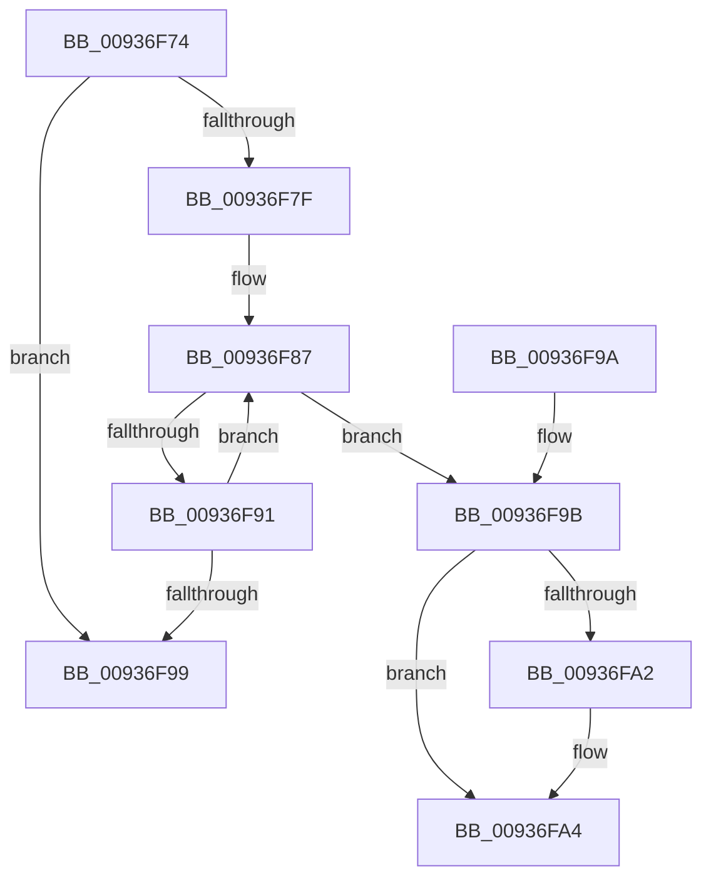

# VrpIncrementDiffHiveEntryHardRefCount

- RVA: `0x00936F74`–`0x00936FA6` (길이 `50` bytes)
- VA: `0x0000000140936F74`
- 실행 섹션: `PAGE`
- PDB 이름 있음: `예`; PDB Function 태그: `아니요`
- unwind 정보 RVA: `0x000DB714`
- 디코드: `16`개 명령, `50/50` bytes 표시
- 미해석 바이트: `0` (있으면 어셈블리에 `.byte`로 보존)

> 이 문서는 커널 이미지의 기계어와 PDB 기호를 분석해 생성했습니다. 4번과 5번은 함수 원형과 자료형을 바이너리 사용 방식에서 추정한 C 해석이며 원본 소스 복구 결과는 아닙니다.

## 1. Dependencies

- 직접 호출 지점: **0**; 고유 호출 대상: **0**
- 직접 호출자로 확인된 함수: **2**
- RIP 상대 이미지 참조: **0**

### Outgoing calls
- 직접 디코드된 call 명령이 없습니다.

### Direct callers
- [VrpLoadDifferencingHive](VrpLoadDifferencingHive_function_00935F40.md) at `0x00936030`
- [VrpUnloadDifferencingHive](VrpUnloadDifferencingHive_function_00936CE0.md) at `0x00936DD9`

### Static image references
- 디코드된 RIP-relative 메모리 참조가 없습니다.

## 2. Other-region calls and transfers

- 다른 실행 섹션으로 향하는 call: **0**
- 별도 외부 분기/꼬리 이동을 확인하지 못했습니다.

## 3. Assembly (complete function range)

```asm
00936F74  48 FF 41 20                     inc qword ptr [rcx + 0x20]
00936F78  48 83 79 20 01                  cmp qword ptr [rcx + 0x20], 1
00936F7D  77 1A                           ja 0x140936f99
00936F7F  0F 0D 49 10                     prefetchw byte ptr [rcx + 0x10]
00936F83  48 8B 41 10                     mov rax, qword ptr [rcx + 0x10]
00936F87  48 8D 50 01                     lea rdx, [rax + 1]
00936F8B  48 83 FA 01                     cmp rdx, 1
00936F8F  76 0A                           jbe 0x140936f9b
00936F91  F0 48 0F B1 51 10               lock cmpxchg qword ptr [rcx + 0x10], rdx
00936F97  75 EE                           jne 0x140936f87
00936F99  C3                              ret
00936F9A  CC                              int3
00936F9B  B9 0E 00 00 00                  mov ecx, 0xe
00936FA0  74 02                           je 0x140936fa4
00936FA2  CD 29                           int 0x29
00936FA4  CD 29                           int 0x29
```

## 4. C-style interpretation (structured pseudocode)

```c
__int64 __fastcall VrpIncrementDiffHiveEntryHardRefCount(__int64 a1)
{
    if ((*(unsigned __int64 *)(a1 + 32)) > 1) goto loc_00936F99;
loc_00936F87:
    if ((*(unsigned __int64 *)(a1 + 16) + 1) <= 1) goto loc_00936F9B;
    if ((*(unsigned __int64 *)(a1 + 16) + 1) != 1) goto loc_00936F87;
loc_00936F99:
    return *(unsigned __int64 *)(a1 + 16);
loc_00936F9B:
    if ((*(unsigned __int64 *)(a1 + 16) + 1) != 1) {
    }
    return *(unsigned __int64 *)(a1 + 16);
}
```

## 5. (Beta) C Style

```c
int64_t VrpIncrementDiffHiveEntryHardRefCount(void *Arg1)
{
    uint8_t *arg1 = (uint8_t *)Arg1;

    if ((*(uint64_t *)(arg1 + 0x20)) > 1) goto loc_00936F99;
loc_00936F87:
    if ((*(uint64_t *)(arg1 + 0x10) + 1) <= 1) goto loc_00936F9B;
    if ((*(uint64_t *)(arg1 + 0x10) + 1) != 1) goto loc_00936F87;
loc_00936F99:
    return *(uint64_t *)(arg1 + 0x10);
loc_00936F9B:
    if ((*(uint64_t *)(arg1 + 0x10) + 1) != 1) {
    }
    return *(uint64_t *)(arg1 + 0x10);
}
```

### 관측된 메모리 오프셋

구조체 형식이 확인되지 않은 접근은 인자 기준의 오프셋으로만 기록했습니다.

| 기준 인자 | 오프셋 표현 | 폭 (bit) | 접근 |
|---|---:|---:|---|
| `Arg1` | `+ 0x10` | `8` | `R` |
| `Arg1` | `+ 0x10` | `64` | `R` |
| `Arg1` | `+ 0x20` | `64` | `R` |
| `Arg1` | `+ 0x20` | `64` | `R/W` |

## 6. Execution-region graph

[열기: 2D/3D 그래프와 함수 탐색 컨트롤 패널](../../../control-panel.html?section=page&rva=0x00936F74&view=graph)

- 2D 그래프는 위에서 아래로 흐르고, 3D 그래프는 빈 공간을 드래그해 회전합니다. Shift+드래그는 이동, 휠은 확대·축소, 함수 노드 선택은 대상 보고서 이동입니다.

### Static fallback


