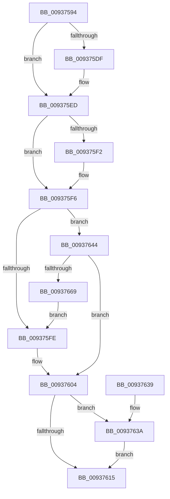

# VrpIncrementSiloCount

- RVA: `0x00937594`–`0x0093766B` (길이 `215` bytes)
- VA: `0x0000000140937594`
- 실행 섹션: `PAGE`
- PDB 이름 있음: `예`; PDB Function 태그: `아니요`
- unwind 정보 RVA: `0x0008F464`
- 디코드: `55`개 명령, `215/215` bytes 표시
- 미해석 바이트: `0` (있으면 어셈블리에 `.byte`로 보존)

> 이 문서는 커널 이미지의 기계어와 PDB 기호를 분석해 생성했습니다. 4번과 5번은 함수 원형과 자료형을 바이너리 사용 방식에서 추정한 C 해석이며 원본 소스 복구 결과는 아닙니다.

## 1. Dependencies

- 직접 호출 지점: **6**; 고유 호출 대상: **6**
- 직접 호출자로 확인된 함수: **1**
- RIP 상대 이미지 참조: **5**

### Outgoing calls
- `0x009375CE` → [KeAbPreAcquire](../../text/21/KeAbPreAcquire_function_00210230.md) (function, `0x00210230`)
- `0x009375E8` → [ExfAcquirePushLockExclusiveEx](../../text/20/ExfAcquirePushLockExclusiveEx_function_0020FC90.md) (function, `0x0020FC90`)
- `0x00937618` → [KeAbPostRelease](../../text/2E/KeAbPostRelease_function_002E1600.md) (function, `0x002E1600`)
- `0x0093761D` → [KeLeaveCriticalRegion](../../text/25/KeLeaveCriticalRegion_function_0025D8B0.md) (function, `0x0025D8B0`)
- `0x0093763D` → [ExfTryToWakePushLock](../../text/26/ExfTryToWakePushLock_function_00265DD0.md) (function, `0x00265DD0`)
- `0x0093765E` → [CmRegisterInternalCallback](../97/CmRegisterInternalCallback_function_0097D450.md) (function, `0x0097D450`)

### Direct callers
- [VrpHandleIoctlInitializeJobForVreg](VrpHandleIoctlInitializeJobForVreg_function_00937254.md) at `0x00937384`

### Static image references
- `0x009375B1` → RVA `0x00EF02C0` (`.data`; read)
- `0x009375F6` → RVA `0x00EF0020` (`.data`; read)
- `0x009375FE` → RVA `0x00EF0020` (`.data`; read/write)
- `0x00937604` → RVA `0x00EF02C0` (`.data`; read/write)
- `0x00937644` → RVA `0x00B0E130` (` ?? ::NNGAKEGL::`string'`; read)

## 2. Other-region calls and transfers

- 다른 실행 섹션으로 향하는 call: **5**
  - `0x009375CE` → [KeAbPreAcquire](../../text/21/KeAbPreAcquire_function_00210230.md) (`PAGE` → `.text`)
  - `0x009375E8` → [ExfAcquirePushLockExclusiveEx](../../text/20/ExfAcquirePushLockExclusiveEx_function_0020FC90.md) (`PAGE` → `.text`)
  - `0x00937618` → [KeAbPostRelease](../../text/2E/KeAbPostRelease_function_002E1600.md) (`PAGE` → `.text`)
  - `0x0093761D` → [KeLeaveCriticalRegion](../../text/25/KeLeaveCriticalRegion_function_0025D8B0.md) (`PAGE` → `.text`)
  - `0x0093763D` → [ExfTryToWakePushLock](../../text/26/ExfTryToWakePushLock_function_00265DD0.md) (`PAGE` → `.text`)
- 별도 외부 분기/꼬리 이동을 확인하지 못했습니다.

## 3. Assembly (complete function range)

```asm
00937594  48 89 5C 24 08                  mov qword ptr [rsp + 8], rbx
00937599  48 89 6C 24 10                  mov qword ptr [rsp + 0x10], rbp
0093759E  48 89 74 24 18                  mov qword ptr [rsp + 0x18], rsi
009375A3  57                              push rdi
009375A4  48 83 EC 40                     sub rsp, 0x40
009375A8  65 48 8B 04 25 88 01 00 00      mov rax, qword ptr gs:[0x188]
009375B1  48 8D 2D 08 8D 5B 00            lea rbp, [rip + 0x5b8d08]
009375B8  48 83 CB FF                     or rbx, 0xffffffffffffffff
009375BC  45 33 C0                        xor r8d, r8d
009375BF  33 D2                           xor edx, edx
009375C1  48 8B CD                        mov rcx, rbp
009375C4  33 F6                           xor esi, esi
009375C6  66 01 98 E4 01 00 00            add word ptr [rax + 0x1e4], bx
009375CD  90                              nop
009375CE  E8 5D 8C 8D FF                  call 0x140210230
009375D3  F0 48 0F BA 6D 00 00            lock bts qword ptr [rbp], 0
009375DA  48 8B F8                        mov rdi, rax
009375DD  73 0E                           jae 0x1409375ed
009375DF  4C 8B C5                        mov r8, rbp
009375E2  48 8B D0                        mov rdx, rax
009375E5  48 8B CD                        mov rcx, rbp
009375E8  E8 A3 86 8D FF                  call 0x14020fc90
009375ED  48 85 FF                        test rdi, rdi
009375F0  74 04                           je 0x1409375f6
009375F2  C6 47 0A 01                     mov byte ptr [rdi + 0xa], 1
009375F6  39 35 24 8A 5B 00               cmp dword ptr [rip + 0x5b8a24], esi
009375FC  74 46                           je 0x140937644
009375FE  FF 05 1C 8A 5B 00               inc dword ptr [rip + 0x5b8a1c]
00937604  F0 48 0F C1 1D B3 8C 5B 00      lock xadd qword ptr [rip + 0x5b8cb3], rbx
0093760D  80 E3 06                        and bl, 6
00937610  80 FB 02                        cmp bl, 2
00937613  74 25                           je 0x14093763a
00937615  48 8B CD                        mov rcx, rbp
00937618  E8 E3 9F 9A FF                  call 0x1402e1600
0093761D  E8 8E 62 92 FF                  call 0x14025d8b0
00937622  48 8B 5C 24 50                  mov rbx, qword ptr [rsp + 0x50]
00937627  8B C6                           mov eax, esi
00937629  48 8B 74 24 60                  mov rsi, qword ptr [rsp + 0x60]
0093762E  48 8B 6C 24 58                  mov rbp, qword ptr [rsp + 0x58]
00937633  48 83 C4 40                     add rsp, 0x40
00937637  5F                              pop rdi
00937638  C3                              ret
00937639  CC                              int3
0093763A  48 8B CD                        mov rcx, rbp
0093763D  E8 8E E7 92 FF                  call 0x140265dd0
00937642  EB D1                           jmp 0x140937615
00937644  48 8D 05 E5 6A 1D 00            lea rax, [rip + 0x1d6ae5]
0093764B  48 C7 44 24 30 0C 00 0E 00      mov qword ptr [rsp + 0x30], 0xe000c
00937654  48 8D 54 24 30                  lea rdx, [rsp + 0x30]
00937659  48 89 44 24 38                  mov qword ptr [rsp + 0x38], rax
0093765E  E8 ED 5D 04 00                  call 0x14097d450
00937663  8B F0                           mov esi, eax
00937665  85 C0                           test eax, eax
00937667  78 9B                           js 0x140937604
00937669  EB 93                           jmp 0x1409375fe
```

## 4. C-style interpretation (structured pseudocode)

```c
__int64 __fastcall VrpIncrementSiloCount(__int64 a1, int a2, int a3)
{
    __int64 result;
    __int64 v_rbx;
    __int64 v_rsi;
    __int64 v_rsp;
    unsigned __int64 v_stack_p10;
    unsigned __int64 v_stack_p18;
    unsigned __int64 v_stack_p30;
    unsigned __int64 v_stack_p38;
    unsigned __int64 v_stack_p8;

    v_stack_p8 = v_rbx;
    v_stack_p10 = v_rbp;
    v_stack_p18 = v_rsi;
    v_rsp = (v_rsp) - (64);
    v_rbx = (v_rbx) | (-1);
    a3 = 0;
    a2 = 0;
    v_rsi = 0;
    result = KeAbPreAcquire(v_rip + 5999880, a2, a3, a4);
    if (!(condition_is_above_or_equal)) {
        a3 = v_rip + 5999880;
        a2 = result;
        a1 = v_rip + 5999880;
        result = ExfAcquirePushLockExclusiveEx(a1, a2, a3, a4);
    }
    if (result != 0) {
        *(unsigned __int8 *)(result + 10) = 1;
    }
    if ((*(unsigned int *)(v_rip + 5999140)) == 0) goto loc_00937644;
loc_009375FE:
loc_00937604:
    v_rbx = (unsigned __int8)((v_rbx) & (6));
    if (((unsigned __int8)(v_rbx)) == 2) goto loc_0093763A;
loc_00937615:
    result = KeAbPostRelease(v_rip + 5999880, a2, a3, a4);
    result = KeLeaveCriticalRegion(v_rip + 5999880, a2, a3, a4);
    v_rsp = (v_rsp) + (64);
    return 0;
loc_0093763A:
    result = ExfTryToWakePushLock(v_stack_p10, a2, a3, a4);
    goto loc_00937615;
loc_00937644:
    v_stack_p30 = 0xE000CULL;
    v_stack_p38 = v_rip + 1927909;
    result = CmRegisterInternalCallback(v_stack_p10, v_stack_p30, a3, a4);
    if (sign_flag) goto loc_00937604;
    goto loc_009375FE;
}
```

## 5. (Beta) C Style

```c
int64_t VrpIncrementSiloCount(int64_t Arg1, int32_t Arg2, int32_t Arg3)
{
    int64_t result;
    int64_t local_rbx;
    int64_t local_rsi;
    int64_t local_rsp;
    uint64_t v_stack_p10;
    uint64_t v_stack_p18;
    uint64_t v_stack_p30;
    uint64_t v_stack_p38;
    uint64_t v_stack_p8;

    v_stack_p8 = local_rbx;
    v_stack_p10 = local_rbp;
    v_stack_p18 = local_rsi;
    local_rsp = (local_rsp) - (64);
    local_rbx = (local_rbx) | (-1);
    Arg3 = 0;
    Arg2 = 0;
    local_rsi = 0;
    result = KeAbPreAcquire(v_rip + 5999880, Arg2, Arg3, a4);
    if (!(condition_is_above_or_equal)) {
        Arg3 = v_rip + 5999880;
        Arg2 = result;
        Arg1 = v_rip + 5999880;
        result = ExfAcquirePushLockExclusiveEx(Arg1, Arg2, Arg3, a4);
    }
    if (result != 0) {
        *(uint8_t *)(result + 0xA) = 1;
    }
    if ((*(uint32_t *)(v_rip + 0x5B8A24)) == 0) goto loc_00937644;
loc_009375FE:
loc_00937604:
    local_rbx = (uint8_t)((local_rbx) & (6));
    if (((uint8_t)(local_rbx)) == 2) goto loc_0093763A;
loc_00937615:
    result = KeAbPostRelease(v_rip + 5999880, Arg2, Arg3, a4);
    result = KeLeaveCriticalRegion(v_rip + 5999880, Arg2, Arg3, a4);
    local_rsp = (local_rsp) + (64);
    return 0;
loc_0093763A:
    result = ExfTryToWakePushLock(v_stack_p10, Arg2, Arg3, a4);
    goto loc_00937615;
loc_00937644:
    v_stack_p30 = 0xE000CULL;
    v_stack_p38 = v_rip + 1927909;
    result = CmRegisterInternalCallback(v_stack_p10, v_stack_p30, Arg3, a4);
    if (sign_flag) goto loc_00937604;
    goto loc_009375FE;
}
```

## 6. Execution-region graph

[열기: 2D/3D 그래프와 함수 탐색 컨트롤 패널](../../../control-panel.html?section=page&rva=0x00937594&view=graph)

- 2D 그래프는 위에서 아래로 흐르고, 3D 그래프는 빈 공간을 드래그해 회전합니다. Shift+드래그는 이동, 휠은 확대·축소, 함수 노드 선택은 대상 보고서 이동입니다.

### Static fallback


