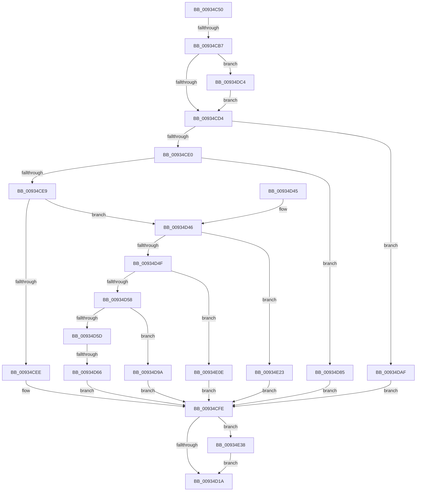

# VrpIoctlDeviceDispatch

- RVA: `0x00934C50`–`0x00934E7B` (길이 `555` bytes)
- VA: `0x0000000140934C50`
- 실행 섹션: `PAGE`
- PDB 이름 있음: `예`; PDB Function 태그: `예`
- unwind 정보 RVA: `0x0008F1F8`
- 디코드: `132`개 명령, `555/555` bytes 표시
- 미해석 바이트: `0` (있으면 어셈블리에 `.byte`로 보존)

> 이 문서는 커널 이미지의 기계어와 PDB 기호를 분석해 생성했습니다. 4번과 5번은 함수 원형과 자료형을 바이너리 사용 방식에서 추정한 C 해석이며 원본 소스 복구 결과는 아닙니다.

## 1. Dependencies

- 직접 호출 지점: **13**; 고유 호출 대상: **12**
- 직접 호출자로 확인된 함수: **0**
- RIP 상대 이미지 참조: **4**

### Outgoing calls
- `0x00934CA4` → [VRegEnabledInJob](VRegEnabledInJob_function_009350B0.md) (function, `0x009350B0`)
- `0x00934CC0` → [EtwActivityIdControl](../../text/41/EtwActivityIdControl_function_0041E720.md) (function, `0x0041E720`)
- `0x00934CF9` → [VrpHandleIoctlCreateNamespaceNode](VrpHandleIoctlCreateNamespaceNode_function_0093511C.md) (function, `0x0093511C`)
- `0x00934D08` → [IofCompleteRequest](../../text/29/IofCompleteRequest_function_0029B5C0.md) (function, `0x0029B5C0`)
- `0x00934D23` → [_security_check_cookie](../../text/6A/_security_check_cookie_function_006AC640.md) (function, `0x006AC640`)
- `0x00934D7B` → [VrpHandleIoctlGetVirtualRootKey](VrpHandleIoctlGetVirtualRootKey_function_00935374.md) (function, `0x00935374`)
- `0x00934D90` → [VrpHandleIoctlLoadDifferencingHive](VrpHandleIoctlLoadDifferencingHive_function_00935C5C.md) (function, `0x00935C5C`)
- `0x00934DA5` → [VrpHandleIoctlUnloadDynamicallyLoadedHives](VrpHandleIoctlUnloadDynamicallyLoadedHives_function_0093778C.md) (function, `0x0093778C`)
- `0x00934DBA` → [VrpHandleIoctlInitializeJobForVreg](VrpHandleIoctlInitializeJobForVreg_function_00937254.md) (function, `0x00937254`)
- `0x00934DFE` → [tlgWriteTransfer_EtwWriteTransfer](../../text/42/tlgWriteTransfer_EtwWriteTransfer_function_004260E0.md) (function, `0x004260E0`)
- `0x00934E19` → [VrpHandleIoctlCreateMultipleNamespaceNodes](../83/VrpHandleIoctlCreateMultipleNamespaceNodes_function_0083B17C.md) (function, `0x0083B17C`)
- `0x00934E2E` → [VrpHandleIoctlModifyFlags](../83/VrpHandleIoctlModifyFlags_function_0083B69C.md) (function, `0x0083B69C`)
- `0x00934E71` → [tlgWriteTransfer_EtwWriteTransfer](../../text/42/tlgWriteTransfer_EtwWriteTransfer_function_004260E0.md) (function, `0x004260E0`)

### Direct callers
- 이 함수 시작 RVA로 연결되는 직접 call은 확인되지 않았습니다. 간접 호출은 완전히 역산할 수 없습니다.

### Static image references
- `0x00934C6F` → RVA `0x00E0A740` (`.data`; read)
- `0x00934CC5` → RVA `0x00E0A630` (`.data`; read)
- `0x00934DE4` → RVA `0x0005A785` (`.rdata`; read)
- `0x00934E54` → RVA `0x0005A7EC` (`.rdata`; read)

## 2. Other-region calls and transfers

- 다른 실행 섹션으로 향하는 call: **5**
  - `0x00934CC0` → [EtwActivityIdControl](../../text/41/EtwActivityIdControl_function_0041E720.md) (`PAGE` → `.text`)
  - `0x00934D08` → [IofCompleteRequest](../../text/29/IofCompleteRequest_function_0029B5C0.md) (`PAGE` → `.text`)
  - `0x00934D23` → [_security_check_cookie](../../text/6A/_security_check_cookie_function_006AC640.md) (`PAGE` → `.text`)
  - `0x00934DFE` → [tlgWriteTransfer_EtwWriteTransfer](../../text/42/tlgWriteTransfer_EtwWriteTransfer_function_004260E0.md) (`PAGE` → `.text`)
  - `0x00934E71` → [tlgWriteTransfer_EtwWriteTransfer](../../text/42/tlgWriteTransfer_EtwWriteTransfer_function_004260E0.md) (`PAGE` → `.text`)
- call이 아닌 외부 분기/꼬리 이동: **2**
  - `0x00934CB1` → [sub_00B24A66](../B2/Unknown_function_00B24A66.md) (`tail-transfer`)
  - `0x00934D60` → [sub_00B24A66 + 0x63](../B2/Unknown_function_00B24A66.md) (`tail-transfer`)

## 3. Assembly (complete function range)

```asm
00934C50  48 8B C4                        mov rax, rsp
00934C53  48 89 58 08                     mov qword ptr [rax + 8], rbx
00934C57  48 89 70 18                     mov qword ptr [rax + 0x18], rsi
00934C5B  48 89 78 20                     mov qword ptr [rax + 0x20], rdi
00934C5F  55                              push rbp
00934C60  41 56                           push r14
00934C62  41 57                           push r15
00934C64  48 8D 68 A1                     lea rbp, [rax - 0x5f]
00934C68  48 81 EC 90 00 00 00            sub rsp, 0x90
00934C6F  48 8B 05 CA 5A 4D 00            mov rax, qword ptr [rip + 0x4d5aca]
00934C76  48 33 C4                        xor rax, rsp
00934C79  48 89 45 3F                     mov qword ptr [rbp + 0x3f], rax
00934C7D  48 8B B2 B8 00 00 00            mov rsi, qword ptr [rdx + 0xb8]
00934C84  4C 8D 72 38                     lea r14, [rdx + 0x38]
00934C88  49 83 26 00                     and qword ptr [r14], 0
00934C8C  48 8D 4D E7                     lea rcx, [rbp - 0x19]
00934C90  0F 57 C0                        xorps xmm0, xmm0
00934C93  0F 57 C9                        xorps xmm1, xmm1
00934C96  0F 11 45 EF                     movups xmmword ptr [rbp - 0x11], xmm0
00934C9A  48 8B FA                        mov rdi, rdx
00934C9D  0F 11 4D FF                     movups xmmword ptr [rbp - 1], xmm1
00934CA1  8B 5E 18                        mov ebx, dword ptr [rsi + 0x18]
00934CA4  E8 07 04 00 00                  call 0x1409350b0
00934CA9  41 BF 04 00 00 00               mov r15d, 4
00934CAF  85 C0                           test eax, eax
00934CB1  0F 85 AF FD 1E 00               jne 0x140b24a66
00934CB7  48 8D 55 FF                     lea rdx, [rbp - 1]
00934CBB  B9 01 00 00 00                  mov ecx, 1
00934CC0  E8 5B 9A AE FF                  call 0x14041e720
00934CC5  8B 05 65 59 4D 00               mov eax, dword ptr [rip + 0x4d5965]
00934CCB  41 3B C7                        cmp eax, r15d
00934CCE  0F 87 F0 00 00 00               ja 0x140934dc4
00934CD4  81 EB 04 00 22 00               sub ebx, 0x220004
00934CDA  0F 84 CF 00 00 00               je 0x140934daf
00934CE0  41 2B DF                        sub ebx, r15d
00934CE3  0F 84 9C 00 00 00               je 0x140934d85
00934CE9  41 2B DF                        sub ebx, r15d
00934CEC  75 58                           jne 0x140934d46
00934CEE  44 8A 47 40                     mov r8b, byte ptr [rdi + 0x40]
00934CF2  8B 56 10                        mov edx, dword ptr [rsi + 0x10]
00934CF5  48 8B 4F 18                     mov rcx, qword ptr [rdi + 0x18]
00934CF9  E8 1E 04 00 00                  call 0x14093511c
00934CFE  8B F0                           mov esi, eax
00934D00  33 D2                           xor edx, edx
00934D02  89 77 30                        mov dword ptr [rdi + 0x30], esi
00934D05  48 8B CF                        mov rcx, rdi
00934D08  E8 B3 68 96 FF                  call 0x14029b5c0
00934D0D  44 39 3D 1C 59 4D 00            cmp dword ptr [rip + 0x4d591c], r15d
00934D14  0F 87 1E 01 00 00               ja 0x140934e38
00934D1A  8B C6                           mov eax, esi
00934D1C  48 8B 4D 3F                     mov rcx, qword ptr [rbp + 0x3f]
00934D20  48 33 CC                        xor rcx, rsp
00934D23  E8 18 79 D7 FF                  call 0x1406ac640
00934D28  4C 8D 9C 24 90 00 00 00         lea r11, [rsp + 0x90]
00934D30  49 8B 5B 20                     mov rbx, qword ptr [r11 + 0x20]
00934D34  49 8B 73 30                     mov rsi, qword ptr [r11 + 0x30]
00934D38  49 8B 7B 38                     mov rdi, qword ptr [r11 + 0x38]
00934D3C  49 8B E3                        mov rsp, r11
00934D3F  41 5F                           pop r15
00934D41  41 5E                           pop r14
00934D43  5D                              pop rbp
00934D44  C3                              ret
00934D45  CC                              int3
00934D46  41 2B DF                        sub ebx, r15d
00934D49  0F 84 D4 00 00 00               je 0x140934e23
00934D4F  41 2B DF                        sub ebx, r15d
00934D52  0F 84 B6 00 00 00               je 0x140934e0e
00934D58  41 2B DF                        sub ebx, r15d
00934D5B  74 3D                           je 0x140934d9a
00934D5D  41 2B DF                        sub ebx, r15d
00934D60  0F 85 63 FD 1E 00               jne 0x140b24ac9
00934D66  48 8B 4F 18                     mov rcx, qword ptr [rdi + 0x18]
00934D6A  44 8A 47 40                     mov r8b, byte ptr [rdi + 0x40]
00934D6E  8B 56 10                        mov edx, dword ptr [rsi + 0x10]
00934D71  4C 89 74 24 28                  mov qword ptr [rsp + 0x28], r14
00934D76  48 89 4C 24 20                  mov qword ptr [rsp + 0x20], rcx
00934D7B  E8 F4 05 00 00                  call 0x140935374
00934D80  E9 79 FF FF FF                  jmp 0x140934cfe
00934D85  44 8A 47 40                     mov r8b, byte ptr [rdi + 0x40]
00934D89  8B 56 10                        mov edx, dword ptr [rsi + 0x10]
00934D8C  48 8B 4F 18                     mov rcx, qword ptr [rdi + 0x18]
00934D90  E8 C7 0E 00 00                  call 0x140935c5c
00934D95  E9 64 FF FF FF                  jmp 0x140934cfe
00934D9A  44 8A 47 40                     mov r8b, byte ptr [rdi + 0x40]
00934D9E  8B 56 10                        mov edx, dword ptr [rsi + 0x10]
00934DA1  48 8B 4F 18                     mov rcx, qword ptr [rdi + 0x18]
00934DA5  E8 E2 29 00 00                  call 0x14093778c
00934DAA  E9 4F FF FF FF                  jmp 0x140934cfe
00934DAF  44 8A 47 40                     mov r8b, byte ptr [rdi + 0x40]
00934DB3  8B 56 10                        mov edx, dword ptr [rsi + 0x10]
00934DB6  48 8B 4F 18                     mov rcx, qword ptr [rdi + 0x18]
00934DBA  E8 95 24 00 00                  call 0x140937254
00934DBF  E9 3A FF FF FF                  jmp 0x140934cfe
00934DC4  83 65 3B 00                     and dword ptr [rbp + 0x3b], 0
00934DC8  48 8D 45 E7                     lea rax, [rbp - 0x19]
00934DCC  48 89 45 2F                     mov qword ptr [rbp + 0x2f], rax
00934DD0  4C 8D 4D FF                     lea r9, [rbp - 1]
00934DD4  48 8D 45 0F                     lea rax, [rbp + 0xf]
00934DD8  89 5D E7                        mov dword ptr [rbp - 0x19], ebx
00934DDB  48 89 44 24 28                  mov qword ptr [rsp + 0x28], rax
00934DE0  4C 8D 45 EF                     lea r8, [rbp - 0x11]
00934DE4  48 8D 15 9A 59 72 FF            lea rdx, [rip - 0x8da666]
00934DEB  C7 44 24 20 03 00 00 00         mov dword ptr [rsp + 0x20], 3
00934DF3  48 8D 0D 36 58 4D 00            lea rcx, [rip + 0x4d5836]
00934DFA  44 89 7D 37                     mov dword ptr [rbp + 0x37], r15d
00934DFE  E8 DD 12 AF FF                  call 0x1404260e0
00934E03  8B 05 27 58 4D 00               mov eax, dword ptr [rip + 0x4d5827]
00934E09  E9 C6 FE FF FF                  jmp 0x140934cd4
00934E0E  44 8A 47 40                     mov r8b, byte ptr [rdi + 0x40]
00934E12  8B 56 10                        mov edx, dword ptr [rsi + 0x10]
00934E15  48 8B 4F 18                     mov rcx, qword ptr [rdi + 0x18]
00934E19  E8 5E 63 F0 FF                  call 0x14083b17c
00934E1E  E9 DB FE FF FF                  jmp 0x140934cfe
00934E23  44 8A 47 40                     mov r8b, byte ptr [rdi + 0x40]
00934E27  8B 56 10                        mov edx, dword ptr [rsi + 0x10]
00934E2A  48 8B 4F 18                     mov rcx, qword ptr [rdi + 0x18]
00934E2E  E8 69 68 F0 FF                  call 0x14083b69c
00934E33  E9 C6 FE FF FF                  jmp 0x140934cfe
00934E38  83 65 3B 00                     and dword ptr [rbp + 0x3b], 0
00934E3C  48 8D 45 E7                     lea rax, [rbp - 0x19]
00934E40  48 89 45 2F                     mov qword ptr [rbp + 0x2f], rax
00934E44  4C 8D 45 EF                     lea r8, [rbp - 0x11]
00934E48  48 8D 45 0F                     lea rax, [rbp + 0xf]
00934E4C  89 75 E7                        mov dword ptr [rbp - 0x19], esi
00934E4F  48 89 44 24 28                  mov qword ptr [rsp + 0x28], rax
00934E54  48 8D 15 91 59 72 FF            lea rdx, [rip - 0x8da66f]
00934E5B  45 33 C9                        xor r9d, r9d
00934E5E  C7 44 24 20 03 00 00 00         mov dword ptr [rsp + 0x20], 3
00934E66  48 8D 0D C3 57 4D 00            lea rcx, [rip + 0x4d57c3]
00934E6D  44 89 7D 37                     mov dword ptr [rbp + 0x37], r15d
00934E71  E8 6A 12 AF FF                  call 0x1404260e0
00934E76  E9 9F FE FF FF                  jmp 0x140934d1a
```

## 4. C-style interpretation (structured pseudocode)

```c
__int64 __fastcall VrpIoctlDeviceDispatch(__int64 a1, __int64 a2)
{
    __int64 result;
    __int64 v_rbx;
    __int64 v_rsp;
    unsigned __int64 v_stack_m18;
    unsigned __int64 v_stack_m68;
    unsigned __int64 v_stack_m70;

    *(unsigned __int64 *)(v_rsp + 8) = v_rbx;
    *(unsigned __int64 *)(v_rsp + 24) = v_rsi;
    *(unsigned __int64 *)(v_rsp + 32) = v_rdi;
    v_rsp = (v_rsp) - (144);
    result = (*(unsigned __int64 *)(v_rip + 5069514)) ^ (v_rsp);
    *(unsigned __int64 *)(v_rsp - 95 + 63) = result;
    *(unsigned __int64 *)(v_rsp - 95 - 17) = v_xmm0;
    *(unsigned __int64 *)(v_rsp - 95 - 1) = v_xmm1;
    result = VRegEnabledInJob(v_rsp - 95 - 25, a2, a3, a4);
    result = EtwActivityIdControl(1, v_rsp - 95 - 1, a3, a4);
    if (((unsigned int)((unsigned int)(*(unsigned int *)(v_rip + 5069157)))) > 4) goto loc_00934DC4;
loc_00934CD4:
    v_rbx = (unsigned int)(((unsigned int)(*(unsigned int *)(*(unsigned __int64 *)(a2 + 184) + 24))) - (0x220004ULL));
    if (condition_is_equal) goto loc_00934DAF;
    v_rbx = (unsigned int)((v_rbx) - (4));
    if (condition_is_equal) goto loc_00934D85;
    v_rbx = (unsigned int)((v_rbx) - (4));
    if (condition_is_not_equal) goto loc_00934D46;
    result = VrpHandleIoctlCreateNamespaceNode(*(unsigned __int64 *)(a2 + 24), (unsigned int)(*(unsigned int *)(*(unsigned __int64 *)(a2 + 184) + 16)), *(unsigned __int8 *)(a2 + 64), a4);
loc_00934CFE:
    a2 = 0;
    *(unsigned int *)(a2 + 48) = (unsigned int)((unsigned int)((unsigned int)(result)));
    result = IofCompleteRequest(0, a2, *(unsigned __int8 *)(a2 + 64), a4);
    if ((*(unsigned int *)(v_rip + 5069084)) > 4) goto loc_00934E38;
loc_00934D1A:
    a1 = (*(unsigned __int64 *)(v_rsp - 95 + 63)) ^ (v_rsp);
    result = _security_check_cookie(a1, a2, *(unsigned __int8 *)(a2 + 64), a4);
    return result;
loc_00934D46:
    v_rbx = (unsigned int)((*(unsigned __int64 *)(v_stack_m18 + 32)) - (4));
    if (condition_is_equal) goto loc_00934E23;
    v_rbx = (unsigned int)((v_rbx) - (4));
    if (condition_is_equal) goto loc_00934E0E;
    v_rbx = (unsigned int)((v_rbx) - (4));
    if (condition_is_equal) goto loc_00934D9A;
    v_rbx = (unsigned int)((v_rbx) - (4));
    v_stack_m68 = a2 + 56;
    v_stack_m70 = *(unsigned __int64 *)(*(unsigned __int64 *)(v_stack_m18 + 56) + 24);
    result = VrpHandleIoctlGetVirtualRootKey(*(unsigned __int64 *)(*(unsigned __int64 *)(v_stack_m18 + 56) + 24), (unsigned int)(*(unsigned int *)(*(unsigned __int64 *)(v_stack_m18 + 48) + 16)), *(unsigned __int8 *)(*(unsigned __int64 *)(v_stack_m18 + 56) + 64), a4);
    goto loc_00934CFE;
loc_00934D85:
    result = VrpHandleIoctlLoadDifferencingHive(*(unsigned __int64 *)(*(unsigned __int64 *)(v_stack_m18 + 56) + 24), (unsigned int)(*(unsigned int *)(*(unsigned __int64 *)(v_stack_m18 + 48) + 16)), *(unsigned __int8 *)(*(unsigned __int64 *)(v_stack_m18 + 56) + 64), a4);
    goto loc_00934CFE;
loc_00934D9A:
    result = VrpHandleIoctlUnloadDynamicallyLoadedHives(*(unsigned __int64 *)(*(unsigned __int64 *)(v_stack_m18 + 56) + 24), (unsigned int)(*(unsigned int *)(*(unsigned __int64 *)(v_stack_m18 + 48) + 16)), *(unsigned __int8 *)(*(unsigned __int64 *)(v_stack_m18 + 56) + 64), a4);
    goto loc_00934CFE;
loc_00934DAF:
    result = VrpHandleIoctlInitializeJobForVreg(*(unsigned __int64 *)(*(unsigned __int64 *)(v_stack_m18 + 56) + 24), (unsigned int)(*(unsigned int *)(*(unsigned __int64 *)(v_stack_m18 + 48) + 16)), *(unsigned __int8 *)(*(unsigned __int64 *)(v_stack_m18 + 56) + 64), a4);
    goto loc_00934CFE;
loc_00934DC4:
    *(unsigned __int64 *)(v_rsp - 95 + 47) = v_rsp - 95 - 25;
    *(unsigned int *)(v_rsp - 95 - 25) = (unsigned int)(v_rbx);
    v_stack_m68 = v_rsp - 95 + 15;
    v_stack_m70 = 3;
    *(unsigned int *)(v_rsp - 95 + 55) = 4;
    result = tlgWriteTransfer_EtwWriteTransfer(v_rip + 5068854, v_rip - 9283174, v_rsp - 95 - 17, v_rsp - 95 - 1);
    goto loc_00934CD4;
loc_00934E0E:
    result = VrpHandleIoctlCreateMultipleNamespaceNodes(*(unsigned __int64 *)(*(unsigned __int64 *)(v_stack_m18 + 56) + 24), (unsigned int)(*(unsigned int *)(*(unsigned __int64 *)(v_stack_m18 + 48) + 16)), *(unsigned __int8 *)(*(unsigned __int64 *)(v_stack_m18 + 56) + 64), v_rsp - 95 - 1);
    goto loc_00934CFE;
loc_00934E23:
    result = VrpHandleIoctlModifyFlags(*(unsigned __int64 *)(*(unsigned __int64 *)(v_stack_m18 + 56) + 24), (unsigned int)(*(unsigned int *)(*(unsigned __int64 *)(v_stack_m18 + 48) + 16)), *(unsigned __int8 *)(*(unsigned __int64 *)(v_stack_m18 + 56) + 64), v_rsp - 95 - 1);
    goto loc_00934CFE;
loc_00934E38:
    *(unsigned __int64 *)(v_rsp - 95 + 47) = v_rsp - 95 - 25;
    *(unsigned int *)(v_rsp - 95 - 25) = (unsigned int)(*(unsigned __int64 *)(v_stack_m18 + 48));
    v_stack_m68 = v_rsp - 95 + 15;
    a4 = 0;
    v_stack_m70 = 3;
    *(unsigned int *)(v_rsp - 95 + 55) = 4;
    result = tlgWriteTransfer_EtwWriteTransfer(v_rip + 5068739, v_rip - 9283183, v_rsp - 95 - 17, a4);
    goto loc_00934D1A;
}
```

## 5. (Beta) C Style

```c
int64_t VrpIoctlDeviceDispatch(int64_t Arg1, void *Arg2)
{
    uint8_t *arg2 = (uint8_t *)Arg2;

    int64_t result;
    int64_t local_rbx;
    int64_t local_rsp;
    uint64_t v_stack_m18;
    uint64_t v_stack_m68;
    uint64_t v_stack_m70;

    *(uint64_t *)(local_rsp + 0x8) = local_rbx;
    *(uint64_t *)(local_rsp + 0x18) = local_rsi;
    *(uint64_t *)(local_rsp + 0x20) = local_rdi;
    local_rsp = (local_rsp) - (144);
    result = (*(uint64_t *)(v_rip + 0x4D5ACA)) ^ (local_rsp);
    *(uint64_t *)(local_rsp - 0x5F + 0x3F) = result;
    *(uint64_t *)(local_rsp - 0x5F - 0x11) = v_xmm0;
    *(uint64_t *)(local_rsp - 0x5F - 0x1) = v_xmm1;
    result = VRegEnabledInJob(local_rsp - 95 - 25, Arg2, a3, a4);
    result = EtwActivityIdControl(1, local_rsp - 95 - 1, a3, a4);
    if (((uint32_t)((uint32_t)(*(uint32_t *)(v_rip + 0x4D5965)))) > 4) goto loc_00934DC4;
loc_00934CD4:
    local_rbx = (uint32_t)(((uint32_t)(*(uint32_t *)(*(uint64_t *)(arg2 + 0xB8) + 0x18))) - (0x220004ULL));
    if (condition_is_equal) goto loc_00934DAF;
    local_rbx = (uint32_t)((local_rbx) - (4));
    if (condition_is_equal) goto loc_00934D85;
    local_rbx = (uint32_t)((local_rbx) - (4));
    if (condition_is_not_equal) goto loc_00934D46;
    result = VrpHandleIoctlCreateNamespaceNode(*(uint64_t *)(arg2 + 0x18), (uint32_t)(*(uint32_t *)(*(uint64_t *)(arg2 + 0xB8) + 0x10)), *(uint8_t *)(arg2 + 0x40), a4);
loc_00934CFE:
    Arg2 = 0;
    *(uint32_t *)(arg2 + 0x30) = (uint32_t)((uint32_t)((uint32_t)(result)));
    result = IofCompleteRequest(0, Arg2, *(uint8_t *)(arg2 + 0x40), a4);
    if ((*(uint32_t *)(v_rip + 0x4D591C)) > 4) goto loc_00934E38;
loc_00934D1A:
    Arg1 = (*(uint64_t *)(local_rsp - 0x5F + 0x3F)) ^ (local_rsp);
    result = _security_check_cookie(Arg1, Arg2, *(uint8_t *)(arg2 + 0x40), a4);
    return result;
loc_00934D46:
    local_rbx = (uint32_t)((*(uint64_t *)(v_stack_m18 + 0x20)) - (4));
    if (condition_is_equal) goto loc_00934E23;
    local_rbx = (uint32_t)((local_rbx) - (4));
    if (condition_is_equal) goto loc_00934E0E;
    local_rbx = (uint32_t)((local_rbx) - (4));
    if (condition_is_equal) goto loc_00934D9A;
    local_rbx = (uint32_t)((local_rbx) - (4));
    v_stack_m68 = Arg2 + 56;
    v_stack_m70 = *(uint64_t *)(*(uint64_t *)(v_stack_m18 + 0x38) + 0x18);
    result = VrpHandleIoctlGetVirtualRootKey(*(uint64_t *)(*(uint64_t *)(v_stack_m18 + 0x38) + 0x18), (uint32_t)(*(uint32_t *)(*(uint64_t *)(v_stack_m18 + 0x30) + 0x10)), *(uint8_t *)(*(uint64_t *)(v_stack_m18 + 0x38) + 0x40), a4);
    goto loc_00934CFE;
loc_00934D85:
    result = VrpHandleIoctlLoadDifferencingHive(*(uint64_t *)(*(uint64_t *)(v_stack_m18 + 0x38) + 0x18), (uint32_t)(*(uint32_t *)(*(uint64_t *)(v_stack_m18 + 0x30) + 0x10)), *(uint8_t *)(*(uint64_t *)(v_stack_m18 + 0x38) + 0x40), a4);
    goto loc_00934CFE;
loc_00934D9A:
    result = VrpHandleIoctlUnloadDynamicallyLoadedHives(*(uint64_t *)(*(uint64_t *)(v_stack_m18 + 0x38) + 0x18), (uint32_t)(*(uint32_t *)(*(uint64_t *)(v_stack_m18 + 0x30) + 0x10)), *(uint8_t *)(*(uint64_t *)(v_stack_m18 + 0x38) + 0x40), a4);
    goto loc_00934CFE;
loc_00934DAF:
    result = VrpHandleIoctlInitializeJobForVreg(*(uint64_t *)(*(uint64_t *)(v_stack_m18 + 0x38) + 0x18), (uint32_t)(*(uint32_t *)(*(uint64_t *)(v_stack_m18 + 0x30) + 0x10)), *(uint8_t *)(*(uint64_t *)(v_stack_m18 + 0x38) + 0x40), a4);
    goto loc_00934CFE;
loc_00934DC4:
    *(uint64_t *)(local_rsp - 0x5F + 0x2F) = local_rsp - 95 - 25;
    *(uint32_t *)(local_rsp - 0x5F - 0x19) = (uint32_t)(local_rbx);
    v_stack_m68 = local_rsp - 95 + 15;
    v_stack_m70 = 3;
    *(uint32_t *)(local_rsp - 0x5F + 0x37) = 4;
    result = tlgWriteTransfer_EtwWriteTransfer(v_rip + 5068854, v_rip - 9283174, local_rsp - 95 - 17, local_rsp - 95 - 1);
    goto loc_00934CD4;
loc_00934E0E:
    result = VrpHandleIoctlCreateMultipleNamespaceNodes(*(uint64_t *)(*(uint64_t *)(v_stack_m18 + 0x38) + 0x18), (uint32_t)(*(uint32_t *)(*(uint64_t *)(v_stack_m18 + 0x30) + 0x10)), *(uint8_t *)(*(uint64_t *)(v_stack_m18 + 0x38) + 0x40), local_rsp - 95 - 1);
    goto loc_00934CFE;
loc_00934E23:
    result = VrpHandleIoctlModifyFlags(*(uint64_t *)(*(uint64_t *)(v_stack_m18 + 0x38) + 0x18), (uint32_t)(*(uint32_t *)(*(uint64_t *)(v_stack_m18 + 0x30) + 0x10)), *(uint8_t *)(*(uint64_t *)(v_stack_m18 + 0x38) + 0x40), local_rsp - 95 - 1);
    goto loc_00934CFE;
loc_00934E38:
    *(uint64_t *)(local_rsp - 0x5F + 0x2F) = local_rsp - 95 - 25;
    *(uint32_t *)(local_rsp - 0x5F - 0x19) = (uint32_t)(*(uint64_t *)(v_stack_m18 + 0x30));
    v_stack_m68 = local_rsp - 95 + 15;
    a4 = 0;
    v_stack_m70 = 3;
    *(uint32_t *)(local_rsp - 0x5F + 0x37) = 4;
    result = tlgWriteTransfer_EtwWriteTransfer(v_rip + 5068739, v_rip - 9283183, local_rsp - 95 - 17, a4);
    goto loc_00934D1A;
}
```

### 관측된 메모리 오프셋

구조체 형식이 확인되지 않은 접근은 인자 기준의 오프셋으로만 기록했습니다.

| 기준 인자 | 오프셋 표현 | 폭 (bit) | 접근 |
|---|---:|---:|---|
| `Arg2` | `+ 0x0` | `64` | `R/W` |
| `Arg2` | `+ 0x18` | `64` | `R` |
| `Arg2` | `+ 0x30` | `32` | `W` |
| `Arg2` | `+ 0x38` | `64` | `R` |
| `Arg2` | `+ 0x40` | `8` | `R` |
| `Arg2` | `+ 0xB8` | `64` | `R` |

## 6. Execution-region graph

[열기: 2D/3D 그래프와 함수 탐색 컨트롤 패널](../../../control-panel.html?section=page&rva=0x00934C50&view=graph)

- 2D 그래프는 위에서 아래로 흐르고, 3D 그래프는 빈 공간을 드래그해 회전합니다. Shift+드래그는 이동, 휠은 확대·축소, 함수 노드 선택은 대상 보고서 이동입니다.

### Static fallback


