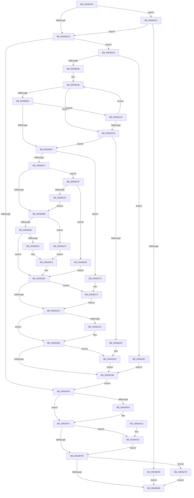

# VrpLoadDifferencingHive

- RVA: `0x00935F40`–`0x00936288` (길이 `840` bytes)
- VA: `0x0000000140935F40`
- 실행 섹션: `PAGE`
- PDB 이름 있음: `예`; PDB Function 태그: `아니요`
- unwind 정보 RVA: `0x0008F328`
- 디코드: `217`개 명령, `840/840` bytes 표시
- 미해석 바이트: `0` (있으면 어셈블리에 `.byte`로 보존)

> 이 문서는 커널 이미지의 기계어와 PDB 기호를 분석해 생성했습니다. 4번과 5번은 함수 원형과 자료형을 바이너리 사용 방식에서 추정한 C 해석이며 원본 소스 복구 결과는 아닙니다.

## 1. Dependencies

- 직접 호출 지점: **16**; 고유 호출 대상: **12**
- 직접 호출자로 확인된 함수: **2**
- RIP 상대 이미지 참조: **1**

### Outgoing calls
- `0x00935FD5` → [VrpFindOrCreateDiffHiveEntryForMountPoint](VrpFindOrCreateDiffHiveEntryForMountPoint_function_00936290.md) (function, `0x00936290`)
- `0x00935FEC` → [VrpDereferenceDiffHiveEntry](VrpDereferenceDiffHiveEntry_function_0093644C.md) (function, `0x0093644C`)
- `0x0093601E` → [ZwClose](../../text/6A/ZwClose_function_006AD2B0.md) (function, `0x006AD2B0`)
- `0x00936028` → [VrpLockDiffHiveEntry](VrpLockDiffHiveEntry_function_00936FAC.md) (function, `0x00936FAC`)
- `0x00936030` → [VrpIncrementDiffHiveEntryHardRefCount](VrpIncrementDiffHiveEntryHardRefCount_function_00936F74.md) (function, `0x00936F74`)
- `0x00936057` → [VrpBecomeDiffHiveEntryTransitionOwner](VrpBecomeDiffHiveEntryTransitionOwner_function_00937088.md) (function, `0x00937088`)
- `0x00936076` → [VrpUnlockDiffHiveEntry](VrpUnlockDiffHiveEntry_function_0093700C.md) (function, `0x0093700C`)
- `0x009360C0` → [ZwOpenKey](../../text/6A/ZwOpenKey_function_006AD310.md) (function, `0x006AD310`)
- `0x00936175` → [CmLoadDifferencingKey](../87/CmLoadDifferencingKey_function_00875670.md) (function, `0x00875670`)
- `0x00936185` → [VrpLockDiffHiveEntry](VrpLockDiffHiveEntry_function_00936FAC.md) (function, `0x00936FAC`)
- `0x009361AF` → [VrpRelinquishDiffHiveEntryTransitionOwner](VrpRelinquishDiffHiveEntryTransitionOwner_function_00936414.md) (function, `0x00936414`)
- `0x009361BC` → [VrpUnlockDiffHiveEntry](VrpUnlockDiffHiveEntry_function_0093700C.md) (function, `0x0093700C`)
- `0x009361C9` → [VrpWaitForDiffHiveEntryTransitionOwnerToLeave](VrpWaitForDiffHiveEntryTransitionOwnerToLeave_function_00937128.md) (function, `0x00937128`)
- `0x009361EB` → [VrpDecrementDiffHiveEntryHardRefCount](VrpDecrementDiffHiveEntryHardRefCount_function_00937048.md) (function, `0x00937048`)
- `0x00936232` → [ZwOpenKey](../../text/6A/ZwOpenKey_function_006AD310.md) (function, `0x006AD310`)
- `0x0093627E` → [ZwClose](../../text/6A/ZwClose_function_006AD2B0.md) (function, `0x006AD2B0`)

### Direct callers
- [VrpHandleIoctlLoadDifferencingHiveForHost](../83/VrpHandleIoctlLoadDifferencingHiveForHost_function_0083B464.md) at `0x0083B5EF`
- [VrpHandleIoctlLoadDifferencingHive](VrpHandleIoctlLoadDifferencingHive_function_00935C5C.md) at `0x00935E6C`

### Static image references
- `0x00936207` → RVA `0x00002240` (`.rdata`; read)

## 2. Other-region calls and transfers

- 다른 실행 섹션으로 향하는 call: **4**
  - `0x0093601E` → [ZwClose](../../text/6A/ZwClose_function_006AD2B0.md) (`PAGE` → `.text`)
  - `0x009360C0` → [ZwOpenKey](../../text/6A/ZwOpenKey_function_006AD310.md) (`PAGE` → `.text`)
  - `0x00936232` → [ZwOpenKey](../../text/6A/ZwOpenKey_function_006AD310.md) (`PAGE` → `.text`)
  - `0x0093627E` → [ZwClose](../../text/6A/ZwClose_function_006AD2B0.md) (`PAGE` → `.text`)
- 별도 외부 분기/꼬리 이동을 확인하지 못했습니다.

## 3. Assembly (complete function range)

```asm
00935F40  44 89 4C 24 20                  mov dword ptr [rsp + 0x20], r9d
00935F45  48 89 54 24 10                  mov qword ptr [rsp + 0x10], rdx
00935F4A  48 89 4C 24 08                  mov qword ptr [rsp + 8], rcx
00935F4F  55                              push rbp
00935F50  53                              push rbx
00935F51  56                              push rsi
00935F52  57                              push rdi
00935F53  41 55                           push r13
00935F55  41 56                           push r14
00935F57  41 57                           push r15
00935F59  48 8D 6C 24 B0                  lea rbp, [rsp - 0x50]
00935F5E  48 81 EC 50 01 00 00            sub rsp, 0x150
00935F65  0F 57 C0                        xorps xmm0, xmm0
00935F68  33 F6                           xor esi, esi
00935F6A  48 8B C2                        mov rax, rdx
00935F6D  48 89 75 80                     mov qword ptr [rbp - 0x80], rsi
00935F71  33 D2                           xor edx, edx
00935F73  48 89 74 24 70                  mov qword ptr [rsp + 0x70], rsi
00935F78  4D 8B E8                        mov r13, r8
00935F7B  48 89 55 08                     mov qword ptr [rbp + 8], rdx
00935F7F  44 8A FE                        mov r15b, sil
00935F82  89 55 10                        mov dword ptr [rbp + 0x10], edx
00935F85  44 8B F6                        mov r14d, esi
00935F88  48 89 55 D8                     mov qword ptr [rbp - 0x28], rdx
00935F8C  0F 11 45 E8                     movups xmmword ptr [rbp - 0x18], xmm0
00935F90  89 55 E0                        mov dword ptr [rbp - 0x20], edx
00935F93  0F 11 45 F8                     movups xmmword ptr [rbp - 8], xmm0
00935F97  48 89 55 38                     mov qword ptr [rbp + 0x38], rdx
00935F9B  0F 11 45 B8                     movups xmmword ptr [rbp - 0x48], xmm0
00935F9F  89 55 40                        mov dword ptr [rbp + 0x40], edx
00935FA2  0F 11 45 C8                     movups xmmword ptr [rbp - 0x38], xmm0
00935FA6  48 89 55 A8                     mov qword ptr [rbp - 0x58], rdx
00935FAA  0F 11 45 18                     movups xmmword ptr [rbp + 0x18], xmm0
00935FAE  89 55 B0                        mov dword ptr [rbp - 0x50], edx
00935FB1  0F 11 45 28                     movups xmmword ptr [rbp + 0x28], xmm0
00935FB5  48 89 74 24 78                  mov qword ptr [rsp + 0x78], rsi
00935FBA  0F 11 45 88                     movups xmmword ptr [rbp - 0x78], xmm0
00935FBE  0F 11 45 98                     movups xmmword ptr [rbp - 0x68], xmm0
00935FC2  39 B5 C0 00 00 00               cmp dword ptr [rbp + 0xc0], esi
00935FC8  0F 85 83 02 00 00               jne 0x140936251
00935FCE  4C 8D 45 80                     lea r8, [rbp - 0x80]
00935FD2  48 8B D0                        mov rdx, rax
00935FD5  E8 B6 02 00 00                  call 0x140936290
00935FDA  48 8B 5D 80                     mov rbx, qword ptr [rbp - 0x80]
00935FDE  8B F8                           mov edi, eax
00935FE0  85 C0                           test eax, eax
00935FE2  79 41                           jns 0x140936025
00935FE4  48 85 DB                        test rbx, rbx
00935FE7  74 08                           je 0x140935ff1
00935FE9  48 8B CB                        mov rcx, rbx
00935FEC  E8 5B 04 00 00                  call 0x14093644c
00935FF1  48 8B 4C 24 70                  mov rcx, qword ptr [rsp + 0x70]
00935FF6  48 85 C9                        test rcx, rcx
00935FF9  75 23                           jne 0x14093601e
00935FFB  48 8B 4C 24 78                  mov rcx, qword ptr [rsp + 0x78]
00936000  48 85 C9                        test rcx, rcx
00936003  0F 85 75 02 00 00               jne 0x14093627e
00936009  8B C7                           mov eax, edi
0093600B  48 81 C4 50 01 00 00            add rsp, 0x150
00936012  41 5F                           pop r15
00936014  41 5E                           pop r14
00936016  41 5D                           pop r13
00936018  5F                              pop rdi
00936019  5E                              pop rsi
0093601A  5B                              pop rbx
0093601B  5D                              pop rbp
0093601C  C3                              ret
0093601D  CC                              int3
0093601E  E8 8D 72 D7 FF                  call 0x1406ad2b0
00936023  EB D6                           jmp 0x140935ffb
00936025  48 8B CB                        mov rcx, rbx
00936028  E8 7F 0F 00 00                  call 0x140936fac
0093602D  48 8B CB                        mov rcx, rbx
00936030  E8 3F 0F 00 00                  call 0x140936f74
00936035  8B 43 38                        mov eax, dword ptr [rbx + 0x38]
00936038  BE 01 00 00 00                  mov esi, 1
0093603D  40 84 C6                        test sil, al
00936040  0F 85 21 02 00 00               jne 0x140936267
00936046  33 FF                           xor edi, edi
00936048  8B 43 38                        mov eax, dword ptr [rbx + 0x38]
0093604B  40 84 C6                        test sil, al
0093604E  0F 85 85 01 00 00               jne 0x1409361d9
00936054  48 8B CB                        mov rcx, rbx
00936057  E8 2C 10 00 00                  call 0x140937088
0093605C  44 8A F8                        mov r15b, al
0093605F  84 C0                           test al, al
00936061  0F 84 5F 01 00 00               je 0x1409361c6
00936067  8B 43 38                        mov eax, dword ptr [rbx + 0x38]
0093606A  40 84 C6                        test sil, al
0093606D  0F 85 FD 01 00 00               jne 0x140936270
00936073  48 8B CB                        mov rcx, rbx
00936076  E8 91 0F 00 00                  call 0x14093700c
0093607B  33 C0                           xor eax, eax
0093607D  39 85 C0 00 00 00               cmp dword ptr [rbp + 0xc0], eax
00936083  0F 85 76 01 00 00               jne 0x1409361ff
00936089  66 41 39 45 00                  cmp word ptr [r13], ax
0093608E  0F 84 5E 01 00 00               je 0x1409361f2
00936094  0F 57 C0                        xorps xmm0, xmm0
00936097  C7 45 B8 30 00 00 00            mov dword ptr [rbp - 0x48], 0x30
0093609E  4C 8D 45 B8                     lea r8, [rbp - 0x48]
009360A2  48 89 45 C0                     mov qword ptr [rbp - 0x40], rax
009360A6  BA 19 00 02 00                  mov edx, 0x20019
009360AB  C7 45 D0 40 02 00 00            mov dword ptr [rbp - 0x30], 0x240
009360B2  48 8D 4C 24 70                  lea rcx, [rsp + 0x70]
009360B7  4C 89 6D C8                     mov qword ptr [rbp - 0x38], r13
009360BB  F3 0F 7F 45 D8                  movdqu xmmword ptr [rbp - 0x28], xmm0
009360C0  E8 4B 72 D7 FF                  call 0x1406ad310
009360C5  45 33 ED                        xor r13d, r13d
009360C8  8B F8                           mov edi, eax
009360CA  85 C0                           test eax, eax
009360CC  0F 88 B0 00 00 00               js 0x140936182
009360D2  44 39 AD B0 00 00 00            cmp dword ptr [rbp + 0xb0], r13d
009360D9  48 8B 54 24 70                  mov rdx, qword ptr [rsp + 0x70]
009360DE  4C 0F 45 F2                     cmovne r14, rdx
009360E2  48 8B 85 90 00 00 00            mov rax, qword ptr [rbp + 0x90]
009360E9  B9 30 00 00 00                  mov ecx, 0x30
009360EE  44 39 AD B8 00 00 00            cmp dword ptr [rbp + 0xb8], r13d
009360F5  41 B8 40 02 00 00               mov r8d, 0x240
009360FB  44 88 6C 24 60                  mov byte ptr [rsp + 0x60], r13b
00936100  0F 57 C0                        xorps xmm0, xmm0
00936103  48 89 45 28                     mov qword ptr [rbp + 0x28], rax
00936107  48 8B 85 98 00 00 00            mov rax, qword ptr [rbp + 0x98]
0093610E  89 4D 18                        mov dword ptr [rbp + 0x18], ecx
00936111  89 4D E8                        mov dword ptr [rbp - 0x18], ecx
00936114  0F 95 C1                        setne cl
00936117  48 89 45 F8                     mov qword ptr [rbp - 8], rax
0093611B  45 33 C9                        xor r9d, r9d
0093611E  48 8B 85 C8 00 00 00            mov rax, qword ptr [rbp + 0xc8]
00936125  48 89 44 24 58                  mov qword ptr [rsp + 0x58], rax
0093612A  88 4C 24 50                     mov byte ptr [rsp + 0x50], cl
0093612E  48 8D 4D 18                     lea rcx, [rbp + 0x18]
00936132  48 89 54 24 48                  mov qword ptr [rsp + 0x48], rdx
00936137  48 8D 55 E8                     lea rdx, [rbp - 0x18]
0093613B  4C 89 6C 24 40                  mov qword ptr [rsp + 0x40], r13
00936140  4C 89 6C 24 38                  mov qword ptr [rsp + 0x38], r13
00936145  44 89 6C 24 30                  mov dword ptr [rsp + 0x30], r13d
0093614A  44 89 45 30                     mov dword ptr [rbp + 0x30], r8d
0093614E  44 89 45 00                     mov dword ptr [rbp], r8d
00936152  44 8B 85 A8 00 00 00            mov r8d, dword ptr [rbp + 0xa8]
00936159  4C 89 6C 24 28                  mov qword ptr [rsp + 0x28], r13
0093615E  4C 89 74 24 20                  mov qword ptr [rsp + 0x20], r14
00936163  4C 89 6D 20                     mov qword ptr [rbp + 0x20], r13
00936167  F3 0F 7F 45 38                  movdqu xmmword ptr [rbp + 0x38], xmm0
0093616C  4C 89 6D F0                     mov qword ptr [rbp - 0x10], r13
00936170  F3 0F 7F 45 08                  movdqu xmmword ptr [rbp + 8], xmm0
00936175  E8 F6 F4 F3 FF                  call 0x140875670
0093617A  85 C0                           test eax, eax
0093617C  8B F8                           mov edi, eax
0093617E  41 0F 49 FD                     cmovns edi, r13d
00936182  48 8B CB                        mov rcx, rbx
00936185  E8 22 0E 00 00                  call 0x140936fac
0093618A  8B 43 38                        mov eax, dword ptr [rbx + 0x38]
0093618D  8B CF                           mov ecx, edi
0093618F  F7 D1                           not ecx
00936191  83 E0 FE                        and eax, 0xfffffffe
00936194  C1 E9 1F                        shr ecx, 0x1f
00936197  0B C8                           or ecx, eax
00936199  89 4B 38                        mov dword ptr [rbx + 0x38], ecx
0093619C  89 7B 3C                        mov dword ptr [rbx + 0x3c], edi
0093619F  85 FF                           test edi, edi
009361A1  0F 89 CC 00 00 00               jns 0x140936273
009361A7  45 84 FF                        test r15b, r15b
009361AA  74 08                           je 0x1409361b4
009361AC  48 8B CB                        mov rcx, rbx
009361AF  E8 60 02 00 00                  call 0x140936414
009361B4  40 84 F6                        test sil, sil
009361B7  75 2F                           jne 0x1409361e8
009361B9  48 8B CB                        mov rcx, rbx
009361BC  E8 4B 0E 00 00                  call 0x14093700c
009361C1  E9 1E FE FF FF                  jmp 0x140935fe4
009361C6  48 8B CB                        mov rcx, rbx
009361C9  E8 5A 0F 00 00                  call 0x140937128
009361CE  03 FE                           add edi, esi
009361D0  83 FF 02                        cmp edi, 2
009361D3  0F 82 6F FE FF FF               jb 0x140936048
009361D9  8B 4B 38                        mov ecx, dword ptr [rbx + 0x38]
009361DC  40 84 CE                        test sil, cl
009361DF  0F 85 82 FE FF FF               jne 0x140936067
009361E5  8B 7B 3C                        mov edi, dword ptr [rbx + 0x3c]
009361E8  48 8B CB                        mov rcx, rbx
009361EB  E8 58 0E 00 00                  call 0x140937048
009361F0  EB C7                           jmp 0x1409361b9
009361F2  48 8B 54 24 70                  mov rdx, qword ptr [rsp + 0x70]
009361F7  45 33 ED                        xor r13d, r13d
009361FA  E9 E3 FE FF FF                  jmp 0x1409360e2
009361FF  48 89 45 90                     mov qword ptr [rbp - 0x70], rax
00936203  4C 8D 45 88                     lea r8, [rbp - 0x78]
00936207  48 8D 05 32 C0 6C FF            lea rax, [rip - 0x933fce]
0093620E  C7 45 88 30 00 00 00            mov dword ptr [rbp - 0x78], 0x30
00936215  0F 57 C0                        xorps xmm0, xmm0
00936218  48 89 45 98                     mov qword ptr [rbp - 0x68], rax
0093621C  BA 19 00 02 00                  mov edx, 0x20019
00936221  C7 45 A0 40 02 00 00            mov dword ptr [rbp - 0x60], 0x240
00936228  48 8D 4C 24 78                  lea rcx, [rsp + 0x78]
0093622D  F3 0F 7F 45 A8                  movdqu xmmword ptr [rbp - 0x58], xmm0
00936232  E8 D9 70 D7 FF                  call 0x1406ad310
00936237  8B F8                           mov edi, eax
00936239  33 C0                           xor eax, eax
0093623B  85 FF                           test edi, edi
0093623D  78 0A                           js 0x140936249
0093623F  4C 8B 74 24 78                  mov r14, qword ptr [rsp + 0x78]
00936244  E9 40 FE FF FF                  jmp 0x140936089
00936249  45 33 ED                        xor r13d, r13d
0093624C  E9 31 FF FF FF                  jmp 0x140936182
00936251  39 B5 B0 00 00 00               cmp dword ptr [rbp + 0xb0], esi
00936257  0F 84 71 FD FF FF               je 0x140935fce
0093625D  BF 0D 00 00 C0                  mov edi, 0xc000000d
00936262  E9 A2 FD FF FF                  jmp 0x140936009
00936267  33 F6                           xor esi, esi
00936269  8B FE                           mov edi, esi
0093626B  E9 49 FF FF FF                  jmp 0x1409361b9
00936270  45 33 ED                        xor r13d, r13d
00936273  41 8B FD                        mov edi, r13d
00936276  41 8A F5                        mov sil, r13b
00936279  E9 29 FF FF FF                  jmp 0x1409361a7
0093627E  E8 2D 70 D7 FF                  call 0x1406ad2b0
00936283  E9 81 FD FF FF                  jmp 0x140936009
```

## 4. C-style interpretation (structured pseudocode)

```c
__int64 __fastcall VrpLoadDifferencingHive(__int64 a1, __int64 a2, __int64 a3, int a4, unsigned int a5, unsigned int a6, unsigned int a7, __int64 a8)
{
    __int64 result;
    __int64 v_r13;
    __int64 v_r14;
    __int64 v_rdi;
    __int64 v_rsi;
    __int64 v_rsp;
    unsigned __int64 v_stack_m100;
    unsigned __int64 v_stack_m108;
    unsigned __int64 v_stack_m110;
    unsigned __int64 v_stack_m118;
    unsigned int v_stack_m48;
    unsigned __int64 v_stack_m50;
    unsigned int v_stack_m58;
    unsigned __int64 v_stack_m60;
    unsigned __int64 v_stack_m68;
    unsigned __int64 v_stack_m70;
    unsigned int v_stack_m78;
    unsigned __int64 v_stack_m80;
    unsigned __int64 v_stack_m88;
    unsigned __int64 v_stack_m90;
    unsigned __int64 v_stack_m98;
    unsigned __int64 v_stack_mA0;
    unsigned int v_stack_mA8;
    unsigned __int64 v_stack_mB0;
    unsigned int v_stack_mB8;
    unsigned __int64 v_stack_mC0;
    unsigned __int64 v_stack_mC8;
    unsigned __int64 v_stack_mD0;
    unsigned int v_stack_mD8;
    unsigned __int64 v_stack_mE0;
    unsigned int v_stack_mE8;
    unsigned __int64 v_stack_mF0;
    unsigned __int64 v_stack_mF8;
    unsigned __int64 v_stack_p10;
    unsigned int v_stack_p20;
    unsigned __int64 v_stack_p28;
    unsigned int v_stack_p30;
    unsigned __int64 v_stack_p38;
    unsigned __int64 v_stack_p40;
    unsigned __int64 v_stack_p48;
    unsigned __int8 v_stack_p50;
    unsigned __int64 v_stack_p58;
    unsigned __int8 v_stack_p60;
    unsigned __int64 v_stack_p70;
    unsigned __int64 v_stack_p78;
    unsigned __int64 v_stack_p8;

    v_stack_p20 = a4;
    v_stack_p10 = a2;
    v_stack_p8 = a1;
    v_rsp = (v_rsp) - (336);
    v_rsi = 0;
    v_stack_m108 = 0;
    a2 = 0;
    v_stack_m118 = 0;
    v_stack_m80 = 0;
    v_stack_m78 = 0;
    v_stack_mB0 = 0;
    v_stack_mA0 = v_xmm0;
    v_stack_mA8 = 0;
    v_stack_m90 = v_xmm0;
    v_stack_m50 = 0;
    v_stack_mD0 = v_xmm0;
    v_stack_m48 = 0;
    v_stack_mC0 = v_xmm0;
    v_stack_mE0 = 0;
    v_stack_m70 = v_xmm0;
    v_stack_mD8 = 0;
    v_stack_m60 = v_xmm0;
    v_stack_m110 = 0;
    v_stack_m100 = v_xmm0;
    v_stack_mF0 = v_xmm0;
    if (a7 != 0) goto loc_00936251;
loc_00935FCE:
    result = VrpFindOrCreateDiffHiveEntryForMountPoint(a1, 0, v_stack_m108, a4);
    if (!sign_flag) goto loc_00936025;
loc_00935FE4:
    if (v_stack_m108 != 0) {
        a1 = v_stack_m108;
        result = VrpDereferenceDiffHiveEntry(a1, 0, v_stack_m108, a4);
    }
    if (v_stack_m118 != 0) goto loc_0093601E;
loc_00935FFB:
    if (v_stack_m110 != 0) goto loc_0093627E;
loc_00936009:
    v_rsp = (v_rsp) + (336);
    return (unsigned int)((unsigned int)((unsigned int)((unsigned int)(result))));
loc_0093601E:
    result = ZwClose(v_stack_m110, 0, v_stack_m108, a4);
    goto loc_00935FFB;
loc_00936025:
    result = VrpLockDiffHiveEntry(v_stack_m108, 0, v_stack_m108, a4);
    result = VrpIncrementDiffHiveEntryHardRefCount(v_stack_m108, 0, v_stack_m108, a4);
    if (((1) & ((unsigned __int8)((unsigned int)(*(unsigned int *)(v_stack_m108 + 56))))) != 0) goto loc_00936267;
    v_rdi = 0;
loc_00936048:
    if (((1) & ((unsigned __int8)((unsigned int)(*(unsigned int *)(v_stack_m108 + 56))))) != 0) goto loc_009361D9;
    result = VrpBecomeDiffHiveEntryTransitionOwner(v_stack_m108, 0, v_stack_m108, a4);
    if ((unsigned __int8)(result) == 0) goto loc_009361C6;
loc_00936067:
    if (((1) & ((unsigned __int8)((unsigned int)(*(unsigned int *)(v_stack_m108 + 56))))) != 0) goto loc_00936270;
    result = VrpUnlockDiffHiveEntry(v_stack_m108, 0, v_stack_m108, a4);
    result = 0;
    if (a7 != 0) goto loc_009361FF;
loc_00936089:
    if ((*(unsigned __int16 *)(a3)) == 0) goto loc_009361F2;
    v_stack_mD0 = 48;
    v_stack_mC8 = 0;
    v_stack_mB8 = 576;
    v_stack_mC0 = a3;
    v_stack_mB0 = v_xmm0;
    result = ZwOpenKey(v_stack_p70, (unsigned int)(0x20019ULL), v_stack_mD0, a4);
    v_r13 = 0;
    if (sign_flag) goto loc_00936182;
    v_r14 = 0;
    if (a5 != 0) { v_r14 = v_stack_p70; }
loc_009360E2:
    v_stack_p60 = 0;
    v_stack_m60 = v_stack_p8;
    v_stack_m70 = 48;
    v_stack_mA0 = 48;
    a1 = (a6 != 0) ? 1 : 0;
    v_stack_m90 = v_stack_p10;
    a4 = 0;
    v_stack_p58 = a8;
    v_stack_p50 = (unsigned __int8)(a1);
    v_stack_p48 = v_stack_p70;
    v_stack_p40 = 0;
    v_stack_p38 = 0;
    v_stack_p30 = 0;
    v_stack_m58 = 576;
    v_stack_m88 = 576;
    v_stack_p28 = 0;
    v_stack_p20 = v_r14;
    v_stack_m68 = 0;
    v_stack_m50 = v_xmm0;
    v_stack_m98 = 0;
    v_stack_m80 = v_xmm0;
    result = CmLoadDifferencingKey(v_stack_m70, v_stack_mA0, (unsigned int)(v_stack_p20), a4);
    v_rdi = (unsigned int)((unsigned int)(result));
    if (!sign_flag) { v_rdi = 0; }
loc_00936182:
    result = VrpLockDiffHiveEntry(v_stack_m108, v_stack_mA0, (unsigned int)(v_stack_p20), a4);
    a1 = (unsigned int)(~((unsigned int)((unsigned int)(v_rdi))));
    result = (unsigned int)(((unsigned int)(*(unsigned int *)(v_stack_m108 + 56))) & (0xFFFFFFFEULL));
    a1 = (unsigned int)((a1) >> (31));
    a1 = (unsigned int)((a1) | ((unsigned int)(result)));
    *(unsigned int *)(v_stack_m108 + 56) = (unsigned int)(a1);
    *(unsigned int *)(v_stack_m108 + 60) = (unsigned int)(v_rdi);
    if (!sign_flag) goto loc_00936273;
loc_009361A7:
    if ((unsigned __int8)((unsigned __int8)(result)) != 0) {
        a1 = v_stack_m108;
        result = VrpRelinquishDiffHiveEntryTransitionOwner(a1, v_stack_mA0, (unsigned int)(v_stack_p20), a4);
    }
    if (1 != 0) goto loc_009361E8;
loc_009361B9:
    result = VrpUnlockDiffHiveEntry(v_stack_m108, v_stack_mA0, (unsigned int)(v_stack_p20), a4);
    goto loc_00935FE4;
loc_009361C6:
    result = VrpWaitForDiffHiveEntryTransitionOwnerToLeave(v_stack_m108, v_stack_mA0, (unsigned int)(v_stack_p20), a4);
    v_rdi = (unsigned int)((v_rdi) + (1));
    if (((unsigned int)(v_rdi)) < 2) goto loc_00936048;
loc_009361D9:
    if (((1) & ((unsigned __int8)((unsigned int)(*(unsigned int *)(v_stack_m108 + 56))))) != 0) goto loc_00936067;
loc_009361E8:
    result = VrpDecrementDiffHiveEntryHardRefCount(v_stack_m108, v_stack_mA0, (unsigned int)(v_stack_p20), a4);
    goto loc_009361B9;
loc_009361F2:
    v_r13 = 0;
    goto loc_009360E2;
loc_009361FF:
    v_stack_mF8 = result;
    v_stack_m100 = 48;
    v_stack_mF0 = v_rip - 9650126;
    v_stack_mE8 = 576;
    v_stack_mE0 = v_xmm0;
    result = ZwOpenKey(v_stack_p78, (unsigned int)(0x20019ULL), v_stack_m100, a4);
    result = 0;
    if (sign_flag) goto loc_00936249;
    goto loc_00936089;
loc_00936249:
    v_r13 = 0;
    goto loc_00936182;
loc_00936251:
    if (a5 == 1) goto loc_00935FCE;
    goto loc_00936009;
loc_00936267:
    v_rsi = 0;
    goto loc_009361B9;
loc_00936270:
    v_r13 = 0;
loc_00936273:
    goto loc_009361A7;
loc_0093627E:
    result = ZwClose(v_stack_p78, (unsigned int)(0x20019ULL), v_stack_m100, a4);
    goto loc_00936009;
}
```

## 5. (Beta) C Style

```c
int64_t VrpLoadDifferencingHive(int64_t Arg1, int64_t Arg2, void *Arg3, int32_t Arg4, uint32_t Arg5, uint32_t Arg6, uint32_t Arg7, int64_t Arg8)
{
    uint8_t *arg3 = (uint8_t *)Arg3;

    int64_t result;
    int64_t local_r13;
    int64_t local_r14;
    int64_t local_rdi;
    int64_t local_rsi;
    int64_t local_rsp;
    uint64_t v_stack_m100;
    uint64_t v_stack_m108;
    uint64_t v_stack_m110;
    uint64_t v_stack_m118;
    uint32_t v_stack_m48;
    uint64_t v_stack_m50;
    uint32_t v_stack_m58;
    uint64_t v_stack_m60;
    uint64_t v_stack_m68;
    uint64_t v_stack_m70;
    uint32_t v_stack_m78;
    uint64_t v_stack_m80;
    uint64_t v_stack_m88;
    uint64_t v_stack_m90;
    uint64_t v_stack_m98;
    uint64_t v_stack_mA0;
    uint32_t v_stack_mA8;
    uint64_t v_stack_mB0;
    uint32_t v_stack_mB8;
    uint64_t v_stack_mC0;
    uint64_t v_stack_mC8;
    uint64_t v_stack_mD0;
    uint32_t v_stack_mD8;
    uint64_t v_stack_mE0;
    uint32_t v_stack_mE8;
    uint64_t v_stack_mF0;
    uint64_t v_stack_mF8;
    uint64_t v_stack_p10;
    uint32_t v_stack_p20;
    uint64_t v_stack_p28;
    uint32_t v_stack_p30;
    uint64_t v_stack_p38;
    uint64_t v_stack_p40;
    uint64_t v_stack_p48;
    uint8_t v_stack_p50;
    uint64_t v_stack_p58;
    uint8_t v_stack_p60;
    uint64_t v_stack_p70;
    uint64_t v_stack_p78;
    uint64_t v_stack_p8;

    v_stack_p20 = Arg4;
    v_stack_p10 = Arg2;
    v_stack_p8 = Arg1;
    local_rsp = (local_rsp) - (336);
    local_rsi = 0;
    v_stack_m108 = 0;
    Arg2 = 0;
    v_stack_m118 = 0;
    v_stack_m80 = 0;
    v_stack_m78 = 0;
    v_stack_mB0 = 0;
    v_stack_mA0 = v_xmm0;
    v_stack_mA8 = 0;
    v_stack_m90 = v_xmm0;
    v_stack_m50 = 0;
    v_stack_mD0 = v_xmm0;
    v_stack_m48 = 0;
    v_stack_mC0 = v_xmm0;
    v_stack_mE0 = 0;
    v_stack_m70 = v_xmm0;
    v_stack_mD8 = 0;
    v_stack_m60 = v_xmm0;
    v_stack_m110 = 0;
    v_stack_m100 = v_xmm0;
    v_stack_mF0 = v_xmm0;
    if (Arg7 != 0) goto loc_00936251;
loc_00935FCE:
    result = VrpFindOrCreateDiffHiveEntryForMountPoint(Arg1, 0, v_stack_m108, Arg4);
    if (!sign_flag) goto loc_00936025;
loc_00935FE4:
    if (v_stack_m108 != 0) {
        Arg1 = v_stack_m108;
        result = VrpDereferenceDiffHiveEntry(Arg1, 0, v_stack_m108, Arg4);
    }
    if (v_stack_m118 != 0) goto loc_0093601E;
loc_00935FFB:
    if (v_stack_m110 != 0) goto loc_0093627E;
loc_00936009:
    local_rsp = (local_rsp) + (336);
    return (uint32_t)((uint32_t)((uint32_t)((uint32_t)(result))));
loc_0093601E:
    result = ZwClose(v_stack_m110, 0, v_stack_m108, Arg4);
    goto loc_00935FFB;
loc_00936025:
    result = VrpLockDiffHiveEntry(v_stack_m108, 0, v_stack_m108, Arg4);
    result = VrpIncrementDiffHiveEntryHardRefCount(v_stack_m108, 0, v_stack_m108, Arg4);
    if (((1) & ((uint8_t)((uint32_t)(*(uint32_t *)(v_stack_m108 + 0x38))))) != 0) goto loc_00936267;
    local_rdi = 0;
loc_00936048:
    if (((1) & ((uint8_t)((uint32_t)(*(uint32_t *)(v_stack_m108 + 0x38))))) != 0) goto loc_009361D9;
    result = VrpBecomeDiffHiveEntryTransitionOwner(v_stack_m108, 0, v_stack_m108, Arg4);
    if ((uint8_t)(result) == 0) goto loc_009361C6;
loc_00936067:
    if (((1) & ((uint8_t)((uint32_t)(*(uint32_t *)(v_stack_m108 + 0x38))))) != 0) goto loc_00936270;
    result = VrpUnlockDiffHiveEntry(v_stack_m108, 0, v_stack_m108, Arg4);
    result = 0;
    if (Arg7 != 0) goto loc_009361FF;
loc_00936089:
    if ((*(uint16_t *)(arg3)) == 0) goto loc_009361F2;
    v_stack_mD0 = 48;
    v_stack_mC8 = 0;
    v_stack_mB8 = 576;
    v_stack_mC0 = Arg3;
    v_stack_mB0 = v_xmm0;
    result = ZwOpenKey(v_stack_p70, (uint32_t)(0x20019ULL), v_stack_mD0, Arg4);
    local_r13 = 0;
    if (sign_flag) goto loc_00936182;
    local_r14 = 0;
    if (Arg5 != 0) { local_r14 = v_stack_p70; }
loc_009360E2:
    v_stack_p60 = 0;
    v_stack_m60 = v_stack_p8;
    v_stack_m70 = 48;
    v_stack_mA0 = 48;
    Arg1 = (Arg6 != 0) ? 1 : 0;
    v_stack_m90 = v_stack_p10;
    Arg4 = 0;
    v_stack_p58 = Arg8;
    v_stack_p50 = (uint8_t)(Arg1);
    v_stack_p48 = v_stack_p70;
    v_stack_p40 = 0;
    v_stack_p38 = 0;
    v_stack_p30 = 0;
    v_stack_m58 = 576;
    v_stack_m88 = 576;
    v_stack_p28 = 0;
    v_stack_p20 = local_r14;
    v_stack_m68 = 0;
    v_stack_m50 = v_xmm0;
    v_stack_m98 = 0;
    v_stack_m80 = v_xmm0;
    result = CmLoadDifferencingKey(v_stack_m70, v_stack_mA0, (uint32_t)(v_stack_p20), Arg4);
    local_rdi = (uint32_t)((uint32_t)(result));
    if (!sign_flag) { local_rdi = 0; }
loc_00936182:
    result = VrpLockDiffHiveEntry(v_stack_m108, v_stack_mA0, (uint32_t)(v_stack_p20), Arg4);
    Arg1 = (uint32_t)(~((uint32_t)((uint32_t)(local_rdi))));
    result = (uint32_t)(((uint32_t)(*(uint32_t *)(v_stack_m108 + 0x38))) & (0xFFFFFFFEULL));
    Arg1 = (uint32_t)((Arg1) >> (31));
    Arg1 = (uint32_t)((Arg1) | ((uint32_t)(result)));
    *(uint32_t *)(v_stack_m108 + 0x38) = (uint32_t)(Arg1);
    *(uint32_t *)(v_stack_m108 + 0x3C) = (uint32_t)(local_rdi);
    if (!sign_flag) goto loc_00936273;
loc_009361A7:
    if ((uint8_t)((uint8_t)(result)) != 0) {
        Arg1 = v_stack_m108;
        result = VrpRelinquishDiffHiveEntryTransitionOwner(Arg1, v_stack_mA0, (uint32_t)(v_stack_p20), Arg4);
    }
    if (1 != 0) goto loc_009361E8;
loc_009361B9:
    result = VrpUnlockDiffHiveEntry(v_stack_m108, v_stack_mA0, (uint32_t)(v_stack_p20), Arg4);
    goto loc_00935FE4;
loc_009361C6:
    result = VrpWaitForDiffHiveEntryTransitionOwnerToLeave(v_stack_m108, v_stack_mA0, (uint32_t)(v_stack_p20), Arg4);
    local_rdi = (uint32_t)((local_rdi) + (1));
    if (((uint32_t)(local_rdi)) < 2) goto loc_00936048;
loc_009361D9:
    if (((1) & ((uint8_t)((uint32_t)(*(uint32_t *)(v_stack_m108 + 0x38))))) != 0) goto loc_00936067;
loc_009361E8:
    result = VrpDecrementDiffHiveEntryHardRefCount(v_stack_m108, v_stack_mA0, (uint32_t)(v_stack_p20), Arg4);
    goto loc_009361B9;
loc_009361F2:
    local_r13 = 0;
    goto loc_009360E2;
loc_009361FF:
    v_stack_mF8 = result;
    v_stack_m100 = 48;
    v_stack_mF0 = v_rip - 9650126;
    v_stack_mE8 = 576;
    v_stack_mE0 = v_xmm0;
    result = ZwOpenKey(v_stack_p78, (uint32_t)(0x20019ULL), v_stack_m100, Arg4);
    result = 0;
    if (sign_flag) goto loc_00936249;
    goto loc_00936089;
loc_00936249:
    local_r13 = 0;
    goto loc_00936182;
loc_00936251:
    if (Arg5 == 1) goto loc_00935FCE;
    goto loc_00936009;
loc_00936267:
    local_rsi = 0;
    goto loc_009361B9;
loc_00936270:
    local_r13 = 0;
loc_00936273:
    goto loc_009361A7;
loc_0093627E:
    result = ZwClose(v_stack_p78, (uint32_t)(0x20019ULL), v_stack_m100, Arg4);
    goto loc_00936009;
}
```

### 관측된 메모리 오프셋

구조체 형식이 확인되지 않은 접근은 인자 기준의 오프셋으로만 기록했습니다.

| 기준 인자 | 오프셋 표현 | 폭 (bit) | 접근 |
|---|---:|---:|---|
| `Arg3` | `+ 0x0` | `16` | `R` |

## 6. Execution-region graph

[열기: 2D/3D 그래프와 함수 탐색 컨트롤 패널](../../../control-panel.html?section=page&rva=0x00935F40&view=graph)

- 2D 그래프는 위에서 아래로 흐르고, 3D 그래프는 빈 공간을 드래그해 회전합니다. Shift+드래그는 이동, 휠은 확대·축소, 함수 노드 선택은 대상 보고서 이동입니다.

### Static fallback


