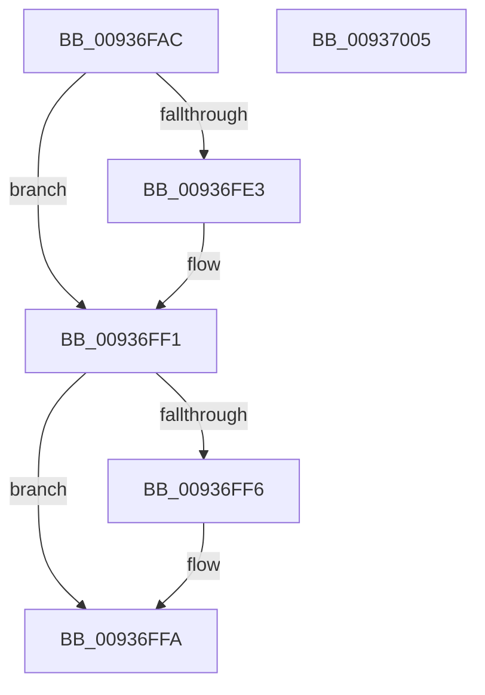

# VrpLockDiffHiveEntry

- RVA: `0x00936FAC`–`0x00937006` (길이 `90` bytes)
- VA: `0x0000000140936FAC`
- 실행 섹션: `PAGE`
- PDB 이름 있음: `예`; PDB Function 태그: `아니요`
- unwind 정보 RVA: `0x0005CAAC`
- 디코드: `26`개 명령, `90/90` bytes 표시
- 미해석 바이트: `0` (있으면 어셈블리에 `.byte`로 보존)

> 이 문서는 커널 이미지의 기계어와 PDB 기호를 분석해 생성했습니다. 4번과 5번은 함수 원형과 자료형을 바이너리 사용 방식에서 추정한 C 해석이며 원본 소스 복구 결과는 아닙니다.

## 1. Dependencies

- 직접 호출 지점: **2**; 고유 호출 대상: **2**
- 직접 호출자로 확인된 함수: **3**
- RIP 상대 이미지 참조: **0**

### Outgoing calls
- `0x00936FD3` → [KeAbPreAcquire](../../text/21/KeAbPreAcquire_function_00210230.md) (function, `0x00210230`)
- `0x00936FEC` → [ExfAcquirePushLockExclusiveEx](../../text/20/ExfAcquirePushLockExclusiveEx_function_0020FC90.md) (function, `0x0020FC90`)

### Direct callers
- [VrpLoadDifferencingHive](VrpLoadDifferencingHive_function_00935F40.md) at `0x00936028`
- [VrpLoadDifferencingHive](VrpLoadDifferencingHive_function_00935F40.md) at `0x00936185`
- [VrpUnloadDifferencingHive](VrpUnloadDifferencingHive_function_00936CE0.md) at `0x00936D22`
- [VrpUnloadDifferencingHive](VrpUnloadDifferencingHive_function_00936CE0.md) at `0x00936D7F`
- [VrpWaitForDiffHiveEntryTransitionOwnerToLeave](VrpWaitForDiffHiveEntryTransitionOwnerToLeave_function_00937128.md) at `0x009371E5`

### Static image references
- 디코드된 RIP-relative 메모리 참조가 없습니다.

## 2. Other-region calls and transfers

- 다른 실행 섹션으로 향하는 call: **2**
  - `0x00936FD3` → [KeAbPreAcquire](../../text/21/KeAbPreAcquire_function_00210230.md) (`PAGE` → `.text`)
  - `0x00936FEC` → [ExfAcquirePushLockExclusiveEx](../../text/20/ExfAcquirePushLockExclusiveEx_function_0020FC90.md) (`PAGE` → `.text`)
- 별도 외부 분기/꼬리 이동을 확인하지 못했습니다.

## 3. Assembly (complete function range)

```asm
00936FAC  48 89 5C 24 08                  mov qword ptr [rsp + 8], rbx
00936FB1  57                              push rdi
00936FB2  48 83 EC 20                     sub rsp, 0x20
00936FB6  65 48 8B 04 25 88 01 00 00      mov rax, qword ptr gs:[0x188]
00936FBF  48 8D 79 18                     lea rdi, [rcx + 0x18]
00936FC3  45 33 C0                        xor r8d, r8d
00936FC6  33 D2                           xor edx, edx
00936FC8  48 8B CF                        mov rcx, rdi
00936FCB  66 FF 88 E4 01 00 00            dec word ptr [rax + 0x1e4]
00936FD2  90                              nop
00936FD3  E8 58 92 8D FF                  call 0x140210230
00936FD8  F0 48 0F BA 2F 00               lock bts qword ptr [rdi], 0
00936FDE  48 8B D8                        mov rbx, rax
00936FE1  73 0E                           jae 0x140936ff1
00936FE3  4C 8B C7                        mov r8, rdi
00936FE6  48 8B D0                        mov rdx, rax
00936FE9  48 8B CF                        mov rcx, rdi
00936FEC  E8 9F 8C 8D FF                  call 0x14020fc90
00936FF1  48 85 DB                        test rbx, rbx
00936FF4  74 04                           je 0x140936ffa
00936FF6  C6 43 0A 01                     mov byte ptr [rbx + 0xa], 1
00936FFA  48 8B 5C 24 30                  mov rbx, qword ptr [rsp + 0x30]
00936FFF  48 83 C4 20                     add rsp, 0x20
00937003  5F                              pop rdi
00937004  C3                              ret
00937005  CC                              int3
```

## 4. C-style interpretation (structured pseudocode)

```c
__int64 __fastcall VrpLockDiffHiveEntry(__int64 a1, int a2, int a3)
{
    __int64 result;
    __int64 v_rsp;
    unsigned __int64 v_stack_p8;

    v_stack_p8 = v_rbx;
    v_rsp = (v_rsp) - (32);
    a3 = 0;
    a2 = 0;
    result = KeAbPreAcquire(a1 + 24, a2, a3, a4);
    if (!(condition_is_above_or_equal)) {
        a3 = a1 + 24;
        a2 = result;
        a1 = a1 + 24;
        result = ExfAcquirePushLockExclusiveEx(a1, a2, a3, a4);
    }
    if (result != 0) {
        *(unsigned __int8 *)(result + 10) = 1;
    }
    v_rsp = (v_rsp) + (32);
    return result;
}
```

## 5. (Beta) C Style

```c
int64_t VrpLockDiffHiveEntry(void *Arg1, int32_t Arg2, int32_t Arg3)
{
    uint8_t *arg1 = (uint8_t *)Arg1;

    int64_t result;
    int64_t local_rsp;
    uint64_t v_stack_p8;

    v_stack_p8 = local_rbx;
    local_rsp = (local_rsp) - (32);
    Arg3 = 0;
    Arg2 = 0;
    result = KeAbPreAcquire(Arg1 + 24, Arg2, Arg3, a4);
    if (!(condition_is_above_or_equal)) {
        Arg3 = Arg1 + 24;
        Arg2 = result;
        Arg1 = Arg1 + 24;
        result = ExfAcquirePushLockExclusiveEx(Arg1, Arg2, Arg3, a4);
    }
    if (result != 0) {
        *(uint8_t *)(result + 0xA) = 1;
    }
    local_rsp = (local_rsp) + (32);
    return result;
}
```

### 관측된 메모리 오프셋

구조체 형식이 확인되지 않은 접근은 인자 기준의 오프셋으로만 기록했습니다.

| 기준 인자 | 오프셋 표현 | 폭 (bit) | 접근 |
|---|---:|---:|---|
| `Arg1` | `+ 0x0` | `64` | `R/W` |
| `Arg1` | `+ 0x18` | `64` | `R` |

## 6. Execution-region graph

[열기: 2D/3D 그래프와 함수 탐색 컨트롤 패널](../../../control-panel.html?section=page&rva=0x00936FAC&view=graph)

- 2D 그래프는 위에서 아래로 흐르고, 3D 그래프는 빈 공간을 드래그해 회전합니다. Shift+드래그는 이동, 휠은 확대·축소, 함수 노드 선택은 대상 보고서 이동입니다.

### Static fallback


