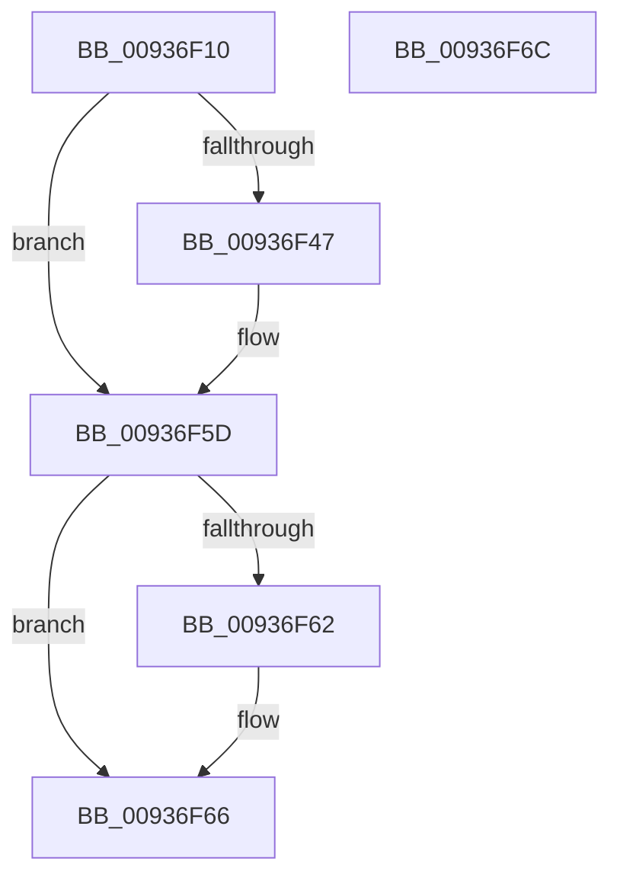

# VrpLockDiffHiveTableExclusive

- RVA: `0x00936F10`–`0x00936F6D` (길이 `93` bytes)
- VA: `0x0000000140936F10`
- 실행 섹션: `PAGE`
- PDB 이름 있음: `예`; PDB Function 태그: `아니요`
- unwind 정보 RVA: `0x0005CF00`
- 디코드: `23`개 명령, `93/93` bytes 표시
- 미해석 바이트: `0` (있으면 어셈블리에 `.byte`로 보존)

> 이 문서는 커널 이미지의 기계어와 PDB 기호를 분석해 생성했습니다. 4번과 5번은 함수 원형과 자료형을 바이너리 사용 방식에서 추정한 C 해석이며 원본 소스 복구 결과는 아닙니다.

## 1. Dependencies

- 직접 호출 지점: **2**; 고유 호출 대상: **2**
- 직접 호출자로 확인된 함수: **2**
- RIP 상대 이미지 참조: **2**

### Outgoing calls
- `0x00936F33` → [KeAbPreAcquire](../../text/21/KeAbPreAcquire_function_00210230.md) (function, `0x00210230`)
- `0x00936F58` → [ExfAcquirePushLockExclusiveEx](../../text/20/ExfAcquirePushLockExclusiveEx_function_0020FC90.md) (function, `0x0020FC90`)

### Direct callers
- [VrpFindOrCreateDiffHiveEntryForMountPoint](VrpFindOrCreateDiffHiveEntryForMountPoint_function_00936290.md) at `0x009362E3`
- [VrpDereferenceDiffHiveEntry](VrpDereferenceDiffHiveEntry_function_0093644C.md) at `0x00936477`

### Static image references
- `0x00936F1F` → RVA `0x00EF02B0` (`.data`; read)
- `0x00936F38` → RVA `0x00EF02B0` (`.data`; read/write)

## 2. Other-region calls and transfers

- 다른 실행 섹션으로 향하는 call: **2**
  - `0x00936F33` → [KeAbPreAcquire](../../text/21/KeAbPreAcquire_function_00210230.md) (`PAGE` → `.text`)
  - `0x00936F58` → [ExfAcquirePushLockExclusiveEx](../../text/20/ExfAcquirePushLockExclusiveEx_function_0020FC90.md) (`PAGE` → `.text`)
- 별도 외부 분기/꼬리 이동을 확인하지 못했습니다.

## 3. Assembly (complete function range)

```asm
00936F10  40 53                           push rbx
00936F12  48 83 EC 20                     sub rsp, 0x20
00936F16  65 48 8B 04 25 88 01 00 00      mov rax, qword ptr gs:[0x188]
00936F1F  48 8D 0D 8A 93 5B 00            lea rcx, [rip + 0x5b938a]
00936F26  45 33 C0                        xor r8d, r8d
00936F29  33 D2                           xor edx, edx
00936F2B  66 FF 88 E4 01 00 00            dec word ptr [rax + 0x1e4]
00936F32  90                              nop
00936F33  E8 F8 92 8D FF                  call 0x140210230
00936F38  F0 48 0F BA 2D 6E 93 5B 00 00   lock bts qword ptr [rip + 0x5b936e], 0
00936F42  48 8B D8                        mov rbx, rax
00936F45  73 16                           jae 0x140936f5d
00936F47  4C 8D 05 62 93 5B 00            lea r8, [rip + 0x5b9362]
00936F4E  48 8B D0                        mov rdx, rax
00936F51  48 8D 0D 58 93 5B 00            lea rcx, [rip + 0x5b9358]
00936F58  E8 33 8D 8D FF                  call 0x14020fc90
00936F5D  48 85 DB                        test rbx, rbx
00936F60  74 04                           je 0x140936f66
00936F62  C6 43 0A 01                     mov byte ptr [rbx + 0xa], 1
00936F66  48 83 C4 20                     add rsp, 0x20
00936F6A  5B                              pop rbx
00936F6B  C3                              ret
00936F6C  CC                              int3
```

## 4. C-style interpretation (structured pseudocode)

```c
__int64 __fastcall VrpLockDiffHiveTableExclusive(__int64 a1, int a2, int a3)
{
    __int64 result;
    __int64 v_rsp;

    v_rsp = (v_rsp) - (32);
    a3 = 0;
    a2 = 0;
    result = KeAbPreAcquire(v_rip + 6001546, a2, a3, a4);
    if (!(condition_is_above_or_equal)) {
        a3 = v_rip + 6001506;
        a2 = result;
        a1 = v_rip + 6001496;
        result = ExfAcquirePushLockExclusiveEx(a1, a2, a3, a4);
    }
    if (result != 0) {
        *(unsigned __int8 *)(result + 10) = 1;
    }
    v_rsp = (v_rsp) + (32);
    return result;
}
```

## 5. (Beta) C Style

```c
int64_t VrpLockDiffHiveTableExclusive(int64_t Arg1, int32_t Arg2, int32_t Arg3)
{
    int64_t result;
    int64_t local_rsp;

    local_rsp = (local_rsp) - (32);
    Arg3 = 0;
    Arg2 = 0;
    result = KeAbPreAcquire(v_rip + 6001546, Arg2, Arg3, a4);
    if (!(condition_is_above_or_equal)) {
        Arg3 = v_rip + 6001506;
        Arg2 = result;
        Arg1 = v_rip + 6001496;
        result = ExfAcquirePushLockExclusiveEx(Arg1, Arg2, Arg3, a4);
    }
    if (result != 0) {
        *(uint8_t *)(result + 0xA) = 1;
    }
    local_rsp = (local_rsp) + (32);
    return result;
}
```

## 6. Execution-region graph

[열기: 2D/3D 그래프와 함수 탐색 컨트롤 패널](../../../control-panel.html?section=page&rva=0x00936F10&view=graph)

- 2D 그래프는 위에서 아래로 흐르고, 3D 그래프는 빈 공간을 드래그해 회전합니다. Shift+드래그는 이동, 휠은 확대·축소, 함수 노드 선택은 대상 보고서 이동입니다.

### Static fallback


