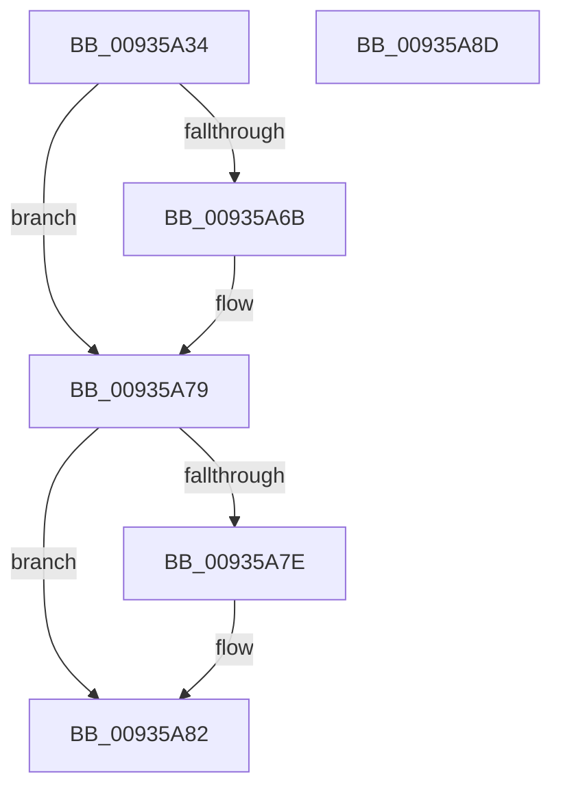

# VrpLockJobContextExclusive

- RVA: `0x00935A34`–`0x00935A8E` (길이 `90` bytes)
- VA: `0x0000000140935A34`
- 실행 섹션: `PAGE`
- PDB 이름 있음: `예`; PDB Function 태그: `아니요`
- unwind 정보 RVA: `0x0005CAAC`
- 디코드: `26`개 명령, `90/90` bytes 표시
- 미해석 바이트: `0` (있으면 어셈블리에 `.byte`로 보존)

> 이 문서는 커널 이미지의 기계어와 PDB 기호를 분석해 생성했습니다. 4번과 5번은 함수 원형과 자료형을 바이너리 사용 방식에서 추정한 C 해석이며 원본 소스 복구 결과는 아닙니다.

## 1. Dependencies

- 직접 호출 지점: **2**; 고유 호출 대상: **2**
- 직접 호출자로 확인된 함수: **7**
- RIP 상대 이미지 참조: **0**

### Outgoing calls
- `0x00935A5B` → [KeAbPreAcquire](../../text/21/KeAbPreAcquire_function_00210230.md) (function, `0x00210230`)
- `0x00935A74` → [ExfAcquirePushLockExclusiveEx](../../text/20/ExfAcquirePushLockExclusiveEx_function_0020FC90.md) (function, `0x0020FC90`)

### Direct callers
- [VrpHandleIoctlCreateMultipleNamespaceNodes](../83/VrpHandleIoctlCreateMultipleNamespaceNodes_function_0083B17C.md) at `0x0083B25D`
- [VrpHandleIoctlModifyFlags](../83/VrpHandleIoctlModifyFlags_function_0083B69C.md) at `0x0083B750`
- [VrpHandleIoctlCreateNamespaceNode](VrpHandleIoctlCreateNamespaceNode_function_0093511C.md) at `0x009352A7`
- [VrpHandleIoctlLoadDifferencingHive](VrpHandleIoctlLoadDifferencingHive_function_00935C5C.md) at `0x00935E1E`
- [VrpHandleIoctlUnloadDynamicallyLoadedHives](VrpHandleIoctlUnloadDynamicallyLoadedHives_function_0093778C.md) at `0x00937875`
- [VrpPreUnloadKey](VrpPreUnloadKey_function_00937950.md) at `0x0093796C`
- [sub_00B4588A](../B4/Unknown_function_00B4588A.md) at `0x00B45B45`

### Static image references
- 디코드된 RIP-relative 메모리 참조가 없습니다.

## 2. Other-region calls and transfers

- 다른 실행 섹션으로 향하는 call: **2**
  - `0x00935A5B` → [KeAbPreAcquire](../../text/21/KeAbPreAcquire_function_00210230.md) (`PAGE` → `.text`)
  - `0x00935A74` → [ExfAcquirePushLockExclusiveEx](../../text/20/ExfAcquirePushLockExclusiveEx_function_0020FC90.md) (`PAGE` → `.text`)
- 별도 외부 분기/꼬리 이동을 확인하지 못했습니다.

## 3. Assembly (complete function range)

```asm
00935A34  48 89 5C 24 08                  mov qword ptr [rsp + 8], rbx
00935A39  57                              push rdi
00935A3A  48 83 EC 20                     sub rsp, 0x20
00935A3E  65 48 8B 04 25 88 01 00 00      mov rax, qword ptr gs:[0x188]
00935A47  48 8D 79 10                     lea rdi, [rcx + 0x10]
00935A4B  45 33 C0                        xor r8d, r8d
00935A4E  33 D2                           xor edx, edx
00935A50  48 8B CF                        mov rcx, rdi
00935A53  66 FF 88 E4 01 00 00            dec word ptr [rax + 0x1e4]
00935A5A  90                              nop
00935A5B  E8 D0 A7 8D FF                  call 0x140210230
00935A60  F0 48 0F BA 2F 00               lock bts qword ptr [rdi], 0
00935A66  48 8B D8                        mov rbx, rax
00935A69  73 0E                           jae 0x140935a79
00935A6B  4C 8B C7                        mov r8, rdi
00935A6E  48 8B D0                        mov rdx, rax
00935A71  48 8B CF                        mov rcx, rdi
00935A74  E8 17 A2 8D FF                  call 0x14020fc90
00935A79  48 85 DB                        test rbx, rbx
00935A7C  74 04                           je 0x140935a82
00935A7E  C6 43 0A 01                     mov byte ptr [rbx + 0xa], 1
00935A82  48 8B 5C 24 30                  mov rbx, qword ptr [rsp + 0x30]
00935A87  48 83 C4 20                     add rsp, 0x20
00935A8B  5F                              pop rdi
00935A8C  C3                              ret
00935A8D  CC                              int3
```

## 4. C-style interpretation (structured pseudocode)

```c
__int64 __fastcall VrpLockJobContextExclusive(__int64 a1, int a2, int a3)
{
    __int64 result;
    __int64 v_rsp;
    unsigned __int64 v_stack_p8;

    v_stack_p8 = v_rbx;
    v_rsp = (v_rsp) - (32);
    a3 = 0;
    a2 = 0;
    result = KeAbPreAcquire(a1 + 16, a2, a3, a4);
    if (!(condition_is_above_or_equal)) {
        a3 = a1 + 16;
        a2 = result;
        a1 = a1 + 16;
        result = ExfAcquirePushLockExclusiveEx(a1, a2, a3, a4);
    }
    if (result != 0) {
        *(unsigned __int8 *)(result + 10) = 1;
    }
    v_rsp = (v_rsp) + (32);
    return result;
}
```

## 5. (Beta) C Style

```c
int64_t VrpLockJobContextExclusive(void *Arg1, int32_t Arg2, int32_t Arg3)
{
    uint8_t *arg1 = (uint8_t *)Arg1;

    int64_t result;
    int64_t local_rsp;
    uint64_t v_stack_p8;

    v_stack_p8 = local_rbx;
    local_rsp = (local_rsp) - (32);
    Arg3 = 0;
    Arg2 = 0;
    result = KeAbPreAcquire(Arg1 + 16, Arg2, Arg3, a4);
    if (!(condition_is_above_or_equal)) {
        Arg3 = Arg1 + 16;
        Arg2 = result;
        Arg1 = Arg1 + 16;
        result = ExfAcquirePushLockExclusiveEx(Arg1, Arg2, Arg3, a4);
    }
    if (result != 0) {
        *(uint8_t *)(result + 0xA) = 1;
    }
    local_rsp = (local_rsp) + (32);
    return result;
}
```

### 관측된 메모리 오프셋

구조체 형식이 확인되지 않은 접근은 인자 기준의 오프셋으로만 기록했습니다.

| 기준 인자 | 오프셋 표현 | 폭 (bit) | 접근 |
|---|---:|---:|---|
| `Arg1` | `+ 0x0` | `64` | `R/W` |
| `Arg1` | `+ 0x10` | `64` | `R` |

## 6. Execution-region graph

[열기: 2D/3D 그래프와 함수 탐색 컨트롤 패널](../../../control-panel.html?section=page&rva=0x00935A34&view=graph)

- 2D 그래프는 위에서 아래로 흐르고, 3D 그래프는 빈 공간을 드래그해 회전합니다. Shift+드래그는 이동, 휠은 확대·축소, 함수 노드 선택은 대상 보고서 이동입니다.

### Static fallback


