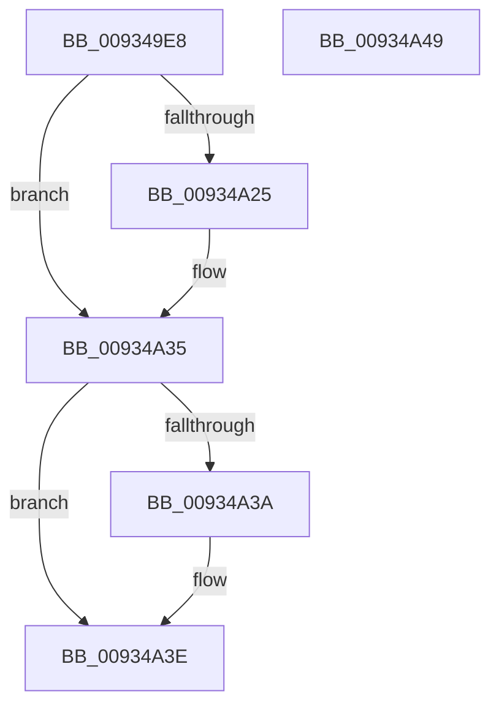

# VrpLockJobContextShared

- RVA: `0x009349E8`–`0x00934A4A` (길이 `98` bytes)
- VA: `0x00000001409349E8`
- 실행 섹션: `PAGE`
- PDB 이름 있음: `예`; PDB Function 태그: `아니요`
- unwind 정보 RVA: `0x00068D5C`
- 디코드: `29`개 명령, `98/98` bytes 표시
- 미해석 바이트: `0` (있으면 어셈블리에 `.byte`로 보존)

> 이 문서는 커널 이미지의 기계어와 PDB 기호를 분석해 생성했습니다. 4번과 5번은 함수 원형과 자료형을 바이너리 사용 방식에서 추정한 C 해석이며 원본 소스 복구 결과는 아닙니다.

## 1. Dependencies

- 직접 호출 지점: **2**; 고유 호출 대상: **2**
- 직접 호출자로 확인된 함수: **1**
- RIP 상대 이미지 참조: **0**

### Outgoing calls
- `0x00934A0F` → [KeAbPreAcquire](../../text/21/KeAbPreAcquire_function_00210230.md) (function, `0x00210230`)
- `0x00934A30` → [ExfAcquirePushLockSharedEx](../../text/21/ExfAcquirePushLockSharedEx_function_0021044C.md) (function, `0x0021044C`)

### Direct callers
- [VrpPostEnumerateKey](VrpPostEnumerateKey_function_00933EA8.md) at `0x0093412C`

### Static image references
- 디코드된 RIP-relative 메모리 참조가 없습니다.

## 2. Other-region calls and transfers

- 다른 실행 섹션으로 향하는 call: **2**
  - `0x00934A0F` → [KeAbPreAcquire](../../text/21/KeAbPreAcquire_function_00210230.md) (`PAGE` → `.text`)
  - `0x00934A30` → [ExfAcquirePushLockSharedEx](../../text/21/ExfAcquirePushLockSharedEx_function_0021044C.md) (`PAGE` → `.text`)
- 별도 외부 분기/꼬리 이동을 확인하지 못했습니다.

## 3. Assembly (complete function range)

```asm
009349E8  48 89 5C 24 10                  mov qword ptr [rsp + 0x10], rbx
009349ED  57                              push rdi
009349EE  48 83 EC 20                     sub rsp, 0x20
009349F2  65 48 8B 04 25 88 01 00 00      mov rax, qword ptr gs:[0x188]
009349FB  48 8D 79 10                     lea rdi, [rcx + 0x10]
009349FF  45 33 C0                        xor r8d, r8d
00934A02  33 D2                           xor edx, edx
00934A04  48 8B CF                        mov rcx, rdi
00934A07  66 FF 88 E4 01 00 00            dec word ptr [rax + 0x1e4]
00934A0E  90                              nop
00934A0F  E8 1C B8 8D FF                  call 0x140210230
00934A14  48 8B D8                        mov rbx, rax
00934A17  B9 11 00 00 00                  mov ecx, 0x11
00934A1C  33 C0                           xor eax, eax
00934A1E  F0 48 0F B1 0F                  lock cmpxchg qword ptr [rdi], rcx
00934A23  74 10                           je 0x140934a35
00934A25  4C 8B CF                        mov r9, rdi
00934A28  4C 8B C3                        mov r8, rbx
00934A2B  33 D2                           xor edx, edx
00934A2D  48 8B CF                        mov rcx, rdi
00934A30  E8 17 BA 8D FF                  call 0x14021044c
00934A35  48 85 DB                        test rbx, rbx
00934A38  74 04                           je 0x140934a3e
00934A3A  C6 43 0A 01                     mov byte ptr [rbx + 0xa], 1
00934A3E  48 8B 5C 24 38                  mov rbx, qword ptr [rsp + 0x38]
00934A43  48 83 C4 20                     add rsp, 0x20
00934A47  5F                              pop rdi
00934A48  C3                              ret
00934A49  CC                              int3
```

## 4. C-style interpretation (structured pseudocode)

```c
__int64 __fastcall VrpLockJobContextShared(__int64 a1, int a2, int a3)
{
    __int64 result;
    __int64 v_rsp;
    unsigned __int64 v_stack_p10;

    v_stack_p10 = v_rbx;
    v_rsp = (v_rsp) - (32);
    a3 = 0;
    a2 = 0;
    result = KeAbPreAcquire(a1 + 16, a2, a3, a4);
    result = 0;
    if (!(condition_is_equal)) {
        a4 = a1 + 16;
        a3 = 0;
        a2 = 0;
        a1 = a1 + 16;
        result = ExfAcquirePushLockSharedEx(a1, a2, a3, a4);
    }
    if (result != 0) {
        *(unsigned __int8 *)(result + 10) = 1;
    }
    v_rsp = (v_rsp) + (32);
    return result;
}
```

## 5. (Beta) C Style

```c
int64_t VrpLockJobContextShared(void *Arg1, int32_t Arg2, int32_t Arg3)
{
    uint8_t *arg1 = (uint8_t *)Arg1;

    int64_t result;
    int64_t local_rsp;
    uint64_t v_stack_p10;

    v_stack_p10 = local_rbx;
    local_rsp = (local_rsp) - (32);
    Arg3 = 0;
    Arg2 = 0;
    result = KeAbPreAcquire(Arg1 + 16, Arg2, Arg3, a4);
    result = 0;
    if (!(condition_is_equal)) {
        a4 = Arg1 + 16;
        Arg3 = 0;
        Arg2 = 0;
        Arg1 = Arg1 + 16;
        result = ExfAcquirePushLockSharedEx(Arg1, Arg2, Arg3, a4);
    }
    if (result != 0) {
        *(uint8_t *)(result + 0xA) = 1;
    }
    local_rsp = (local_rsp) + (32);
    return result;
}
```

### 관측된 메모리 오프셋

구조체 형식이 확인되지 않은 접근은 인자 기준의 오프셋으로만 기록했습니다.

| 기준 인자 | 오프셋 표현 | 폭 (bit) | 접근 |
|---|---:|---:|---|
| `Arg1` | `+ 0x0` | `64` | `R` |
| `Arg1` | `+ 0x10` | `64` | `R` |

## 6. Execution-region graph

[열기: 2D/3D 그래프와 함수 탐색 컨트롤 패널](../../../control-panel.html?section=page&rva=0x009349E8&view=graph)

- 2D 그래프는 위에서 아래로 흐르고, 3D 그래프는 빈 공간을 드래그해 회전합니다. Shift+드래그는 이동, 휠은 확대·축소, 함수 노드 선택은 대상 보고서 이동입니다.

### Static fallback


