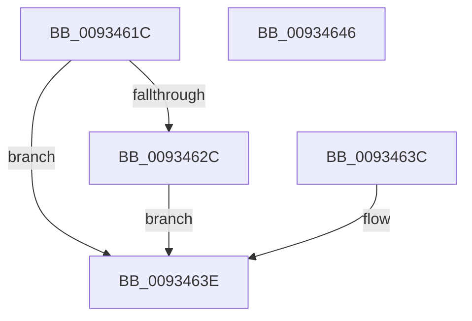

# VrpOutputBufferParameter

- RVA: `0x0093461C`–`0x00934647` (길이 `43` bytes)
- VA: `0x000000014093461C`
- 실행 섹션: `PAGE`
- PDB 이름 있음: `예`; PDB Function 태그: `아니요`
- unwind 정보 RVA: `0x0008F100`
- 디코드: `17`개 명령, `43/43` bytes 표시
- 미해석 바이트: `0` (있으면 어셈블리에 `.byte`로 보존)

> 이 문서는 커널 이미지의 기계어와 PDB 기호를 분석해 생성했습니다. 4번과 5번은 함수 원형과 자료형을 바이너리 사용 방식에서 추정한 C 해석이며 원본 소스 복구 결과는 아닙니다.

## 1. Dependencies

- 직접 호출 지점: **1**; 고유 호출 대상: **1**
- 직접 호출자로 확인된 함수: **3**
- RIP 상대 이미지 참조: **0**

### Outgoing calls
- `0x00934635` → [memcpy](../../text/6C/memcpy_function_006C6840.md) (function, `0x006C6840`)

### Direct callers
- [VrpPostQueryKey](VrpPostQueryKey_function_009338F0.md) at `0x00933A4D`
- [VrpPostQueryKey](VrpPostQueryKey_function_009338F0.md) at `0x00933A9C`
- [VrpPostQueryKey](VrpPostQueryKey_function_009338F0.md) at `0x00933AEE`
- [VrpPostQueryKey](VrpPostQueryKey_function_009338F0.md) at `0x00933B0D`
- [VrpPostEnumerateKey](VrpPostEnumerateKey_function_00933EA8.md) at `0x0093400F`
- [VrpPostEnumerateKey](VrpPostEnumerateKey_function_00933EA8.md) at `0x0093406B`
- [sub_00B246DA](../B2/Unknown_function_00B246DA.md) at `0x00B248E2`

### Static image references
- 디코드된 RIP-relative 메모리 참조가 없습니다.

## 2. Other-region calls and transfers

- 다른 실행 섹션으로 향하는 call: **1**
  - `0x00934635` → [memcpy](../../text/6C/memcpy_function_006C6840.md) (`PAGE` → `.text`)
- 별도 외부 분기/꼬리 이동을 확인하지 못했습니다.

## 3. Assembly (complete function range)

```asm
0093461C  40 53                           push rbx
0093461E  48 83 EC 20                     sub rsp, 0x20
00934622  48 8B C2                        mov rax, rdx
00934625  33 DB                           xor ebx, ebx
00934627  80 F9 01                        cmp cl, 1
0093462A  75 12                           jne 0x14093463e
0093462C  45 8B C0                        mov r8d, r8d
0093462F  49 8B 11                        mov rdx, qword ptr [r9]
00934632  48 8B C8                        mov rcx, rax
00934635  E8 06 22 D9 FF                  call 0x1406c6840
0093463A  EB 02                           jmp 0x14093463e
0093463C  8B D8                           mov ebx, eax
0093463E  8B C3                           mov eax, ebx
00934640  48 83 C4 20                     add rsp, 0x20
00934644  5B                              pop rbx
00934645  C3                              ret
00934646  CC                              int3
```

## 4. C-style interpretation (structured pseudocode)

```c
__int64 __fastcall VrpOutputBufferParameter(unsigned __int8 a1, __int64 a2, int a3, __int64 a4)
{
    __int64 result;
    __int64 v_rbx;
    __int64 v_rsp;

    v_rsp = (v_rsp) - (32);
    v_rbx = 0;
    if (a1 != 1) goto loc_0093463E;
    result = memcpy(a2, *(unsigned __int64 *)(a4), (unsigned int)(a3), a4);
    goto loc_0093463E;
loc_0093463E:
    v_rsp = (v_rsp) + (32);
    return 0;
}
```

## 5. (Beta) C Style

```c
int64_t VrpOutputBufferParameter(uint8_t Arg1, int64_t Arg2, int32_t Arg3, void *Arg4)
{
    uint8_t *arg4 = (uint8_t *)Arg4;

    int64_t result;
    int64_t local_rbx;
    int64_t local_rsp;

    local_rsp = (local_rsp) - (32);
    local_rbx = 0;
    if (Arg1 != 1) goto loc_0093463E;
    result = memcpy(Arg2, *(uint64_t *)(arg4), (uint32_t)(Arg3), Arg4);
    goto loc_0093463E;
loc_0093463E:
    local_rsp = (local_rsp) + (32);
    return 0;
}
```

### 관측된 메모리 오프셋

구조체 형식이 확인되지 않은 접근은 인자 기준의 오프셋으로만 기록했습니다.

| 기준 인자 | 오프셋 표현 | 폭 (bit) | 접근 |
|---|---:|---:|---|
| `Arg4` | `+ 0x0` | `64` | `R` |

## 6. Execution-region graph

[열기: 2D/3D 그래프와 함수 탐색 컨트롤 패널](../../../control-panel.html?section=page&rva=0x0093461C&view=graph)

- 2D 그래프는 위에서 아래로 흐르고, 3D 그래프는 빈 공간을 드래그해 회전합니다. Shift+드래그는 이동, 휠은 확대·축소, 함수 노드 선택은 대상 보고서 이동입니다.

### Static fallback


