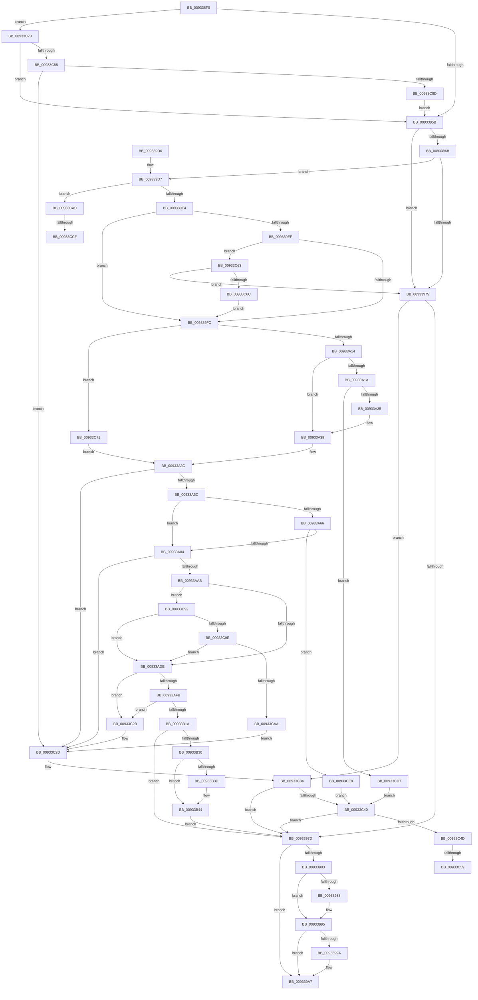

# VrpPostQueryKey

- RVA: `0x009338F0`–`0x00933CF9` (길이 `1,033` bytes)
- VA: `0x00000001409338F0`
- 실행 섹션: `PAGE`
- PDB 이름 있음: `예`; PDB Function 태그: `예`
- unwind 정보 RVA: `0x0008F048`
- 디코드: `239`개 명령, `1,033/1,033` bytes 표시
- 미해석 바이트: `0` (있으면 어셈블리에 `.byte`로 보존)

> 이 문서는 커널 이미지의 기계어와 PDB 기호를 분석해 생성했습니다. 4번과 5번은 함수 원형과 자료형을 바이너리 사용 방식에서 추정한 C 해석이며 원본 소스 복구 결과는 아닙니다.

## 1. Dependencies

- 직접 호출 지점: **13**; 고유 호출 대상: **8**
- 직접 호출자로 확인된 함수: **1**
- RIP 상대 이미지 참조: **9**

### Outgoing calls
- `0x00933935` → [EtwActivityIdControl](../../text/41/EtwActivityIdControl_function_0041E720.md) (function, `0x0041E720`)
- `0x00933944` → [ExGetPreviousMode](../../text/44/ExGetPreviousMode_function_0044C3A0.md) (function, `0x0044C3A0`)
- `0x00933990` → [ExFreePoolWithTag](../../poolcode/B8/ExFreePoolWithTag_function_00B82870.md) (function, `0x00B82870`)
- `0x009339A2` → [ExFreePoolWithTag](../../poolcode/B8/ExFreePoolWithTag_function_00B82870.md) (function, `0x00B82870`)
- `0x009339B0` → [_security_check_cookie](../../text/6A/_security_check_cookie_function_006AC640.md) (function, `0x006AC640`)
- `0x00933A27` → [ExAllocatePool2](../../poolcode/B8/ExAllocatePool2_function_00B820F0.md) (function, `0x00B820F0`)
- `0x00933A4D` → [VrpOutputBufferParameter](VrpOutputBufferParameter_function_0093461C.md) (function, `0x0093461C`)
- `0x00933A76` → [ExAllocatePool2](../../poolcode/B8/ExAllocatePool2_function_00B820F0.md) (function, `0x00B820F0`)
- `0x00933A9C` → [VrpOutputBufferParameter](VrpOutputBufferParameter_function_0093461C.md) (function, `0x0093461C`)
- `0x00933ACC` → [VrpUpdateKeyInformation](VrpUpdateKeyInformation_function_00933D00.md) (function, `0x00933D00`)
- `0x00933AEE` → [VrpOutputBufferParameter](VrpOutputBufferParameter_function_0093461C.md) (function, `0x0093461C`)
- `0x00933B0D` → [VrpOutputBufferParameter](VrpOutputBufferParameter_function_0093461C.md) (function, `0x0093461C`)
- `0x00933C19` → [EtwWriteTransfer](../../text/41/EtwWriteTransfer_function_0041C830.md) (function, `0x0041C830`)

### Direct callers
- [VrpRegistryCallback](../86/VrpRegistryCallback_function_00867450.md) at `0x008674EA`

### Static image references
- `0x00933914` → RVA `0x00E0A740` (`.data`; read)
- `0x0093395F` → RVA `0x00002F28` (`.rdata`; read)
- `0x009339D7` → RVA `0x00E0A630` (`.data`; read)
- `0x00933B77` → RVA `0x0005A8E2` (`.rdata`; read)
- `0x00933B81` → RVA `0x00E0A638` (`.data`; read)
- `0x00933B8F` → RVA `0x00043590` (`.rdata`; read)
- `0x00933BD2` → RVA `0x0005A8EC` (`.rdata`; read)
- `0x00933BDD` → RVA `0x0005BCFD` (`.rdata`; read)
- `0x00933C01` → RVA `0x00E0A650` (`.data`; read)

## 2. Other-region calls and transfers

- 다른 실행 섹션으로 향하는 call: **8**
  - `0x00933935` → [EtwActivityIdControl](../../text/41/EtwActivityIdControl_function_0041E720.md) (`PAGE` → `.text`)
  - `0x00933944` → [ExGetPreviousMode](../../text/44/ExGetPreviousMode_function_0044C3A0.md) (`PAGE` → `.text`)
  - `0x00933990` → [ExFreePoolWithTag](../../poolcode/B8/ExFreePoolWithTag_function_00B82870.md) (`PAGE` → `POOLCODE`)
  - `0x009339A2` → [ExFreePoolWithTag](../../poolcode/B8/ExFreePoolWithTag_function_00B82870.md) (`PAGE` → `POOLCODE`)
  - `0x009339B0` → [_security_check_cookie](../../text/6A/_security_check_cookie_function_006AC640.md) (`PAGE` → `.text`)
  - `0x00933A27` → [ExAllocatePool2](../../poolcode/B8/ExAllocatePool2_function_00B820F0.md) (`PAGE` → `POOLCODE`)
  - `0x00933A76` → [ExAllocatePool2](../../poolcode/B8/ExAllocatePool2_function_00B820F0.md) (`PAGE` → `POOLCODE`)
  - `0x00933C19` → [EtwWriteTransfer](../../text/41/EtwWriteTransfer_function_0041C830.md) (`PAGE` → `.text`)
- call이 아닌 외부 분기/꼬리 이동: **4**
  - `0x00933C53` → [sub_00B2452C + 0x58](../B2/Unknown_function_00B2452C.md) (`tail-transfer`)
  - `0x00933C5E` → [sub_00B2452C + 0x58](../B2/Unknown_function_00B2452C.md) (`tail-transfer`)
  - `0x00933CC9` → [sub_00B2452C](../B2/Unknown_function_00B2452C.md) (`tail-transfer`)
  - `0x00933CD2` → [sub_00B2452C](../B2/Unknown_function_00B2452C.md) (`tail-transfer`)

## 3. Assembly (complete function range)

```asm
009338F0  48 89 5C 24 10                  mov qword ptr [rsp + 0x10], rbx
009338F5  48 89 74 24 18                  mov qword ptr [rsp + 0x18], rsi
009338FA  48 89 7C 24 20                  mov qword ptr [rsp + 0x20], rdi
009338FF  55                              push rbp
00933900  41 54                           push r12
00933902  41 55                           push r13
00933904  41 56                           push r14
00933906  41 57                           push r15
00933908  48 8D 6C 24 C9                  lea rbp, [rsp - 0x37]
0093390D  48 81 EC E0 00 00 00            sub rsp, 0xe0
00933914  48 8B 05 25 6E 4D 00            mov rax, qword ptr [rip + 0x4d6e25]
0093391B  48 33 C4                        xor rax, rsp
0093391E  48 89 45 27                     mov qword ptr [rbp + 0x27], rax
00933922  4C 8B F1                        mov r14, rcx
00933925  48 8D 55 B7                     lea rdx, [rbp - 0x49]
00933929  0F 57 C0                        xorps xmm0, xmm0
0093392C  B9 03 00 00 00                  mov ecx, 3
00933931  0F 11 45 B7                     movups xmmword ptr [rbp - 0x49], xmm0
00933935  E8 E6 AD AE FF                  call 0x14041e720
0093393A  4D 8B 66 28                     mov r12, qword ptr [r14 + 0x28]
0093393E  33 F6                           xor esi, esi
00933940  4D 8B 6E 10                     mov r13, qword ptr [r14 + 0x10]
00933944  E8 57 8A B1 FF                  call 0x14044c3a0
00933949  41 8B 5E 08                     mov ebx, dword ptr [r14 + 8]
0093394D  33 FF                           xor edi, edi
0093394F  44 0F B6 F8                     movzx r15d, al
00933953  85 DB                           test ebx, ebx
00933955  0F 88 1E 03 00 00               js 0x140933c79
0093395B  41 8B 45 08                     mov eax, dword ptr [r13 + 8]
0093395F  48 8D 0D C2 F5 6C FF            lea rcx, [rip - 0x930a3e]
00933966  83 F8 08                        cmp eax, 8
00933969  77 0A                           ja 0x140933975
0093396B  BA 1B 01 00 00                  mov edx, 0x11b
00933970  0F A3 C2                        bt edx, eax
00933973  72 62                           jb 0x1409339d7
00933975  85 DB                           test ebx, ebx
00933977  0F 88 B7 02 00 00               js 0x140933c34
0093397D  41 80 FF 01                     cmp r15b, 1
00933981  75 24                           jne 0x1409339a7
00933983  48 85 F6                        test rsi, rsi
00933986  74 0D                           je 0x140933995
00933988  BA 56 52 65 67                  mov edx, 0x67655256
0093398D  48 8B CE                        mov rcx, rsi
00933990  E8 DB EE 24 00                  call 0x140b82870
00933995  48 85 FF                        test rdi, rdi
00933998  74 0D                           je 0x1409339a7
0093399A  BA 56 52 65 67                  mov edx, 0x67655256
0093399F  48 8B CF                        mov rcx, rdi
009339A2  E8 C9 EE 24 00                  call 0x140b82870
009339A7  8B C3                           mov eax, ebx
009339A9  48 8B 4D 27                     mov rcx, qword ptr [rbp + 0x27]
009339AD  48 33 CC                        xor rcx, rsp
009339B0  E8 8B 8C D7 FF                  call 0x1406ac640
009339B5  4C 8D 9C 24 E0 00 00 00         lea r11, [rsp + 0xe0]
009339BD  49 8B 5B 38                     mov rbx, qword ptr [r11 + 0x38]
009339C1  49 8B 73 40                     mov rsi, qword ptr [r11 + 0x40]
009339C5  49 8B 7B 48                     mov rdi, qword ptr [r11 + 0x48]
009339C9  49 8B E3                        mov rsp, r11
009339CC  41 5F                           pop r15
009339CE  41 5E                           pop r14
009339D0  41 5D                           pop r13
009339D2  41 5C                           pop r12
009339D4  5D                              pop rbp
009339D5  C3                              ret
009339D6  CC                              int3
009339D7  83 3D 52 6C 4D 00 05            cmp dword ptr [rip + 0x4d6c52], 5
009339DE  0F 87 C8 02 00 00               ja 0x140933cac
009339E4  41 F7 44 24 24 00 00 00 20      test dword ptr [r12 + 0x24], 0x20000000
009339ED  75 0D                           jne 0x1409339fc
009339EF  41 8B 45 08                     mov eax, dword ptr [r13 + 8]
009339F3  83 F8 03                        cmp eax, 3
009339F6  0F 85 67 02 00 00               jne 0x140933c63
009339FC  49 8B 4D 10                     mov rcx, qword ptr [r13 + 0x10]
00933A00  49 8D 55 10                     lea rdx, [r13 + 0x10]
00933A04  33 C0                           xor eax, eax
00933A06  49 8D 5D 18                     lea rbx, [r13 + 0x18]
00933A0A  41 80 FF 01                     cmp r15b, 1
00933A0E  0F 85 5D 02 00 00               jne 0x140933c71
00933A14  8B 0B                           mov ecx, dword ptr [rbx]
00933A16  85 C9                           test ecx, ecx
00933A18  74 1F                           je 0x140933a39
00933A1A  8B D1                           mov edx, ecx
00933A1C  41 B8 56 52 65 67               mov r8d, 0x67655256
00933A22  B9 00 01 00 00                  mov ecx, 0x100
00933A27  E8 C4 E6 24 00                  call 0x140b820f0
00933A2C  48 85 C0                        test rax, rax
00933A2F  0F 84 A2 02 00 00               je 0x140933cd7
00933A35  49 8D 55 10                     lea rdx, [r13 + 0x10]
00933A39  48 8B F0                        mov rsi, rax
00933A3C  44 8B 03                        mov r8d, dword ptr [rbx]
00933A3F  4C 8B CA                        mov r9, rdx
00933A42  48 8B D6                        mov rdx, rsi
00933A45  48 89 75 97                     mov qword ptr [rbp - 0x69], rsi
00933A49  41 0F B6 CF                     movzx ecx, r15b
00933A4D  E8 CA 0B 00 00                  call 0x14093461c
00933A52  8B D8                           mov ebx, eax
00933A54  85 C0                           test eax, eax
00933A56  0F 88 D1 01 00 00               js 0x140933c2d
00933A5C  49 8B 45 20                     mov rax, qword ptr [r13 + 0x20]
00933A60  41 80 FF 01                     cmp r15b, 1
00933A64  75 1E                           jne 0x140933a84
00933A66  BA 04 00 00 00                  mov edx, 4
00933A6B  B9 00 01 00 00                  mov ecx, 0x100
00933A70  41 B8 56 52 65 67               mov r8d, 0x67655256
00933A76  E8 75 E6 24 00                  call 0x140b820f0
00933A7B  48 85 C0                        test rax, rax
00933A7E  0F 84 64 02 00 00               je 0x140933ce8
00933A84  4D 8D 4D 20                     lea r9, [r13 + 0x20]
00933A88  48 89 45 9F                     mov qword ptr [rbp - 0x61], rax
00933A8C  41 B8 04 00 00 00               mov r8d, 4
00933A92  48 8B D0                        mov rdx, rax
00933A95  41 0F B6 CF                     movzx ecx, r15b
00933A99  48 8B F8                        mov rdi, rax
00933A9C  E8 7B 0B 00 00                  call 0x14093461c
00933AA1  8B D8                           mov ebx, eax
00933AA3  85 C0                           test eax, eax
00933AA5  0F 88 82 01 00 00               js 0x140933c2d
00933AAB  41 8B 44 24 24                  mov eax, dword ptr [r12 + 0x24]
00933AB0  49 8D 4C 24 10                  lea rcx, [r12 + 0x10]
00933AB5  45 8B 45 18                     mov r8d, dword ptr [r13 + 0x18]
00933AB9  4C 8B CF                        mov r9, rdi
00933ABC  89 44 24 28                     mov dword ptr [rsp + 0x28], eax
00933AC0  48 8B D6                        mov rdx, rsi
00933AC3  48 89 4C 24 20                  mov qword ptr [rsp + 0x20], rcx
00933AC8  41 8B 4D 08                     mov ecx, dword ptr [r13 + 8]
00933ACC  E8 2F 02 00 00                  call 0x140933d00
00933AD1  89 45 8B                        mov dword ptr [rbp - 0x75], eax
00933AD4  8B D8                           mov ebx, eax
00933AD6  85 C0                           test eax, eax
00933AD8  0F 88 B4 01 00 00               js 0x140933c92
00933ADE  45 8B 45 18                     mov r8d, dword ptr [r13 + 0x18]
00933AE2  4C 8D 4D 97                     lea r9, [rbp - 0x69]
00933AE6  49 8B 55 10                     mov rdx, qword ptr [r13 + 0x10]
00933AEA  41 0F B6 CF                     movzx ecx, r15b
00933AEE  E8 29 0B 00 00                  call 0x14093461c
00933AF3  85 C0                           test eax, eax
00933AF5  0F 88 30 01 00 00               js 0x140933c2b
00933AFB  49 8B 55 20                     mov rdx, qword ptr [r13 + 0x20]
00933AFF  4C 8D 4D 9F                     lea r9, [rbp - 0x61]
00933B03  41 B8 04 00 00 00               mov r8d, 4
00933B09  41 0F B6 CF                     movzx ecx, r15b
00933B0D  E8 0A 0B 00 00                  call 0x14093461c
00933B12  85 C0                           test eax, eax
00933B14  0F 88 11 01 00 00               js 0x140933c2b
00933B1A  41 89 5E 18                     mov dword ptr [r14 + 0x18], ebx
00933B1E  BB 03 05 00 C0                  mov ebx, 0xc0000503
00933B23  83 3D 06 6B 4D 00 05            cmp dword ptr [rip + 0x4d6b06], 5
00933B2A  0F 86 4D FE FF FF               jbe 0x14093397d
00933B30  49 83 7C 24 18 00               cmp qword ptr [r12 + 0x18], 0
00933B36  49 8D 44 24 10                  lea rax, [r12 + 0x10]
00933B3B  75 07                           jne 0x140933b44
00933B3D  48 8D 05 E4 F3 6C FF            lea rax, [rip - 0x930c1c]
00933B44  0F B7 08                        movzx ecx, word ptr [rax]
00933B47  48 8D 55 FF                     lea rdx, [rbp - 1]
00933B4B  48 8B 40 08                     mov rax, qword ptr [rax + 8]
00933B4F  4C 8D 45 B7                     lea r8, [rbp - 0x49]
00933B53  48 89 45 F7                     mov qword ptr [rbp - 9], rax
00933B57  45 33 C9                        xor r9d, r9d
00933B5A  41 8B 45 08                     mov eax, dword ptr [r13 + 8]
00933B5E  89 45 87                        mov dword ptr [rbp - 0x79], eax
00933B61  48 8D 45 87                     lea rax, [rbp - 0x79]
00933B65  48 89 45 07                     mov qword ptr [rbp + 7], rax
00933B69  8B 45 8B                        mov eax, dword ptr [rbp - 0x75]
00933B6C  89 45 8B                        mov dword ptr [rbp - 0x75], eax
00933B6F  48 8D 45 8B                     lea rax, [rbp - 0x75]
00933B73  48 89 45 17                     mov qword ptr [rbp + 0x17], rax
00933B77  0F B7 05 64 6D 72 FF            movzx eax, word ptr [rip - 0x8d929c]
00933B7E  89 45 AB                        mov dword ptr [rbp - 0x55], eax
00933B81  48 8B 05 B0 6A 4D 00            mov rax, qword ptr [rip + 0x4d6ab0]
00933B88  48 89 45 C7                     mov qword ptr [rbp - 0x39], rax
00933B8C  89 4D FF                        mov dword ptr [rbp - 1], ecx
00933B8F  48 8D 0D FA F9 70 FF            lea rcx, [rip - 0x8f0606]
00933B96  48 89 55 E7                     mov qword ptr [rbp - 0x19], rdx
00933B9A  48 8D 55 A7                     lea rdx, [rbp - 0x59]
00933B9E  48 C7 45 EF 02 00 00 00         mov qword ptr [rbp - 0x11], 2
00933BA6  C7 45 03 00 00 00 00            mov dword ptr [rbp + 3], 0
00933BAD  48 C7 45 0F 04 00 00 00         mov qword ptr [rbp + 0xf], 4
00933BB5  48 C7 45 1F 04 00 00 00         mov qword ptr [rbp + 0x1f], 4
00933BBD  C7 45 A7 00 00 00 0B            mov dword ptr [rbp - 0x59], 0xb000000
00933BC4  48 C7 45 AF 00 00 00 00         mov qword ptr [rbp - 0x51], 0
00933BCC  0F B7 00                        movzx eax, word ptr [rax]
00933BCF  89 45 CF                        mov dword ptr [rbp - 0x31], eax
00933BD2  48 8D 05 13 6D 72 FF            lea rax, [rip - 0x8d92ed]
00933BD9  48 89 45 D7                     mov qword ptr [rbp - 0x29], rax
00933BDD  48 8D 05 19 81 72 FF            lea rax, [rip - 0x8d7ee7]
00933BE4  2B C1                           sub eax, ecx
00933BE6  C7 45 D3 02 00 00 00            mov dword ptr [rbp - 0x2d], 2
00933BED  C7 45 DF 53 00 00 00            mov dword ptr [rbp - 0x21], 0x53
00933BF4  C7 45 E3 01 00 00 00            mov dword ptr [rbp - 0x1d], 1
00933BFB  89 45 8F                        mov dword ptr [rbp - 0x71], eax
00933BFE  8B 45 8F                        mov eax, dword ptr [rbp - 0x71]
00933C01  48 8B 0D 48 6A 4D 00            mov rcx, qword ptr [rip + 0x4d6a48]
00933C08  48 8D 45 C7                     lea rax, [rbp - 0x39]
00933C0C  48 89 44 24 28                  mov qword ptr [rsp + 0x28], rax
00933C11  C7 44 24 20 06 00 00 00         mov dword ptr [rsp + 0x20], 6
00933C19  E8 12 8C AE FF                  call 0x14041c830
00933C1E  48 8B 75 97                     mov rsi, qword ptr [rbp - 0x69]
00933C22  48 8B 7D 9F                     mov rdi, qword ptr [rbp - 0x61]
00933C26  E9 52 FD FF FF                  jmp 0x14093397d
00933C2B  8B D8                           mov ebx, eax
00933C2D  48 8D 0D F4 F2 6C FF            lea rcx, [rip - 0x930d0c]
00933C34  81 FB 03 05 00 C0               cmp ebx, 0xc0000503
00933C3A  0F 84 3D FD FF FF               je 0x14093397d
00933C40  83 3D E9 69 4D 00 02            cmp dword ptr [rip + 0x4d69e9], 2
00933C47  0F 86 30 FD FF FF               jbe 0x14093397d
00933C4D  49 83 7C 24 18 00               cmp qword ptr [r12 + 0x18], 0
00933C53  0F 84 2B 09 1F 00               je 0x140b24584
00933C59  49 8D 4C 24 10                  lea rcx, [r12 + 0x10]
00933C5E  E9 21 09 1F 00                  jmp 0x140b24584
00933C63  83 F8 08                        cmp eax, 8
00933C66  0F 85 09 FD FF FF               jne 0x140933975
00933C6C  E9 8B FD FF FF                  jmp 0x1409339fc
00933C71  48 8B F1                        mov rsi, rcx
00933C74  E9 C3 FD FF FF                  jmp 0x140933a3c
00933C79  81 FB 23 00 00 C0               cmp ebx, 0xc0000023
00933C7F  0F 84 D6 FC FF FF               je 0x14093395b
00933C85  81 FB 05 00 00 80               cmp ebx, 0x80000005
00933C8B  75 A0                           jne 0x140933c2d
00933C8D  E9 C9 FC FF FF                  jmp 0x14093395b
00933C92  81 FB 05 00 00 80               cmp ebx, 0x80000005
00933C98  0F 84 40 FE FF FF               je 0x140933ade
00933C9E  81 FB 23 00 00 C0               cmp ebx, 0xc0000023
00933CA4  0F 84 34 FE FF FF               je 0x140933ade
00933CAA  EB 81                           jmp 0x140933c2d
00933CAC  89 45 87                        mov dword ptr [rbp - 0x79], eax
00933CAF  48 8D 45 87                     lea rax, [rbp - 0x79]
00933CB3  48 89 45 E7                     mov qword ptr [rbp - 0x19], rax
00933CB7  49 8D 44 24 10                  lea rax, [r12 + 0x10]
00933CBC  48 C7 45 EF 04 00 00 00         mov qword ptr [rbp - 0x11], 4
00933CC4  49 39 74 24 18                  cmp qword ptr [r12 + 0x18], rsi
00933CC9  0F 85 5D 08 1F 00               jne 0x140b2452c
00933CCF  48 8B C1                        mov rax, rcx
00933CD2  E9 55 08 1F 00                  jmp 0x140b2452c
00933CD7  BB 9A 00 00 C0                  mov ebx, 0xc000009a
00933CDC  48 8D 0D 45 F2 6C FF            lea rcx, [rip - 0x930dbb]
00933CE3  E9 58 FF FF FF                  jmp 0x140933c40
00933CE8  BB 9A 00 00 C0                  mov ebx, 0xc000009a
00933CED  48 8D 0D 34 F2 6C FF            lea rcx, [rip - 0x930dcc]
00933CF4  E9 47 FF FF FF                  jmp 0x140933c40
```

## 4. C-style interpretation (structured pseudocode)

```c
__int64 __fastcall VrpPostQueryKey(__int64 a1)
{
    __int64 result;
    __int64 v_rdi;
    __int64 v_rsi;
    __int64 v_rsp;
    unsigned __int64 v_stack_m28;
    unsigned __int64 v_stack_m38;
    unsigned __int64 v_stack_m40;
    unsigned __int64 v_stack_m48;
    unsigned __int64 v_stack_m50;
    unsigned __int64 v_stack_m58;
    unsigned int v_stack_m5C;
    unsigned __int64 v_stack_m5F;
    unsigned __int64 v_stack_m60;
    unsigned __int64 v_stack_m68;
    unsigned __int64 v_stack_m70;
    unsigned __int64 v_stack_m78;
    unsigned int v_stack_m7C;
    unsigned int v_stack_m80;
    unsigned __int64 v_stack_m88;
    unsigned int v_stack_m8C;
    unsigned int v_stack_m90;
    unsigned __int64 v_stack_m98;
    unsigned __int64 v_stack_mA8;
    unsigned __int64 v_stack_mB0;
    unsigned int v_stack_mB4;
    unsigned int v_stack_mB8;
    unsigned __int64 v_stack_mC0;
    unsigned __int64 v_stack_mC8;
    unsigned int v_stack_mD0;
    unsigned int v_stack_mD4;
    unsigned int v_stack_mD8;
    unsigned __int64 v_stack_p10;
    unsigned __int64 v_stack_p18;
    unsigned __int64 v_stack_p20;

    v_stack_p10 = v_rbx;
    v_stack_p18 = v_rsi;
    v_stack_p20 = v_rdi;
    v_rsp = (v_rsp) - (224);
    result = (*(unsigned __int64 *)(v_rip + 5074469)) ^ (v_rsp);
    v_stack_m38 = result;
    v_stack_mA8 = v_xmm0;
    result = EtwActivityIdControl(3, v_stack_mA8, a3, a4);
    v_rsi = 0;
    result = ExGetPreviousMode(3, v_stack_mA8, a3, a4);
    v_rdi = 0;
    if (sign_flag) goto loc_00933C79;
loc_0093395B:
    if (((unsigned int)((unsigned int)(*(unsigned int *)(*(unsigned __int64 *)(a1 + 16) + 8)))) > 8) goto loc_00933975;
    if (((unsigned int)((unsigned int)(*(unsigned int *)(*(unsigned __int64 *)(a1 + 16) + 8)))) < 8) goto loc_009339D7;
loc_00933975:
    if (sign_flag) goto loc_00933C34;
loc_0093397D:
    if (((unsigned __int8)((unsigned __int8)(result))) != 1) goto loc_009339A7;
    result = (unsigned int)(*(unsigned int *)(*(unsigned __int64 *)(a1 + 16) + 8));
    if (0 != 0) {
        a2 = 0x67655256ULL;
        a1 = 0;
        result = ExFreePoolWithTag(a1, a2, a3, a4);
    }
    if (0 != 0) {
        a2 = 0x67655256ULL;
        a1 = 0;
        result = ExFreePoolWithTag(a1, a2, a3, a4);
    }
    a1 = (v_stack_m38) ^ (v_rsp);
    result = _security_check_cookie(a1, a2, a3, a4);
    return result;
loc_009339D7:
    if ((*(unsigned int *)(v_rip + 5074002)) > 5) goto loc_00933CAC;
    if (((*(unsigned int *)(*(unsigned __int64 *)(a1 + 40) + 36)) & (0x20000000ULL)) != 0) goto loc_009339FC;
    if (((unsigned int)((unsigned int)(*(unsigned int *)(*(unsigned __int64 *)(a1 + 16) + 8)))) != 3) goto loc_00933C63;
loc_009339FC:
    result = 0;
    if (((unsigned __int8)((unsigned __int8)(result))) != 1) goto loc_00933C71;
    if ((unsigned int)((unsigned int)(*(unsigned int *)(*(unsigned __int64 *)(a1 + 16) + 24))) == 0) goto loc_00933A39;
    result = ExAllocatePool2(256, (unsigned int)((unsigned int)((unsigned int)(*(unsigned int *)(*(unsigned __int64 *)(a1 + 16) + 24)))), (unsigned int)(0x67655256ULL), a4);
    if (result == 0) goto loc_00933CD7;
loc_00933A39:
loc_00933A3C:
    v_stack_mC8 = result;
    result = VrpOutputBufferParameter((unsigned __int8)((unsigned __int8)(result)), result, (unsigned int)(*(unsigned int *)(*(unsigned __int64 *)(a1 + 16) + 24)), *(unsigned __int64 *)(a1 + 16) + 16);
    if (sign_flag) goto loc_00933C2D;
    if (((unsigned __int8)((unsigned __int8)(result))) != 1) goto loc_00933A84;
    result = ExAllocatePool2(256, 4, (unsigned int)(0x67655256ULL), *(unsigned __int64 *)(a1 + 16) + 16);
    if (result == 0) goto loc_00933CE8;
loc_00933A84:
    v_stack_mC0 = result;
    result = VrpOutputBufferParameter((unsigned __int8)((unsigned __int8)(result)), result, 4, *(unsigned __int64 *)(a1 + 16) + 32);
    if (sign_flag) goto loc_00933C2D;
    v_stack_mB8 = (unsigned int)((unsigned int)(*(unsigned int *)(*(unsigned __int64 *)(a1 + 40) + 36)));
    v_stack_mC0 = *(unsigned __int64 *)(a1 + 40) + 16;
    result = VrpUpdateKeyInformation((unsigned int)(*(unsigned int *)(*(unsigned __int64 *)(a1 + 16) + 8)), result, (unsigned int)(*(unsigned int *)(*(unsigned __int64 *)(a1 + 16) + 24)), result);
    v_stack_mD4 = (unsigned int)(result);
    if (sign_flag) goto loc_00933C92;
loc_00933ADE:
    result = VrpOutputBufferParameter((unsigned __int8)((unsigned __int8)(result)), *(unsigned __int64 *)(*(unsigned __int64 *)(a1 + 16) + 16), (unsigned int)(*(unsigned int *)(*(unsigned __int64 *)(a1 + 16) + 24)), v_stack_mC8);
    if (sign_flag) goto loc_00933C2B;
    result = VrpOutputBufferParameter((unsigned __int8)((unsigned __int8)(result)), *(unsigned __int64 *)(*(unsigned __int64 *)(a1 + 16) + 32), 4, v_stack_mC0);
    if (sign_flag) goto loc_00933C2B;
    *(unsigned int *)(a1 + 24) = (unsigned int)((unsigned int)((unsigned int)(result)));
    if ((*(unsigned int *)(v_rip + 5073670)) <= 5) goto loc_0093397D;
    result = *(unsigned __int64 *)(a1 + 40) + 16;
    if ((*(unsigned __int64 *)(*(unsigned __int64 *)(a1 + 40) + 24)) == 0) {
        result = v_rip - 9636892;
    }
    v_stack_m68 = *(unsigned __int64 *)(result + 8);
    a4 = 0;
    v_stack_mD8 = (unsigned int)((unsigned int)(*(unsigned int *)(*(unsigned __int64 *)(a1 + 16) + 8)));
    v_stack_m58 = v_stack_mD8;
    v_stack_mD4 = (unsigned int)((unsigned int)(v_stack_mD4));
    v_stack_m48 = v_stack_mD4;
    v_stack_mB4 = (unsigned int)(*(unsigned __int16 *)(v_rip - 9278108));
    v_stack_m98 = *(unsigned __int64 *)(v_rip + 5073584);
    v_stack_m60 = (unsigned int)(*(unsigned __int16 *)(result));
    v_stack_m78 = v_stack_m60;
    v_stack_m70 = 2;
    v_stack_m5C = 0;
    v_stack_m50 = 4;
    v_stack_m40 = 4;
    v_stack_mB8 = 0xB000000ULL;
    v_stack_mB0 = 0;
    v_stack_m90 = (unsigned int)(*(unsigned __int16 *)(*(unsigned __int64 *)(v_rip + 5073584)));
    v_stack_m88 = v_rip - 9278189;
    result = (unsigned int)((v_rip - 9273063) - ((unsigned int)(v_rip - 9373190)));
    v_stack_m8C = 2;
    v_stack_m80 = 83;
    v_stack_m7C = 1;
    v_stack_mD0 = (unsigned int)(result);
    v_stack_mB8 = v_stack_m98;
    v_stack_mC0 = 6;
    result = EtwWriteTransfer(*(unsigned __int64 *)(v_rip + 5073480), v_stack_mB8, v_stack_mA8, a4);
    goto loc_0093397D;
loc_00933C2B:
loc_00933C2D:
loc_00933C34:
    if (((unsigned int)((unsigned int)((unsigned int)(result)))) == 0xC0000503ULL) goto loc_0093397D;
loc_00933C40:
    if ((*(unsigned int *)(v_rip + 5073385)) <= 2) goto loc_0093397D;
loc_00933C63:
    if (((unsigned int)(result)) != 8) goto loc_00933975;
    goto loc_009339FC;
loc_00933C71:
    goto loc_00933A3C;
loc_00933C79:
    if (((unsigned int)((unsigned int)((unsigned int)(result)))) == 0xC0000023ULL) goto loc_0093395B;
    if (((unsigned int)((unsigned int)((unsigned int)(result)))) != 0x80000005ULL) goto loc_00933C2D;
    goto loc_0093395B;
loc_00933C92:
    if (((unsigned int)((unsigned int)((unsigned int)(result)))) == 0x80000005ULL) goto loc_00933ADE;
    if (((unsigned int)((unsigned int)((unsigned int)(result)))) == 0xC0000023ULL) goto loc_00933ADE;
    goto loc_00933C2D;
loc_00933CAC:
    v_stack_mD8 = (unsigned int)(result);
    v_stack_m78 = v_stack_mD8;
    v_stack_m70 = 4;
loc_00933CD7:
    goto loc_00933C40;
loc_00933CE8:
    goto loc_00933C40;
}
```

## 5. (Beta) C Style

```c
int64_t VrpPostQueryKey(void *Arg1)
{
    uint8_t *arg1 = (uint8_t *)Arg1;

    int64_t result;
    int64_t local_rdi;
    int64_t local_rsi;
    int64_t local_rsp;
    uint64_t v_stack_m28;
    uint64_t v_stack_m38;
    uint64_t v_stack_m40;
    uint64_t v_stack_m48;
    uint64_t v_stack_m50;
    uint64_t v_stack_m58;
    uint32_t v_stack_m5C;
    uint64_t v_stack_m5F;
    uint64_t v_stack_m60;
    uint64_t v_stack_m68;
    uint64_t v_stack_m70;
    uint64_t v_stack_m78;
    uint32_t v_stack_m7C;
    uint32_t v_stack_m80;
    uint64_t v_stack_m88;
    uint32_t v_stack_m8C;
    uint32_t v_stack_m90;
    uint64_t v_stack_m98;
    uint64_t v_stack_mA8;
    uint64_t v_stack_mB0;
    uint32_t v_stack_mB4;
    uint32_t v_stack_mB8;
    uint64_t v_stack_mC0;
    uint64_t v_stack_mC8;
    uint32_t v_stack_mD0;
    uint32_t v_stack_mD4;
    uint32_t v_stack_mD8;
    uint64_t v_stack_p10;
    uint64_t v_stack_p18;
    uint64_t v_stack_p20;

    v_stack_p10 = local_rbx;
    v_stack_p18 = local_rsi;
    v_stack_p20 = local_rdi;
    local_rsp = (local_rsp) - (224);
    result = (*(uint64_t *)(v_rip + 0x4D6E25)) ^ (local_rsp);
    v_stack_m38 = result;
    v_stack_mA8 = v_xmm0;
    result = EtwActivityIdControl(3, v_stack_mA8, a3, a4);
    local_rsi = 0;
    result = ExGetPreviousMode(3, v_stack_mA8, a3, a4);
    local_rdi = 0;
    if (sign_flag) goto loc_00933C79;
loc_0093395B:
    if (((uint32_t)((uint32_t)(*(uint32_t *)(*(uint64_t *)(arg1 + 0x10) + 0x8)))) > 8) goto loc_00933975;
    if (((uint32_t)((uint32_t)(*(uint32_t *)(*(uint64_t *)(arg1 + 0x10) + 0x8)))) < 8) goto loc_009339D7;
loc_00933975:
    if (sign_flag) goto loc_00933C34;
loc_0093397D:
    if (((uint8_t)((uint8_t)(result))) != 1) goto loc_009339A7;
    result = (uint32_t)(*(uint32_t *)(*(uint64_t *)(arg1 + 0x10) + 0x8));
    if (0 != 0) {
        a2 = 0x67655256ULL;
        Arg1 = 0;
        result = ExFreePoolWithTag(Arg1, a2, a3, a4);
    }
    if (0 != 0) {
        a2 = 0x67655256ULL;
        Arg1 = 0;
        result = ExFreePoolWithTag(Arg1, a2, a3, a4);
    }
    Arg1 = (v_stack_m38) ^ (local_rsp);
    result = _security_check_cookie(Arg1, a2, a3, a4);
    return result;
loc_009339D7:
    if ((*(uint32_t *)(v_rip + 0x4D6C52)) > 5) goto loc_00933CAC;
    if (((*(uint32_t *)(*(uint64_t *)(arg1 + 0x28) + 0x24)) & (0x20000000ULL)) != 0) goto loc_009339FC;
    if (((uint32_t)((uint32_t)(*(uint32_t *)(*(uint64_t *)(arg1 + 0x10) + 0x8)))) != 3) goto loc_00933C63;
loc_009339FC:
    result = 0;
    if (((uint8_t)((uint8_t)(result))) != 1) goto loc_00933C71;
    if ((uint32_t)((uint32_t)(*(uint32_t *)(*(uint64_t *)(arg1 + 0x10) + 0x18))) == 0) goto loc_00933A39;
    result = ExAllocatePool2(256, (uint32_t)((uint32_t)((uint32_t)(*(uint32_t *)(*(uint64_t *)(arg1 + 0x10) + 0x18)))), (uint32_t)(0x67655256ULL), a4);
    if (result == 0) goto loc_00933CD7;
loc_00933A39:
loc_00933A3C:
    v_stack_mC8 = result;
    result = VrpOutputBufferParameter((uint8_t)((uint8_t)(result)), result, (uint32_t)(*(uint32_t *)(*(uint64_t *)(arg1 + 0x10) + 0x18)), *(uint64_t *)(arg1 + 0x10) + 16);
    if (sign_flag) goto loc_00933C2D;
    if (((uint8_t)((uint8_t)(result))) != 1) goto loc_00933A84;
    result = ExAllocatePool2(256, 4, (uint32_t)(0x67655256ULL), *(uint64_t *)(arg1 + 0x10) + 16);
    if (result == 0) goto loc_00933CE8;
loc_00933A84:
    v_stack_mC0 = result;
    result = VrpOutputBufferParameter((uint8_t)((uint8_t)(result)), result, 4, *(uint64_t *)(arg1 + 0x10) + 32);
    if (sign_flag) goto loc_00933C2D;
    v_stack_mB8 = (uint32_t)((uint32_t)(*(uint32_t *)(*(uint64_t *)(arg1 + 0x28) + 0x24)));
    v_stack_mC0 = *(uint64_t *)(arg1 + 0x28) + 16;
    result = VrpUpdateKeyInformation((uint32_t)(*(uint32_t *)(*(uint64_t *)(arg1 + 0x10) + 0x8)), result, (uint32_t)(*(uint32_t *)(*(uint64_t *)(arg1 + 0x10) + 0x18)), result);
    v_stack_mD4 = (uint32_t)(result);
    if (sign_flag) goto loc_00933C92;
loc_00933ADE:
    result = VrpOutputBufferParameter((uint8_t)((uint8_t)(result)), *(uint64_t *)(*(uint64_t *)(arg1 + 0x10) + 0x10), (uint32_t)(*(uint32_t *)(*(uint64_t *)(arg1 + 0x10) + 0x18)), v_stack_mC8);
    if (sign_flag) goto loc_00933C2B;
    result = VrpOutputBufferParameter((uint8_t)((uint8_t)(result)), *(uint64_t *)(*(uint64_t *)(arg1 + 0x10) + 0x20), 4, v_stack_mC0);
    if (sign_flag) goto loc_00933C2B;
    *(uint32_t *)(arg1 + 0x18) = (uint32_t)((uint32_t)((uint32_t)(result)));
    if ((*(uint32_t *)(v_rip + 0x4D6B06)) <= 5) goto loc_0093397D;
    result = *(uint64_t *)(arg1 + 0x28) + 16;
    if ((*(uint64_t *)(*(uint64_t *)(arg1 + 0x28) + 0x18)) == 0) {
        result = v_rip - 9636892;
    }
    v_stack_m68 = *(uint64_t *)(result + 0x8);
    a4 = 0;
    v_stack_mD8 = (uint32_t)((uint32_t)(*(uint32_t *)(*(uint64_t *)(arg1 + 0x10) + 0x8)));
    v_stack_m58 = v_stack_mD8;
    v_stack_mD4 = (uint32_t)((uint32_t)(v_stack_mD4));
    v_stack_m48 = v_stack_mD4;
    v_stack_mB4 = (uint32_t)(*(uint16_t *)(v_rip - 0x8D929C));
    v_stack_m98 = *(uint64_t *)(v_rip + 0x4D6AB0);
    v_stack_m60 = (uint32_t)(*(uint16_t *)(result));
    v_stack_m78 = v_stack_m60;
    v_stack_m70 = 2;
    v_stack_m5C = 0;
    v_stack_m50 = 4;
    v_stack_m40 = 4;
    v_stack_mB8 = 0xB000000ULL;
    v_stack_mB0 = 0;
    v_stack_m90 = (uint32_t)(*(uint16_t *)(*(uint64_t *)(v_rip + 0x4D6AB0)));
    v_stack_m88 = v_rip - 9278189;
    result = (uint32_t)((v_rip - 9273063) - ((uint32_t)(v_rip - 9373190)));
    v_stack_m8C = 2;
    v_stack_m80 = 83;
    v_stack_m7C = 1;
    v_stack_mD0 = (uint32_t)(result);
    v_stack_mB8 = v_stack_m98;
    v_stack_mC0 = 6;
    result = EtwWriteTransfer(*(uint64_t *)(v_rip + 0x4D6A48), v_stack_mB8, v_stack_mA8, a4);
    goto loc_0093397D;
loc_00933C2B:
loc_00933C2D:
loc_00933C34:
    if (((uint32_t)((uint32_t)((uint32_t)(result)))) == 0xC0000503ULL) goto loc_0093397D;
loc_00933C40:
    if ((*(uint32_t *)(v_rip + 0x4D69E9)) <= 2) goto loc_0093397D;
loc_00933C63:
    if (((uint32_t)(result)) != 8) goto loc_00933975;
    goto loc_009339FC;
loc_00933C71:
    goto loc_00933A3C;
loc_00933C79:
    if (((uint32_t)((uint32_t)((uint32_t)(result)))) == 0xC0000023ULL) goto loc_0093395B;
    if (((uint32_t)((uint32_t)((uint32_t)(result)))) != 0x80000005ULL) goto loc_00933C2D;
    goto loc_0093395B;
loc_00933C92:
    if (((uint32_t)((uint32_t)((uint32_t)(result)))) == 0x80000005ULL) goto loc_00933ADE;
    if (((uint32_t)((uint32_t)((uint32_t)(result)))) == 0xC0000023ULL) goto loc_00933ADE;
    goto loc_00933C2D;
loc_00933CAC:
    v_stack_mD8 = (uint32_t)(result);
    v_stack_m78 = v_stack_mD8;
    v_stack_m70 = 4;
loc_00933CD7:
    goto loc_00933C40;
loc_00933CE8:
    goto loc_00933C40;
}
```

### 관측된 메모리 오프셋

구조체 형식이 확인되지 않은 접근은 인자 기준의 오프셋으로만 기록했습니다.

| 기준 인자 | 오프셋 표현 | 폭 (bit) | 접근 |
|---|---:|---:|---|
| `Arg1` | `+ 0x8` | `32` | `R` |
| `Arg1` | `+ 0x10` | `64` | `R` |
| `Arg1` | `+ 0x18` | `32` | `W` |
| `Arg1` | `+ 0x28` | `64` | `R` |

## 6. Execution-region graph

[열기: 2D/3D 그래프와 함수 탐색 컨트롤 패널](../../../control-panel.html?section=page&rva=0x009338F0&view=graph)

- 2D 그래프는 위에서 아래로 흐르고, 3D 그래프는 빈 공간을 드래그해 회전합니다. Shift+드래그는 이동, 휠은 확대·축소, 함수 노드 선택은 대상 보고서 이동입니다.

### Static fallback


