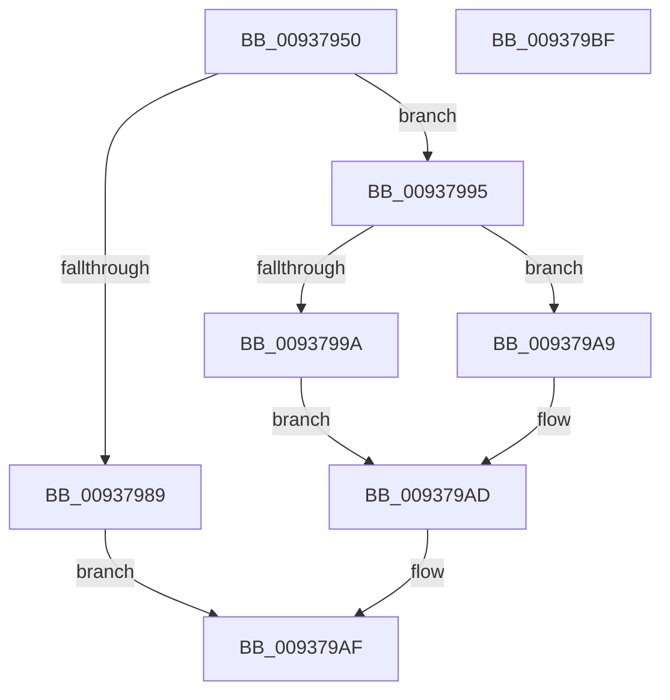

# VrpPreUnloadKey

- RVA: `0x00937950`–`0x009379C0` (길이 `112` bytes)
- VA: `0x0000000140937950`
- 실행 섹션: `PAGE`
- PDB 이름 있음: `예`; PDB Function 태그: `아니요`
- unwind 정보 RVA: `0x0005FD94`
- 디코드: `34`개 명령, `112/112` bytes 표시
- 미해석 바이트: `0` (있으면 어셈블리에 `.byte`로 보존)

> 이 문서는 커널 이미지의 기계어와 PDB 기호를 분석해 생성했습니다. 4번과 5번은 함수 원형과 자료형을 바이너리 사용 방식에서 추정한 C 해석이며 원본 소스 복구 결과는 아닙니다.

## 1. Dependencies

- 직접 호출 지점: **4**; 고유 호출 대상: **3**
- 직접 호출자로 확인된 함수: **1**
- RIP 상대 이미지 참조: **0**

### Outgoing calls
- `0x0093796C` → [VrpLockJobContextExclusive](VrpLockJobContextExclusive_function_00935A34.md) (function, `0x00935A34`)
- `0x0093797D` → [VrpFindExactNamespaceNode](VrpFindExactNamespaceNode_function_00934748.md) (function, `0x00934748`)
- `0x0093798C` → [VrpUnlockJobContextExclusive](VrpUnlockJobContextExclusive_function_009354FC.md) (function, `0x009354FC`)
- `0x009379A2` → [VrpUnlockJobContextExclusive](VrpUnlockJobContextExclusive_function_009354FC.md) (function, `0x009354FC`)

### Direct callers
- [sub_00B17664](../B1/Unknown_function_00B17664.md) at `0x00B1767A`

### Static image references
- 디코드된 RIP-relative 메모리 참조가 없습니다.

## 2. Other-region calls and transfers

- 다른 실행 섹션으로 향하는 call: **0**
- 별도 외부 분기/꼬리 이동을 확인하지 못했습니다.

## 3. Assembly (complete function range)

```asm
00937950  48 89 5C 24 10                  mov qword ptr [rsp + 0x10], rbx
00937955  48 89 74 24 18                  mov qword ptr [rsp + 0x18], rsi
0093795A  57                              push rdi
0093795B  48 83 EC 20                     sub rsp, 0x20
0093795F  48 8B 59 18                     mov rbx, qword ptr [rcx + 0x18]
00937963  48 8B F1                        mov rsi, rcx
00937966  48 8B CA                        mov rcx, rdx
00937969  48 8B FA                        mov rdi, rdx
0093796C  E8 C3 E0 FF FF                  call 0x140935a34
00937971  48 8D 53 10                     lea rdx, [rbx + 0x10]
00937975  48 8B CF                        mov rcx, rdi
00937978  4C 8D 44 24 30                  lea r8, [rsp + 0x30]
0093797D  E8 C6 CD FF FF                  call 0x140934748
00937982  33 DB                           xor ebx, ebx
00937984  48 85 C0                        test rax, rax
00937987  75 0C                           jne 0x140937995
00937989  48 8B CF                        mov rcx, rdi
0093798C  E8 6B DB FF FF                  call 0x1409354fc
00937991  33 C0                           xor eax, eax
00937993  EB 1A                           jmp 0x1409379af
00937995  39 58 38                        cmp dword ptr [rax + 0x38], ebx
00937998  7C 0F                           jl 0x1409379a9
0093799A  48 8B CF                        mov rcx, rdi
0093799D  BB 22 00 00 C0                  mov ebx, 0xc0000022
009379A2  E8 55 DB FF FF                  call 0x1409354fc
009379A7  EB 04                           jmp 0x1409379ad
009379A9  48 89 46 10                     mov qword ptr [rsi + 0x10], rax
009379AD  8B C3                           mov eax, ebx
009379AF  48 8B 5C 24 38                  mov rbx, qword ptr [rsp + 0x38]
009379B4  48 8B 74 24 40                  mov rsi, qword ptr [rsp + 0x40]
009379B9  48 83 C4 20                     add rsp, 0x20
009379BD  5F                              pop rdi
009379BE  C3                              ret
009379BF  CC                              int3
```

## 4. C-style interpretation (structured pseudocode)

```c
__int64 __fastcall VrpPreUnloadKey(__int64 a1, __int64 a2)
{
    __int64 result;
    __int64 v_rbx;
    __int64 v_rsp;
    unsigned __int64 v_stack_p10;
    unsigned __int64 v_stack_p18;
    unsigned __int64 v_stack_p8;

    v_stack_p10 = v_rbx;
    v_stack_p18 = v_rsi;
    v_rsp = (v_rsp) - (32);
    result = VrpLockJobContextExclusive(a2, a2, a3, a4);
    result = VrpFindExactNamespaceNode(a2, *(unsigned __int64 *)(a1 + 24) + 16, v_stack_p8, a4);
    v_rbx = 0;
    if (result != 0) goto loc_00937995;
    result = VrpUnlockJobContextExclusive(a2, *(unsigned __int64 *)(a1 + 24) + 16, v_stack_p8, a4);
    result = 0;
    goto loc_009379AF;
loc_00937995:
    if ((*(unsigned int *)(result + 56)) < 0) goto loc_009379A9;
    result = VrpUnlockJobContextExclusive(a2, *(unsigned __int64 *)(a1 + 24) + 16, v_stack_p8, a4);
    goto loc_009379AD;
loc_009379A9:
    *(unsigned __int64 *)(a1 + 16) = result;
loc_009379AD:
loc_009379AF:
    v_rsp = (v_rsp) + (32);
    return (unsigned int)((unsigned int)((unsigned int)(0xC0000022ULL)));
}
```

## 5. (Beta) C Style

```c
int64_t VrpPreUnloadKey(void *Arg1, int64_t Arg2)
{
    uint8_t *arg1 = (uint8_t *)Arg1;

    int64_t result;
    int64_t local_rbx;
    int64_t local_rsp;
    uint64_t v_stack_p10;
    uint64_t v_stack_p18;
    uint64_t v_stack_p8;

    v_stack_p10 = local_rbx;
    v_stack_p18 = local_rsi;
    local_rsp = (local_rsp) - (32);
    result = VrpLockJobContextExclusive(Arg2, Arg2, a3, a4);
    result = VrpFindExactNamespaceNode(Arg2, *(uint64_t *)(arg1 + 0x18) + 16, v_stack_p8, a4);
    local_rbx = 0;
    if (result != 0) goto loc_00937995;
    result = VrpUnlockJobContextExclusive(Arg2, *(uint64_t *)(arg1 + 0x18) + 16, v_stack_p8, a4);
    result = 0;
    goto loc_009379AF;
loc_00937995:
    if ((*(uint32_t *)(result + 0x38)) < 0) goto loc_009379A9;
    result = VrpUnlockJobContextExclusive(Arg2, *(uint64_t *)(arg1 + 0x18) + 16, v_stack_p8, a4);
    goto loc_009379AD;
loc_009379A9:
    *(uint64_t *)(arg1 + 0x10) = result;
loc_009379AD:
loc_009379AF:
    local_rsp = (local_rsp) + (32);
    return (uint32_t)((uint32_t)((uint32_t)(0xC0000022ULL)));
}
```

### 관측된 메모리 오프셋

구조체 형식이 확인되지 않은 접근은 인자 기준의 오프셋으로만 기록했습니다.

| 기준 인자 | 오프셋 표현 | 폭 (bit) | 접근 |
|---|---:|---:|---|
| `Arg1` | `+ 0x10` | `64` | `W` |
| `Arg1` | `+ 0x18` | `64` | `R` |

## 6. Execution-region graph

[열기: 2D/3D 그래프와 함수 탐색 컨트롤 패널](../../../control-panel.html?section=page&rva=0x00937950&view=graph)

- 2D 그래프는 위에서 아래로 흐르고, 3D 그래프는 빈 공간을 드래그해 회전합니다. Shift+드래그는 이동, 휠은 확대·축소, 함수 노드 선택은 대상 보고서 이동입니다.

### Static fallback


