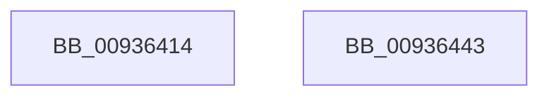

# VrpRelinquishDiffHiveEntryTransitionOwner

- RVA: `0x00936414`–`0x00936444` (길이 `48` bytes)
- VA: `0x0000000140936414`
- 실행 섹션: `PAGE`
- PDB 이름 있음: `예`; PDB Function 태그: `아니요`
- unwind 정보 RVA: `0x0005CF00`
- 디코드: `15`개 명령, `48/48` bytes 표시
- 미해석 바이트: `0` (있으면 어셈블리에 `.byte`로 보존)

> 이 문서는 커널 이미지의 기계어와 PDB 기호를 분석해 생성했습니다. 4번과 5번은 함수 원형과 자료형을 바이너리 사용 방식에서 추정한 C 해석이며 원본 소스 복구 결과는 아닙니다.

## 1. Dependencies

- 직접 호출 지점: **3**; 고유 호출 대상: **3**
- 직접 호출자로 확인된 함수: **2**
- RIP 상대 이미지 참조: **0**

### Outgoing calls
- `0x0093642B` → [KeWakeWaitChain](../../text/34/KeWakeWaitChain_function_0034F8C0.md) (function, `0x0034F8C0`)
- `0x00936433` → [KeAbPostRelease](../../text/2E/KeAbPostRelease_function_002E1600.md) (function, `0x002E1600`)
- `0x00936438` → [KeLeaveCriticalRegion](../../text/25/KeLeaveCriticalRegion_function_0025D8B0.md) (function, `0x0025D8B0`)

### Direct callers
- [VrpLoadDifferencingHive](VrpLoadDifferencingHive_function_00935F40.md) at `0x009361AF`
- [VrpUnloadDifferencingHive](VrpUnloadDifferencingHive_function_00936CE0.md) at `0x00936DE3`

### Static image references
- 디코드된 RIP-relative 메모리 참조가 없습니다.

## 2. Other-region calls and transfers

- 다른 실행 섹션으로 향하는 call: **3**
  - `0x0093642B` → [KeWakeWaitChain](../../text/34/KeWakeWaitChain_function_0034F8C0.md) (`PAGE` → `.text`)
  - `0x00936433` → [KeAbPostRelease](../../text/2E/KeAbPostRelease_function_002E1600.md) (`PAGE` → `.text`)
  - `0x00936438` → [KeLeaveCriticalRegion](../../text/25/KeLeaveCriticalRegion_function_0025D8B0.md) (`PAGE` → `.text`)
- 별도 외부 분기/꼬리 이동을 확인하지 못했습니다.

## 3. Assembly (complete function range)

```asm
00936414  40 53                           push rbx
00936416  48 83 EC 20                     sub rsp, 0x20
0093641A  48 8D 59 28                     lea rbx, [rcx + 0x28]
0093641E  45 33 C0                        xor r8d, r8d
00936421  48 83 23 00                     and qword ptr [rbx], 0
00936425  48 83 C1 30                     add rcx, 0x30
00936429  33 D2                           xor edx, edx
0093642B  E8 90 94 A1 FF                  call 0x14034f8c0
00936430  48 8B CB                        mov rcx, rbx
00936433  E8 C8 B1 9A FF                  call 0x1402e1600
00936438  E8 73 74 92 FF                  call 0x14025d8b0
0093643D  48 83 C4 20                     add rsp, 0x20
00936441  5B                              pop rbx
00936442  C3                              ret
00936443  CC                              int3
```

## 4. C-style interpretation (structured pseudocode)

```c
__int64 __fastcall VrpRelinquishDiffHiveEntryTransitionOwner(__int64 a1, int a2, int a3)
{
    __int64 result;
    __int64 v_rsp;

    v_rsp = (v_rsp) - (32);
    a3 = 0;
    a1 = (a1) + (48);
    a2 = 0;
    result = KeWakeWaitChain(a1, a2, a3, a4);
    result = KeAbPostRelease(a1 + 40, a2, a3, a4);
    result = KeLeaveCriticalRegion(a1 + 40, a2, a3, a4);
    v_rsp = (v_rsp) + (32);
    return result;
}
```

## 5. (Beta) C Style

```c
int64_t VrpRelinquishDiffHiveEntryTransitionOwner(void *Arg1, int32_t Arg2, int32_t Arg3)
{
    uint8_t *arg1 = (uint8_t *)Arg1;

    int64_t result;
    int64_t local_rsp;

    local_rsp = (local_rsp) - (32);
    Arg3 = 0;
    Arg1 = (Arg1) + (48);
    Arg2 = 0;
    result = KeWakeWaitChain(Arg1, Arg2, Arg3, a4);
    result = KeAbPostRelease(Arg1 + 40, Arg2, Arg3, a4);
    result = KeLeaveCriticalRegion(Arg1 + 40, Arg2, Arg3, a4);
    local_rsp = (local_rsp) + (32);
    return result;
}
```

### 관측된 메모리 오프셋

구조체 형식이 확인되지 않은 접근은 인자 기준의 오프셋으로만 기록했습니다.

| 기준 인자 | 오프셋 표현 | 폭 (bit) | 접근 |
|---|---:|---:|---|
| `Arg1` | `+ 0x0` | `64` | `R/W` |
| `Arg1` | `+ 0x28` | `64` | `R` |

## 6. Execution-region graph

[열기: 2D/3D 그래프와 함수 탐색 컨트롤 패널](../../../control-panel.html?section=page&rva=0x00936414&view=graph)

- 2D 그래프는 위에서 아래로 흐르고, 3D 그래프는 빈 공간을 드래그해 회전합니다. Shift+드래그는 이동, 휠은 확대·축소, 함수 노드 선택은 대상 보고서 이동입니다.

### Static fallback


