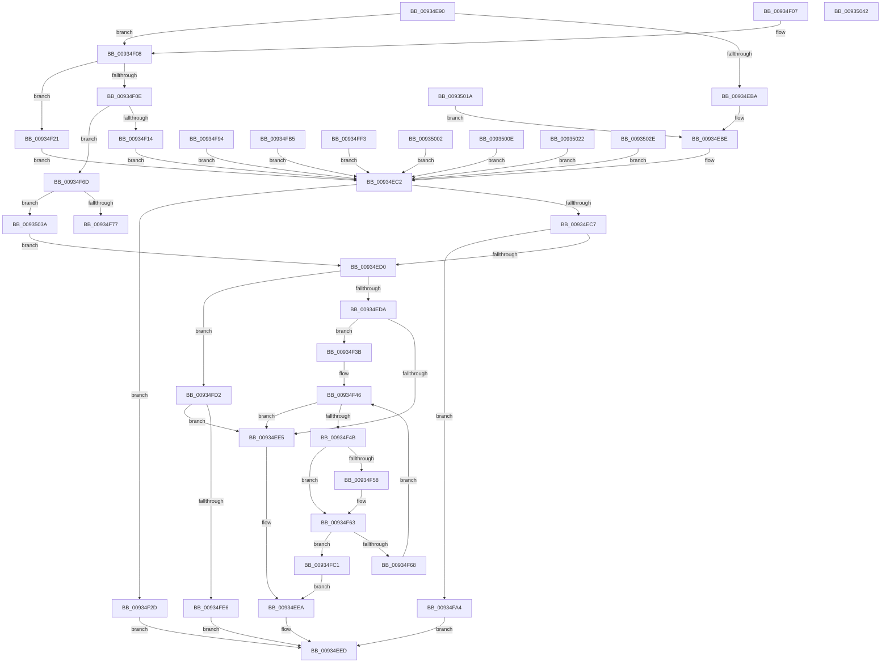

# VrpShouldOperateOnCall

- RVA: `0x00934E90`–`0x009350A7` (길이 `535` bytes)
- VA: `0x0000000140934E90`
- 실행 섹션: `PAGE`
- PDB 이름 있음: `예`; PDB Function 태그: `아니요`
- unwind 정보 RVA: `0x0008F230`
- 디코드: `162`개 명령, `535/535` bytes 표시
- 미해석 바이트: `4` (있으면 어셈블리에 `.byte`로 보존)

> 이 문서는 커널 이미지의 기계어와 PDB 기호를 분석해 생성했습니다. 4번과 5번은 함수 원형과 자료형을 바이너리 사용 방식에서 추정한 C 해석이며 원본 소스 복구 결과는 아닙니다.

## 1. Dependencies

- 직접 호출 지점: **1**; 고유 호출 대상: **1**
- 직접 호출자로 확인된 함수: **1**
- RIP 상대 이미지 참조: **6**

### Outgoing calls
- `0x00934FD7` → [VRegEnabledInJob](VRegEnabledInJob_function_009350B0.md) (function, `0x009350B0`)

### Direct callers
- [VrpRegistryCallback](../86/VrpRegistryCallback_function_00867450.md) at `0x00867496`

### Static image references
- `0x00934F4F` → RVA `0x00011F68` (`.rdata`; read)
- `0x00934F5C` → RVA `0x00011F70` (`.rdata`; read)
- `0x00934F77` → RVA `0x00000000` (`image boundary/outside`; read)
- `0x0093507E` → RVA `0x0593558F` (`image boundary/outside`; read)
- `0x00935092` → RVA `0x05955BA0` (`image boundary/outside`; read/write)
- `0x00935098` → RVA `0x099D55A7` (`image boundary/outside`; read)

## 2. Other-region calls and transfers

- 다른 실행 섹션으로 향하는 call: **0**
- 별도 외부 분기/꼬리 이동을 확인하지 못했습니다.

## 3. Assembly (complete function range)

```asm
00934E90  48 89 5C 24 08                  mov qword ptr [rsp + 8], rbx
00934E95  48 89 6C 24 10                  mov qword ptr [rsp + 0x10], rbp
00934E9A  48 89 74 24 18                  mov qword ptr [rsp + 0x18], rsi
00934E9F  57                              push rdi
00934EA0  48 83 EC 30                     sub rsp, 0x30
00934EA4  33 ED                           xor ebp, ebp
00934EA6  4C 63 D1                        movsxd r10, ecx
00934EA9  48 89 6C 24 20                  mov qword ptr [rsp + 0x20], rbp
00934EAE  49 8B F1                        mov rsi, r9
00934EB1  49 8B F8                        mov rdi, r8
00934EB4  41 83 FA 30                     cmp r10d, 0x30
00934EB8  75 4E                           jne 0x140934f08
00934EBA  48 8B 42 20                     mov rax, qword ptr [rdx + 0x20]
00934EBE  48 8B 5A 28                     mov rbx, qword ptr [rdx + 0x28]
00934EC2  48 85 DB                        test rbx, rbx
00934EC5  75 66                           jne 0x140934f2d
00934EC7  48 85 C0                        test rax, rax
00934ECA  0F 85 D4 00 00 00               jne 0x140934fa4
00934ED0  41 83 FA 20                     cmp r10d, 0x20
00934ED4  0F 84 F8 00 00 00               je 0x140934fd2
00934EDA  41 8D 42 E5                     lea eax, [r10 - 0x1b]
00934EDE  A9 FD FF FF FF                  test eax, 0xfffffffd
00934EE3  74 56                           je 0x140934f3b
00934EE5  8B D5                           mov edx, ebp
00934EE7  48 89 2E                        mov qword ptr [rsi], rbp
00934EEA  48 8B DD                        mov rbx, rbp
00934EED  48 89 1F                        mov qword ptr [rdi], rbx
00934EF0  8B C2                           mov eax, edx
00934EF2  48 8B 5C 24 40                  mov rbx, qword ptr [rsp + 0x40]
00934EF7  48 8B 6C 24 48                  mov rbp, qword ptr [rsp + 0x48]
00934EFC  48 8B 74 24 50                  mov rsi, qword ptr [rsp + 0x50]
00934F01  48 83 C4 30                     add rsp, 0x30
00934F05  5F                              pop rdi
00934F06  C3                              ret
00934F07  CC                              int3
00934F08  41 83 FA 1A                     cmp r10d, 0x1a
00934F0C  74 13                           je 0x140934f21
00934F0E  41 83 FA 21                     cmp r10d, 0x21
00934F12  75 59                           jne 0x140934f6d
00934F14  48 8B 02                        mov rax, qword ptr [rdx]
00934F17  48 8B 58 28                     mov rbx, qword ptr [rax + 0x28]
00934F1B  48 8B 40 20                     mov rax, qword ptr [rax + 0x20]
00934F1F  EB A1                           jmp 0x140934ec2
00934F21  48 8B 1A                        mov rbx, qword ptr [rdx]
00934F24  48 8B C5                        mov rax, rbp
00934F27  48 8B 5B 58                     mov rbx, qword ptr [rbx + 0x58]
00934F2B  EB 95                           jmp 0x140934ec2
00934F2D  48 8B 43 28                     mov rax, qword ptr [rbx + 0x28]
00934F31  BA 01 00 00 00                  mov edx, 1
00934F36  49 89 01                        mov qword ptr [r9], rax
00934F39  EB B2                           jmp 0x140934eed
00934F3B  48 8B 42 08                     mov rax, qword ptr [rdx + 8]
00934F3F  48 8B 48 10                     mov rcx, qword ptr [rax + 0x10]
00934F43  48 8B 01                        mov rax, qword ptr [rcx]
00934F46  48 3B C1                        cmp rax, rcx
00934F49  74 9A                           je 0x140934ee5
00934F4B  48 8B 50 10                     mov rdx, qword ptr [rax + 0x10]
00934F4F  48 2B 15 12 D0 6D FF            sub rdx, qword ptr [rip - 0x922fee]
00934F56  75 0B                           jne 0x140934f63
00934F58  48 8B 50 18                     mov rdx, qword ptr [rax + 0x18]
00934F5C  48 2B 15 0D D0 6D FF            sub rdx, qword ptr [rip - 0x922ff3]
00934F63  48 85 D2                        test rdx, rdx
00934F66  74 59                           je 0x140934fc1
00934F68  48 8B 00                        mov rax, qword ptr [rax]
00934F6B  EB D9                           jmp 0x140934f46
00934F6D  41 83 FA 32                     cmp r10d, 0x32
00934F71  0F 87 C3 00 00 00               ja 0x14093503a
00934F77  4C 8D 05 82 B0 6C FF            lea r8, [rip - 0x934f7e]
00934F7E  43 0F B6 84 10 74 50 93 00      movzx eax, byte ptr [r8 + r10 + 0x935074]
00934F87  41 8B 8C 80 44 50 93 00         mov ecx, dword ptr [r8 + rax*4 + 0x935044]
00934F8F  49 03 C8                        add rcx, r8
00934F92  FF E1                           jmp rcx
00934F94  CC                              int3
00934F95  CC                              int3
00934F96  CC                              int3
00934F97  CC                              int3
00934F98  48 8B 5A 10                     mov rbx, qword ptr [rdx + 0x10]
00934F9C  48 8B C5                        mov rax, rbp
00934F9F  E9 1E FF FF FF                  jmp 0x140934ec2
00934FA4  48 8B 40 08                     mov rax, qword ptr [rax + 8]
00934FA8  BA 01 00 00 00                  mov edx, 1
00934FAD  49 89 01                        mov qword ptr [r9], rax
00934FB0  E9 38 FF FF FF                  jmp 0x140934eed
00934FB5  48 8B 5A 08                     mov rbx, qword ptr [rdx + 8]
00934FB9  48 8B C5                        mov rax, rbp
00934FBC  E9 01 FF FF FF                  jmp 0x140934ec2
00934FC1  48 8B 40 30                     mov rax, qword ptr [rax + 0x30]
00934FC5  BA 01 00 00 00                  mov edx, 1
00934FCA  49 89 01                        mov qword ptr [r9], rax
00934FCD  E9 18 FF FF FF                  jmp 0x140934eea
00934FD2  48 8D 4C 24 20                  lea rcx, [rsp + 0x20]
00934FD7  E8 D4 00 00 00                  call 0x1409350b0
00934FDC  8B D0                           mov edx, eax
00934FDE  85 C0                           test eax, eax
00934FE0  0F 84 FF FE FF FF               je 0x140934ee5
00934FE6  48 8B 4C 24 20                  mov rcx, qword ptr [rsp + 0x20]
00934FEB  48 89 0E                        mov qword ptr [rsi], rcx
00934FEE  E9 FA FE FF FF                  jmp 0x140934eed
00934FF3  48 8B 1A                        mov rbx, qword ptr [rdx]
00934FF6  48 8B C5                        mov rax, rbp
00934FF9  48 8B 5B 48                     mov rbx, qword ptr [rbx + 0x48]
00934FFD  E9 C0 FE FF FF                  jmp 0x140934ec2
00935002  48 8B 5A 30                     mov rbx, qword ptr [rdx + 0x30]
00935006  48 8B C5                        mov rax, rbp
00935009  E9 B4 FE FF FF                  jmp 0x140934ec2
0093500E  48 8B 5A 18                     mov rbx, qword ptr [rdx + 0x18]
00935012  48 8B C5                        mov rax, rbp
00935015  E9 A8 FE FF FF                  jmp 0x140934ec2
0093501A  48 8B C5                        mov rax, rbp
0093501D  E9 9C FE FF FF                  jmp 0x140934ebe
00935022  48 8B 5A 38                     mov rbx, qword ptr [rdx + 0x38]
00935026  48 8B C5                        mov rax, rbp
00935029  E9 94 FE FF FF                  jmp 0x140934ec2
0093502E  48 8B 5A 20                     mov rbx, qword ptr [rdx + 0x20]
00935032  48 8B C5                        mov rax, rbp
00935035  E9 88 FE FF FF                  jmp 0x140934ec2
0093503A  48 8B DD                        mov rbx, rbp
0093503D  E9 8E FE FF FF                  jmp 0x140934ed0
00935042  66 90                           nop
00935044  98                              cwde
00935045  4F 93                           xchg r11, rax
00935047  00 02                           add byte ptr [rdx], al
00935049  50                              push rax
0093504A  93                              xchg ebx, eax
0093504B  00 0E                           add byte ptr [rsi], cl
0093504D  50                              push rax
0093504E  93                              xchg ebx, eax
0093504F  00 1A                           add byte ptr [rdx], bl
00935051  50                              push rax
00935052  93                              xchg ebx, eax
00935053  00 22                           add byte ptr [rdx], ah
00935055  50                              push rax
00935056  93                              xchg ebx, eax
00935057  00 BA 4E 93 00 14               add byte ptr [rdx + 0x1400934e], bh
0093505D  4F 93                           xchg r11, rax
0093505F  00 21                           add byte ptr [rcx], ah
00935061  4F 93                           xchg r11, rax
00935063  00 F3                           add bl, dh
00935065  4F 93                           xchg r11, rax
00935067  00 2E                           add byte ptr [rsi], ch
00935069  50                              push rax
0093506A  93                              xchg ebx, eax
0093506B  00 B5 4F 93 00 3A               add byte ptr [rbp + 0x3a00934f], dh
00935071  50                              push rax
00935072  93                              xchg ebx, eax
00935073  00 00                           add byte ptr [rax], al
00935075  01 02                           add dword ptr [rdx], eax
00935077  03 02                           add eax, dword ptr [rdx]
00935079  01 01                           add dword ptr [rcx], eax
0093507B  01 04 04                        add dword ptr [rsp + rax], eax
0093507E  0B 05 0B 05 00 05               or eax, dword ptr [rip + 0x500050b]
00935084  05 05 05 05 05                  add eax, 0x5050505
00935089  05 05 05 05 05                  add eax, 0x5050505
0093508E  0B 06                           or eax, dword ptr [rsi]
00935090  07                              .byte 0x07
00935091  06                              .byte 0x06
00935092  00 05 08 0B 02 05               add byte ptr [rip + 0x5020b08], al
00935098  03 05 09 05 0A 09               add eax, dword ptr [rip + 0x90a0509]
0093509E  05 09 05 09 05                  add eax, 0x5090509
009350A3  03 0B                           add ecx, dword ptr [rbx]
009350A5  03                              .byte 0x03
009350A6  05                              .byte 0x05
```

## 4. C-style interpretation (structured pseudocode)

```c
__int64 __fastcall VrpShouldOperateOnCall(int a1, __int64 a2, __int64 a3, __int64 a4)
{
    __int64 result;
    __int64 v_rbp;
    __int64 v_rsp;
    unsigned __int64 v_stack_m18;
    unsigned __int64 v_stack_p10;
    unsigned __int64 v_stack_p18;
    unsigned __int64 v_stack_p20;
    unsigned __int64 v_stack_p8;

    v_stack_p8 = v_rbx;
    v_stack_p10 = v_rbp;
    v_stack_p18 = v_rsi;
    v_rsp = (v_rsp) - (48);
    v_rbp = 0;
    v_stack_m18 = 0;
    if (((unsigned int)((int)(a1))) != 48) goto loc_00934F08;
loc_00934EBE:
loc_00934EC2:
    if (*(unsigned __int64 *)(a2 + 40) != 0) goto loc_00934F2D;
    if (*(unsigned __int64 *)(a2 + 32) != 0) goto loc_00934FA4;
loc_00934ED0:
    if (((unsigned int)((int)(a1))) == 32) goto loc_00934FD2;
    if ((((unsigned int)((int)(a1) - 27)) & (0xFFFFFFFDULL)) == 0) goto loc_00934F3B;
loc_00934EE5:
    *(unsigned __int64 *)(a4) = 0;
loc_00934EEA:
loc_00934EED:
    *(unsigned __int64 *)(a3) = 0;
    v_rsp = (v_rsp) + (48);
    return 0;
loc_00934F08:
    if (((unsigned int)((int)(a1))) == 26) goto loc_00934F21;
    if (((unsigned int)((int)(a1))) != 33) goto loc_00934F6D;
    goto loc_00934EC2;
loc_00934F21:
    goto loc_00934EC2;
loc_00934F2D:
    *(unsigned __int64 *)(a4) = *(unsigned __int64 *)(*(unsigned __int64 *)(*(unsigned __int64 *)(0) + 88) + 40);
    goto loc_00934EED;
loc_00934F3B:
loc_00934F46:
    if ((*(unsigned __int64 *)(*(unsigned __int64 *)(*(unsigned __int64 *)(1 + 8) + 16))) == (*(unsigned __int64 *)(*(unsigned __int64 *)(1 + 8) + 16))) goto loc_00934EE5;
    a2 = (*(unsigned __int64 *)(*(unsigned __int64 *)(*(unsigned __int64 *)(*(unsigned __int64 *)(1 + 8) + 16)) + 16)) - (*(unsigned __int64 *)(v_rip - 9580526));
    if (!(condition_is_not_equal)) {
        a2 = *(unsigned __int64 *)(*(unsigned __int64 *)(*(unsigned __int64 *)(*(unsigned __int64 *)(1 + 8) + 16)) + 24);
        a2 = (a2) - (*(unsigned __int64 *)(v_rip - 9580531));
    }
    if (a2 == 0) goto loc_00934FC1;
    goto loc_00934F46;
loc_00934F6D:
    if (((unsigned int)((int)(a1))) > 50) goto loc_0093503A;
    a1 = ((unsigned int)(*(unsigned int *)(v_rip - 9654142 + *(unsigned __int8 *)(v_rip - 9654142 + (int)(a1) * 1 + 9654388) * 4 + 9654340))) + (v_rip - 9654142);
loc_00934FA4:
    *(unsigned __int64 *)(a4) = *(unsigned __int64 *)(*(unsigned __int8 *)(v_rip - 9654142 + (int)(a1) * 1 + 9654388) + 8);
    goto loc_00934EED;
loc_00934FC1:
    *(unsigned __int64 *)(a4) = *(unsigned __int64 *)(*(unsigned __int64 *)(*(unsigned __int8 *)(v_rip - 9654142 + (int)(a1) * 1 + 9654388) + 8) + 48);
    goto loc_00934EEA;
loc_00934FD2:
    result = VRegEnabledInJob(v_stack_p20, 1, v_rip - 9654142, a4);
    if ((unsigned int)(result) == 0) goto loc_00934EE5;
    *(unsigned __int64 *)(v_stack_p18) = v_stack_p20;
    goto loc_00934EED;
loc_0093503A:
    goto loc_00934ED0;
}
```

## 5. (Beta) C Style

```c
int64_t VrpShouldOperateOnCall(int32_t Arg1, void *Arg2, void *Arg3, void *Arg4)
{
    uint8_t *arg2 = (uint8_t *)Arg2;
    uint8_t *arg3 = (uint8_t *)Arg3;
    uint8_t *arg4 = (uint8_t *)Arg4;

    int64_t result;
    int64_t local_rbp;
    int64_t local_rsp;
    uint64_t v_stack_m18;
    uint64_t v_stack_p10;
    uint64_t v_stack_p18;
    uint64_t v_stack_p20;
    uint64_t v_stack_p8;

    v_stack_p8 = local_rbx;
    v_stack_p10 = local_rbp;
    v_stack_p18 = local_rsi;
    local_rsp = (local_rsp) - (48);
    local_rbp = 0;
    v_stack_m18 = 0;
    if (((uint32_t)((int32_t)(Arg1))) != 48) goto loc_00934F08;
loc_00934EBE:
loc_00934EC2:
    if (*(uint64_t *)(arg2 + 0x28) != 0) goto loc_00934F2D;
    if (*(uint64_t *)(arg2 + 0x20) != 0) goto loc_00934FA4;
loc_00934ED0:
    if (((uint32_t)((int32_t)(Arg1))) == 32) goto loc_00934FD2;
    if ((((uint32_t)((int32_t)(Arg1) - 27)) & (0xFFFFFFFDULL)) == 0) goto loc_00934F3B;
loc_00934EE5:
    *(uint64_t *)(arg4) = 0;
loc_00934EEA:
loc_00934EED:
    *(uint64_t *)(arg3) = 0;
    local_rsp = (local_rsp) + (48);
    return 0;
loc_00934F08:
    if (((uint32_t)((int32_t)(Arg1))) == 26) goto loc_00934F21;
    if (((uint32_t)((int32_t)(Arg1))) != 33) goto loc_00934F6D;
    goto loc_00934EC2;
loc_00934F21:
    goto loc_00934EC2;
loc_00934F2D:
    *(uint64_t *)(arg4) = *(uint64_t *)(*(uint64_t *)(*(uint64_t *)(0) + 0x58) + 0x28);
    goto loc_00934EED;
loc_00934F3B:
loc_00934F46:
    if ((*(uint64_t *)(*(uint64_t *)(*(uint64_t *)(1 + 0x8) + 0x10))) == (*(uint64_t *)(*(uint64_t *)(1 + 0x8) + 0x10))) goto loc_00934EE5;
    Arg2 = (*(uint64_t *)(*(uint64_t *)(*(uint64_t *)(*(uint64_t *)(1 + 0x8) + 0x10)) + 0x10)) - (*(uint64_t *)(v_rip - 0x922FEE));
    if (!(condition_is_not_equal)) {
        Arg2 = *(uint64_t *)(*(uint64_t *)(*(uint64_t *)(*(uint64_t *)(1 + 0x8) + 0x10)) + 0x18);
        Arg2 = (Arg2) - (*(uint64_t *)(v_rip - 0x922FF3));
    }
    if (Arg2 == NULL) goto loc_00934FC1;
    goto loc_00934F46;
loc_00934F6D:
    if (((uint32_t)((int32_t)(Arg1))) > 50) goto loc_0093503A;
    Arg1 = ((uint32_t)(*(uint32_t *)(v_rip - 0x934F7E + *(uint8_t *)(v_rip - 0x934F7E + (int32_t)(Arg1) * 1 + 0x935074) * 4 + 0x935044))) + (v_rip - 9654142);
loc_00934FA4:
    *(uint64_t *)(arg4) = *(uint64_t *)(*(uint8_t *)(v_rip - 0x934F7E + (int32_t)(Arg1) * 1 + 0x935074) + 0x8);
    goto loc_00934EED;
loc_00934FC1:
    *(uint64_t *)(arg4) = *(uint64_t *)(*(uint64_t *)(*(uint8_t *)(v_rip - 0x934F7E + (int32_t)(Arg1) * 1 + 0x935074) + 0x8) + 0x30);
    goto loc_00934EEA;
loc_00934FD2:
    result = VRegEnabledInJob(v_stack_p20, 1, v_rip - 9654142, Arg4);
    if ((uint32_t)(result) == 0) goto loc_00934EE5;
    *(uint64_t *)(v_stack_p18) = v_stack_p20;
    goto loc_00934EED;
loc_0093503A:
    goto loc_00934ED0;
}
```

### 관측된 메모리 오프셋

구조체 형식이 확인되지 않은 접근은 인자 기준의 오프셋으로만 기록했습니다.

| 기준 인자 | 오프셋 표현 | 폭 (bit) | 접근 |
|---|---:|---:|---|
| `Arg2` | `+ 0x0` | `64` | `R` |
| `Arg2` | `+ 0x8` | `64` | `R` |
| `Arg2` | `+ 0x20` | `64` | `R` |
| `Arg2` | `+ 0x28` | `64` | `R` |
| `Arg3` | `+ 0x0` | `64` | `W` |
| `Arg4` | `+ 0x0` | `64` | `W` |

## 6. Execution-region graph

[열기: 2D/3D 그래프와 함수 탐색 컨트롤 패널](../../../control-panel.html?section=page&rva=0x00934E90&view=graph)

- 2D 그래프는 위에서 아래로 흐르고, 3D 그래프는 빈 공간을 드래그해 회전합니다. Shift+드래그는 이동, 휠은 확대·축소, 함수 노드 선택은 대상 보고서 이동입니다.

### Static fallback


