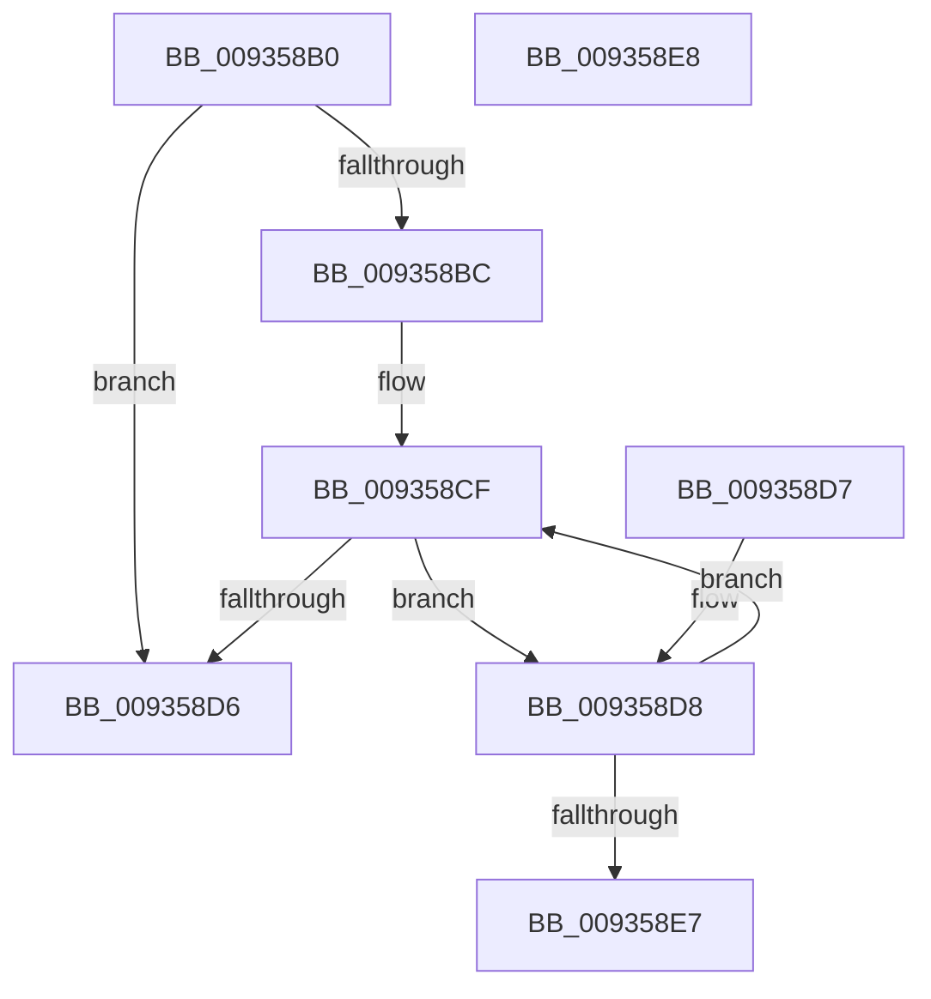

# VrpStripTrailingCharacters

- RVA: `0x009358B0`–`0x009358E9` (길이 `57` bytes)
- VA: `0x00000001409358B0`
- 실행 섹션: `PAGE`
- PDB 이름 있음: `예`; PDB Function 태그: `아니요`
- unwind 정보 RVA: `0x000DB714`
- 디코드: `21`개 명령, `57/57` bytes 표시
- 미해석 바이트: `0` (있으면 어셈블리에 `.byte`로 보존)

> 이 문서는 커널 이미지의 기계어와 PDB 기호를 분석해 생성했습니다. 4번과 5번은 함수 원형과 자료형을 바이너리 사용 방식에서 추정한 C 해석이며 원본 소스 복구 결과는 아닙니다.

## 1. Dependencies

- 직접 호출 지점: **0**; 고유 호출 대상: **0**
- 직접 호출자로 확인된 함수: **2**
- RIP 상대 이미지 참조: **0**

### Outgoing calls
- 직접 디코드된 call 명령이 없습니다.

### Direct callers
- [VrpCreateNamespaceNode](VrpCreateNamespaceNode_function_00935538.md) at `0x0093559C`
- [VrpCreateNamespaceNode](VrpCreateNamespaceNode_function_00935538.md) at `0x009355A4`
- [sub_00B4588A](../B4/Unknown_function_00B4588A.md) at `0x00B45A03`

### Static image references
- 디코드된 RIP-relative 메모리 참조가 없습니다.

## 2. Other-region calls and transfers

- 다른 실행 섹션으로 향하는 call: **0**
- 별도 외부 분기/꼬리 이동을 확인하지 못했습니다.

## 3. Assembly (complete function range)

```asm
009358B0  0F B7 11                        movzx edx, word ptr [rcx]
009358B3  8B C2                           mov eax, edx
009358B5  D1 E8                           shr eax, 1
009358B7  83 F8 01                        cmp eax, 1
009358BA  72 1A                           jb 0x1409358d6
009358BC  44 8B C0                        mov r8d, eax
009358BF  48 8B 41 08                     mov rax, qword ptr [rcx + 8]
009358C3  49 FF C8                        dec r8
009358C6  4E 8D 0C 40                     lea r9, [rax + r8*2]
009358CA  B8 02 00 00 00                  mov eax, 2
009358CF  66 41 83 39 5C                  cmp word ptr [r9], 0x5c
009358D4  74 02                           je 0x1409358d8
009358D6  C3                              ret
009358D7  CC                              int3
009358D8  66 2B D0                        sub dx, ax
009358DB  4C 2B C8                        sub r9, rax
009358DE  49 83 E8 01                     sub r8, 1
009358E2  66 89 11                        mov word ptr [rcx], dx
009358E5  79 E8                           jns 0x1409358cf
009358E7  C3                              ret
009358E8  CC                              int3
```

## 4. C-style interpretation (structured pseudocode)

```c
__int64 __fastcall VrpStripTrailingCharacters(__int64 a1)
{
    __int64 result;

    result = (unsigned int)(((unsigned int)((unsigned int)(*(unsigned __int16 *)(a1)))) >> (1));
    if (((unsigned int)(result)) < 1) goto loc_009358D6;
    a3 = ((unsigned int)((unsigned int)(result))) - 1;
loc_009358CF:
    if ((*(unsigned __int16 *)(*(unsigned __int64 *)(a1 + 8) + a3 * 2)) == 92) goto loc_009358D8;
loc_009358D6:
    return 2;
loc_009358D8:
    a2 = (unsigned __int16)((*(unsigned __int16 *)(a1)) - (2));
    a4 = (*(unsigned __int64 *)(a1 + 8) + a3 * 2) - (2);
    a3 = (a3) - (1);
    *(unsigned __int16 *)(a1) = (unsigned __int16)(a2);
    if (!sign_flag) goto loc_009358CF;
    return 2;
}
```

## 5. (Beta) C Style

```c
int64_t VrpStripTrailingCharacters(void *Arg1)
{
    uint8_t *arg1 = (uint8_t *)Arg1;

    int64_t result;

    result = (uint32_t)(((uint32_t)((uint32_t)(*(uint16_t *)(arg1)))) >> (1));
    if (((uint32_t)(result)) < 1) goto loc_009358D6;
    a3 = ((uint32_t)((uint32_t)(result))) - 1;
loc_009358CF:
    if ((*(uint16_t *)(*(uint64_t *)(arg1 + 0x8) + a3 * 2)) == 92) goto loc_009358D8;
loc_009358D6:
    return 2;
loc_009358D8:
    a2 = (uint16_t)((*(uint16_t *)(arg1)) - (2));
    a4 = (*(uint64_t *)(arg1 + 0x8) + a3 * 2) - (2);
    a3 = (a3) - (1);
    *(uint16_t *)(arg1) = (uint16_t)(a2);
    if (!sign_flag) goto loc_009358CF;
    return 2;
}
```

### 관측된 메모리 오프셋

구조체 형식이 확인되지 않은 접근은 인자 기준의 오프셋으로만 기록했습니다.

| 기준 인자 | 오프셋 표현 | 폭 (bit) | 접근 |
|---|---:|---:|---|
| `Arg1` | `+ 0x0` | `16` | `R` |
| `Arg1` | `+ 0x0` | `16` | `W` |
| `Arg1` | `+ 0x8` | `64` | `R` |

## 6. Execution-region graph

[열기: 2D/3D 그래프와 함수 탐색 컨트롤 패널](../../../control-panel.html?section=page&rva=0x009358B0&view=graph)

- 2D 그래프는 위에서 아래로 흐르고, 3D 그래프는 빈 공간을 드래그해 회전합니다. Shift+드래그는 이동, 휠은 확대·축소, 함수 노드 선택은 대상 보고서 이동입니다.

### Static fallback


