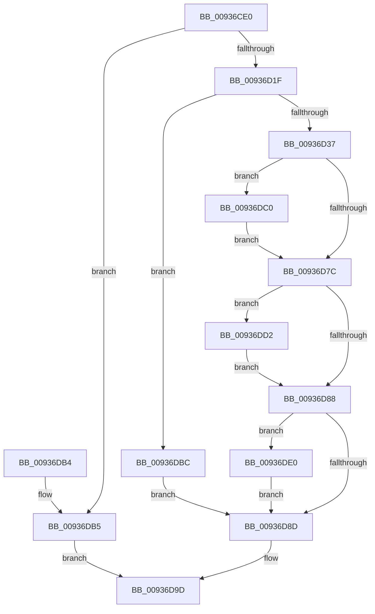

# VrpUnloadDifferencingHive

- RVA: `0x00936CE0`–`0x00936DEA` (길이 `266` bytes)
- VA: `0x0000000140936CE0`
- 실행 섹션: `PAGE`
- PDB 이름 있음: `예`; PDB Function 태그: `아니요`
- unwind 정보 RVA: `0x0008F420`
- 디코드: `74`개 명령, `266/266` bytes 표시
- 미해석 바이트: `0` (있으면 어셈블리에 `.byte`로 보존)

> 이 문서는 커널 이미지의 기계어와 PDB 기호를 분석해 생성했습니다. 4번과 5번은 함수 원형과 자료형을 바이너리 사용 방식에서 추정한 C 해석이며 원본 소스 복구 결과는 아닙니다.

## 1. Dependencies

- 직접 호출 지점: **12**; 고유 호출 대상: **10**
- 직접 호출자로 확인된 함수: **3**
- RIP 상대 이미지 참조: **0**

### Outgoing calls
- `0x00936D0E` → [VrpFindDiffHiveEntryForMountPoint](VrpFindDiffHiveEntryForMountPoint_function_00936DF0.md) (function, `0x00936DF0`)
- `0x00936D22` → [VrpLockDiffHiveEntry](VrpLockDiffHiveEntry_function_00936FAC.md) (function, `0x00936FAC`)
- `0x00936D2A` → [VrpDecrementDiffHiveEntryHardRefCount](VrpDecrementDiffHiveEntryHardRefCount_function_00937048.md) (function, `0x00937048`)
- `0x00936D3A` → [VrpBecomeDiffHiveEntryTransitionOwner](VrpBecomeDiffHiveEntryTransitionOwner_function_00937088.md) (function, `0x00937088`)
- `0x00936D49` → [VrpUnlockDiffHiveEntry](VrpUnlockDiffHiveEntry_function_0093700C.md) (function, `0x0093700C`)
- `0x00936D71` → [ZwUnloadKey](../../text/6B/ZwUnloadKey_function_006B0C30.md) (function, `0x006B0C30`)
- `0x00936D7F` → [VrpLockDiffHiveEntry](VrpLockDiffHiveEntry_function_00936FAC.md) (function, `0x00936FAC`)
- `0x00936D90` → [VrpUnlockDiffHiveEntry](VrpUnlockDiffHiveEntry_function_0093700C.md) (function, `0x0093700C`)
- `0x00936D98` → [VrpDereferenceDiffHiveEntry](VrpDereferenceDiffHiveEntry_function_0093644C.md) (function, `0x0093644C`)
- `0x00936DC9` → [ZwUnloadKey2](../../text/6B/ZwUnloadKey2_function_006B0C50.md) (function, `0x006B0C50`)
- `0x00936DD9` → [VrpIncrementDiffHiveEntryHardRefCount](VrpIncrementDiffHiveEntryHardRefCount_function_00936F74.md) (function, `0x00936F74`)
- `0x00936DE3` → [VrpRelinquishDiffHiveEntryTransitionOwner](VrpRelinquishDiffHiveEntryTransitionOwner_function_00936414.md) (function, `0x00936414`)

### Direct callers
- [VrpHandleIoctlUnloadDifferencingHiveForHost](../83/VrpHandleIoctlUnloadDifferencingHiveForHost_function_0083B7A4.md) at `0x0083B90B`
- [VrpHandleIoctlLoadDifferencingHive](VrpHandleIoctlLoadDifferencingHive_function_00935C5C.md) at `0x00935F28`
- [VrpCleanupNamespace](VrpCleanupNamespace_function_0093649C.md) at `0x009364E9`

### Static image references
- 디코드된 RIP-relative 메모리 참조가 없습니다.

## 2. Other-region calls and transfers

- 다른 실행 섹션으로 향하는 call: **2**
  - `0x00936D71` → [ZwUnloadKey](../../text/6B/ZwUnloadKey_function_006B0C30.md) (`PAGE` → `.text`)
  - `0x00936DC9` → [ZwUnloadKey2](../../text/6B/ZwUnloadKey2_function_006B0C50.md) (`PAGE` → `.text`)
- 별도 외부 분기/꼬리 이동을 확인하지 못했습니다.

## 3. Assembly (complete function range)

```asm
00936CE0  48 89 5C 24 08                  mov qword ptr [rsp + 8], rbx
00936CE5  48 89 74 24 10                  mov qword ptr [rsp + 0x10], rsi
00936CEA  48 89 7C 24 18                  mov qword ptr [rsp + 0x18], rdi
00936CEF  55                              push rbp
00936CF0  48 8B EC                        mov rbp, rsp
00936CF3  48 83 EC 50                     sub rsp, 0x50
00936CF7  33 C0                           xor eax, eax
00936CF9  0F 57 C0                        xorps xmm0, xmm0
00936CFC  0F 11 45 D0                     movups xmmword ptr [rbp - 0x30], xmm0
00936D00  48 89 45 F0                     mov qword ptr [rbp - 0x10], rax
00936D04  48 8B F9                        mov rdi, rcx
00936D07  0F 11 45 E0                     movups xmmword ptr [rbp - 0x20], xmm0
00936D0B  89 45 F8                        mov dword ptr [rbp - 8], eax
00936D0E  E8 DD 00 00 00                  call 0x140936df0
00936D13  48 8B D8                        mov rbx, rax
00936D16  48 85 C0                        test rax, rax
00936D19  0F 84 96 00 00 00               je 0x140936db5
00936D1F  48 8B C8                        mov rcx, rax
00936D22  E8 85 02 00 00                  call 0x140936fac
00936D27  48 8B CB                        mov rcx, rbx
00936D2A  E8 19 03 00 00                  call 0x140937048
00936D2F  84 C0                           test al, al
00936D31  0F 84 85 00 00 00               je 0x140936dbc
00936D37  48 8B CB                        mov rcx, rbx
00936D3A  E8 49 03 00 00                  call 0x140937088
00936D3F  83 63 38 FE                     and dword ptr [rbx + 0x38], 0xfffffffe
00936D43  48 8B CB                        mov rcx, rbx
00936D46  40 8A F0                        mov sil, al
00936D49  E8 BE 02 00 00                  call 0x14093700c
00936D4E  48 83 65 D8 00                  and qword ptr [rbp - 0x28], 0
00936D53  48 8D 4D D0                     lea rcx, [rbp - 0x30]
00936D57  0F 57 C0                        xorps xmm0, xmm0
00936D5A  C7 45 D0 30 00 00 00            mov dword ptr [rbp - 0x30], 0x30
00936D61  F3 0F 7F 45 F0                  movdqu xmmword ptr [rbp - 0x10], xmm0
00936D66  C7 45 E8 40 02 00 00            mov dword ptr [rbp - 0x18], 0x240
00936D6D  48 89 7D E0                     mov qword ptr [rbp - 0x20], rdi
00936D71  E8 BA 9E D7 FF                  call 0x1406b0c30
00936D76  8B F8                           mov edi, eax
00936D78  85 C0                           test eax, eax
00936D7A  78 44                           js 0x140936dc0
00936D7C  48 8B CB                        mov rcx, rbx
00936D7F  E8 28 02 00 00                  call 0x140936fac
00936D84  85 FF                           test edi, edi
00936D86  78 4A                           js 0x140936dd2
00936D88  40 84 F6                        test sil, sil
00936D8B  75 53                           jne 0x140936de0
00936D8D  48 8B CB                        mov rcx, rbx
00936D90  E8 77 02 00 00                  call 0x14093700c
00936D95  48 8B CB                        mov rcx, rbx
00936D98  E8 AF F6 FF FF                  call 0x14093644c
00936D9D  48 8B 5C 24 60                  mov rbx, qword ptr [rsp + 0x60]
00936DA2  8B C7                           mov eax, edi
00936DA4  48 8B 7C 24 70                  mov rdi, qword ptr [rsp + 0x70]
00936DA9  48 8B 74 24 68                  mov rsi, qword ptr [rsp + 0x68]
00936DAE  48 83 C4 50                     add rsp, 0x50
00936DB2  5D                              pop rbp
00936DB3  C3                              ret
00936DB4  CC                              int3
00936DB5  BF 34 00 00 C0                  mov edi, 0xc0000034
00936DBA  EB E1                           jmp 0x140936d9d
00936DBC  33 FF                           xor edi, edi
00936DBE  EB CD                           jmp 0x140936d8d
00936DC0  BA 01 00 00 00                  mov edx, 1
00936DC5  48 8D 4D D0                     lea rcx, [rbp - 0x30]
00936DC9  E8 82 9E D7 FF                  call 0x1406b0c50
00936DCE  8B F8                           mov edi, eax
00936DD0  EB AA                           jmp 0x140936d7c
00936DD2  83 4B 38 01                     or dword ptr [rbx + 0x38], 1
00936DD6  48 8B CB                        mov rcx, rbx
00936DD9  E8 96 01 00 00                  call 0x140936f74
00936DDE  EB A8                           jmp 0x140936d88
00936DE0  48 8B CB                        mov rcx, rbx
00936DE3  E8 2C F6 FF FF                  call 0x140936414
00936DE8  EB A3                           jmp 0x140936d8d
```

## 4. C-style interpretation (structured pseudocode)

```c
__int64 __fastcall VrpUnloadDifferencingHive(__int64 a1)
{
    __int64 result;
    __int64 v_rdi;
    __int64 v_rsp;
    unsigned int v_stack_m10;
    unsigned __int64 v_stack_m18;
    unsigned int v_stack_m20;
    unsigned __int64 v_stack_m28;
    unsigned __int64 v_stack_m30;
    unsigned __int64 v_stack_m38;
    unsigned __int64 v_stack_p10;
    unsigned __int64 v_stack_p18;
    unsigned __int64 v_stack_p8;

    v_stack_p8 = v_rbx;
    v_stack_p10 = v_rsi;
    v_stack_p18 = v_rdi;
    v_rsp = (v_rsp) - (80);
    result = 0;
    v_stack_m38 = v_xmm0;
    v_stack_m18 = 0;
    v_stack_m28 = v_xmm0;
    v_stack_m10 = 0;
    result = VrpFindDiffHiveEntryForMountPoint(a1, a2, a3, a4);
    if (result == 0) goto loc_00936DB5;
    result = VrpLockDiffHiveEntry(result, a2, a3, a4);
    result = VrpDecrementDiffHiveEntryHardRefCount(result, a2, a3, a4);
    if ((unsigned __int8)(result) == 0) goto loc_00936DBC;
    result = VrpBecomeDiffHiveEntryTransitionOwner(result, a2, a3, a4);
    result = VrpUnlockDiffHiveEntry(result, a2, a3, a4);
    v_stack_m38 = 48;
    v_stack_m18 = v_xmm0;
    v_stack_m20 = 576;
    v_stack_m28 = a1;
    result = ZwUnloadKey(v_stack_m38, a2, a3, a4);
    if (sign_flag) goto loc_00936DC0;
loc_00936D7C:
    result = VrpLockDiffHiveEntry(result, a2, a3, a4);
    if (sign_flag) goto loc_00936DD2;
loc_00936D88:
    if ((unsigned __int8)((unsigned __int8)(result)) != 0) goto loc_00936DE0;
loc_00936D8D:
    result = VrpUnlockDiffHiveEntry(result, a2, a3, a4);
    result = VrpDereferenceDiffHiveEntry(result, a2, a3, a4);
loc_00936D9D:
    v_rsp = (v_rsp) + (80);
    return (unsigned int)((unsigned int)((unsigned int)((unsigned int)(result))));
loc_00936DB5:
    goto loc_00936D9D;
loc_00936DBC:
    v_rdi = 0;
    goto loc_00936D8D;
loc_00936DC0:
    result = ZwUnloadKey2(v_stack_m38, 1, a3, a4);
    goto loc_00936D7C;
loc_00936DD2:
    result = VrpIncrementDiffHiveEntryHardRefCount(v_stack_p8, 1, a3, a4);
    goto loc_00936D88;
loc_00936DE0:
    result = VrpRelinquishDiffHiveEntryTransitionOwner(v_stack_p8, 1, a3, a4);
    goto loc_00936D8D;
}
```

## 5. (Beta) C Style

```c
int64_t VrpUnloadDifferencingHive(int64_t Arg1)
{
    int64_t result;
    int64_t local_rdi;
    int64_t local_rsp;
    uint32_t v_stack_m10;
    uint64_t v_stack_m18;
    uint32_t v_stack_m20;
    uint64_t v_stack_m28;
    uint64_t v_stack_m30;
    uint64_t v_stack_m38;
    uint64_t v_stack_p10;
    uint64_t v_stack_p18;
    uint64_t v_stack_p8;

    v_stack_p8 = local_rbx;
    v_stack_p10 = local_rsi;
    v_stack_p18 = local_rdi;
    local_rsp = (local_rsp) - (80);
    result = 0;
    v_stack_m38 = v_xmm0;
    v_stack_m18 = 0;
    v_stack_m28 = v_xmm0;
    v_stack_m10 = 0;
    result = VrpFindDiffHiveEntryForMountPoint(Arg1, a2, a3, a4);
    if (result == 0) goto loc_00936DB5;
    result = VrpLockDiffHiveEntry(result, a2, a3, a4);
    result = VrpDecrementDiffHiveEntryHardRefCount(result, a2, a3, a4);
    if ((uint8_t)(result) == 0) goto loc_00936DBC;
    result = VrpBecomeDiffHiveEntryTransitionOwner(result, a2, a3, a4);
    result = VrpUnlockDiffHiveEntry(result, a2, a3, a4);
    v_stack_m38 = 48;
    v_stack_m18 = v_xmm0;
    v_stack_m20 = 576;
    v_stack_m28 = Arg1;
    result = ZwUnloadKey(v_stack_m38, a2, a3, a4);
    if (sign_flag) goto loc_00936DC0;
loc_00936D7C:
    result = VrpLockDiffHiveEntry(result, a2, a3, a4);
    if (sign_flag) goto loc_00936DD2;
loc_00936D88:
    if ((uint8_t)((uint8_t)(result)) != 0) goto loc_00936DE0;
loc_00936D8D:
    result = VrpUnlockDiffHiveEntry(result, a2, a3, a4);
    result = VrpDereferenceDiffHiveEntry(result, a2, a3, a4);
loc_00936D9D:
    local_rsp = (local_rsp) + (80);
    return (uint32_t)((uint32_t)((uint32_t)((uint32_t)(result))));
loc_00936DB5:
    goto loc_00936D9D;
loc_00936DBC:
    local_rdi = 0;
    goto loc_00936D8D;
loc_00936DC0:
    result = ZwUnloadKey2(v_stack_m38, 1, a3, a4);
    goto loc_00936D7C;
loc_00936DD2:
    result = VrpIncrementDiffHiveEntryHardRefCount(v_stack_p8, 1, a3, a4);
    goto loc_00936D88;
loc_00936DE0:
    result = VrpRelinquishDiffHiveEntryTransitionOwner(v_stack_p8, 1, a3, a4);
    goto loc_00936D8D;
}
```

## 6. Execution-region graph

[열기: 2D/3D 그래프와 함수 탐색 컨트롤 패널](../../../control-panel.html?section=page&rva=0x00936CE0&view=graph)

- 2D 그래프는 위에서 아래로 흐르고, 3D 그래프는 빈 공간을 드래그해 회전합니다. Shift+드래그는 이동, 휠은 확대·축소, 함수 노드 선택은 대상 보고서 이동입니다.

### Static fallback


