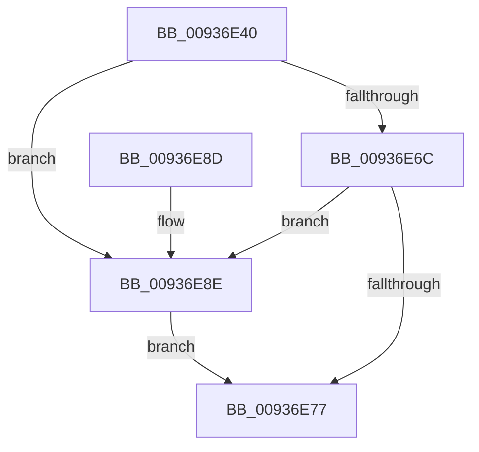

# VrpUnlockDiffHiveTable

- RVA: `0x00936E40`–`0x00936E9C` (길이 `92` bytes)
- VA: `0x0000000140936E40`
- 실행 섹션: `PAGE`
- PDB 이름 있음: `예`; PDB Function 태그: `아니요`
- unwind 정보 RVA: `0x00064C74`
- 디코드: `22`개 명령, `92/92` bytes 표시
- 미해석 바이트: `0` (있으면 어셈블리에 `.byte`로 보존)

> 이 문서는 커널 이미지의 기계어와 PDB 기호를 분석해 생성했습니다. 4번과 5번은 함수 원형과 자료형을 바이너리 사용 방식에서 추정한 C 해석이며 원본 소스 복구 결과는 아닙니다.

## 1. Dependencies

- 직접 호출 지점: **3**; 고유 호출 대상: **3**
- 직접 호출자로 확인된 함수: **3**
- RIP 상대 이미지 참조: **1**

### Outgoing calls
- `0x00936E7E` → [KeAbPostRelease](../../text/2E/KeAbPostRelease_function_002E1600.md) (function, `0x002E1600`)
- `0x00936E83` → [KeLeaveCriticalRegion](../../text/25/KeLeaveCriticalRegion_function_0025D8B0.md) (function, `0x0025D8B0`)
- `0x00936E95` → [ExfReleasePushLock](../../text/26/ExfReleasePushLock_function_002638D0.md) (function, `0x002638D0`)

### Direct callers
- [VrpFindOrCreateDiffHiveEntryForMountPoint](VrpFindOrCreateDiffHiveEntryForMountPoint_function_00936290.md) at `0x009362C4`
- [VrpFindOrCreateDiffHiveEntryForMountPoint](VrpFindOrCreateDiffHiveEntryForMountPoint_function_00936290.md) at `0x00936315`
- [VrpDereferenceDiffHiveEntry](VrpDereferenceDiffHiveEntry_function_0093644C.md) at `0x00936484`
- [VrpFindDiffHiveEntryForMountPoint](VrpFindDiffHiveEntryForMountPoint_function_00936DF0.md) at `0x00936E22`

### Static image references
- `0x00936E44` → RVA `0x00EF02B0` (`.data`; read)

## 2. Other-region calls and transfers

- 다른 실행 섹션으로 향하는 call: **3**
  - `0x00936E7E` → [KeAbPostRelease](../../text/2E/KeAbPostRelease_function_002E1600.md) (`PAGE` → `.text`)
  - `0x00936E83` → [KeLeaveCriticalRegion](../../text/25/KeLeaveCriticalRegion_function_0025D8B0.md) (`PAGE` → `.text`)
  - `0x00936E95` → [ExfReleasePushLock](../../text/26/ExfReleasePushLock_function_002638D0.md) (`PAGE` → `.text`)
- 별도 외부 분기/꼬리 이동을 확인하지 못했습니다.

## 3. Assembly (complete function range)

```asm
00936E40  48 83 EC 28                     sub rsp, 0x28
00936E44  0F 0D 0D 65 94 5B 00            prefetchw byte ptr [rip + 0x5b9465]
00936E4B  48 8B 05 5E 94 5B 00            mov rax, qword ptr [rip + 0x5b945e]
00936E52  45 33 C0                        xor r8d, r8d
00936E55  48 8B C8                        mov rcx, rax
00936E58  48 83 E1 F0                     and rcx, 0xfffffffffffffff0
00936E5C  48 83 F9 10                     cmp rcx, 0x10
00936E60  48 8D 50 F0                     lea rdx, [rax - 0x10]
00936E64  49 0F 46 D0                     cmovbe rdx, r8
00936E68  A8 02                           test al, 2
00936E6A  75 22                           jne 0x140936e8e
00936E6C  F0 48 0F B1 15 3B 94 5B 00      lock cmpxchg qword ptr [rip + 0x5b943b], rdx
00936E75  75 17                           jne 0x140936e8e
00936E77  48 8D 0D 32 94 5B 00            lea rcx, [rip + 0x5b9432]
00936E7E  E8 7D A7 9A FF                  call 0x1402e1600
00936E83  E8 28 6A 92 FF                  call 0x14025d8b0
00936E88  48 83 C4 28                     add rsp, 0x28
00936E8C  C3                              ret
00936E8D  CC                              int3
00936E8E  48 8D 0D 1B 94 5B 00            lea rcx, [rip + 0x5b941b]
00936E95  E8 36 CA 92 FF                  call 0x1402638d0
00936E9A  EB DB                           jmp 0x140936e77
```

## 4. C-style interpretation (structured pseudocode)

```c
__int64 __fastcall VrpUnlockDiffHiveTable(__int64 a1, __int64 a2, int a3)
{
    __int64 result;
    __int64 v_rsp;

    v_rsp = (v_rsp) - (40);
    a3 = 0;
    a1 = (*(unsigned __int64 *)(v_rip + 6001758)) & (-16);
    a2 = *(unsigned __int64 *)(v_rip + 6001758) - 16;
    if (a1 <= 16) { a2 = 0; }
    if ((((unsigned __int8)(*(unsigned __int64 *)(v_rip + 6001758))) & (2)) != 0) goto loc_00936E8E;
    if ((((unsigned __int8)(*(unsigned __int64 *)(v_rip + 6001758))) & (2)) != 0) goto loc_00936E8E;
loc_00936E77:
    result = KeAbPostRelease(v_rip + 6001714, a2, a3, a4);
    result = KeLeaveCriticalRegion(v_rip + 6001714, a2, a3, a4);
    v_rsp = (v_rsp) + (40);
    return result;
loc_00936E8E:
    result = ExfReleasePushLock(v_rip + 6001691, a2, a3, a4);
    goto loc_00936E77;
}
```

## 5. (Beta) C Style

```c
int64_t VrpUnlockDiffHiveTable(int64_t Arg1, int64_t Arg2, int32_t Arg3)
{
    int64_t result;
    int64_t local_rsp;

    local_rsp = (local_rsp) - (40);
    Arg3 = 0;
    Arg1 = (*(uint64_t *)(v_rip + 0x5B945E)) & (-16);
    Arg2 = *(uint64_t *)(v_rip + 0x5B945E) - 16;
    if (Arg1 <= 16) { Arg2 = 0; }
    if ((((uint8_t)(*(uint64_t *)(v_rip + 0x5B945E))) & (2)) != 0) goto loc_00936E8E;
    if ((((uint8_t)(*(uint64_t *)(v_rip + 0x5B945E))) & (2)) != 0) goto loc_00936E8E;
loc_00936E77:
    result = KeAbPostRelease(v_rip + 6001714, Arg2, Arg3, a4);
    result = KeLeaveCriticalRegion(v_rip + 6001714, Arg2, Arg3, a4);
    local_rsp = (local_rsp) + (40);
    return result;
loc_00936E8E:
    result = ExfReleasePushLock(v_rip + 6001691, Arg2, Arg3, a4);
    goto loc_00936E77;
}
```

## 6. Execution-region graph

[열기: 2D/3D 그래프와 함수 탐색 컨트롤 패널](../../../control-panel.html?section=page&rva=0x00936E40&view=graph)

- 2D 그래프는 위에서 아래로 흐르고, 3D 그래프는 빈 공간을 드래그해 회전합니다. Shift+드래그는 이동, 휠은 확대·축소, 함수 노드 선택은 대상 보고서 이동입니다.

### Static fallback


