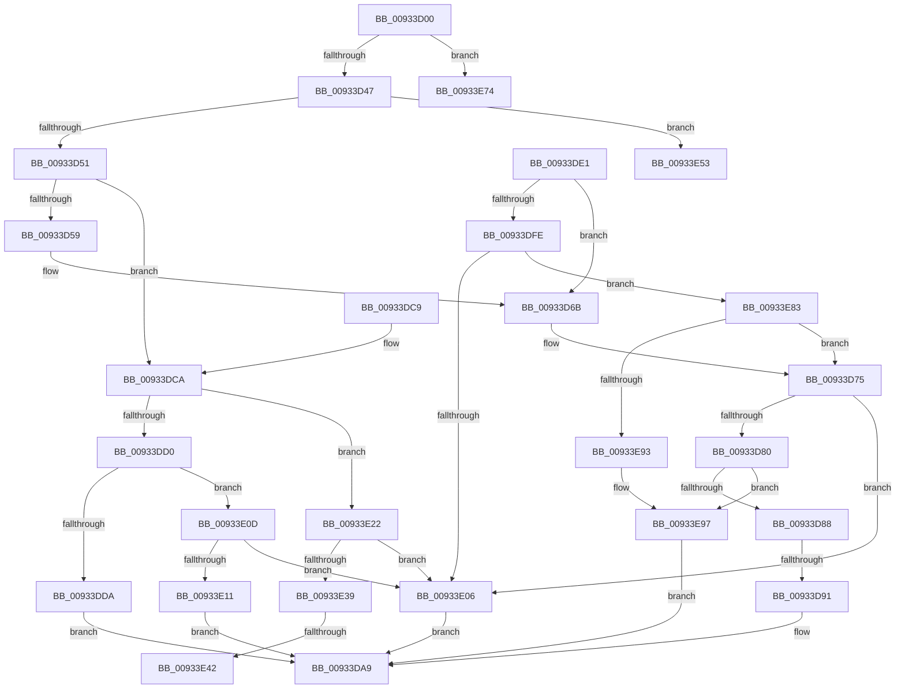

# VrpUpdateKeyInformation

- RVA: `0x00933D00`–`0x00933EA1` (길이 `417` bytes)
- VA: `0x0000000140933D00`
- 실행 섹션: `PAGE`
- PDB 이름 있음: `예`; PDB Function 태그: `예`
- unwind 정보 RVA: `0x0008F084`
- 디코드: `117`개 명령, `417/417` bytes 표시
- 미해석 바이트: `0` (있으면 어셈블리에 `.byte`로 보존)

> 이 문서는 커널 이미지의 기계어와 PDB 기호를 분석해 생성했습니다. 4번과 5번은 함수 원형과 자료형을 바이너리 사용 방식에서 추정한 C 해석이며 원본 소스 복구 결과는 아닙니다.

## 1. Dependencies

- 직접 호출 지점: **1**; 고유 호출 대상: **1**
- 직접 호출자로 확인된 함수: **2**
- RIP 상대 이미지 참조: **0**

### Outgoing calls
- `0x00933D9C` → [memcpy](../../text/6C/memcpy_function_006C6840.md) (function, `0x006C6840`)

### Direct callers
- [VrpPostQueryKey](VrpPostQueryKey_function_009338F0.md) at `0x00933ACC`
- [sub_00B246DA](../B2/Unknown_function_00B246DA.md) at `0x00B2484D`

### Static image references
- 디코드된 RIP-relative 메모리 참조가 없습니다.

## 2. Other-region calls and transfers

- 다른 실행 섹션으로 향하는 call: **1**
  - `0x00933D9C` → [memcpy](../../text/6C/memcpy_function_006C6840.md) (`PAGE` → `.text`)
- call이 아닌 외부 분기/꼬리 이동: **5**
  - `0x00933D8B` → [sub_00B245EE + 0x88](../B2/Unknown_function_00B245EE.md) (`tail-transfer`)
  - `0x00933E3C` → [sub_00B245EE + 0x10](../B2/Unknown_function_00B245EE.md) (`tail-transfer`)
  - `0x00933E4E` → [sub_00B245EE](../B2/Unknown_function_00B245EE.md) (`tail-transfer`)
  - `0x00933E6F` → [sub_00B245EE + 0x21](../B2/Unknown_function_00B245EE.md) (`tail-transfer`)
  - `0x00933E7E` → [sub_00B245EE + 0x21](../B2/Unknown_function_00B245EE.md) (`tail-transfer`)

## 3. Assembly (complete function range)

```asm
00933D00  48 8B C4                        mov rax, rsp
00933D03  48 89 58 08                     mov qword ptr [rax + 8], rbx
00933D07  48 89 68 10                     mov qword ptr [rax + 0x10], rbp
00933D0B  48 89 70 18                     mov qword ptr [rax + 0x18], rsi
00933D0F  57                              push rdi
00933D10  41 54                           push r12
00933D12  41 55                           push r13
00933D14  41 56                           push r14
00933D16  41 57                           push r15
00933D18  48 83 EC 40                     sub rsp, 0x40
00933D1C  33 F6                           xor esi, esi
00933D1E  0F 57 C0                        xorps xmm0, xmm0
00933D21  48 89 74 24 28                  mov qword ptr [rsp + 0x28], rsi
00933D26  41 8B E8                        mov ebp, r8d
00933D29  48 89 74 24 20                  mov qword ptr [rsp + 0x20], rsi
00933D2E  4C 8B F2                        mov r14, rdx
00933D31  8B D9                           mov ebx, ecx
00933D33  44 8B DE                        mov r11d, esi
00933D36  8B FE                           mov edi, esi
00933D38  44 8B D1                        mov r10d, ecx
00933D3B  0F 11 40 C8                     movups xmmword ptr [rax - 0x38], xmm0
00933D3F  85 C9                           test ecx, ecx
00933D41  0F 84 2D 01 00 00               je 0x140933e74
00933D47  41 83 EA 01                     sub r10d, 1
00933D4B  0F 84 02 01 00 00               je 0x140933e53
00933D51  8D 56 02                        lea edx, [rsi + 2]
00933D54  44 2B D2                        sub r10d, edx
00933D57  75 71                           jne 0x140933dca
00933D59  4C 8B BC 24 90 00 00 00         mov r15, qword ptr [rsp + 0x90]
00933D61  4D 8D 66 04                     lea r12, [r14 + 4]
00933D65  4D 8B EE                        mov r13, r14
00933D68  8D 4E 04                        lea ecx, [rsi + 4]
00933D6B  41 0F B7 17                     movzx edx, word ptr [r15]
00933D6F  41 2B D6                        sub edx, r14d
00933D72  41 03 D4                        add edx, r12d
00933D75  41 89 11                        mov dword ptr [r9], edx
00933D78  3B E9                           cmp ebp, ecx
00933D7A  0F 82 86 00 00 00               jb 0x140933e06
00933D80  3B EA                           cmp ebp, edx
00933D82  0F 82 0F 01 00 00               jb 0x140933e97
00933D88  4D 85 DB                        test r11, r11
00933D8B  0F 85 E5 08 1F 00               jne 0x140b24676
00933D91  45 0F B7 07                     movzx r8d, word ptr [r15]
00933D95  49 8B CC                        mov rcx, r12
00933D98  49 8B 57 08                     mov rdx, qword ptr [r15 + 8]
00933D9C  E8 9F 2A D9 FF                  call 0x1406c6840
00933DA1  41 0F B7 0F                     movzx ecx, word ptr [r15]
00933DA5  41 89 4D 00                     mov dword ptr [r13], ecx
00933DA9  4C 8D 5C 24 40                  lea r11, [rsp + 0x40]
00933DAE  8B C6                           mov eax, esi
00933DB0  49 8B 5B 30                     mov rbx, qword ptr [r11 + 0x30]
00933DB4  49 8B 6B 38                     mov rbp, qword ptr [r11 + 0x38]
00933DB8  49 8B 73 40                     mov rsi, qword ptr [r11 + 0x40]
00933DBC  49 8B E3                        mov rsp, r11
00933DBF  41 5F                           pop r15
00933DC1  41 5E                           pop r14
00933DC3  41 5D                           pop r13
00933DC5  41 5C                           pop r12
00933DC7  5F                              pop rdi
00933DC8  C3                              ret
00933DC9  CC                              int3
00933DCA  41 83 EA 01                     sub r10d, 1
00933DCE  74 52                           je 0x140933e22
00933DD0  B9 04 00 00 00                  mov ecx, 4
00933DD5  44 3B D1                        cmp r10d, ecx
00933DD8  74 33                           je 0x140933e0d
00933DDA  BE 0D 00 00 C0                  mov esi, 0xc000000d
00933DDF  EB C8                           jmp 0x140933da9
00933DE1  66 44 89 54 24 32               mov word ptr [rsp + 0x32], r10w
00933DE7  4B 8D 04 47                     lea rax, [r15 + r8*2]
00933DEB  48 89 44 24 38                  mov qword ptr [rsp + 0x38], rax
00933DF0  4C 8D 7C 24 30                  lea r15, [rsp + 0x30]
00933DF5  83 FB 01                        cmp ebx, 1
00933DF8  0F 85 6D FF FF FF               jne 0x140933d6b
00933DFE  45 8B 01                        mov r8d, dword ptr [r9]
00933E01  44 3B C1                        cmp r8d, ecx
00933E04  73 7D                           jae 0x140933e83
00933E06  BE 23 00 00 C0                  mov esi, 0xc0000023
00933E0B  EB 9C                           jmp 0x140933da9
00933E0D  3B E9                           cmp ebp, ecx
00933E0F  72 F5                           jb 0x140933e06
00933E11  8B 84 24 98 00 00 00            mov eax, dword ptr [rsp + 0x98]
00933E18  D1 E8                           shr eax, 1
00933E1A  83 E0 01                        and eax, 1
00933E1D  41 89 06                        mov dword ptr [r14], eax
00933E20  EB 87                           jmp 0x140933da9
00933E22  48 8B 84 24 90 00 00 00         mov rax, qword ptr [rsp + 0x90]
00933E2A  44 0F B7 08                     movzx r9d, word ptr [rax]
00933E2E  41 8B C9                        mov ecx, r9d
00933E31  48 D1 E9                        shr rcx, 1
00933E34  83 FD 28                        cmp ebp, 0x28
00933E37  72 CD                           jb 0x140933e06
00933E39  48 85 C9                        test rcx, rcx
00933E3C  0F 84 BC 07 1F 00               je 0x140b245fe
00933E42  4C 8B 40 08                     mov r8, qword ptr [rax + 8]
00933E46  49 83 C0 FE                     add r8, -2
00933E4A  4D 8D 04 48                     lea r8, [r8 + rcx*2]
00933E4E  E9 9B 07 1F 00                  jmp 0x140b245ee
00933E53  B9 18 00 00 00                  mov ecx, 0x18
00933E58  4C 8D 5A 0C                     lea r11, [rdx + 0xc]
00933E5C  48 8D 7A 10                     lea rdi, [rdx + 0x10]
00933E60  4C 89 5C 24 28                  mov qword ptr [rsp + 0x28], r11
00933E65  48 89 7C 24 20                  mov qword ptr [rsp + 0x20], rdi
00933E6A  8B C1                           mov eax, ecx
00933E6C  8D 51 FC                        lea edx, [rcx - 4]
00933E6F  E9 9B 07 1F 00                  jmp 0x140b2460f
00933E74  B8 10 00 00 00                  mov eax, 0x10
00933E79  8B C8                           mov ecx, eax
00933E7B  8D 50 FC                        lea edx, [rax - 4]
00933E7E  E9 8C 07 1F 00                  jmp 0x140b2460f
00933E83  41 0F B7 D2                     movzx edx, r10w
00933E87  41 03 D0                        add edx, r8d
00933E8A  41 3B D0                        cmp edx, r8d
00933E8D  0F 83 E2 FE FF FF               jae 0x140933d75
00933E93  41 83 09 FF                     or dword ptr [r9], 0xffffffff
00933E97  BE 05 00 00 80                  mov esi, 0x80000005
00933E9C  E9 08 FF FF FF                  jmp 0x140933da9
```

## 4. C-style interpretation (structured pseudocode)

```c
__int64 __fastcall VrpUpdateKeyInformation(int a1, __int64 a2, int a3, __int64 a4, __int64 a5, unsigned int a6)
{
    __int64 result;
    __int64 v_r10;
    __int64 v_rsi;
    __int64 v_rsp;
    unsigned __int64 v_stack_m10;
    unsigned __int64 v_stack_m18;
    unsigned __int64 v_stack_m20;
    unsigned __int64 v_stack_m28;
    unsigned __int64 v_stack_m40;
    unsigned __int64 v_stack_m48;
    unsigned __int64 v_stack_m8;
    unsigned __int16 v_stack_mE;

    *(unsigned __int64 *)(v_rsp + 8) = v_rbx;
    *(unsigned __int64 *)(v_rsp + 16) = v_rbp;
    *(unsigned __int64 *)(v_rsp + 24) = v_rsi;
    v_rsp = (v_rsp) - (64);
    v_rsi = 0;
    v_stack_m40 = 0;
    v_stack_m48 = 0;
    *(unsigned __int64 *)(v_rsp - 56) = v_xmm0;
    if (a1 == 0) goto loc_00933E74;
    v_r10 = (unsigned int)(((unsigned int)(a1)) - (1));
    if (condition_is_equal) goto loc_00933E53;
    v_r10 = (unsigned int)((v_r10) - ((unsigned int)(v_rsi + 2)));
    if (condition_is_not_equal) goto loc_00933DCA;
loc_00933D6B:
    a2 = (unsigned int)((*(unsigned __int16 *)(a5)) - ((unsigned int)(a2)));
    a2 = (unsigned int)((a2) + ((unsigned int)(a2 + 4)));
loc_00933D75:
    *(unsigned int *)(a4) = (unsigned int)(a2);
    if (((unsigned int)((unsigned int)(a3))) < ((unsigned int)(v_rsi + 4))) goto loc_00933E06;
    if (((unsigned int)((unsigned int)(a3))) < ((unsigned int)(a2))) goto loc_00933E97;
    result = memcpy(a2 + 4, *(unsigned __int64 *)(a5 + 8), *(unsigned __int16 *)(a5), a4);
    *(unsigned int *)(a2) = (unsigned int)(*(unsigned __int16 *)(a5));
loc_00933DA9:
    return 0;
loc_00933DCA:
    v_r10 = (unsigned int)((v_r10) - (1));
    if (condition_is_equal) goto loc_00933E22;
    if (((unsigned int)(v_r10)) == 4) goto loc_00933E0D;
    goto loc_00933DA9;
loc_00933E06:
    goto loc_00933DA9;
loc_00933E0D:
    if (((unsigned int)(*(unsigned __int64 *)(v_stack_m28 + 56))) < 4) goto loc_00933E06;
    result = (unsigned int)(((unsigned int)(a6)) >> (1));
    result = (unsigned int)((result) & (1));
    *(unsigned int *)(a2) = (unsigned int)(result);
    goto loc_00933DA9;
loc_00933E22:
    a1 = ((unsigned int)((unsigned int)(*(unsigned __int16 *)(a5)))) >> (1);
    if (((unsigned int)(*(unsigned __int64 *)(v_stack_m28 + 56))) < 40) goto loc_00933E06;
    a3 = (*(unsigned __int64 *)(a5 + 8)) + (-2);
loc_00933E53:
    v_stack_m18 = *(unsigned __int64 *)(a5 + 8) + 12;
    v_stack_m20 = *(unsigned __int64 *)(a5 + 8) + 16;
loc_00933E74:
loc_00933E97:
    goto loc_00933DA9;
}
```

## 5. (Beta) C Style

```c
int64_t VrpUpdateKeyInformation(int32_t Arg1, void *Arg2, int32_t Arg3, void *Arg4, void *Arg5, uint32_t Arg6)
{
    uint8_t *arg2 = (uint8_t *)Arg2;
    uint8_t *arg4 = (uint8_t *)Arg4;
    uint8_t *arg5 = (uint8_t *)Arg5;

    int64_t result;
    int64_t local_r10;
    int64_t local_rsi;
    int64_t local_rsp;
    uint64_t v_stack_m10;
    uint64_t v_stack_m18;
    uint64_t v_stack_m20;
    uint64_t v_stack_m28;
    uint64_t v_stack_m40;
    uint64_t v_stack_m48;
    uint64_t v_stack_m8;
    uint16_t v_stack_mE;

    *(uint64_t *)(local_rsp + 0x8) = local_rbx;
    *(uint64_t *)(local_rsp + 0x10) = local_rbp;
    *(uint64_t *)(local_rsp + 0x18) = local_rsi;
    local_rsp = (local_rsp) - (64);
    local_rsi = 0;
    v_stack_m40 = 0;
    v_stack_m48 = 0;
    *(uint64_t *)(local_rsp - 0x38) = v_xmm0;
    if (Arg1 == 0) goto loc_00933E74;
    local_r10 = (uint32_t)(((uint32_t)(Arg1)) - (1));
    if (condition_is_equal) goto loc_00933E53;
    local_r10 = (uint32_t)((local_r10) - ((uint32_t)(local_rsi + 2)));
    if (condition_is_not_equal) goto loc_00933DCA;
loc_00933D6B:
    Arg2 = (uint32_t)((*(uint16_t *)(arg5)) - ((uint32_t)(Arg2)));
    Arg2 = (uint32_t)((Arg2) + ((uint32_t)(Arg2 + 4)));
loc_00933D75:
    *(uint32_t *)(arg4) = (uint32_t)(Arg2);
    if (((uint32_t)((uint32_t)(Arg3))) < ((uint32_t)(local_rsi + 4))) goto loc_00933E06;
    if (((uint32_t)((uint32_t)(Arg3))) < ((uint32_t)(Arg2))) goto loc_00933E97;
    result = memcpy(Arg2 + 4, *(uint64_t *)(arg5 + 0x8), *(uint16_t *)(arg5), Arg4);
    *(uint32_t *)(arg2) = (uint32_t)(*(uint16_t *)(arg5));
loc_00933DA9:
    return 0;
loc_00933DCA:
    local_r10 = (uint32_t)((local_r10) - (1));
    if (condition_is_equal) goto loc_00933E22;
    if (((uint32_t)(local_r10)) == 4) goto loc_00933E0D;
    goto loc_00933DA9;
loc_00933E06:
    goto loc_00933DA9;
loc_00933E0D:
    if (((uint32_t)(*(uint64_t *)(v_stack_m28 + 0x38))) < 4) goto loc_00933E06;
    result = (uint32_t)(((uint32_t)(Arg6)) >> (1));
    result = (uint32_t)((result) & (1));
    *(uint32_t *)(arg2) = (uint32_t)(result);
    goto loc_00933DA9;
loc_00933E22:
    Arg1 = ((uint32_t)((uint32_t)(*(uint16_t *)(arg5)))) >> (1);
    if (((uint32_t)(*(uint64_t *)(v_stack_m28 + 0x38))) < 40) goto loc_00933E06;
    Arg3 = (*(uint64_t *)(arg5 + 0x8)) + (-2);
loc_00933E53:
    v_stack_m18 = *(uint64_t *)(arg5 + 0x8) + 12;
    v_stack_m20 = *(uint64_t *)(arg5 + 0x8) + 16;
loc_00933E74:
loc_00933E97:
    goto loc_00933DA9;
}
```

### 관측된 메모리 오프셋

구조체 형식이 확인되지 않은 접근은 인자 기준의 오프셋으로만 기록했습니다.

| 기준 인자 | 오프셋 표현 | 폭 (bit) | 접근 |
|---|---:|---:|---|
| `Arg2` | `+ 0x0` | `32` | `W` |
| `Arg2` | `+ 0x4` | `64` | `R` |
| `Arg2` | `+ 0xC` | `64` | `R` |
| `Arg2` | `+ 0x10` | `64` | `R` |
| `Arg4` | `+ 0x0` | `32` | `W` |
| `Arg5` | `+ 0x0` | `16` | `R` |
| `Arg5` | `+ 0x8` | `64` | `R` |

## 6. Execution-region graph

[열기: 2D/3D 그래프와 함수 탐색 컨트롤 패널](../../../control-panel.html?section=page&rva=0x00933D00&view=graph)

- 2D 그래프는 위에서 아래로 흐르고, 3D 그래프는 빈 공간을 드래그해 회전합니다. Shift+드래그는 이동, 휠은 확대·축소, 함수 노드 선택은 대상 보고서 이동입니다.

### Static fallback


