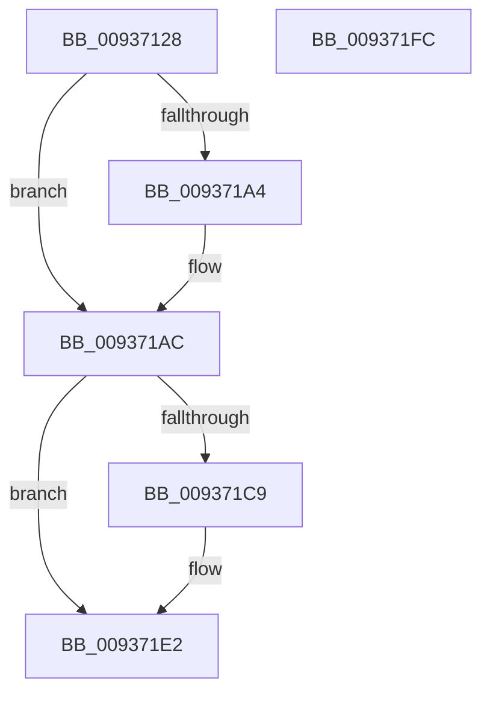

# VrpWaitForDiffHiveEntryTransitionOwnerToLeave

- RVA: `0x00937128`–`0x009371FD` (길이 `213` bytes)
- VA: `0x0000000140937128`
- 실행 섹션: `PAGE`
- PDB 이름 있음: `예`; PDB Function 태그: `아니요`
- unwind 정보 RVA: `0x000689A0`
- 디코드: `58`개 명령, `213/213` bytes 표시
- 미해석 바이트: `0` (있으면 어셈블리에 `.byte`로 보존)

> 이 문서는 커널 이미지의 기계어와 PDB 기호를 분석해 생성했습니다. 4번과 5번은 함수 원형과 자료형을 바이너리 사용 방식에서 추정한 C 해석이며 원본 소스 복구 결과는 아닙니다.

## 1. Dependencies

- 직접 호출 지점: **9**; 고유 호출 대상: **8**
- 직접 호출자로 확인된 함수: **1**
- RIP 상대 이미지 참조: **0**

### Outgoing calls
- `0x0093716A` → [KeInitializeEvent](../../text/40/KeInitializeEvent_function_0040DD10.md) (function, `0x0040DD10`)
- `0x0093717E` → [RtlInsertHeadCircularList](../../text/43/RtlInsertHeadCircularList_function_00433510.md) (function, `0x00433510`)
- `0x00937186` → [VrpUnlockDiffHiveEntry](VrpUnlockDiffHiveEntry_function_0093700C.md) (function, `0x0093700C`)
- `0x00937197` → [KeAbPreAcquire](../../text/21/KeAbPreAcquire_function_00210230.md) (function, `0x00210230`)
- `0x009371A7` → [KeAbPreWait](../../text/20/KeAbPreWait_function_0020E560.md) (function, `0x0020E560`)
- `0x009371BF` → [KeWaitForSingleObject](../../text/20/KeWaitForSingleObject_function_0020E6B0.md) (function, `0x0020E6B0`)
- `0x009371D2` → [KeAbPreAcquire](../../text/21/KeAbPreAcquire_function_00210230.md) (function, `0x00210230`)
- `0x009371DD` → [KeAbPostReleaseEx](../../text/26/KeAbPostReleaseEx_function_00262210.md) (function, `0x00262210`)
- `0x009371E5` → [VrpLockDiffHiveEntry](VrpLockDiffHiveEntry_function_00936FAC.md) (function, `0x00936FAC`)

### Direct callers
- [VrpLoadDifferencingHive](VrpLoadDifferencingHive_function_00935F40.md) at `0x009361C9`

### Static image references
- 디코드된 RIP-relative 메모리 참조가 없습니다.

## 2. Other-region calls and transfers

- 다른 실행 섹션으로 향하는 call: **7**
  - `0x0093716A` → [KeInitializeEvent](../../text/40/KeInitializeEvent_function_0040DD10.md) (`PAGE` → `.text`)
  - `0x0093717E` → [RtlInsertHeadCircularList](../../text/43/RtlInsertHeadCircularList_function_00433510.md) (`PAGE` → `.text`)
  - `0x00937197` → [KeAbPreAcquire](../../text/21/KeAbPreAcquire_function_00210230.md) (`PAGE` → `.text`)
  - `0x009371A7` → [KeAbPreWait](../../text/20/KeAbPreWait_function_0020E560.md) (`PAGE` → `.text`)
  - `0x009371BF` → [KeWaitForSingleObject](../../text/20/KeWaitForSingleObject_function_0020E6B0.md) (`PAGE` → `.text`)
  - `0x009371D2` → [KeAbPreAcquire](../../text/21/KeAbPreAcquire_function_00210230.md) (`PAGE` → `.text`)
  - `0x009371DD` → [KeAbPostReleaseEx](../../text/26/KeAbPostReleaseEx_function_00262210.md) (`PAGE` → `.text`)
- 별도 외부 분기/꼬리 이동을 확인하지 못했습니다.

## 3. Assembly (complete function range)

```asm
00937128  4C 8B DC                        mov r11, rsp
0093712B  49 89 5B 08                     mov qword ptr [r11 + 8], rbx
0093712F  49 89 73 10                     mov qword ptr [r11 + 0x10], rsi
00937133  57                              push rdi
00937134  48 83 EC 70                     sub rsp, 0x70
00937138  65 48 8B 04 25 88 01 00 00      mov rax, qword ptr gs:[0x188]
00937141  0F 57 C0                        xorps xmm0, xmm0
00937144  48 8B F1                        mov rsi, rcx
00937147  45 33 C0                        xor r8d, r8d
0093714A  33 C9                           xor ecx, ecx
0093714C  0F 11 44 24 30                  movups xmmword ptr [rsp + 0x30], xmm0
00937151  0F 11 44 24 40                  movups xmmword ptr [rsp + 0x40], xmm0
00937156  8D 51 01                        lea edx, [rcx + 1]
00937159  0F 11 44 24 50                  movups xmmword ptr [rsp + 0x50], xmm0
0093715E  49 89 4B E8                     mov qword ptr [r11 - 0x18], rcx
00937162  49 8D 4B D0                     lea rcx, [r11 - 0x30]
00937166  49 89 43 C8                     mov qword ptr [r11 - 0x38], rax
0093716A  E8 A1 6B AD FF                  call 0x14040dd10
0093716F  48 83 64 24 60 00               and qword ptr [rsp + 0x60], 0
00937175  48 8D 4E 30                     lea rcx, [rsi + 0x30]
00937179  48 8D 54 24 30                  lea rdx, [rsp + 0x30]
0093717E  E8 8D C3 AF FF                  call 0x140433510
00937183  48 8B CE                        mov rcx, rsi
00937186  E8 81 FE FF FF                  call 0x14093700c
0093718B  48 8D 7E 28                     lea rdi, [rsi + 0x28]
0093718F  45 33 C0                        xor r8d, r8d
00937192  48 8B CF                        mov rcx, rdi
00937195  33 D2                           xor edx, edx
00937197  E8 94 90 8D FF                  call 0x140210230
0093719C  48 8B D8                        mov rbx, rax
0093719F  48 85 C0                        test rax, rax
009371A2  74 08                           je 0x1409371ac
009371A4  48 8B C8                        mov rcx, rax
009371A7  E8 B4 73 8D FF                  call 0x14020e560
009371AC  48 83 64 24 20 00               and qword ptr [rsp + 0x20], 0
009371B2  48 8D 4C 24 48                  lea rcx, [rsp + 0x48]
009371B7  45 33 C9                        xor r9d, r9d
009371BA  45 33 C0                        xor r8d, r8d
009371BD  33 D2                           xor edx, edx
009371BF  E8 EC 74 8D FF                  call 0x14020e6b0
009371C4  48 85 DB                        test rbx, rbx
009371C7  74 19                           je 0x1409371e2
009371C9  45 33 C0                        xor r8d, r8d
009371CC  48 8B D3                        mov rdx, rbx
009371CF  48 8B CF                        mov rcx, rdi
009371D2  E8 59 90 8D FF                  call 0x140210230
009371D7  48 8B D3                        mov rdx, rbx
009371DA  48 8B CF                        mov rcx, rdi
009371DD  E8 2E B0 92 FF                  call 0x140262210
009371E2  48 8B CE                        mov rcx, rsi
009371E5  E8 C2 FD FF FF                  call 0x140936fac
009371EA  4C 8D 5C 24 70                  lea r11, [rsp + 0x70]
009371EF  49 8B 5B 10                     mov rbx, qword ptr [r11 + 0x10]
009371F3  49 8B 73 18                     mov rsi, qword ptr [r11 + 0x18]
009371F7  49 8B E3                        mov rsp, r11
009371FA  5F                              pop rdi
009371FB  C3                              ret
009371FC  CC                              int3
```

## 4. C-style interpretation (structured pseudocode)

```c
__int64 __fastcall VrpWaitForDiffHiveEntryTransitionOwnerToLeave(__int64 a1, __int64 a2, int a3, int a4)
{
    __int64 result;
    __int64 v_rsp;
    unsigned __int64 v_stack_m18;
    unsigned __int64 v_stack_m28;
    unsigned __int64 v_stack_m30;
    unsigned __int64 v_stack_m38;
    unsigned __int64 v_stack_m48;
    unsigned __int64 v_stack_m58;
    unsigned __int64 v_stack_m8;

    *(unsigned __int64 *)(v_rsp + 8) = v_rbx;
    *(unsigned __int64 *)(v_rsp + 16) = v_rsi;
    v_rsp = (v_rsp) - (112);
    a3 = 0;
    a1 = 0;
    v_stack_m48 = v_xmm0;
    v_stack_m38 = v_xmm0;
    v_stack_m28 = v_xmm0;
    *(unsigned __int64 *)(v_rsp - 24) = 0;
    *(unsigned __int64 *)(v_rsp - 56) = *(unsigned __int64 *)(gs_base + (0 + 392));
    result = KeInitializeEvent(v_rsp - 48, a1 + 1, a3, a4);
    result = RtlInsertHeadCircularList(a1 + 48, v_stack_m48, a3, a4);
    result = VrpUnlockDiffHiveEntry(0, v_stack_m48, a3, a4);
    a3 = 0;
    a2 = 0;
    result = KeAbPreAcquire(a1 + 40, a2, a3, a4);
    if (result != 0) {
        a1 = result;
        result = KeAbPreWait(a1, a2, a3, a4);
    }
    a4 = 0;
    a3 = 0;
    a2 = 0;
    result = KeWaitForSingleObject(v_stack_m30, a2, a3, a4);
    if (result != 0) {
        a3 = 0;
        a2 = result;
        a1 = a1 + 40;
        result = KeAbPreAcquire(a1, a2, a3, a4);
        a2 = result;
        a1 = a1 + 40;
        result = KeAbPostReleaseEx(a1, a2, a3, a4);
    }
    result = VrpLockDiffHiveEntry(a1, a2, a3, a4);
    return result;
}
```

## 5. (Beta) C Style

```c
int64_t VrpWaitForDiffHiveEntryTransitionOwnerToLeave(void *Arg1, int64_t Arg2, int32_t Arg3, int32_t Arg4)
{
    uint8_t *arg1 = (uint8_t *)Arg1;

    int64_t result;
    int64_t local_rsp;
    uint64_t v_stack_m18;
    uint64_t v_stack_m28;
    uint64_t v_stack_m30;
    uint64_t v_stack_m38;
    uint64_t v_stack_m48;
    uint64_t v_stack_m58;
    uint64_t v_stack_m8;

    *(uint64_t *)(local_rsp + 0x8) = local_rbx;
    *(uint64_t *)(local_rsp + 0x10) = local_rsi;
    local_rsp = (local_rsp) - (112);
    Arg3 = 0;
    Arg1 = 0;
    v_stack_m48 = v_xmm0;
    v_stack_m38 = v_xmm0;
    v_stack_m28 = v_xmm0;
    *(uint64_t *)(local_rsp - 0x18) = 0;
    *(uint64_t *)(local_rsp - 0x38) = *(uint64_t *)(gs_base + (0 + 0x188));
    result = KeInitializeEvent(local_rsp - 48, Arg1 + 1, Arg3, Arg4);
    result = RtlInsertHeadCircularList(Arg1 + 48, v_stack_m48, Arg3, Arg4);
    result = VrpUnlockDiffHiveEntry(0, v_stack_m48, Arg3, Arg4);
    Arg3 = 0;
    Arg2 = 0;
    result = KeAbPreAcquire(Arg1 + 40, Arg2, Arg3, Arg4);
    if (result != 0) {
        Arg1 = result;
        result = KeAbPreWait(Arg1, Arg2, Arg3, Arg4);
    }
    Arg4 = 0;
    Arg3 = 0;
    Arg2 = 0;
    result = KeWaitForSingleObject(v_stack_m30, Arg2, Arg3, Arg4);
    if (result != 0) {
        Arg3 = 0;
        Arg2 = result;
        Arg1 = Arg1 + 40;
        result = KeAbPreAcquire(Arg1, Arg2, Arg3, Arg4);
        Arg2 = result;
        Arg1 = Arg1 + 40;
        result = KeAbPostReleaseEx(Arg1, Arg2, Arg3, Arg4);
    }
    result = VrpLockDiffHiveEntry(Arg1, Arg2, Arg3, Arg4);
    return result;
}
```

### 관측된 메모리 오프셋

구조체 형식이 확인되지 않은 접근은 인자 기준의 오프셋으로만 기록했습니다.

| 기준 인자 | 오프셋 표현 | 폭 (bit) | 접근 |
|---|---:|---:|---|
| `Arg1` | `+ 0x28` | `64` | `R` |
| `Arg1` | `+ 0x30` | `64` | `R` |

## 6. Execution-region graph

[열기: 2D/3D 그래프와 함수 탐색 컨트롤 패널](../../../control-panel.html?section=page&rva=0x00937128&view=graph)

- 2D 그래프는 위에서 아래로 흐르고, 3D 그래프는 빈 공간을 드래그해 회전합니다. Shift+드래그는 이동, 휠은 확대·축소, 함수 노드 선택은 대상 보고서 이동입니다.

### Static fallback


